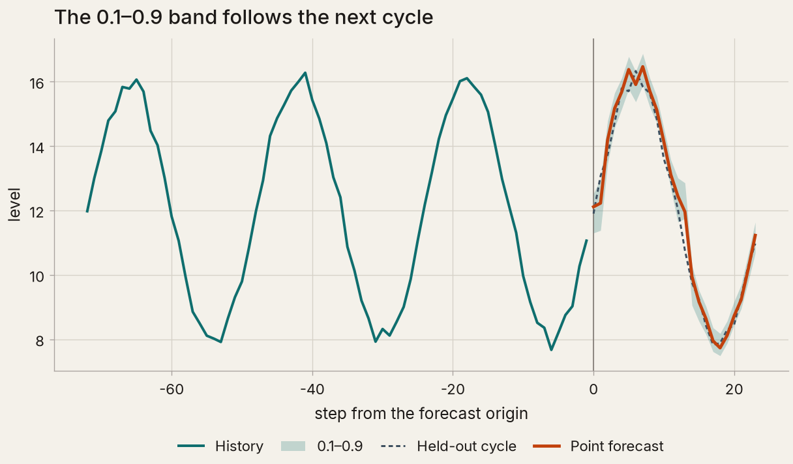
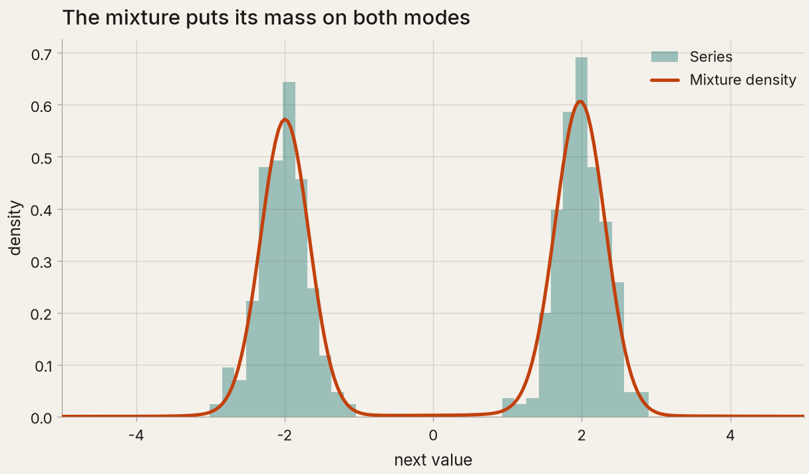
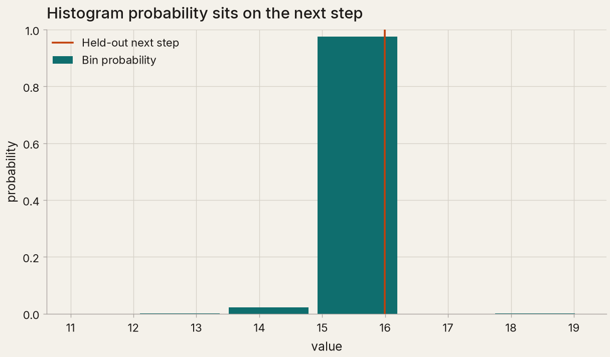

# Ashlar

Ashlar fits a table and forecasts a series with a small JAX model. You call `fit` and `predict`. Categorical columns become learned vectors. A forecast can return a point, a quantile band, or a density.

The import name is `ashlar`. The distribution name is `ashlar-tabular`. Install from this checkout. The PyPI project named `ashlar` is an unrelated microscopy stitcher.

## Install

From a checkout of [maxmbay/ashlar](https://github.com/maxmbay/ashlar):

```bash
pip install -e ".[dataframes]"
```

CPU is enough. Set `JAX_PLATFORMS=cpu` to run on CPU.

## What a fit looks like

The pictures below are short CPU fits from [`examples/figures.py`](examples/figures.py). The series are synthetic.


One numeric column, a few epochs, then `predict` on a grid. The line is the fit. The dots are the rows.


Each category is a learned 2-d vector. Color is that category's effect on the target. Categories that move the target the same way land next to each other. The unknown row, index 0, is left off the plot.


`predict_score` is the expected label: class probabilities times the integer class values. The mean for each label sits on that integer.



A quantile forecaster, rolled one step at a time across a held-out cycle. Each step uses the observed history that ends there. The clay line is `predict`. The band is `quantiles` at 0.1 and 0.9.



The series jumps between two values. `head="mixture"` is five normals. The curve is `log_prob` of the next step, and both modes get the mass.



`head="histogram"` is a softmax over 16 fixed bins. `bin_probabilities` puts almost all of the mass on the bin that holds the held-out next step.

## Fit a table

```python
from ashlar import TabularEstimator

model = TabularEstimator()
model.fit(X, y)
model.predict(X)
```

`X` is a NumPy array shaped `(rows, columns)`, a dict of columns, or a pandas or Polars frame. Numeric columns are imputed and scaled from the training rows. String columns are categorical and get a learned embedding. Missing categories, and categories that never appeared in training, use index 0.

```python
model = TabularEstimator(
    categorical_embeddings=["city"],
    categorical_embedding_dim=8,
)
model.fit({"rooms": rooms, "city": city}, y)
city_vectors = model.core_.categorical_embeddings.tables[0]
names = model.encoder_.embedding_columns[0].categories
```

`tables[0]` is one row per category, with the unknown row first. `names` lines up with the rows after that.

`classifier()` is the same preprocessing with class labels. `predict` returns the label. `predict_proba` returns one column per class, in `classes_` order.

`ordinal()` keeps the numeric order of real-valued labels. `predict` is the most likely label. `predict_score` is the expected label.

```python
from ashlar import ordinal

model = ordinal()
model.fit(X, y)
model.predict(X)
model.predict_score(X)
```

Defaults, search, and set columns are in [docs/tabular.md](docs/tabular.md).

## Forecast

```python
from ashlar import TimeSeriesForecaster

model = TimeSeriesForecaster(lookback=48, horizon=1, head="quantile")
model.fit(series)
point = model.predict(history)       # (horizon,)
band = model.quantiles(history)      # (horizon, 3) at 0.1, 0.5, 0.9
```

`history` is the last `lookback` observations. `predict` is one point on the original scale for every head. `mse`, the default, is squared error. A quantile point is the 0.5 level, a gaussian point is the mean, a mixture point is the mixture mean, a flow point is the median, and a histogram point is the bin-center mean.

`log_prob(history, value)` is the density for `gaussian`, `mixture`, `flow`, and `histogram`. `bin_probabilities(history)` returns the histogram probabilities and the bin centers. `gaussian(history)` returns location and scale. `sample(history, key, n)` draws from those four densities.

`FullHistoryForecaster` takes the same `head` and reads the whole prefix. Head by head, the calls are in [docs/forecast.md](docs/forecast.md).
