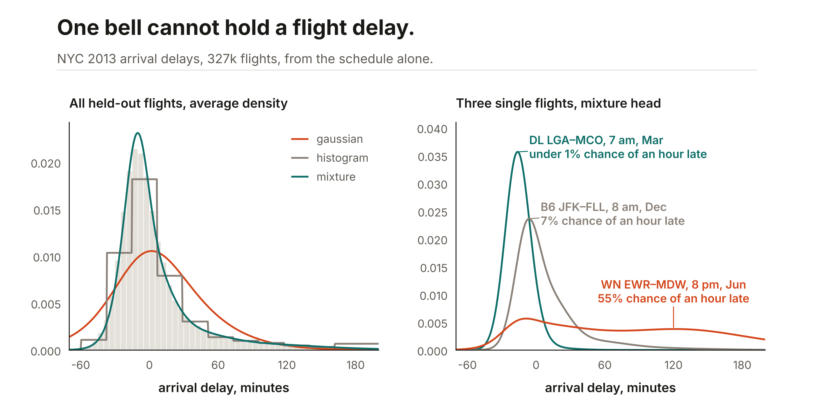

<p align="center">
  <picture>
    <source media="(prefers-color-scheme: dark)" srcset="docs/images/logo-dark.svg">
    
  </picture>
</p>

Ashlar fits tables and forecasts series with small JAX models. You call `fit` and `predict`. Categorical columns become learned vectors. A regression or a forecast can return a whole distribution, not just a point: a Gaussian, a mixture, a spline flow, a histogram, or a set of quantiles.

It slots in wherever a gradient-boosted model does. It follows the scikit-learn estimator interface, takes a pandas or Polars frame as it is, string columns included, and works with `clone`, `Pipeline`, `cross_val_score`, and `GridSearchCV`. Swap `LGBMRegressor()` or `XGBRegressor()` for `TabularEstimator()`, and `LGBMClassifier()` for `classifier()`. That is a drop-in for the workflow, not a promise of the same accuracy: [the comparison below](#ashlar-beside-gradient-boosted-trees) shows where the trees still win.

- [Install](#install)
- [Quick start](#quick-start)
- [Ashlar beside gradient-boosted trees](#ashlar-beside-gradient-boosted-trees)
- [Pick a head for the shape of the target](#pick-a-head-for-the-shape-of-the-target)
- [Learned embeddings](#learned-embeddings)
- [Documentation](#documentation)

## Install

From a checkout of [maxmbay/ashlar](https://github.com/maxmbay/ashlar):

```bash
pip install -e ".[dataframes]"
```

The import name is `ashlar`. The distribution name is `ashlar-tabular`. The PyPI project named `ashlar` is an unrelated microscopy stitcher, so install from this checkout. CPU is enough. Set `JAX_PLATFORMS=cpu` to run on CPU.

## Quick start

A table. `X` is a NumPy array, a dict of columns, or a pandas or Polars frame. Numeric columns are imputed and scaled. String columns get a learned embedding.

```python
from ashlar import TabularEstimator, classifier, ordinal

model = TabularEstimator().fit(X, y)        # where you had LGBMRegressor()
model.predict(X_new)

clf = classifier().fit(X, labels)           # where you had LGBMClassifier(); predict, predict_proba
rank = ordinal().fit(X, ratings)            # predict, predict_score (expected label)
```

Two differences from a scikit-learn regressor or classifier: there is no `score` method, so pass `scoring=` to `cross_val_score` or `GridSearchCV`, and scikit-learn does not tag `classifier()` as a classifier, so it will not stratify folds on its own and the `roc_auc` scorer does not read its probabilities.

A series, with a distributional head.

```python
from ashlar import TimeSeriesForecaster

model = TimeSeriesForecaster(lookback=48, horizon=1, head="mixture").fit(series)
model.predict(history)                     # one point per horizon step
model.log_prob(history, value)             # density of a value
model.sample(history, key, n=1000)         # draws
```

The heads are `mse` (the default), `quantile`, `gaussian`, `mixture`, `flow`, and `histogram`. `FullHistoryForecaster` takes the same heads and reads the whole prefix instead of a window.

## Ashlar beside gradient-boosted trees

If all you need is one number per row, gradient-boosted trees are hard to beat. The table is the test-set score on five public tables, the mean of three random 80/20 splits. Ashlar is `TabularEstimator()` or `classifier()` with no arguments. XGBoost and LightGBM are early-stopped on a 20% validation slice of the training rows, the same share Ashlar holds out. Their plain defaults are in [docs/benchmarks.md](docs/benchmarks.md) and score a little lower.

| Table | Rows | Target, metric | Ashlar | XGBoost | LightGBM |
|---|---:|---|---:|---:|---:|
| California housing | 20,640 | value in $100k, RMSE ↓ | 0.563 | 0.464 | **0.457** |
| Diamonds | 53,940 | log price, RMSE ↓ | 0.108 | **0.085** | **0.085** |
| Adult income | 48,842 | income over $50k, accuracy ↑ | 0.859 | 0.876 | **0.877** |
| Ames housing | 2,930 | log sale price, RMSE ↓ | **0.119** | 0.122 | 0.120 |
| Abalone | 4,177 | rings, RMSE ↓ | **2.145** | 2.225 | 2.231 |

The trees win clearly on the three larger tables. Ashlar is level on Ames and slightly ahead on abalone, inside about one standard deviation across splits. The trees also fit in seconds, where Ashlar's default took between 13 seconds and 3.5 minutes on CPU.

So use a tree when a point estimate on a big table is the whole job. Use Ashlar when you need what a tree regressor does not give you: a full predictive distribution from one fit, vectors for your categories, or a JAX model you can differentiate and compose.

## Pick a head for the shape of the target

A tree regressor predicts a mean. For an interval you fit one more model per quantile, or put a fixed-width normal around the mean. Neither gives a density you can evaluate or sample from. An Ashlar head gives the whole predictive distribution from one fit, and the head is a choice you make for the shape of the target.

| The target looks like | Head | Why |
|---|---|---|
| A bell whose width changes from row to row | `gaussian` | Two numbers per row, a mean and a scale. Cheap and easy to read. On a table this is the built-in `task="normal"`. |
| A few distinct regimes, or a sharp peak with a long tail | `mixture` | Five normals with learned weights. Each mode gets its own location and spread. |
| Skewed, heavy-tailed, censored, or with a spike | `flow` | A monotone spline bends a normal into almost any one-dimensional shape and still gives an exact density. |
| Any shape, when coarse resolution is enough | `histogram` | A softmax over 16 fixed bins across ±4 standard deviations. No shape assumption. Each bin is half a standard deviation wide, and the two end bins are open-ended: the last one reads as "this far out or more". |
| Only the interval matters | `quantile` | Pinball loss at 0.1, 0.5, and 0.9. No density and no draws. |

### Flight delays, 327 thousand and 3 million rows



Arrival delay is a hard target. Most flights land a little early, a long tail lands hours late, and which of the two you get depends on the airline, the route, the hour, and the season. The model sees only what is on the schedule: no departure delay and no weather. The Gaussian head has to spend its single bell on both the peak and the tail, so it is too wide at the peak and too thin in the tail. The mixture and the histogram follow the shape, and the mixture's shape changes from flight to flight: a 7 a.m. Delta flight from LaGuardia to Orlando in March is one tight peak, while an 8 p.m. Southwest flight from Newark to Chicago in June is a low, wide spread with a 55% chance of landing an hour or more late.

Two scores, both lower-is-better. CRPS scores the whole predictive distribution, in minutes. NLL is the negative log density at the delay that happened: a gap of 0.4 means about 1.5 times as much density on the actual outcome.

| Data | Score | `gaussian` | `mixture` | `flow` | `histogram` | Tree mean + normal |
|---|---|---:|---:|---:|---:|---:|
| NYC flights 2013, 327,346 rows, 3 splits | CRPS | 20.66 | **18.66** | 18.82 | 18.74 | 19.01 |
| | NLL | 5.15 | **4.67** | 4.83 | 4.71 | 5.10 |
| US flights 2001, 3,000,000 rows, 1 split | CRPS | 13.45 | 11.65 | 12.06 | 11.39 | **11.02** |
| | NLL | 4.71 | **4.18** | 4.37 | 4.21 | 4.60 |

The tree column is the early-stopped mean of the better of XGBoost and LightGBM with a normal around it whose width is the validation residual. That is the distribution a tree regressor offers without another library.

Matching the head to the shape cuts CRPS by about 10% on the NYC flights and 15% on the 3 million, against the Gaussian head. On likelihood the mixture beats the trees' normal by about 0.43 on both tables, about 1.5 times the density on what actually happened. On CRPS it is closer, because CRPS also rewards a good mean, and the trees have the better mean: on the 3 million rows XGBoost's mean misses by 13.4 minutes on average and Ashlar's squared-error model by 16.6, so XGBoost's mean plus a normal edges out the best head. Three separate LightGBM quantile models also keep the lowest pinball loss on both tables. Ashlar ran its default network, two blocks 64 wide, at every size here, and a wider backbone on the large tables is the obvious next run.

### Smaller tables


NYC taxi tips with the payment type hidden. A third of tips are exactly zero, the cash fares, and the rest are a skewed bump around $2. The Gaussian head has to cover both with one bell, so it puts 8% of its mass within 25¢ of zero and spills below it. The flow and the mixture grow a spike there and put 46% and 41% within 25¢ of zero. The histogram sees the spike but cannot make it narrower than one bin.

| Target | Shape | `gaussian` | `mixture` | `flow` | `histogram` | Tree mean + normal |
|---|---|---:|---:|---:|---:|---:|
| Taxi tips, $ | spike at zero, skewed | 0.950 | 0.952 | 0.927 | **0.910** | 1.001 |
| California value, $100k | capped at 5.0 | 0.287 | 0.267 | 0.267 | 0.271 | **0.236** |
| Diamond price, $1,000 | skewed, spread grows with size | 0.240 | **0.228** | 0.260 | 0.354 | 0.274 |
| Abalone rings | near normal, counts | 1.109 | **1.055** | 1.071 | 1.064 | 1.157 |
| Melbourne min. temperature, °C, one day ahead | seasonal, near normal | 1.264 | **1.243** | 1.248 | 1.262 | — |

CRPS, three splits each. Three things stand out. The right head depends on the shape: the flow and the histogram win on the spike in tips, while the histogram is the worst head on diamond prices, where most of the mass sits in two or three of its fixed bins. A row-by-row spread matters: on diamonds and abalone every Ashlar density head beats a tree mean with a constant-width normal. And a better mean can still win: on California the trees' mean is so much closer (RMSE 0.457 against 0.563) that a plain normal around it has the lowest CRPS.

The intervals are better calibrated too. With an interval that promises 80%, the three LightGBM quantile models cover 70% of held-out California values, 69% of diamond prices, and 72% of abalone rings. Ashlar's mixture covers 82%, 80%, and 77%. On the temperature forecast the mixture beats LightGBM on the same 28-day window on every interval score: pinball 0.554 against 0.573, and coverage 83% against 77%. Every column, with pinball loss, coverage, width, and log-likelihood, is in [docs/benchmarks.md](docs/benchmarks.md).

### Using the heads

The forecasters take the head by name. `TabularEstimator` has the point head and the normal head built in. The other four reach a table through the custom-head API, in [`examples/table_heads.py`](examples/table_heads.py):

```python
from table_heads import table_head            # examples/table_heads.py

mean, std = y.mean(), y.std()
model = table_head("mixture").fit(X, (y - mean) / std)
raw = model.predict_raw(X_new)                 # mixture parameters, decode with ashlar.distributional
```

## Learned embeddings

Every string column becomes a learned vector, 8 numbers by default. Row 0 of each table is for a missing value or a category that never appeared in training, so new categories at prediction time are not an error. The vectors are ordinary arrays you can read back:

```python
model = TabularEstimator().fit(X, y)
names = [column.name for column in model.encoder_.embedding_columns]
zones = model.core_.categorical_embeddings.tables[names.index("pickup_zone")]   # (1 + levels, 8)
```


That table is a model of NYC taxi trip duration from the pickup and drop-off zones, 191 and 203 levels, plus the hour, the weekday, and the borough. There is no distance column. The model was never told where a zone is, yet its first principal component tracks how long trips from that zone run (correlation 0.73), and both airports land far from everything else.

On accuracy alone the embeddings are no magic. Log-duration RMSE, three splits:

| Model | RMSE ↓ |
|---|---:|
| Ashlar, defaults, 8-d embeddings or one-hot | 0.687 |
| Ashlar, longer schedule, 8-d embeddings | 0.588 |
| Ashlar, longer schedule, one-hot | 0.563 |
| Ashlar, longer schedule, 16-d embeddings | 0.555 |
| XGBoost, early-stopped | 0.580 |
| LightGBM, early-stopped, native categorical splits | **0.520** |

The defaults stop after a few epochs on this small, wide table, so the longer schedule (learning rate `3e-3`, up to 100 epochs, patience 20) was chosen by hand on the first split. With it, 16-d embeddings are within noise of one-hot and ahead of XGBoost, 8-d embeddings are behind both, and LightGBM is best. What the embeddings add is a representation: 16 numbers per zone instead of a 200-column one-hot block, a geometry you can inspect, cluster, or hand to another model, and a defined vector for a zone the model has never seen. The same holds at scale: the NYC flights model above embeds 4,037 tail numbers and 104 destinations in 8 numbers each, where one-hot would add more than 4,000 input columns.

## Documentation

- [docs/tabular.md](docs/tabular.md): fitting a table. Defaults, tasks, embeddings, set columns, and search.
- [docs/forecast.md](docs/forecast.md): the forecasters and each head, call by call.
- [docs/benchmarks.md](docs/benchmarks.md): every number on this page, per table and per metric, and how it was run.
- [`examples/`](examples): runnable scripts. [`examples/table_heads.py`](examples/table_heads.py) puts the forecast heads on a table. [`examples/benchmark_readme.py`](examples/benchmark_readme.py) produces the numbers here.
