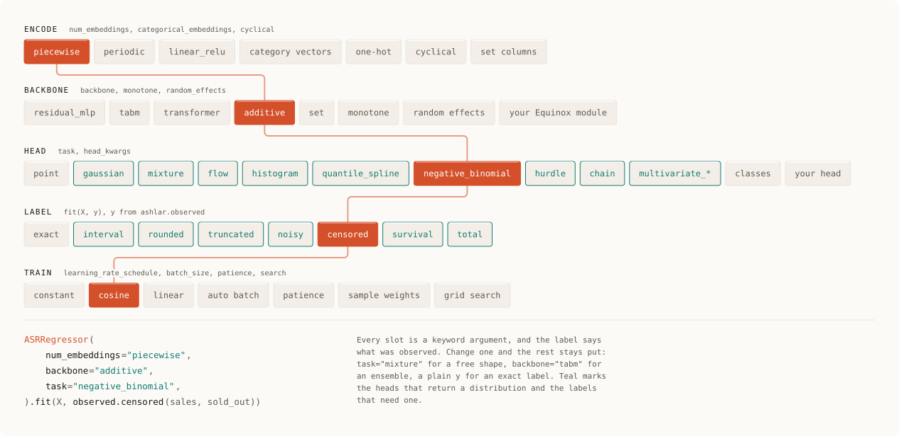
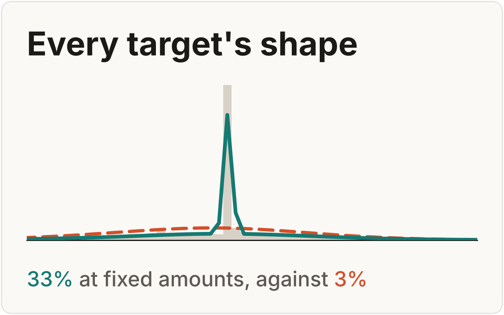
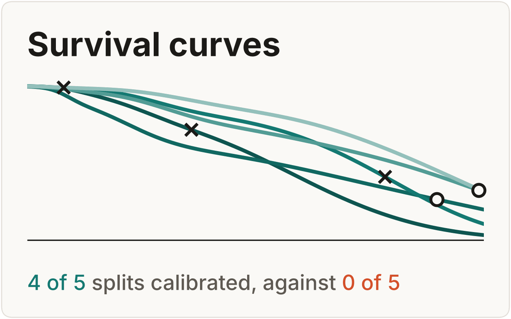
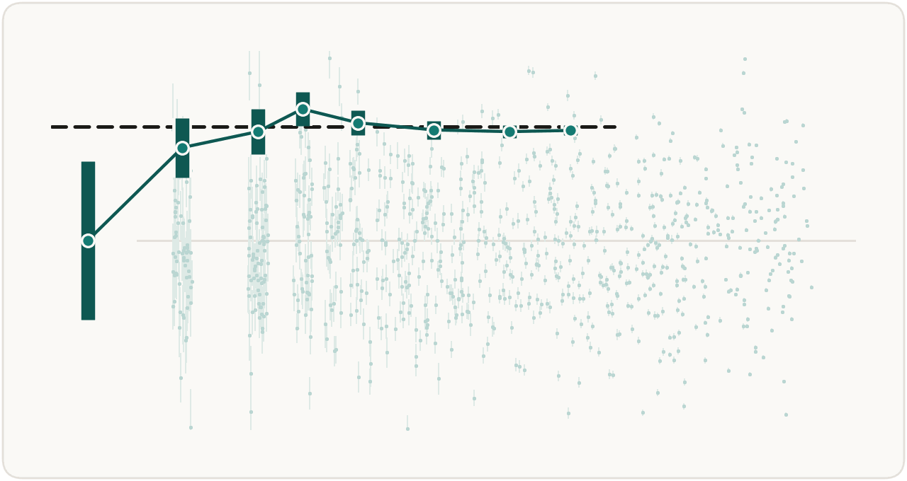
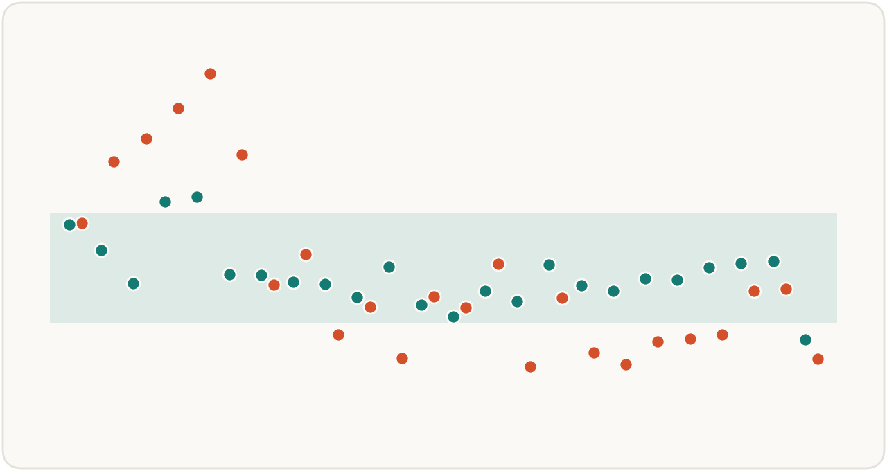
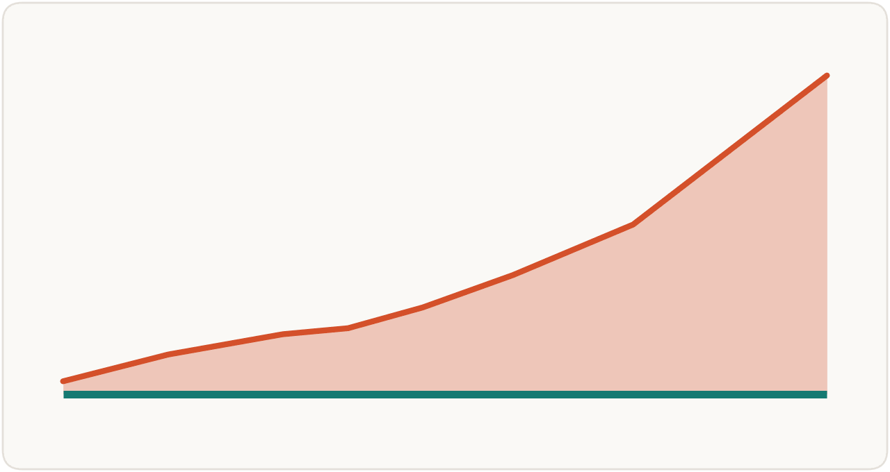
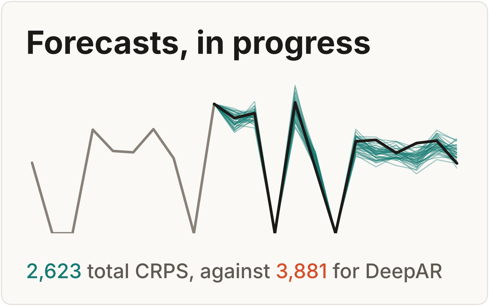

<p align="center">
  <picture>
    <source media="(prefers-color-scheme: dark)" srcset="docs/images/logo-dark.svg">
    
  </picture>
</p>

<p align="center">
  <a href="https://pypi.org/project/ashlar-tabular/"></a>
  <a href="https://pypi.org/project/ashlar-tabular/"></a>
  <a href="https://github.com/maxmbay/ashlar/actions/workflows/tests.yml"></a>
  <a href="LICENSE"></a>
</p>

Ashlar is a Python library for regression and classification on tabular data, built on JAX. Its models are scikit-learn estimators: you call `fit` and `predict` as you would with XGBoost or LightGBM. With a distribution head, or as the dressed model below, a regressor predicts a probability distribution for each row.

The part of Ashlar that is new is the **dressed model**, `ashlar.dressed()`. One call fits five networks and five label readers to a table, pools them, gives the pool a density, and corrects it with one more network. A label reader predicts a row from the training rows' labels, which it reads at prediction time. What comes back is one distribution per row with an exact density and CDF. On [ScoringBench](https://github.com/jonaslandsgesell/ScoringBench), the dressed model ranks [RANK] of [N] untuned models trained from scratch. ScoringBench also lists tuned models and models pretrained on other data; that rank is within the untuned, trained-from-scratch group only.

- `ASRRegressor` and `ASRClassifier` are scikit-learn estimators and drop in where `XGBRegressor` and `LGBMClassifier` are used: settings go in the constructor, then `fit(X, y)`, `predict`, and `predict_proba`. They work with `clone`, `Pipeline`, `cross_val_score`, and `GridSearchCV`, and take NumPy arrays or pandas and Polars frames with string columns and missing values as they are. The dressed model is a scikit-learn regressor too. [Coming from another library](#coming-from-another-library) lists the calls that change.
- A regressor with a distribution head, such as `ASRRegressor(task="mixture")`, and the dressed model are natively distributional. They predict one distribution per row, and the quantiles, intervals, tail probabilities, samples, and mean are all read from it, so they agree with each other.
- Every forward pass gives a log probability. `model.log_prob(X_new, y_new)` is each new row's exact log probability under its predicted distribution, with no sampling: a log density for a continuous target, and a log mass for a count, a class, or a target with a few values. This holds for every distribution head, the classifiers, and the dressed model. The point regressor `ASRRegressor()` and the `quantile` head have none.
- Models are modular. A model is five choices: how the columns are encoded, the backbone, the head, the type of label, and the training schedule. They combine freely, and the backbone and the head can be your own Equinox modules. [How a model is specified](#how-a-model-is-specified) has the diagram.
- Ashlar is built on JAX. The networks are Equinox modules and run on the CPU by default; a GPU takes one extra install and no code changes. The general estimator is trained end to end by gradient descent on its loss, and a fitted model can be differentiated in its numeric inputs with `jax.grad`. The dressed model is fitted in stages, as [what `fit` does](#what-fit-does) explains.

## The dressed model

`ashlar.dressed()` is for one numeric target on a table of a few hundred to a few thousand rows. Its fit is slow, and it is meant for when the quality of the predicted distribution is worth that time.

<p align="center">
  <picture>
    <source media="(prefers-color-scheme: dark)" srcset="docs/images/dressed-dark.svg">
    
  </picture>
</p>

```python
import ashlar

model = ashlar.dressed().fit(X, y)

dist = model.predict_dist(X_new)                 # one distribution per row
dist.log_prob(y_new)                             # exact log density
dist.cdf(y_new)                                  # exact CDF
model.predict(X_new)                             # the mean
model.predict_quantiles(X_new, [0.1, 0.5, 0.9])  # (rows, 3)
model.sample(X_new, n=1000)                      # (1000, rows)
```

### What `fit` does

A network with a density head fits a smooth map from the columns to the target. That does not suit a target that is a linear function of the columns, one with a handful of values, or one where a row's nearest neighbours already hold the answer. A label reader (`ashlar.label_reader.LabelReader`) suits those. Inside its forward pass it solves one ridge regression of the training labels on the columns, which gives each row a trend and every training row a leave-one-out residual, and then spreads each row's probability over those residuals by attention. Neither wins on every table, so a dressed model fits both and lets held-out rows decide how much weight each gets.

1. The rows are cut into five parts. Member `k` holds out part `k` and fits a network with a density head and a label reader on the other four.
2. One pool weight between the networks and the readers is picked by the CRPS (continuous ranked probability score, the error of a predicted distribution; lower is better) of every row under the member that held it out.
3. A reader predicts weighted points, so the pool has no density and no log score. Smoothing turns each point into a normal, with a width picked on the held-out rows.
4. One more network, the corrector, is trained on where each label falls in its own row's held-out pool. It reshapes every row's pool.
5. A gate weighs the corrected pool against the smoothed one, picked on held-out rows. If the corrector did not help there, the gate is 0 and the corrector is left out.

Steps 2 to 5 work on out-of-fold predictions: each training row is read through the member that did not train on it. Every piece has a closed-form CDF and density, so the final distribution does too: `log_prob` is an exact log density, or an exact log probability for a target with at most 20 distinct values. Each network and each reader is trained by gradient descent on its own loss. The pool weight, the smoothing, and the gate are then searched on held-out rows, and the final distribution is computed in NumPy.

### What it adds

Bagging cross-fitted models, weighting two models by a held-out score, kernel smoothing, and correcting a prediction on its own probability scale are established methods. Two parts are this model's own:

- The label reader returns a distribution, built from a ridge fit and its leave-one-out residuals, and is trained from scratch on the one table. Retrieval models such as TabR and ModernNCA, and pretrained in-context models such as TabPFN, also read the training labels at prediction time; TabR and ModernNCA return a single value for regression, and TabPFN is pretrained on synthetic tables.
- The corrector is trained on each label's position in the pool of the member that held that row out. So it learns the pool's errors on rows the pool did not see, and the gate can switch it off.

### How it was tested


The design was chosen on one fold of 23 regression tables (12 from OpenML's CTR23 suite, 7 from PMLB, and 4 of those with the target binned into 5 to 10 ratings; at most 2,400 training rows each), then scored once on two other folds, 46 fits, against a pass line written down beforehand. Against one of its own networks, the dressed model's CRPS was lower by more than 1% on 37 fits, within 1% on 7, and higher on 2. Against the same five members pooled without dressing, which have no density, the geometric mean of the CRPS ratio was 0.955, and its log score was above the five averaged networks' on 39 of the 46 fits. [docs/dressed.md](docs/dressed.md#how-it-was-tested) has the full table, the pass line, the designs that failed, and the check that the library gives the same numbers as the research code.

### Limits

- One numeric target with exact labels. A target with at most 20 distinct values is treated as a set of values and gets a probability for each. Censored and interval labels, joint targets, classes, and sample weights are for [the general estimator](#the-rest-of-ashlar).
- Every test is on at most 2,400 training rows. Nothing larger has been tested, and a fit needs at least 100 rows.
- It is the slowest model in Ashlar: five networks, five readers, and a corrector. On the 46 held-out fits, the median fit took 16 minutes and the longest 2.3 hours, on a 12-core laptop that was running several fits at once.
- A target that the columns determine almost exactly can come out worse than the undressed pool. On one fold of `wave_energy`, whose target is a linear function of the columns, its CRPS was 5.5 times the undressed pool's. [docs/dressed.md](docs/dressed.md#limits) explains why.
- It has `fit`, `predict`, `predict_dist`, `predict_quantiles`, `log_prob`, `sample`, and `score`, and a fitted model pickles. It has no `calibrate`, `predict_interval`, or `save` yet: read an interval from `predict_quantiles` and a tail probability from `predict_dist(X).cdf`.

## Install

```bash
pip install "ashlar-tabular[dataframes]"
```

The package is imported as `ashlar` and needs Python 3.11 or later. This installs the CPU version of JAX, which is all Ashlar needs; every result on this page was computed on CPUs.

<details>
<summary>Training on an NVIDIA GPU</summary>

On Linux, also install JAX's CUDA build. It includes the CUDA libraries, so only the NVIDIA driver needs to be installed:

```bash
pip install "ashlar-tabular[dataframes]" "jax[cuda12]"
python -c "import jax; print(jax.devices())"   # should list a CudaDevice
```

No code changes are needed, because JAX uses the GPU when one is available. For other CUDA versions and platforms, see [JAX's install guide](https://docs.jax.dev/en/latest/installation.html).

</details>

## Quick start

Ashlar's estimators are used the same way as XGBoost's or LightGBM's:

```python
from ashlar import ASRClassifier, ASRRegressor
from xgboost import XGBClassifier, XGBRegressor

model = XGBRegressor().fit(X, y)          # XGBoost
model = ASRRegressor().fit(X, y)          # Ashlar
model.predict(X_new)                      # (rows,)

model = XGBClassifier().fit(X, labels)    # XGBoost
model = ASRClassifier().fit(X, labels)    # Ashlar
model.predict_proba(X_new)                # (rows, classes), in classes_ order
```

`X` can be a NumPy array, a dict of columns, or a pandas or Polars data frame, with missing cells and string columns as they are; the model imputes and scales numbers, learns an embedding for each string column, and accepts categories it did not see in training. [docs/estimator.md](docs/estimator.md) has the inputs, the outputs and their shapes, and the scikit-learn tools that work.

`ASRRegressor()` predicts a point, like `XGBRegressor()`. Set `task` to a distribution head and every method reads one predicted distribution per row:

```python
model = ASRRegressor(task="mixture").fit(X, y)

model.predict(X_new)                          # the mean
model.predict_quantiles(X_new, [0.1, 0.9])    # (rows, 2)
model.predict_exceedance(X_new, 60)           # P(y > 60) for each row
model.sample(X_new, n=1000)                   # (1000, rows)
model.log_prob(X_new, y_new)                  # log density of each observed value
model.predict_dist(X_new)                     # the distribution itself, a JAX pytree

model.calibrate(X_holdout, y_holdout)         # split-conformal, on rows the model did not train on
model.predict_interval(X_new, coverage=0.8)   # (rows, 2): holds 80% of new rows like the held-out ones
```

All of these are computed from the same predicted distribution, so they are consistent with each other; for example, the quantiles never cross.

![One held-out flight, Delta from Washington Dulles to Atlanta at 17:25 on a Friday in August: its predicted delay distribution with the calibrated 80% interval shaded dark, the median and mean marked, LightGBMLSS's uncalibrated 80% interval under it, and the actual delay of 49 minutes. Under the distribution, each call from the quick start with its result on the same delay axis: predict 16.4 beside LightGBM's 21.4, predict_quantiles −3.4 to 53.5, predict_exceedance 0.086, five samples, log_prob −6.17, predict_interval after calibrate −3.4 to 52.5, and the three largest attributions from explain for the 0.9 quantile.](docs/images/readme/one-flight.png)

The figure shows what these calls, and `explain`, return for one test flight from the airline delay table, using the model from the [benchmarks](#benchmarks-on-eight-large-tables) below.

### Coming from another library

| Today | With Ashlar |
|---|---|
| `XGBRegressor()`, `LGBMRegressor()`, `GradientBoostingRegressor()` | `ASRRegressor()`, with the same `fit`, `predict`, and `score` |
| `XGBClassifier()`, `LGBMClassifier()`, `LogisticRegression()` | `ASRClassifier()`, with the same `fit`, `predict`, `predict_proba`, and `classes_` |
| `LGBMRegressor(objective="quantile", alpha=0.9)`, one model per level | `ASRRegressor(task="mixture")`, then `predict_quantiles(X_new, [0.1, 0.5, 0.9])`: one model for every level |
| `NGBRegressor().fit(X, y).pred_dist(X_new).logpdf(y_new)` | `ASRRegressor(task="mixture").fit(X, y).log_prob(X_new, y_new)` |
| `XGBRegressor(objective="survival:aft")` with lower and upper bounds | `ASRRegressor(task="mixture").fit(X, observed.survival(np.log(time), event))` |
| A conformal wrapper such as MAPIE around a point model | `model.calibrate(X_cal, y_cal)`, then `model.predict_interval(X_new, coverage=0.8)` |
| `cross_val_score`, `GridSearchCV`, `Pipeline`, `clone`, `pickle` | The same calls |

What is different:

- A fit takes minutes on a CPU, not seconds: 2 to 5 minutes on the large tables below on 12 cores, where LightGBM takes 4 seconds to 2 minutes.
- Early stopping is built in. By default 20% of the rows are held out to pick the epoch (`validation_size`), and `fit(X, y, validation=(X_val, y_val))` uses rows you choose. There is no `eval_set` or `early_stopping_rounds`.
- The settings have a network's names: `learning_rate`, `weight_decay`, `batch_size`, `max_epochs`, and `patience`. `fit(X, y, search=True)` runs a small grid. [docs/tabular.md](docs/tabular.md#defaults) lists every default.
- There is no `feature_importances_`. For a distribution head, `model.explain(X_new, "quantile", level=0.9).importance()` attributes a quantile, an interval's width, or a tail probability to the features.

## The rest of Ashlar

Besides the dressed model, Ashlar has one general estimator, `ASRModel`. `ASRRegressor` and `ASRClassifier` are its main forms, and `ASROrdinalClassifier` and `ASROutcomeTree` are two more for ordered and nested labels. The table says what it covers and where each part is documented.

| You want | Setting | Guide |
|---|---|---|
| A point prediction or class probabilities, like a tree model | `ASRRegressor()`, `ASRClassifier()` | [docs/tabular.md](docs/tabular.md) |
| A distribution per row: a bell, a skewed shape, a spike, heavy tails | `task="gaussian"`, `"mixture"`, `"flow"`, `"histogram"`, `"student_t"`, `"quantile_spline"` | [docs/heads.md](docs/heads.md) |
| Counts, and targets that are often exactly zero | `task="poisson"`, `"negative_binomial"`, `"hurdle"` | [docs/heads.md](docs/heads.md) |
| Labels not seen exactly: censored, survival, interval, rounded, truncated, noisy, or totals over several rows | `y = observed.censored(sales, sold_out)` and the other builders in `ashlar.observed` | [docs/observed.md](docs/observed.md) |
| Several targets with one joint distribution, or outcomes of different kinds chained | `task="multivariate_gaussian"`, `"multivariate_mixture"`, `"multivariate_flow"`, `"chain"` | [docs/distributions.md](docs/distributions.md#several-targets-at-once) |
| Intervals that hold their coverage, overall or within each group | `model.calibrate(X_holdout, y_holdout)`, then `predict_interval` | [docs/heads.md](docs/heads.md#calibrated-intervals) |
| Random effects for a grouping column with few rows per group, and predictions for new groups | `random_effects={"store": ["intercept", "embedding"]}` | [docs/effects.md](docs/effects.md) |
| An additive model of every parameter of the distribution, with readable terms (a neural GAMLSS) | `backbone="additive"`, then `shape_functions` | [docs/additive.md](docs/additive.md) |
| A feature that must move the whole distribution one way | `monotone={"price": -1}` | [docs/distributions.md](docs/distributions.md#features-that-push-one-way) |
| Wider predictions where inputs are missing or noisy | `model.with_uncertain_inputs(32)` | [docs/distributions.md](docs/distributions.md#missing-and-noisy-inputs) |
| An order quantity, a tail risk, or an attribution of a quantile to the features | `predict_order`, `ashlar.decide`, `explain` | [docs/distributions.md](docs/distributions.md#deciding-from-the-distribution) |
| Ordered labels, or outcomes nested in a tree | `ASROrdinalClassifier`, `ASROutcomeTree` | [docs/tabular.md](docs/tabular.md#tasks) |
| A stronger, slower network: a TabM batch ensemble on piecewise-linear embeddings | `tabm_piecewise()` | [docs/tabular.md](docs/tabular.md#recipes) |
| Forecast paths for many series with covariates (work in progress) | `ashlar.horizon.horizon_frame` and a joint head | [docs/forecast.md](docs/forecast.md#many-series-covariates-and-paths) |
| Save and load without pickle | `model.save(path)`, `ASRModel.load(path)` | [docs/estimator.md](docs/estimator.md#saving-and-loading) |

Many of these exist in other packages, one or two per package: LightGBMLSS and NGBoost fit distributions with boosted trees, XGBoost and CatBoost fit censored survival times, R's `gamlss` fits additive models of a distribution's parameters, GPBoost fits random effects, MAPIE adds conformal intervals, and brms in R fits many of the same likelihoods in Bayesian models. Ashlar has them in one estimator, so they can be combined. Some we have not found elsewhere, such as labels that are totals over several rows, and calibrated intervals for a function of several predicted outcomes, like the total cost of a policy's claims.

### How a model is specified

An Ashlar model is defined by the five choices in the diagram: how the input columns are encoded, the backbone network, the output head, the type of label, and the training schedule. Four of them are keyword arguments to the estimator. The fifth, the label type, is set by what you pass to `fit`: a plain array for exact values, or a label built with `ashlar.observed` for censored, interval, rounded, truncated, noisy, or summed values. The choices are independent of each other, so they can be combined. The highlighted path is one example: an additive backbone with a negative binomial head, fitted to sales that were censored on days a product sold out.

<p align="center">
  <picture>
    <source media="(prefers-color-scheme: dark)" srcset="docs/images/architecture-dark.svg">
    
  </picture>
</p>

Every configuration is an instance of the same class, `ASRModel`, so a model is fully described by its arguments, which makes it easy to save, version, and tune. [docs/models.md](docs/models.md) describes the keyword arguments and [docs/observed.md](docs/observed.md) the label types. A fitted general model is one JAX computation from the encoded row to the distribution, so `jax.grad`, `jax.vmap`, and `jax.jit` apply to it; [docs/distributions.md](docs/distributions.md#jax-transforms) shows how to take the gradient of a predicted probability with respect to the inputs.

## Benchmarks on eight large tables

Eight OpenML tables with half a million to two million rows, three random splits each, with no tuning on either side: Ashlar at its default settings, and the tree-based models at a learning rate of 0.05 with early stopping.

![Two panels over eight OpenML tables, each row a dot for Ashlar's relative difference from the best tree-based model on that table, left of zero when Ashlar is better. Left, test error compared with the best of LightGBM, XGBoost, and CatBoost: within 0.3% on airline delay, song release years, and Zurich transport, better on Higgs and covertype, 1.5% and 2.3% worse on click prediction and airlines, and 11% worse on taxi tips. Right, the predicted distribution compared with the best tree-based distribution: CRPS 0.2% higher than LightGBMLSS's mixture on airline delay, 3.5% and 1.7% lower on song release years and Zurich transport, and 27% higher on taxi tips; log loss lower on Higgs and covertype, higher on click prediction and airlines.](docs/images/readme/scoreboard.png)

Each dot is Ashlar's score relative to the best tree-based model on one table; left of zero, Ashlar is better. On point predictions, Ashlar is within 0.3% of the best of LightGBM, XGBoost, and CatBoost on three tables, better on two, and worse on three, by up to 11% (the RMSE on taxi tips). On predicted distributions, by CRPS against LightGBMLSS's mixture of three normals, it is better on two of the four regression tables and worse on two, by up to 27% (taxi tips). LightGBM trains in 4 seconds to 2 minutes per table on six threads; Ashlar takes 2 to 5 minutes on 12 cores. [docs/showcase.md](docs/showcase.md#benchmarks-on-eight-large-tables) has the full tables and results on five smaller tables, and [docs/benchmarks.md](docs/benchmarks.md) has every number and setting, including [a comparison with other neural packages](docs/benchmarks.md#beside-other-neural-packages).


Each curve is one test flight's predicted departure delay from `ASRRegressor(task="mixture")`, trained on 1.6 million US flights from 1987 to 2008 with schedule information only, no weather; under it are LightGBMLSS's 80% interval and the actual delay. On 100,000 test flights the two models have almost the same CRPS, in minutes: 9.17 for Ashlar and 9.14 for LightGBMLSS, which is also slightly ahead on the benchmark's other two splits. Calibrated to cover 80% of flights, Ashlar's intervals are 7% wider on average, and they cover between 79% and 81% of the flights in each fifth of predicted risk of an hour's delay, against 77% to 86% for LightGBMLSS. [docs/benchmarks.md](docs/benchmarks.md#the-readmes-airline-figure) says how the figure was made.

## Examples

Each example compares Ashlar with a tool commonly used for the same task: a gradient-boosted tree model, a mixed model, R's `gamlss`, XGBoost's survival model, or DeepAR. Select a tile to see the full example in [docs/showcase.md](docs/showcase.md), with the code, the results, and the cases where the other tool does better.

<table>
  <tr>
    <td align="center" valign="top" width="33%"><a href="docs/showcase.md#distribution-heads"></a><br><a href="docs/showcase.md#distribution-heads"><b>Distribution heads</b></a><br><sub>Claims at four fixed amounts: 42% observed, 33% predicted, CatBoost 3%</sub></td>
    <td align="center" valign="top" width="33%"><a href="docs/showcase.md#survival-analysis"></a><br><a href="docs/showcase.md#survival-analysis"><b>Survival analysis</b></a><br><sub>Passes D-calibration on 4 of 5 splits; tuned XGBoost AFT on none</sub></td>
    <td align="center" valign="top" width="33%"><a href="docs/showcase.md#partially-observed-labels"></a><br><a href="docs/showcase.md#partially-observed-labels"><b>Partially observed labels</b></a><br><sub>Days when four products all sell out (simulated): 11.4% predicted, 11.1% observed, 0.7% from separate models</sub></td>
  </tr>
  <tr>
    <td align="center" valign="top" width="33%"><a href="docs/showcase.md#multivariate-targets"></a><br><a href="docs/showcase.md#multivariate-targets"><b>Multivariate targets</b></a><br><sub>Calibrated 80% intervals for hourly bike rentals: 80 riders wide, LightGBM with CQR 85</sub></td>
    <td align="center" valign="top" width="33%"><a href="docs/showcase.md#random-effects"></a><br><a href="docs/showcase.md#random-effects"><b>Random effects</b></a><br><sub>CRPS for stores with 1 to 5 days of data: 0.096, GPBoost 0.125</sub></td>
    <td align="center" valign="top" width="33%"><a href="docs/showcase.md#additive-models"></a><br><a href="docs/showcase.md#additive-models"><b>Additive models</b></a><br><sub>Same terms as R's gamlss; 10 seconds per fit on 12 cores, gamlss 4 to 6 minutes on one thread</sub></td>
  </tr>
  <tr>
    <td align="center" valign="top" width="33%"><a href="docs/showcase.md#calibrated-intervals-and-missing-inputs"></a><br><a href="docs/showcase.md#calibrated-intervals-and-missing-inputs"><b>Calibrated intervals</b></a><br><sub>Coverage between 75% and 85% in 21 of 24 hours; LightGBM with CQR in 10</sub></td>
    <td align="center" valign="top" width="33%"><a href="docs/showcase.md#decisions-and-explanations"></a><br><a href="docs/showcase.md#decisions-and-explanations"><b>Decisions and explanations</b></a><br><sub>Orders for any cost ratio from one model; LightGBM refitted per ratio costs up to 23% more</sub></td>
    <td align="center" valign="top" width="33%"><a href="docs/showcase.md#forecasting-work-in-progress"></a><br><a href="docs/showcase.md#forecasting-work-in-progress"><b>Forecasting (in progress)</b></a><br><sub>CRPS of 12-day sales totals: 2,623, DeepAR 3,881</sub></td>
  </tr>
</table>

## Documentation

[docs/README.md](docs/README.md) is the index, with a reading order. The pages:

- [docs/dressed.md](docs/dressed.md): the dressed model, step by step, with its settings, its limits, and every test.
- [docs/estimator.md](docs/estimator.md): what the estimators take and return, the shapes, the scikit-learn tools that work, and saving and loading.
- [docs/models.md](docs/models.md): the keyword arguments that define a model, and the research models beyond the defaults.
- [docs/tabular.md](docs/tabular.md): defaults, recipes, tasks, embeddings, set-valued columns, and hyperparameter search.
- [docs/heads.md](docs/heads.md): each head and the targets it suits, calibrated intervals, and uncertainty across ensemble members.
- [docs/distributions.md](docs/distributions.md): the distribution object returned by every head, joint heads, constraints, missing inputs, decisions, explanations, and JAX transforms.
- [docs/observed.md](docs/observed.md): censored, interval, survival, rounded, truncated, noisy, and total labels, and which heads support them.
- [docs/additive.md](docs/additive.md): additive models for every parameter of a distribution (a neural GAMLSS), and how to read the fitted terms with `shape_functions`.
- [docs/effects.md](docs/effects.md): random effects for groups such as stores, patients, or products, including predictions for new groups from a few rows.
- [docs/forecast.md](docs/forecast.md): the two single-series forecasters, and forecasting many series with covariates using a joint head over the forecast horizon.
- [docs/showcase.md](docs/showcase.md): the full benchmark results and the examples from the gallery, with figures, code, and comparisons.
- [docs/benchmarks.md](docs/benchmarks.md): all benchmark results, per table and metric, with the baselines, how each was run, and the cases where the baselines do better.
- [`examples/`](examples/): runnable scripts, including the benchmarks, and [`examples/readme/`](examples/readme/), which redraws the figures in the README and the showcase from saved results.
- [CHANGELOG.md](CHANGELOG.md): changes in each release.

## Acknowledgements

The `tabm` backbone and the `tabm()` and `tabm_piecewise()` recipes follow TabM, by Yury Gorishniy, Akim Kotelnikov, and Artem Babenko ([paper](https://arxiv.org/abs/2410.24210), [code](https://github.com/yandex-research/tabm)). The piecewise-linear and periodic numeric embeddings follow [Gorishniy, Rubachev, and Babenko (2022)](https://arxiv.org/abs/2203.05556). TabM is also the strongest neural baseline in our benchmarks.
