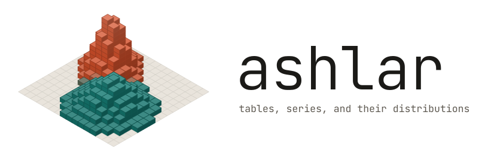
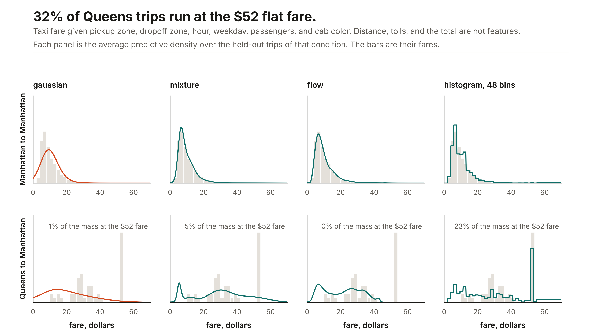
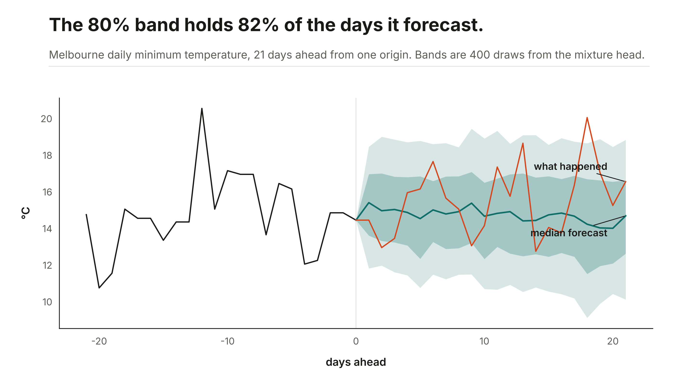
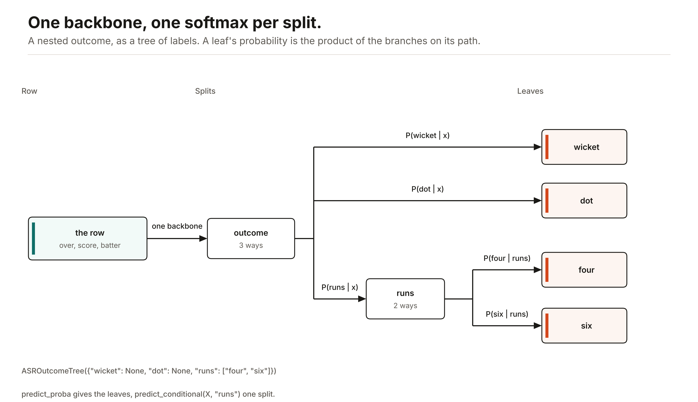

<p align="center">
  <picture>
    <source media="(prefers-color-scheme: dark)" srcset="docs/images/logo-dark.svg">
    
  </picture>
</p>

Ashlar fits tables and forecasts series with JAX neural networks. You call `fit` and `predict`. Categorical columns become learned vectors. A regression or a forecast can return a whole distribution, not just a point: a Gaussian, a mixture, a spline flow, a histogram, or a set of quantiles.

It slots in wherever a gradient-boosted model does. Swap `LGBMRegressor()` for `ASRRegressor()` and `LGBMClassifier()` for `ASRClassifier()`: the scikit-learn interface, a pandas or Polars frame as it is, string columns included, and `clone`, `Pipeline`, `cross_val_score`, and `GridSearchCV` all work. On eight public tables of half a million to two million rows the defaults win or tie on five, and for a predictive distribution they beat the trees on most tables. [The benchmarks](docs/benchmarks.md) have every number, including where the trees still win.

## Install

```bash
pip install -e ".[dataframes]"
```

From a checkout of [maxmbay/ashlar](https://github.com/maxmbay/ashlar). The import name is `ashlar` and the distribution name is `ashlar-tabular`; the PyPI project named `ashlar` is an unrelated microscopy stitcher. CPU is enough.

## Quick start

```python
from ashlar import ASRRegressor, ASRClassifier

model = ASRRegressor().fit(X, y)        # where you had LGBMRegressor()
model.predict(X_new)

clf = ASRClassifier().fit(X, labels)    # predict, predict_proba, score
```

`X` is a NumPy array, a dict of columns, or a pandas or Polars frame. Numeric columns are imputed and scaled, string columns get a learned embedding, and a category that never appeared in training is not an error.

## The architecture is an argument

A model is one set of keyword arguments. Four slots — how the columns are encoded, the backbone that reads them, the head that answers, and the training schedule — and each one is independent of the others. Change the head and the same network returns a density instead of a number. Change the backbone and the head does not notice.

<p align="center">
  <picture>
    <source media="(prefers-color-scheme: dark)" srcset="docs/images/architecture-dark.svg">
    
  </picture>
</p>

```python
ASRRegressor()                                      # the defaults above
ASRRegressor(task="mixture")                        # same net, now a predictive density
ASRRegressor(task="flow", backbone="tabm")          # skewed target, ensemble trunk
ASRClassifier(backbone="transformer")               # attention over the columns
```

Nothing above is a wrapper class: every line is `ASRModel` with different arguments, so a recipe you like is a dict you can save, version, or sweep. `backbone=` also takes your own Equinox module, and `task="custom"` takes your own head and objective. [docs/models.md](docs/models.md) is the tour of what goes in each slot.

## Heads: pick one for the shape of the target

A tree regressor predicts a mean. For an interval you fit one more model per quantile, or put a fixed-width normal around the mean. An Ashlar head gives the whole predictive distribution from one fit.

```python
model = ASRRegressor(task="mixture").fit(X, y)

model.predict(X_new)                        # the mean
model.predict_quantiles(X_new, [0.1, 0.9])  # on the scale of y
model.sample(X_new, n=1000)                 # draws
model.log_prob(X_new, y_new)                # log density of what happened
```

The distribution is conditional, so it changes shape from row to row:



One fit per head on taxi fares, given the zones, the hour, the weekday, the passengers, and the cab color, with distance and the total held out. Manhattan hops are a skewed bump the smooth heads catch. The Queens corridor is bimodal, because 32% of those trips run at the $52 airport flat fare, and only the histogram head grows a spike there: 23% of its mass against the mixture's 5% and the Gaussian's 1%. The bin count is yours (`head_kwargs={"bins": 48}` above, 16 by default).

`gaussian`, `mixture`, `flow`, `histogram`, and `quantile` for a number; `ASRClassifier` for classes, `ASROrdinalClassifier` for an ordered scale, and `ASROutcomeTree` for nested outcomes. [docs/heads.md](docs/heads.md) says which to reach for and why.

## Forecasting

```python
from ashlar import ASRForecaster

model = ASRForecaster(lookback=48, horizon=1, head="mixture").fit(series)
model.predict(history)                     # one point per horizon step
model.sample(history, key, n=1000)         # draws
```



The forecasters take the same heads by name, so a forecast is a distribution per step rather than a line. `ASRHistoryForecaster` reads the whole prefix instead of a window. [docs/forecast.md](docs/forecast.md) covers both, call by call.

## Nested outcomes

Some targets are a tree, not a flat set of classes: a ball is a wicket, a dot, or runs, and runs are a four or a six. `ASROutcomeTree` fits one backbone with a softmax per split, so a label that stops early (`"runs"`, with no detail recorded) still trains the splits above it.



```python
from ashlar import ASROutcomeTree

model = ASROutcomeTree({"wicket": None, "dot": None, "runs": ["four", "six"]}).fit(X, outcomes)
model.predict_proba(X_new)                  # the leaves
model.predict_conditional(X_new, "runs")    # P(four or six | runs, x)
```

## Results

The defaults match the trees on large tables, and the heads win where the answer is a distribution. CRPS scores a whole predictive distribution in the target's units, lower is better.

| Table | Rows | Ashlar `mixture` | Best tree distribution |
|---|---:|---:|---:|
| Airline delay, minutes | 2,000,000 | **9.17** | 11.46 |
| Year (MSD) | 515,345 | **4.05** | 4.41 |
| Zurich transport | 2,000,000 | **1.62** | 1.74 |
| NYC green taxi tips, $ | 581,835 | 0.59 | **0.46** |

The intervals are honest too: an Ashlar interval that promises 80% holds about 80% of held-out values, where a tree mean with a fitted normal holds 94% of airline delays because one width has to serve every flight. On point accuracy alone the picture is closer, and the trees still win the taxi tips.

[docs/benchmarks.md](docs/benchmarks.md) has all of it: eight large tables against LightGBM, XGBoost, and CatBoost, five smaller ones, a comparison with RealMLP, TabM, and FT-Transformer, the ablation behind the defaults, and the forecast heads.

## Documentation

- [docs/models.md](docs/models.md): what goes in each slot, and the research models beyond the defaults.
- [docs/heads.md](docs/heads.md): every head and the shape of target it suits.
- [docs/tabular.md](docs/tabular.md): fitting a table. Defaults, recipes, tasks, embeddings, set columns, and search.
- [docs/forecast.md](docs/forecast.md): the two forecasters, call by call.
- [docs/benchmarks.md](docs/benchmarks.md): every number, per table and per metric, and how it was run.
- [`examples/`](examples): runnable scripts, including the benchmarks and the figures on this page.
