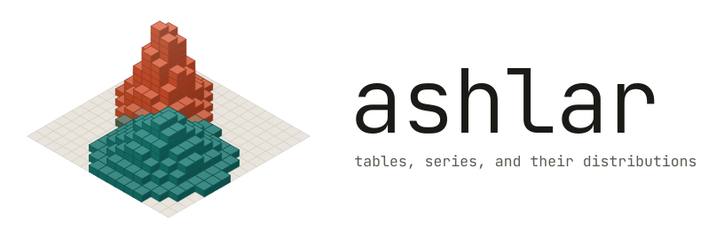
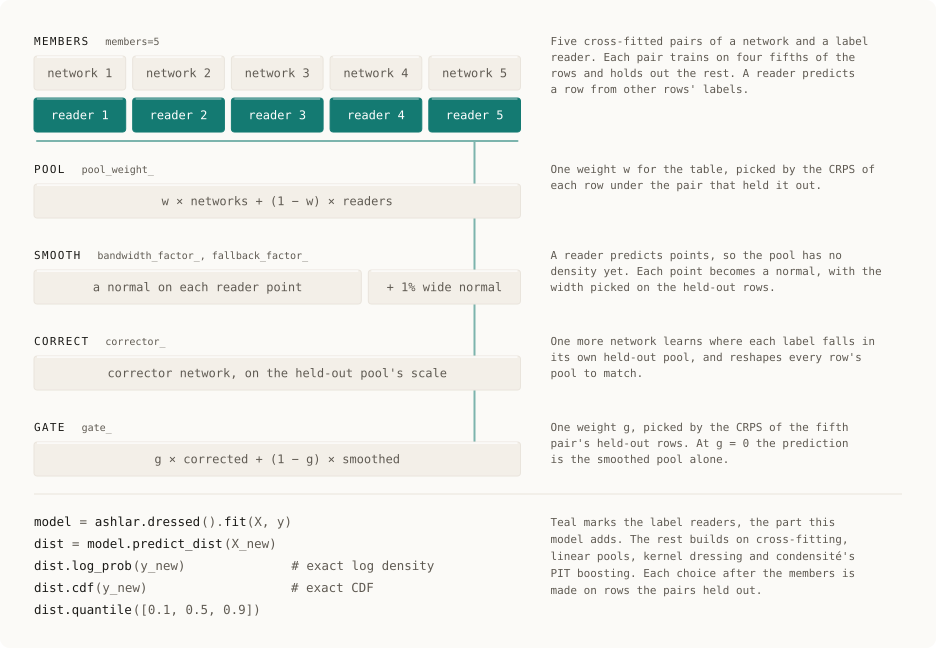
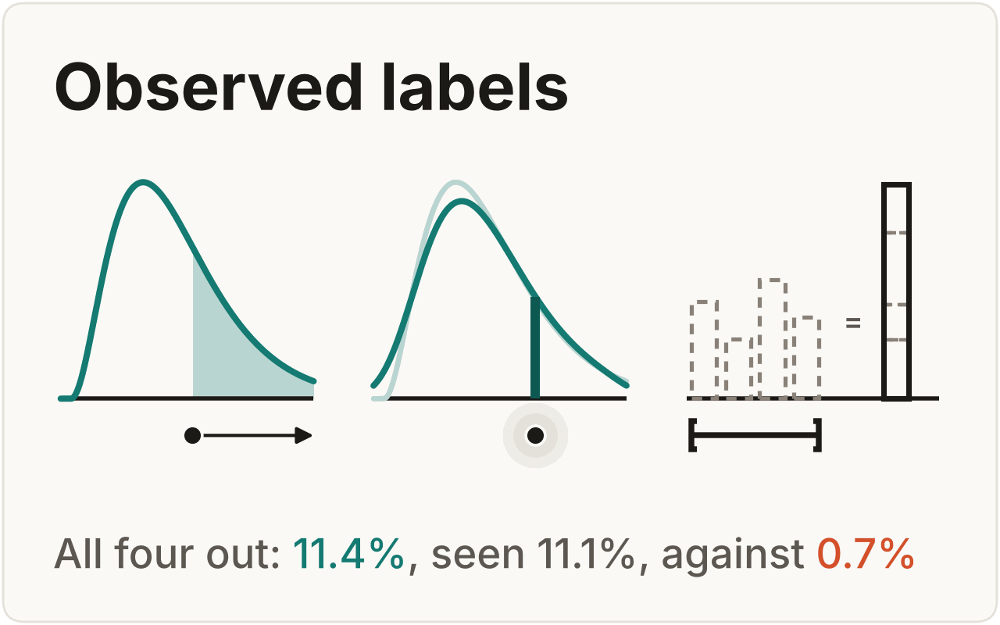
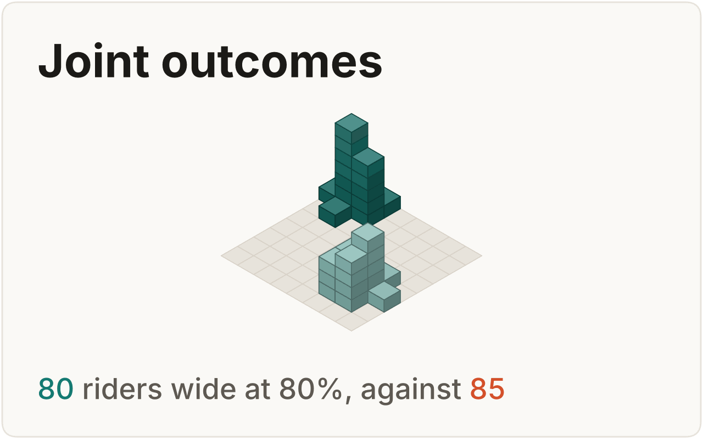
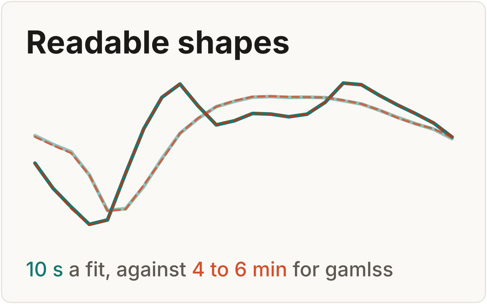

<p align="center">
  <picture>
    <source media="(prefers-color-scheme: dark)" srcset="docs/images/logo-dark.svg">
    
  </picture>
</p>

<p align="center">
  <a href="https://pypi.org/project/ashlar-tabular/"></a>
  <a href="https://pypi.org/project/ashlar-tabular/"></a>
  <a href="https://github.com/maxmbay/ashlar/actions/workflows/tests.yml"></a>
  <a href="LICENSE"></a>
</p>

Ashlar is a Python library for regression and classification on tabular data, built on JAX. Its main models are scikit-learn estimators, and a regressor can predict a probability distribution for each row.

The model Ashlar adds is [the dressed model](docs/dressed.md), `ashlar.dressed()`, named for the dressed stone of ashlar masonry. It pools five networks with five label readers, gives the pool a density, and corrects it with one more network. A label reader predicts a row from the training rows' labels, which it reads at prediction time.

On [ScoringBench](https://github.com/jonaslandsgesell/ScoringBench), in our own run, the dressed model ranks first of 21 untuned models trained from scratch, by CRPS across 99 tables. The rank is provisional until ScoringBench's maintainer repeats the run. ScoringBench also lists tuned and pretrained models, and the rank is within the untuned group only.

```bash
pip install "ashlar-tabular[dataframes]"
```

```python
import ashlar

model = ashlar.dressed().fit(X, y)

dist = model.predict_dist(X_new)                 # one distribution per row
dist.log_prob(y_new)                             # exact log density
dist.cdf(y_new)                                  # exact CDF
model.predict(X_new)                             # the mean
model.predict_quantiles(X_new, [0.1, 0.5, 0.9])  # (rows, 3)
model.sample(X_new, n=1000)                      # (1000, rows)
```

A target with at most 20 distinct values gets an exact probability for each value and no density.

## What each part adds on ScoringBench

Each row is one Ashlar model, ranked alone among the same 20 untuned models.

| Model | Mean rank | Lead | CRPS ratio to the row above |
|---|---|---|---|
| One network | 3.58 | 0.93 | |
| That network pooled with one label reader | 1.62 | 3.05 | 0.903 |
| Five cross-fitted pairs pooled | 1.38 | 3.32 | 0.978 |
| The dressed model | 1.33 | 3.39 | 0.987 |

Lead is the distance to the next model, condensité in every row; above 3.15 it is significant at the 5% level (Nemenyi test). The label reader is the largest step: it lowers a network's CRPS, the error of its predicted distributions, by 9.7% on the geometric mean. The first two rows come from the same fits, and so do the last two, so each of those steps changes one part; between them the code moved from research code to the library. [The guide](docs/dressed.md#on-scoringbench) has all 21 mean ranks.

## The general estimator

Besides the dressed model, Ashlar has one general estimator, used like XGBoost or LightGBM:

```python
from ashlar import ASRClassifier, ASRRegressor
from xgboost import XGBClassifier, XGBRegressor

model = XGBRegressor().fit(X, y)          # XGBoost
model = ASRRegressor().fit(X, y)          # Ashlar
model.predict(X_new)                      # (rows,)

model = XGBClassifier().fit(X, labels)    # XGBoost
model = ASRClassifier().fit(X, labels)    # Ashlar
model.predict_proba(X_new)                # (rows, classes), in classes_ order
```

Set `task` to a distribution head and every method reads one predicted distribution:

```python
model = ASRRegressor(task="mixture").fit(X, y)

model.predict(X_new)                          # the mean
model.predict_quantiles(X_new, [0.1, 0.9])    # (rows, 2)
model.predict_exceedance(X_new, 60)           # P(y > 60) for each row
model.sample(X_new, n=1000)                   # (1000, rows)
model.log_prob(X_new, y_new)                  # log density of each observed value
model.predict_dist(X_new)                     # the distribution itself, a JAX pytree

model.calibrate(X_holdout, y_holdout)         # split-conformal, on rows the model did not train on
model.predict_interval(X_new, coverage=0.8)   # (rows, 2): holds 80% of new rows like the held-out ones
```

## Where to start

Find your data or problem in the first column and start from the call beside it; `model` is a regressor fitted with a distribution head, and every name imports from `ashlar` (`horizon_frame` from `ashlar.horizon`).

| Your data or problem | Start with | Guide |
|---|---|---|
| A few hundred to a few thousand training rows, one numeric target with exact labels, at most thousands of rows to predict, and a predicted distribution worth a slow fit | `ashlar.dressed().fit(X, y)`. Slow to fit and to predict; no test has more than 2,400 training rows. | [dressed](docs/dressed.md) |
| A distribution per row with more rows than that, to train on or to predict: a skewed target, several peaks, a cap, fixed amounts | `ASRRegressor(task="mixture").fit(X, y)`. It has trained on two million rows in 2 to 5 minutes on 12 cores at its default budget ([benchmarks](docs/benchmarks.md#large-tables)). | [heads](docs/heads.md) |
| A number or a class per row, as from XGBoost or LightGBM | `ASRRegressor().fit(X, y)` or `ASRClassifier().fit(X, y)`; `tabm_piecewise().fit(X, y)` is a stronger, slower network | [tabular](docs/tabular.md) |
| Counts | `ASRRegressor(task="negative_binomial").fit(X, y)` | [heads](docs/heads.md) |
| Often exactly zero, otherwise a positive amount | `ASRRegressor(task="hurdle").fit(X, y)` | [heads](docs/heads.md) |
| Ordered classes | `ASROrdinalClassifier().fit(X, y)` | [tabular](docs/tabular.md#tasks) |
| Labels not seen exactly: survival times, sold-out days, ranges, rounded values, totals over several rows | `ASRRegressor(task="mixture").fit(X, observed.censored(y, sold_out))`, or a label from `observed.survival`, `interval`, `rounded`, or `total` | [observed](docs/observed.md) |
| Several targets predicted jointly | `ASRRegressor(task="multivariate_gaussian").fit(X, Y)`, or `task="chain"` for targets of different kinds | [distributions](docs/distributions.md#several-targets-at-once) |
| Many groups, such as stores or patients, with few rows for most | `ASRRegressor(task="gaussian", random_effects={"store": "intercept"}).fit(X, y)` | [effects](docs/effects.md) |
| Terms you can plot and read, one per column | `ASRRegressor(task="gaussian", backbone="additive").fit(X, y)`, then `model.shape_functions(X)` | [additive](docs/additive.md) |
| Intervals with a coverage guarantee | `model.calibrate(X_holdout, y_holdout)`, then `model.predict_interval(X_new, coverage=0.8)` | [heads](docs/heads.md#calibrated-intervals) |
| A decision under a cost, such as how much to order | `model.predict_order(X_new, under=9, over=1)` | [distributions](docs/distributions.md#deciding-from-the-distribution) |
| Many time series with covariates (work in progress) | `horizon_frame(sales, target="units", lookback=28, horizon=12, series="store", time="day")`, then a joint head on `frame.X` and `frame.Y` | [forecast](docs/forecast.md#many-series-covariates-and-paths) |
| Your own backbone or head | `ASRRegressor(backbone=Trunk).fit(X, y)` with your Equinox class `Trunk`; `task="custom"` for a head | [models](docs/models.md#backbone), [showcase](docs/showcase.md#one-table-one-choice-at-a-time) |

[docs/models.md](docs/models.md#what-the-general-estimator-covers) has the fuller table of what the general estimator covers.

## Properties

- `ASRRegressor` and `ASRClassifier` drop in where `XGBRegressor` and `LGBMClassifier` are used, on pandas or Polars frames with string columns and missing values as they are ([the calls that change](docs/estimator.md#coming-from-another-library)).
- Regressors with a distribution head and the dressed model are natively distributional: quantiles, intervals, tail probabilities, samples, and the mean are read from one predicted distribution per row, so they agree ([docs/heads.md](docs/heads.md)).
- Every forward pass gives a log probability: `log_prob` is exact, with no sampling, for every distribution head, the classifiers, and the dressed model. The point regressor and the `quantile` head have none ([docs/estimator.md](docs/estimator.md#what-the-methods-return)).
- Models are modular: a general model is five independent choices (column encoding, backbone, head, label type, training schedule), and the backbone and head can be your own Equinox modules ([docs/models.md](docs/models.md)).
- Ashlar is built on JAX: a GPU needs [one extra install](docs/README.md#install) and no code changes, and `jax.grad` differentiates a fitted general model in its numeric inputs ([docs/distributions.md](docs/distributions.md#jax-transforms)).

## How the dressed model works

`ashlar.dressed()` is for one numeric target with exact labels, when the predicted distribution is worth a slow fit: a median of 32 minutes per fold on ScoringBench, with six fits sharing a 12-core laptop CPU. It suits a few hundred to a few thousand training rows and at most thousands of rows to predict, because reading a row's full distribution takes tenths of a second on a laptop CPU.

<p align="center">
  <picture>
    <source media="(prefers-color-scheme: dark)" srcset="docs/images/dressed-dark.svg">
    
  </picture>
</p>

Each of five pairs, a network and a label reader, is fitted on four fifths of the rows. The pool weight, the smoothing, the corrector, and a gate between the corrected and smoothed pools are then fitted on the rows the pairs held out.

The model adds the label reader and its pairing with a network. A reader solves a ridge regression of the training labels inside its forward pass, then spreads a row's probability over the leave-one-out residuals by attention. TabR and ModernNCA read training labels at prediction time too, and return one number; TabPFN reads them with pretrained weights. The rest builds on established work: the networks follow TabM, the smoothing is kernel dressing from weather forecasting, and the corrector and gate follow the PIT boosting of [condensité](https://pypi.org/project/condensite/0.1.1/), the next model in the table above.

No test has more than 2,400 training rows. A target that the columns determine almost exactly can come out worse than the five pairs pooled without dressing: 5.5 times their CRPS on one development fold. [docs/dressed.md](docs/dressed.md) has every step and the tests, including the designs that failed.

## What else is in the library

<p align="center">
  <picture>
    <source media="(prefers-color-scheme: dark)" srcset="docs/images/architecture-dark.svg">
    
  </picture>
</p>

Each tile opens an example in [docs/showcase.md](docs/showcase.md) with its code, and [docs/benchmarks.md](docs/benchmarks.md) has every result. [docs/models.md](docs/models.md#what-the-general-estimator-covers) has the full list.

<table>
  <tr>
    <td align="center" valign="top" width="33%"><a href="docs/showcase.md#distribution-heads"></a><br><a href="docs/showcase.md#distribution-heads"><b>Distribution heads</b></a><br><sub>Claims at four fixed amounts: 42% observed, 33% predicted, CatBoost 3%</sub></td>
    <td align="center" valign="top" width="33%"><a href="docs/showcase.md#survival-analysis"></a><br><a href="docs/showcase.md#survival-analysis"><b>Survival analysis</b></a><br><sub>Passes D-calibration on 4 of 5 splits; tuned XGBoost AFT on none</sub></td>
    <td align="center" valign="top" width="33%"><a href="docs/showcase.md#partially-observed-labels"></a><br><a href="docs/showcase.md#partially-observed-labels"><b>Partially observed labels</b></a><br><sub>Days when four products all sell out (simulated): 11.4% predicted, 11.1% observed, 0.7% from separate models</sub></td>
  </tr>
  <tr>
    <td align="center" valign="top" width="33%"><a href="docs/showcase.md#multivariate-targets"></a><br><a href="docs/showcase.md#multivariate-targets"><b>Multivariate targets</b></a><br><sub>Calibrated 80% intervals for hourly bike rentals: 80 riders wide, LightGBM with CQR 85</sub></td>
    <td align="center" valign="top" width="33%"><a href="docs/showcase.md#random-effects"></a><br><a href="docs/showcase.md#random-effects"><b>Random effects</b></a><br><sub>CRPS for stores with 1 to 5 days of data: 0.096, GPBoost 0.125</sub></td>
    <td align="center" valign="top" width="33%"><a href="docs/showcase.md#additive-models"></a><br><a href="docs/showcase.md#additive-models"><b>Additive models</b></a><br><sub>Same terms as R's gamlss; 10 seconds per fit on 12 cores, gamlss 4 to 6 minutes on one thread</sub></td>
  </tr>
  <tr>
    <td align="center" valign="top" width="33%"><a href="docs/showcase.md#calibrated-intervals-and-missing-inputs"></a><br><a href="docs/showcase.md#calibrated-intervals-and-missing-inputs"><b>Calibrated intervals</b></a><br><sub>Coverage between 75% and 85% in 21 of 24 hours; LightGBM with CQR in 10</sub></td>
    <td align="center" valign="top" width="33%"><a href="docs/showcase.md#decisions-and-explanations"></a><br><a href="docs/showcase.md#decisions-and-explanations"><b>Decisions and explanations</b></a><br><sub>Orders for any cost ratio from one model; LightGBM refitted per ratio costs up to 23% more</sub></td>
    <td align="center" valign="top" width="33%"><a href="docs/showcase.md#forecasting-work-in-progress"></a><br><a href="docs/showcase.md#forecasting-work-in-progress"><b>Forecasting (in progress)</b></a><br><sub>CRPS of 12-day sales totals: 2,623, DeepAR 3,881</sub></td>
  </tr>
</table>

## Documentation

[docs/README.md](docs/README.md) is the index, and [CHANGELOG.md](CHANGELOG.md) lists each release.

## License and acknowledgements

Ashlar is released under the [Apache 2.0 license](LICENSE).

The `tabm` backbone and the `tabm()` and `tabm_piecewise()` recipes follow TabM, by Yury Gorishniy, Akim Kotelnikov, and Artem Babenko ([paper](https://arxiv.org/abs/2410.24210), [code](https://github.com/yandex-research/tabm)). The piecewise-linear and periodic numeric embeddings follow [Gorishniy, Rubachev, and Babenko (2022)](https://arxiv.org/abs/2203.05556).
