<p align="center">
  <picture>
    <source media="(prefers-color-scheme: dark)" srcset="docs/images/logo-dark.svg">
    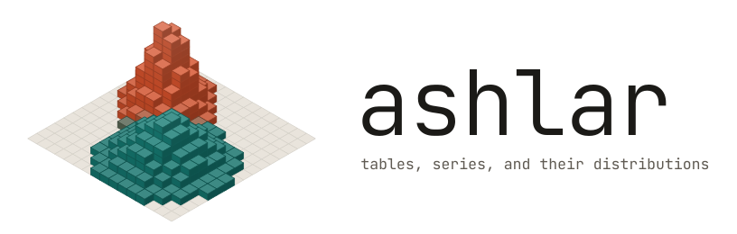
  </picture>
</p>

<p align="center">
  <a href="https://pypi.org/project/ashlar-tabular/"></a>
  <a href="https://pypi.org/project/ashlar-tabular/"></a>
  <a href="https://github.com/maxmbay/ashlar/actions/workflows/tests.yml"></a>
  <a href="LICENSE"></a>
</p>

Ashlar is a Python library for regression and classification on tabular data. It trains neural networks with JAX, and for regression it predicts a probability distribution for each row instead of a single value. You choose the distribution family to suit the target, for example a negative binomial for counts, a mixture of normals for skewed or multimodal targets, or a hurdle model for targets with many zeros. Labels do not have to be exact. A survival time can be censored, a day's sales can be capped by a stock-out, and a value can be known only as a range or as a total over several rows.

The estimators follow the scikit-learn API and take NumPy arrays or pandas and Polars data frames. On eight public tables with half a million to two million rows, Ashlar's point predictions are within 0.3% of the best of LightGBM, XGBoost, and CatBoost on three tables, better on two, and worse on three; the largest shortfall is an 11% higher RMSE on taxi tips. On the four regression tables, its predicted distributions were also compared with LightGBMLSS, the best tree-based distributional model on these tables. By CRPS, Ashlar is better on song release years (by 3.5%) and Zurich transport (1.7%), slightly worse on airline delays (0.2%), and much worse on taxi tips (27%).


The figure shows predicted departure delays for 16 flights from the test set of the airline delay table. The model, `ASRRegressor(task="mixture")`, was trained on 1.6 million US flights from 1987 to 2008, using schedule information only and no weather data. Each curve is one flight's predicted distribution, with the central 80% shaded dark and a narrow spike at zero for leaving exactly on time. Under each curve are the 80% interval predicted by LightGBMLSS's mixture of three normals and a dot for the actual delay.

On 100,000 test flights the two models have almost the same CRPS (continuous ranked probability score, the error of a predicted distribution in minutes; lower is better): 9.17 for Ashlar and 9.14 for LightGBMLSS, which is also slightly ahead on the benchmark's other two splits. When both are calibrated to cover 80% of flights, Ashlar's intervals are 7% wider on average, but their coverage depends less on how risky a flight is. Ranked into fifths by each model's predicted probability of an hour's delay, Ashlar's intervals cover between 79% and 81% of the flights in each fifth, and LightGBMLSS's between 77% and 86%. Ashlar's predicted probability of a delay of more than an hour is within 0.6 percentage points of the observed rate in every group of 1,000 or more flights with similar predictions; LightGBMLSS's is off by up to 8.3 points. On this split, training took 4 minutes for Ashlar on the 12 cores of a laptop and 20 minutes for LightGBMLSS on six threads.

## How a model is specified

An Ashlar model is defined by five choices, shown in the diagram below: how the input columns are encoded, the backbone network, the output head, the type of label, and the training schedule. The head sets what the model predicts, such as a distribution family, class probabilities, or a single value. Four of the choices are keyword arguments to the estimator. The fifth, the label type, is set by what you pass to `fit`: a plain array for exact values, or a label built with `ashlar.observed` for censored, interval, rounded, truncated, noisy, or summed values. The choices are independent of each other, so they can be combined. The highlighted path is one example, an additive backbone with a negative binomial head, fitted to sales that were censored on days a product sold out.

<p align="center">
  <picture>
    <source media="(prefers-color-scheme: dark)" srcset="docs/images/architecture-dark.svg">
    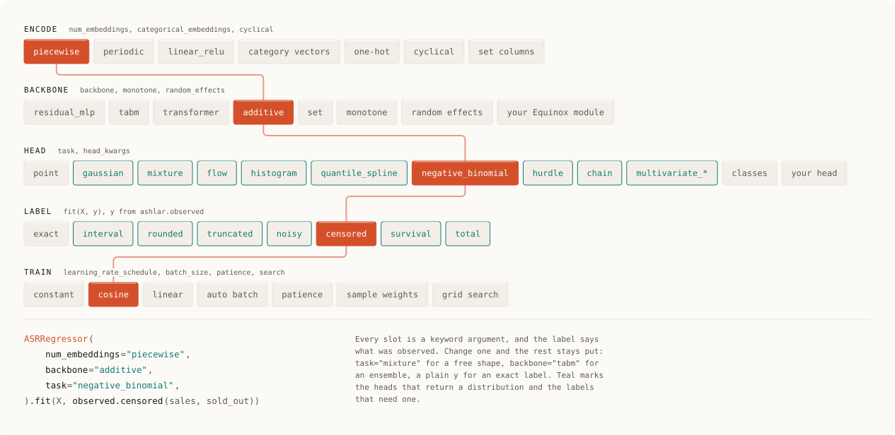
  </picture>
</p>

Every configuration is an instance of the same class, `ASRModel`, with different arguments; `ASRRegressor` and `ASRClassifier` are `ASRModel` with the task already set. A model is therefore fully described by its arguments, which makes it easy to save, version, and tune. [docs/models.md](docs/models.md) describes the keyword arguments and [docs/observed.md](docs/observed.md) the label types.

Many of these features are available in other packages, spread across several of them. LightGBMLSS and NGBoost fit distributions with gradient-boosted trees, XGBoost and CatBoost fit censored survival times, R's `gamlss` fits additive models for each parameter of a distribution, GPBoost and mixed-model packages fit random effects, and MAPIE adds conformal prediction intervals. In R, brms fits many of the same likelihoods, including censoring, truncation, mixtures, hurdles, and random effects, in Bayesian regression models. Ashlar provides them in one estimator with a neural network backbone, so they can be used together. Some of its features we have not found in other libraries, such as labels that are totals over several rows, and calibrated intervals for a function of several predicted outcomes, like the total cost of a policy's claims.

## Install

```bash
pip install "ashlar-tabular[dataframes]"
```

The package is imported as `ashlar`. This installs the CPU version of JAX, which is all Ashlar needs; every result on this page was computed on CPUs.

<details>
<summary>Training on an NVIDIA GPU</summary>

On Linux, also install JAX's CUDA build. It includes the CUDA libraries, so only the NVIDIA driver needs to be installed:

```bash
pip install "ashlar-tabular[dataframes]" "jax[cuda12]"
python -c "import jax; print(jax.devices())"   # should list a CudaDevice
```

No code changes are needed, because JAX uses the GPU when one is available. For other CUDA versions and platforms, see [JAX's install guide](https://docs.jax.dev/en/latest/installation.html).

</details>

## Quick start

Ashlar's estimators are used the same way as XGBoost's or LightGBM's:

```python
from ashlar import ASRClassifier, ASRRegressor
from xgboost import XGBClassifier, XGBRegressor

model = XGBRegressor().fit(X, y)          # XGBoost
model = ASRRegressor().fit(X, y)          # Ashlar
model.predict(X_new)

model = XGBClassifier().fit(X, labels)    # XGBoost
model = ASRClassifier().fit(X, labels)    # Ashlar
model.predict_proba(X_new)
```

`X` can be a NumPy array, a dict of columns, or a pandas or Polars data frame, and needs no preprocessing. The model imputes and scales numeric columns, learns embeddings for string columns, and accepts categories at prediction time that it did not see in training. The estimators work with scikit-learn tools such as `clone`, `Pipeline`, `cross_val_score`, and `GridSearchCV`.

To predict a distribution rather than a mean, set `task` to a distribution head. The fitted model then gives quantiles, tail probabilities, samples, and log-likelihoods for each row:

```python
model = ASRRegressor(task="mixture").fit(X, y)

model.predict(X_new)                          # the mean
model.predict_quantiles(X_new, [0.1, 0.9])    # quantiles
model.predict_exceedance(X_new, 60)           # P(y > 60) for each row
model.sample(X_new, n=1000)                   # samples
model.log_prob(X_new, y_new)                  # log-likelihood of observed values

model.calibrate(X_holdout, y_holdout)         # calibrate on held-out rows
model.predict_interval(X_new, coverage=0.8)   # split-conformal 80% intervals
```

All of these are computed from the same predicted distribution, so they are consistent with each other; for example, the quantiles never cross.

![One held-out flight, Delta from Washington Dulles to Atlanta at 17:25 on a Friday in August: its predicted delay distribution with the calibrated 80% interval shaded dark, the median and mean marked, LightGBMLSS's uncalibrated 80% interval under it, and the actual delay of 49 minutes. Under the distribution, each call from the quick start with its result on the same delay axis: predict 16.4 beside LightGBM's 21.4, predict_quantiles −3.4 to 53.5, predict_exceedance 0.086, five samples, log_prob −6.17, predict_interval after calibrate −3.4 to 52.5, and the three largest attributions from explain for the 0.9 quantile.](docs/images/readme/one-flight.png)

The figure shows what these calls, and `explain`, return for one test flight, using the model from the first figure.

## Benchmarks on eight large tables

![Two panels over eight OpenML tables, each row a dot for Ashlar's relative difference from the best tree-based model on that table, left of zero when Ashlar is better. Left, test error compared with the best of LightGBM, XGBoost, and CatBoost: within 0.3% on airline delay, song release years, and Zurich transport, better on Higgs and covertype, 1.5% and 2.3% worse on click prediction and airlines, and 11% worse on taxi tips. Right, the predicted distribution compared with the best tree-based distribution: CRPS 0.2% higher than LightGBMLSS's mixture on airline delay, 3.5% and 1.7% lower on song release years and Zurich transport, and 27% higher on taxi tips; log loss lower on Higgs and covertype, higher on click prediction and airlines.](docs/images/readme/scoreboard.png)

Each dot shows how Ashlar's score differs from that of the best tree-based model on one table; left of zero means Ashlar is better. The left panel compares test error, and the right panel compares the predicted distributions by CRPS or log loss. LightGBM trains much faster, in 4 seconds to 2 minutes per table on six threads, while Ashlar takes 2 to 5 minutes on all 12 cores of a laptop. [docs/showcase.md](docs/showcase.md#benchmarks-on-eight-large-tables) has the full tables, training times, and results on five smaller tables.

## Examples

Each example compares Ashlar with a tool commonly used for the same task: a gradient-boosted tree model, a mixed model, R's `gamlss`, XGBoost's survival model, or DeepAR. Select a tile to see the full example in [docs/showcase.md](docs/showcase.md), with the code, the results, and the cases where the other tool does better.

<table>
  <tr>
    <td align="center" valign="top" width="33%"><a href="docs/showcase.md#distribution-heads">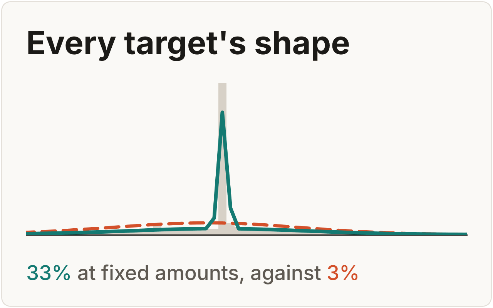</a><br><a href="docs/showcase.md#distribution-heads"><b>Distribution heads</b></a><br><sub>Claims at four fixed amounts: 42% observed, 33% predicted, CatBoost 3%</sub></td>
    <td align="center" valign="top" width="33%"><a href="docs/showcase.md#survival-analysis">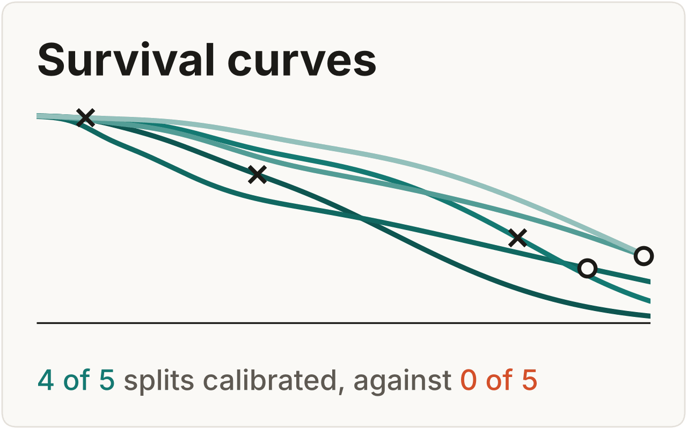</a><br><a href="docs/showcase.md#survival-analysis"><b>Survival analysis</b></a><br><sub>Passes D-calibration on 4 of 5 splits; tuned XGBoost AFT on none</sub></td>
    <td align="center" valign="top" width="33%"><a href="docs/showcase.md#partially-observed-labels">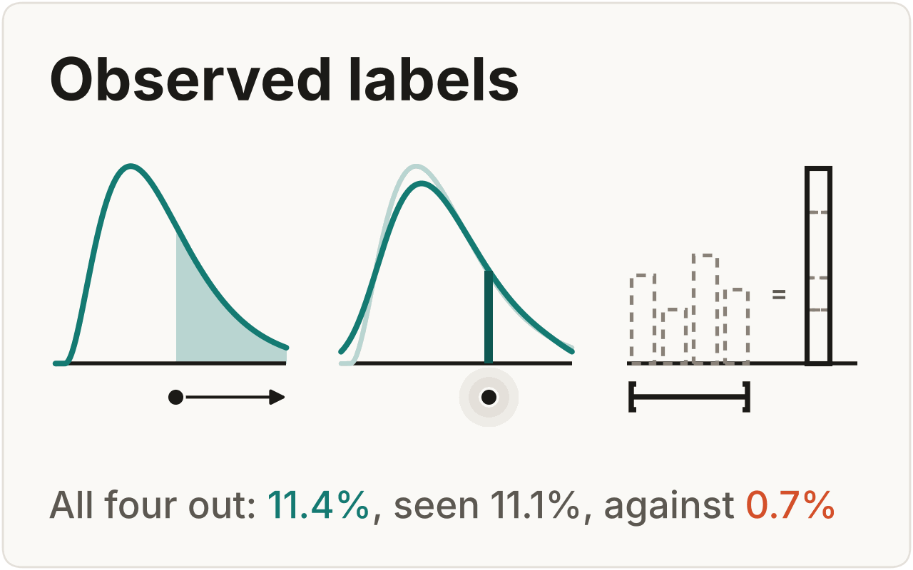</a><br><a href="docs/showcase.md#partially-observed-labels"><b>Partially observed labels</b></a><br><sub>Days when four products all sell out (simulated): 11.4% predicted, 11.1% observed, 0.7% from separate models</sub></td>
  </tr>
  <tr>
    <td align="center" valign="top" width="33%"><a href="docs/showcase.md#several-outcomes-in-one-model">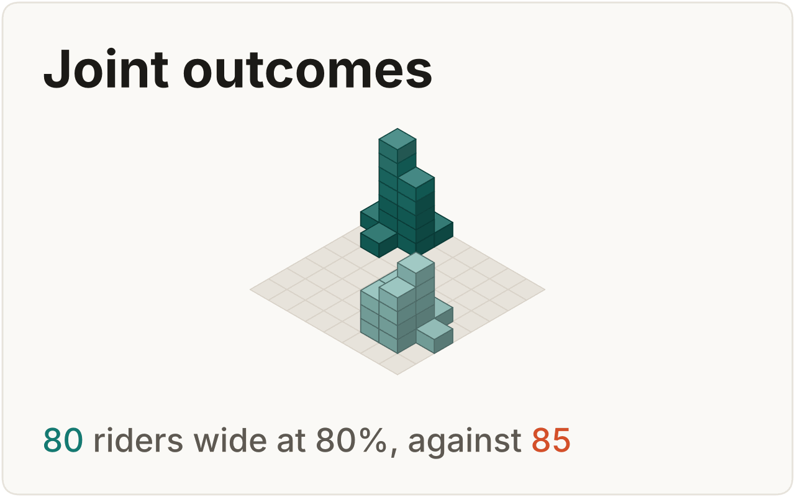</a><br><a href="docs/showcase.md#several-outcomes-in-one-model"><b>Several outcomes</b></a><br><sub>Calibrated 80% intervals for hourly bike rentals: 80 riders wide, LightGBM with CQR 85</sub></td>
    <td align="center" valign="top" width="33%"><a href="docs/showcase.md#random-effects">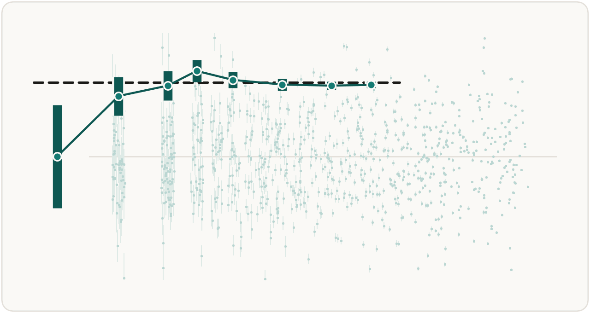</a><br><a href="docs/showcase.md#random-effects"><b>Random effects</b></a><br><sub>CRPS for stores with 1 to 5 days of data: 0.096, GPBoost 0.125</sub></td>
    <td align="center" valign="top" width="33%"><a href="docs/showcase.md#additive-models">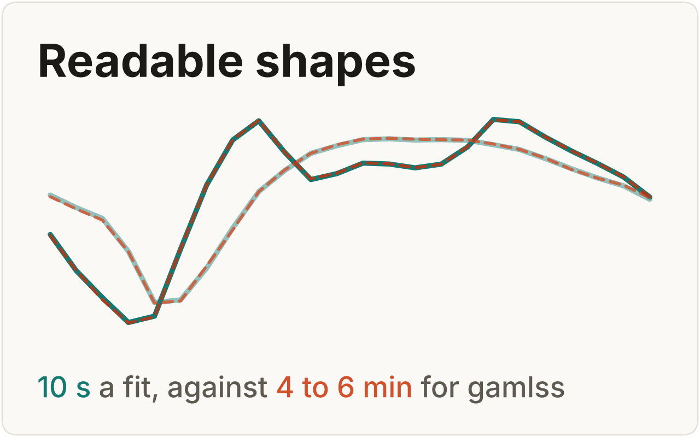</a><br><a href="docs/showcase.md#additive-models"><b>Additive models</b></a><br><sub>Same terms as R's gamlss; 10 seconds per fit on 12 cores, gamlss 4 to 6 minutes on one thread</sub></td>
  </tr>
  <tr>
    <td align="center" valign="top" width="33%"><a href="docs/showcase.md#calibrated-intervals-and-missing-inputs">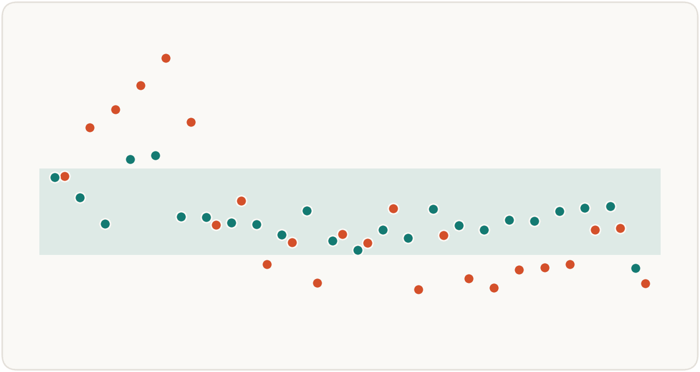</a><br><a href="docs/showcase.md#calibrated-intervals-and-missing-inputs"><b>Calibrated intervals</b></a><br><sub>Coverage between 75% and 85% in 21 of 24 hours; LightGBM with CQR in 10</sub></td>
    <td align="center" valign="top" width="33%"><a href="docs/showcase.md#decisions-and-explanations">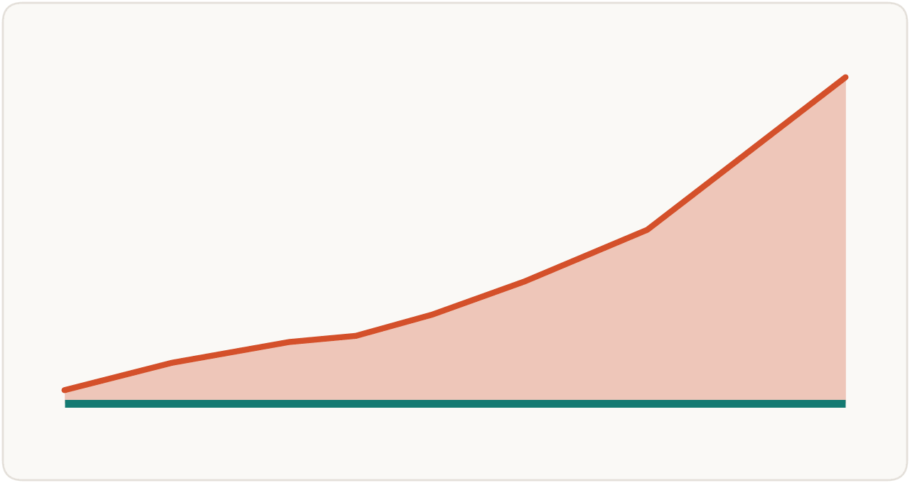</a><br><a href="docs/showcase.md#decisions-and-explanations"><b>Decisions and explanations</b></a><br><sub>Orders for any cost ratio from one model; LightGBM refitted per ratio costs up to 23% more</sub></td>
    <td align="center" valign="top" width="33%"><a href="docs/showcase.md#forecasting-work-in-progress">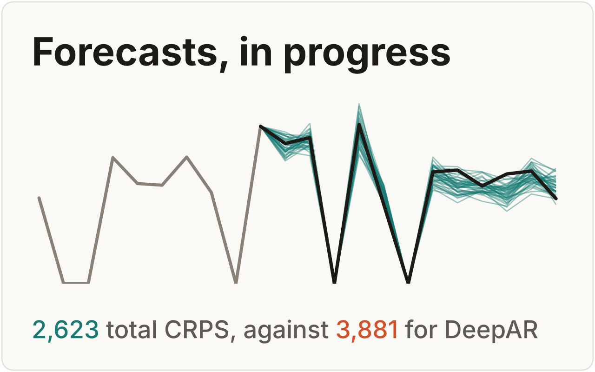</a><br><a href="docs/showcase.md#forecasting-work-in-progress"><b>Forecasting (in progress)</b></a><br><sub>CRPS of 12-day sales totals: 2,623, DeepAR 3,881</sub></td>
  </tr>
</table>

## Documentation

- [docs/showcase.md](docs/showcase.md): the full benchmark results and the examples from the gallery, with figures, code, and comparisons.
- [docs/models.md](docs/models.md): the keyword arguments that define a model, and the research models beyond the defaults.
- [docs/heads.md](docs/heads.md): each head and the targets it suits, calibrated intervals, and uncertainty across ensemble members.
- [docs/distributions.md](docs/distributions.md): the distribution object returned by every head, joint heads, constraints, missing inputs, decisions, explanations, and JAX transforms.
- [docs/observed.md](docs/observed.md): censored, interval, survival, rounded, truncated, noisy, and total labels, and which heads support them.
- [docs/additive.md](docs/additive.md): additive models for every parameter of a distribution (a neural GAMLSS), and how to read the fitted terms with `shape_functions`.
- [docs/effects.md](docs/effects.md): random effects for groups such as stores, patients, or products, including predictions for new groups from a few rows.
- [docs/tabular.md](docs/tabular.md): defaults, recipes, tasks, embeddings, set-valued columns, and hyperparameter search.
- [docs/forecast.md](docs/forecast.md): the two single-series forecasters, and forecasting many series with covariates using a joint head over the forecast horizon.
- [docs/benchmarks.md](docs/benchmarks.md): all benchmark results, per table and metric, with the baselines, how each was run, and the cases where the baselines do better.
- [`examples/`](examples/): runnable scripts, including the benchmarks, and [`examples/readme/`](examples/readme/), which redraws the figures in the README and the showcase from saved results.
- [CHANGELOG.md](CHANGELOG.md): changes in each release.

## Acknowledgements

The `tabm` backbone and the `tabm()` and `tabm_piecewise()` recipes follow TabM, by Yury Gorishniy, Akim Kotelnikov, and Artem Babenko ([paper](https://arxiv.org/abs/2410.24210), [code](https://github.com/yandex-research/tabm)). The piecewise-linear and periodic numeric embeddings follow [Gorishniy, Rubachev, and Babenko (2022)](https://arxiv.org/abs/2203.05556). TabM is also the strongest neural baseline in our benchmarks.
