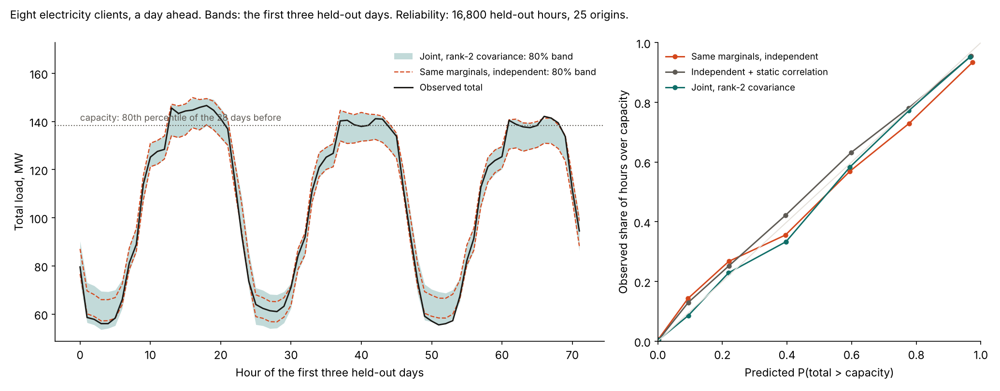

# Benchmarks

[Ashlar](../README.md) beside LightGBM, XGBoost, CatBoost, and other neural packages. The large-table numbers come from [`examples/benchmark_large.py`](../examples/benchmark_large.py), the small-table numbers from [`examples/benchmark_readme.py`](../examples/benchmark_readme.py), and the ablations from [`examples/ablation_gbm_parity.py`](../examples/ablation_gbm_parity.py).

```bash
pip install -e ".[dataframes]" xgboost lightgbm catboost openml pyarrow pytabkit
JAX_PLATFORMS=cpu python examples/benchmark_large.py --tables higgs covertype --models ashlar lightgbm --seeds 0
python examples/benchmark_large.py --report --seeds 0
JAX_PLATFORMS=cpu python examples/benchmark_readme.py --stage all
python examples/benchmark_readme.py --stage report
JAX_PLATFORMS=cpu python examples/benchmark_uncertainty.py --stage all
python examples/benchmark_uncertainty.py --stage report
```

- [How it was run](#how-it-was-run)
- [Large tables](#large-tables)
- [Beside other neural packages](#beside-other-neural-packages)
- [What each change buys](#what-each-change-buys)
- [Point accuracy on small tables](#point-accuracy)
- [Distributions on smaller tables](#distributions-on-smaller-tables)
- [Learned embeddings](#learned-embeddings)
- [Forecast heads](#forecast-heads)
- [Calibrated intervals](#calibrated-intervals)
- [Count heads](#count-heads)
- [Hurdle head](#hurdle-head)
- [Labels that say what was observed](#labels-that-say-what-was-observed)
- [Observed labels on real data](#observed-labels-on-real-data)
- [Joint demand across locations](#joint-demand-across-locations)
- [Member uncertainty](#member-uncertainty)

## How it was run

**Versions.** LightGBM 4.7.0, XGBoost 3.4.1, CatBoost 1.2.10, PyTabKit 1.7.3, JAX 0.12.

**Hardware.** An Apple M3 Pro laptop with 12 cores and 18 GB, CPU only. Several runs shared the machine. Ashlar (JAX) used every core it could get; the trees ran on one thread each; PyTabKit models ran on four threads. Read the seconds as an order of magnitude.

**Large tables.** Eight tables from OpenML, each capped at 2,000,000 rows by a fixed random sample. One random 80/20 split per table (seed 0) so far; more seeds are running. Every model holds out the same share, 20% of the training rows, to stop early. The trees run at learning rate 0.05 with up to 4,000 trees and 100 rounds of patience, with native categorical handling. Ashlar is `ASRRegressor()`, `ASRClassifier()`, or `ASRRegressor(task="mixture")` with no other arguments. The distributional scores are on a fixed sample of 100,000 test rows; point and classification scores use every test row.

**Small tables.** Each table is split 80/20 at random, three times, with seeds 0, 1, and 2. A cell is the mean over the three test sets ± the standard deviation across them. The temperature forecast is split on the clock instead, the last 20% of the series, so its three runs differ only in the seed. XGBoost and LightGBM "default" is the library's constructor defaults; "early-stopped" is a learning rate of 0.05 and up to 4,000 trees, stopped after 100 rounds without improvement on a 20% validation slice of the training rows. A category the training rows never saw is missing to the trees, as it is index 0 to Ashlar.

**Distributional scores** are on the original scale of the target.

- *CRPS*, the continuous ranked probability score, is the expected absolute error of a draw minus half the expected distance between two draws. It scores the whole distribution, in the target's units, and stays finite on targets with a spike. Ashlar's is from 200 (large tables) or 400 (small tables) draws per row; a normal's is exact.
- *Pinball* is the quantile loss averaged over the 0.1, 0.5, and 0.9 levels. For a density head the levels are taken from the same draws.
- *80% coverage* is the share of held-out values between the 0.1 and 0.9 levels, and *80% width* is the average distance between them.
- *NLL* is the negative log density per row. On targets with a spike, such as taxi tips that are exactly zero or California values capped at 5, a head can drive it down by making the spike narrow. Read CRPS there.
- The trees have no density of their own. "Mean + constant normal" is the early-stopped mean with a normal whose scale is the residual standard deviation on the validation slice. "Three quantile models" fits one early-stopped model per level with the quantile loss. CatBoost's `RMSEWithUncertainty` fits a mean and a variance per row and is scored as that normal.

**What is not here.** No hyperparameter search on any side. Flight tables with a date column were dropped: under a random split a model can learn which days had bad weather and meet those same days again in the test set.

## Data

| Table | Source | Rows | Target | Notes |
|---|---|---:|---|---|
| Higgs | [OpenML 45664](https://www.openml.org/d/45664) | 2,000,000 of 5,100,000 | signal or background | 28 numeric columns. |
| Covertype | [OpenML 1596](https://www.openml.org/d/1596) | 581,012 | 7 forest cover types | 10 numeric columns and 44 binary indicators, read as categories. |
| Year prediction (MSD) | [OpenML 44027](https://www.openml.org/d/44027) | 515,345 | release year | 90 timbre features. |
| Zurich public transport | [OpenML 45034](https://www.openml.org/d/45034) | 2,000,000 of 5,465,575 | delay | Weather as observed (temperature, wind, rain, dew point, humidity) and time of day. A model of delay given the weather, not a forecast. |
| Airline delay | [OpenML 42728](https://www.openml.org/d/42728) | 2,000,000 of 10,000,000 | departure delay, minutes | Month, weekday, scheduled times, carrier, origin, destination, distance. Day of month dropped. Schedule only, no weather. |
| Click prediction | [OpenML 1218](https://www.openml.org/d/1218) | 1,997,410 | clicked | KDD Cup 2012 ad ids, read as numbers. |
| Airlines | [OpenML 1169](https://www.openml.org/d/1169) | 539,383 | delayed | Carrier, flight, airports, weekday, time, length. Schedule only. |
| NYC green taxi, Dec 2016 | [OpenML 42729](https://www.openml.org/d/42729) | 581,835 | tip, $ | Pickup and drop-off zones, rate code, total amount, and times. |
| California housing | [ageron/handson-ml2](https://github.com/ageron/handson-ml2) | 20,640 | median house value, $100k | Capped at 5.0. `ocean_proximity` is a string column. |
| Diamonds | [mwaskom/seaborn-data](https://github.com/mwaskom/seaborn-data) | 53,940 | log price; price in $1,000 for the distribution runs | The distribution runs use a fixed 12,000-row sample. |
| Adult income | [jbrownlee/Datasets](https://github.com/jbrownlee/Datasets) | 48,842 | income over $50k | Eight string columns. |
| Ames housing | [wblakecannon/ames](https://github.com/wblakecannon/ames) | 2,930 | log sale price | 79 columns, 43 of them strings. |
| Abalone | [jbrownlee/Datasets](https://github.com/jbrownlee/Datasets) | 4,177 | rings | |
| NYC taxi trips | [mwaskom/seaborn-data](https://github.com/mwaskom/seaborn-data) | 6,433 | tip in $, or log trip minutes | Tips leave out payment and total. Duration leaves out distance and fare. |
| Melbourne daily minimum temperature | [jbrownlee/Datasets](https://github.com/jbrownlee/Datasets) | 3,650 | °C, one day ahead | 28-day window. |

## Large tables

One split each (seed 0). Ashlar's seconds include every core of the laptop; each tree used one thread.

### Zurich public transport, delay, 2,000,000 of 5,465,575 rows

| Model | Splits | RMSE | MAE | CRPS | NLL | 80% coverage | 80% width | Seconds |
|---|---:|---:|---:|---:|---:|---:|---:|---:|
| Ashlar, default | 1 | 3.052 | 2.56 | — | — | — | — | 521 |
| Ashlar, `task="mixture"` | 1 | 3.05 | 2.558 | 1.621 | 2.005 | 79% | 8.03 | 536 |
| LightGBM | 1 | 3.047 | 2.554 | 1.747 | 2.534 | 79% | 7.803 | 35 |
| XGBoost | 1 | 3.047 | 2.553 | 1.747 | 2.534 | 79% | 7.804 | 59 |
| CatBoost | 1 | 3.047 | 2.553 | 1.747 | 2.534 | 79% | 7.804 | 351 |
| CatBoost, `RMSEWithUncertainty` | 1 | 3.047 | 2.554 | 1.742 | 2.531 | 80% | 7.781 | 552 |

### Airline delay, departure delay in minutes, 2,000,000 of 10,000,000 rows

| Model | Splits | RMSE | MAE | CRPS | NLL | 80% coverage | 80% width | Seconds |
|---|---:|---:|---:|---:|---:|---:|---:|---:|
| Ashlar, default | 1 | 29.04 | 13.89 | — | — | — | — | 751 |
| Ashlar, `task="mixture"` | 1 | 29.11 | 13.94 | 9.167 | 2.66 | 80% | 32.8 | 1438 |
| LightGBM | 1 | 29.06 | 13.91 | 12.2 | 4.813 | 94% | 74.87 | 12 |
| XGBoost | 1 | 29.11 | 13.92 | 12.21 | 4.813 | 94% | 74.93 | 25 |
| CatBoost | 1 | 29.05 | 13.9 | 12.17 | 4.812 | 94% | 74.91 | 880 |
| CatBoost, `RMSEWithUncertainty` | 1 | 29.06 | 13.92 | 11.46 | 4.722 | 94% | 66.82 | 626 |

### NYC green taxi, tip in $, 581,835 rows

| Model | Splits | RMSE | MAE | CRPS | NLL | 80% coverage | 80% width | Seconds |
|---|---:|---:|---:|---:|---:|---:|---:|---:|
| Ashlar, default | 1 | 1.977 | 0.872 | — | — | — | — | 190 |
| Ashlar, `tabm_piecewise()` | 1 | 1.979 | 0.8747 | — | — | — | — | 924 |
| Ashlar, `task="mixture"` | 1 | 1.977 | 0.8641 | 0.5935 | -1.973 | 82% | 2.814 | 520 |
| LightGBM | 1 | 1.752 | 0.6307 | 0.6583 | 1.978 | 95% | 4.464 | 52 |
| XGBoost | 1 | 1.869 | 0.6452 | 0.6877 | 2.055 | 95% | 4.726 | 177 |
| CatBoost | 1 | 1.758 | 0.6414 | 0.6633 | 1.995 | 95% | 4.528 | 1546 |
| CatBoost, `RMSEWithUncertainty` | 1 | 1.745 | 0.6455 | 0.4647 | 0.7008 | 83% | 1.952 | 2345 |
| RealMLP (pytabkit) | 1 | 1.934 | 0.892 | — | — | — | — | 4044 |
| TabM (pytabkit) | 1 | 1.798 | 0.7327 | — | — | — | — | 15169 |

### Year prediction (MSD), release year, 515,345 rows

| Model | Splits | RMSE | MAE | CRPS | NLL | 80% coverage | 80% width | Seconds |
|---|---:|---:|---:|---:|---:|---:|---:|---:|
| Ashlar, default | 1 | 8.698 | 5.903 | — | — | — | — | 323 |
| Ashlar, `task="mixture"` | 1 | 8.699 | 5.835 | 4.051 | 3.081 | 77% | 16.81 | 282 |
| LightGBM | 1 | 8.754 | 6.09 | 4.621 | 3.588 | 85% | 22.33 | 309 |
| XGBoost | 1 | 8.71 | 6.085 | 4.609 | 3.583 | 85% | 22.22 | 736 |
| CatBoost | 1 | 8.776 | 6.123 | 4.637 | 3.591 | 85% | 22.4 | 271 |
| CatBoost, `RMSEWithUncertainty` | 1 | 8.883 | 6.197 | 4.407 | 3.416 | 83% | 19.01 | 220 |

### Higgs, signal against background, 2,000,000 of 5,100,000 rows

| Model | Splits | Accuracy | AUC | Log loss | Seconds |
|---|---:|---:|---:|---:|---:|
| Ashlar, default | 1 | 0.7625 | 0.8464 | 0.4823 | 507 |
| LightGBM | 1 | 0.7493 | 0.8324 | 0.5002 | 261 |
| XGBoost | 1 | 0.7516 | 0.8347 | 0.497 | 391 |
| CatBoost | 1 | 0.7503 | 0.8328 | 0.5 | 855 |

### Covertype, 7 forest types, 581,012 rows

| Model | Splits | Accuracy | AUC | Log loss | Seconds |
|---|---:|---:|---:|---:|---:|
| Ashlar, default | 1 | 0.967 | 0.9988 | 0.09441 | 415 |
| LightGBM | 1 | 0.9628 | 0.9983 | 0.1165 | 361 |
| XGBoost | 1 | 0.9477 | 0.9973 | 0.1488 | 930 |
| CatBoost | 1 | 0.9102 | 0.9929 | 0.2474 | 692 |

### Airlines, delayed or not, 539,383 rows

| Model | Splits | Accuracy | AUC | Log loss | Seconds |
|---|---:|---:|---:|---:|---:|
| Ashlar, default | 1 | 0.6601 | 0.71 | 0.6143 | 267 |
| LightGBM | 1 | 0.6655 | 0.7185 | 0.6085 | 13 |
| XGBoost | 1 | 0.6642 | 0.7181 | 0.6089 | 14 |
| CatBoost | 1 | 0.6675 | 0.7215 | 0.6062 | 1011 |

### Click prediction, clicked or not, 1,997,410 rows

| Model | Splits | Accuracy | AUC | Log loss | Seconds |
|---|---:|---:|---:|---:|---:|
| Ashlar, default | 1 | 0.8421 | 0.7382 | 0.3943 | 365 |
| LightGBM | 1 | 0.8444 | 0.7544 | 0.3858 | 132 |
| XGBoost | 1 | 0.8442 | 0.7557 | 0.3852 | 188 |
| CatBoost | 1 | 0.8435 | 0.7502 | 0.3879 | 726 |

## Beside other neural packages

PyTabKit 1.7.3's tuned-default recipes (`RealMLP_TD`, `TabM_D`, `FTT_D`, `MLP_PLR_D`) on one split (seed 0), missing numbers filled with the training median because PyTabKit refuses them, four threads each. Same split as the ablations: adult is not stratified here. The taxi column is the large-table split above; `tabm_piecewise()` ran there before the automatic epoch budget grew, with 10 epochs.

| Model | California RMSE ↓ | Diamonds RMSE ↓ | Adult accuracy ↑ | NYC green taxi tips RMSE ↓ |
|---|---:|---:|---:|---:|
| Ashlar, default | 0.475 (28 s) | 0.0876 (2 min) | 0.864 (27 s) | 1.977 (3 min) |
| Ashlar, `tabm_piecewise()` | **0.440** (4 min) | 0.0842 (8 min) | **0.869** (4 min) | 1.979 (15 min) |
| TabM (PyTabKit) | 0.453 (11 min) | **0.0797** (49 min) | 0.863 (8 min) | **1.798** (4.2 h) |
| RealMLP (PyTabKit) | 0.472 (13 min) | 0.0882 (11 min) | 0.868 (4 min) | 1.934 (67 min) |
| FT-Transformer (PyTabKit) | 0.466 (11 min) | 0.0853 (38 min) | 0.864 (14 min) | — |
| MLP-PLR (PyTabKit) | 0.489 (2 min) | 0.0896 (5 min) | 0.862 (2 min) | — |
| LightGBM, early-stopped | 0.446 (2 s) | 0.0841 (6 s) | 0.875 (1 s) | 1.752 (1 min) |

PyTabKit's TabM is the strongest of the other packages and wins diamonds and the taxi tips; it is also the slowest by far on a CPU. `tabm_piecewise()` wins California and adult. The Ashlar default matches RealMLP and FT-Transformer in a tenth of the time or less.

## What each change buys

Three random splits of California, diamonds (log price), and adult, the same splits as the small-table comparison below except that adult is not stratified here. Each row adds one change to the row above. Mean ± standard deviation across the splits. Seconds are for one fit.

| Step | California RMSE ↓ | Diamonds RMSE ↓ | Adult accuracy ↑ | California seconds |
|---|---:|---:|---:|---:|
| Old default: 2 blocks of 64, batch 64, constant `1e-3`, 50 epochs | 0.562 ± 0.003 | 0.107 ± 0.008 | 0.856 ± 0.003 | 4 |
| Wider: 3 blocks of 256, dropout 0.1, batch 256, up to 100 epochs | 0.521 ± 0.004 | 0.102 ± 0.007 | 0.857 ± 0.004 | 55 |
| + cosine schedule at `2e-3` | 0.511 ± 0.005 | 0.094 ± 0.003 | 0.857 ± 0.004 | 41 |
| Wider + piecewise-linear embeddings, constant `1e-3` | 0.471 ± 0.007 | 0.089 ± 0.002 | 0.860 ± 0.005 | 38 |
| **New default**: wider + piecewise + cosine `2e-3` + auto budget | 0.472 ± 0.003 | 0.089 ± 0.003 | 0.861 ± 0.003 | 39 |
| `tabm_piecewise()`: 32-member TabM on piecewise embeddings of quantile-normalized columns | **0.447 ± 0.006** | **0.085 ± 0.000** | 0.865 ± 0.003 | 263 |

The piecewise-linear embedding of each numeric column is the largest single gain: it takes California from 0.52 to 0.47 and diamonds from 0.102 to 0.089. Width and the cosine schedule buy most of the rest. Once the embeddings are in, the schedule matters little on these tables; it is the default because it converges inside a fixed budget on large tables, where early stopping rarely fires. The TabM ensemble buys another 5% on California at about seven times the cost.

Variations that did not help, three splits each, on top of the new default:

| Variation | California | Diamonds | Adult |
|---|---:|---:|---:|
| Periodic embeddings instead of piecewise (constant rate) | 0.513 ± 0.004 | 0.096 ± 0.006 | 0.860 ± 0.004 |
| ReLU on the piecewise embedding | 0.470 ± 0.006 | 0.092 ± 0.005 | 0.860 ± 0.003 |
| Hidden layer per categorical column, 16-d categories | 0.465 ± 0.007 | 0.090 ± 0.005 | 0.860 ± 0.003 |

Single-split screens (seed 0) of batch size 1,024, width 512, dropout 0 or 0.2, embedding width 32, weight decay `1e-2`, and quantile scaling all landed within 0.006 of the default on California, inside the spread between splits. On one split the spread from initialization alone is about ±0.015 RMSE on California, so a single-split difference smaller than that is noise.

The large tables changed the epoch budget. With 10 epochs at a million rows, covertype reached 0.897; with 40 it reached 0.969. The automatic budget is now about 20 million row passes, at least 20 and at most 100 epochs.


## Point accuracy

Three random splits of five small tables. Ashlar is `ASRRegressor()` or `ASRClassifier()`.

### Abalone, rings

4,177 rows, 3 splits.

| Model | RMSE | Seconds |
|---|---:|---:|
| Ashlar, default | 2.166 ± 0.080 | 6.8 |
| LightGBM, default | 2.236 ± 0.058 | 0.1 |
| LightGBM, early-stopped | 2.231 ± 0.072 | 0.1 |
| XGBoost, default | 2.302 ± 0.047 | 0.1 |
| XGBoost, early-stopped | 2.225 ± 0.060 | 0.1 |

### Adult income, over $50k

48,842 rows, 3 splits.

| Model | Accuracy | Log loss | Seconds |
|---|---:|---:|---:|
| Ashlar, default | 0.864 ± 0.002 | 0.296 ± 0.003 | 62 |
| LightGBM, default | 0.877 ± 0.001 | 0.271 ± 0.002 | 0.6 |
| LightGBM, early-stopped | 0.877 ± 0.002 | 0.271 ± 0.001 | 1.4 |
| XGBoost, default | 0.874 ± 0.001 | 0.277 ± 0.002 | 0.6 |
| XGBoost, early-stopped | 0.876 ± 0.002 | 0.271 ± 0.001 | 1.9 |

### Ames housing, log sale price

2,930 rows, 3 splits.

| Model | RMSE | Seconds |
|---|---:|---:|
| Ashlar, default | 0.117 ± 0.011 | 8.7 |
| LightGBM, default | 0.120 ± 0.002 | 0.3 |
| LightGBM, early-stopped | 0.120 ± 0.003 | 0.6 |
| XGBoost, default | 0.129 ± 0.007 | 0.4 |
| XGBoost, early-stopped | 0.122 ± 0.004 | 3.0 |

### California housing, median value in $100k

20,640 rows, 3 splits.

| Model | RMSE | Seconds |
|---|---:|---:|
| Ashlar, default | 0.472 ± 0.003 | 38 |
| LightGBM, default | 0.475 ± 0.006 | 0.2 |
| LightGBM, early-stopped | 0.457 ± 0.009 | 2.1 |
| XGBoost, default | 0.473 ± 0.008 | 0.3 |
| XGBoost, early-stopped | 0.464 ± 0.010 | 3.8 |

### Diamonds, log price

53,940 rows, 3 splits.

| Model | RMSE | Seconds |
|---|---:|---:|
| Ashlar, default | 0.089 ± 0.002 | 138 |
| LightGBM, default | 0.090 ± 0.001 | 0.5 |
| LightGBM, early-stopped | 0.085 ± 0.002 | 6.1 |
| XGBoost, default | 0.087 ± 0.001 | 0.5 |
| XGBoost, early-stopped | 0.085 ± 0.002 | 4.4 |

## Distributions on smaller tables

The `flow` rows here and under [Forecast heads](#forecast-heads) were rerun on the same splits after the flow head gained its per-row shift and scale; before it, every row shared the spline's tails. The other rows are from the first run.

### Abalone, rings

4,177 rows, 3 splits.

| Model | CRPS | Pinball | 80% coverage | 80% width | NLL | MAE | Seconds |
|---|---:|---:|---:|---:|---:|---:|---:|
| Ashlar, `flow` | 1.087 ± 0.030 | 0.486 ± 0.012 | 77% | 4.489 ± 0.099 | 1.965 ± 0.023 | 1.512 ± 0.044 | 9.1 |
| Ashlar, `gaussian` | 1.105 ± 0.025 | 0.494 ± 0.010 | 84% | 5.098 ± 0.251 | 2.059 ± 0.027 | 1.530 ± 0.038 | 6.7 |
| Ashlar, `histogram` | 1.089 ± 0.033 | 0.487 ± 0.015 | 81% | 4.847 ± 0.104 | 1.942 ± 0.008 | 1.520 ± 0.029 | 6.0 |
| Ashlar, `mixture` | 1.076 ± 0.039 | 0.481 ± 0.018 | 78% | 4.398 ± 0.063 | 1.941 ± 0.033 | 1.498 ± 0.036 | 7.6 |
| Ashlar, squared error | — | — | — | — | — | 1.528 ± 0.035 | 7.0 |
| Ashlar, `quantile` | — | 0.479 ± 0.015 | 79% | 4.584 ± 0.180 | — | 1.498 ± 0.055 | 8.6 |
| LightGBM mean + constant normal | 1.161 ± 0.028 | 0.528 ± 0.012 | 83% | 5.075 ± 0.076 | 2.237 ± 0.038 | 1.546 ± 0.038 | — |
| LightGBM, three quantile models | — | 0.503 ± 0.015 | 72% | 4.070 ± 0.150 | — | 1.535 ± 0.035 | — |
| XGBoost mean + constant normal | 1.157 ± 0.021 | 0.526 ± 0.009 | 83% | 5.081 ± 0.098 | 2.234 ± 0.032 | 1.539 ± 0.024 | — |
| XGBoost, three quantile models | — | 0.512 ± 0.017 | 75% | 4.180 ± 0.075 | — | 1.559 ± 0.040 | — |

### California housing, median value in $100k

20,640 rows, 3 splits.

| Model | CRPS | Pinball | 80% coverage | 80% width | NLL | MAE | Seconds |
|---|---:|---:|---:|---:|---:|---:|---:|
| Ashlar, `flow` | 0.211 ± 0.002 | 0.095 ± 0.001 | 77% | 0.853 ± 0.011 | 0.036 ± 0.015 | 0.290 ± 0.002 | 50 |
| Ashlar, `gaussian` | 0.225 ± 0.003 | 0.101 ± 0.001 | 83% | 1.014 ± 0.012 | 0.403 ± 0.018 | 0.311 ± 0.005 | 38 |
| Ashlar, `histogram` | 0.229 ± 0.003 | 0.103 ± 0.002 | 86% | 1.122 ± 0.035 | 0.479 ± 0.008 | 0.310 ± 0.002 | 32 |
| Ashlar, `mixture` | 0.205 ± 0.001 | 0.092 ± 0.001 | 76% | 0.812 ± 0.035 | 0.076 ± 0.037 | 0.287 ± 0.002 | 51 |
| Ashlar, squared error | — | — | — | — | — | 0.312 ± 0.006 | 40 |
| Ashlar, `quantile` | — | 0.094 ± 0.001 | 75% | 0.812 ± 0.007 | — | 0.288 ± 0.001 | 52 |
| LightGBM mean + constant normal | 0.236 ± 0.003 | 0.108 ± 0.001 | 87% | 1.178 ± 0.020 | 0.638 ± 0.020 | 0.303 ± 0.004 | — |
| LightGBM, three quantile models | — | 0.098 ± 0.001 | 70% | 0.848 ± 0.016 | — | 0.288 ± 0.002 | — |
| XGBoost mean + constant normal | 0.238 ± 0.002 | 0.108 ± 0.001 | 87% | 1.182 ± 0.020 | 0.652 ± 0.022 | 0.305 ± 0.002 | — |
| XGBoost, three quantile models | — | 0.103 ± 0.001 | 71% | 0.874 ± 0.019 | — | 0.301 ± 0.002 | — |

### Diamonds, price in $1,000, 12,000-row sample

12,000 rows, 3 splits.

| Model | CRPS | Pinball | 80% coverage | 80% width | NLL | MAE | Seconds |
|---|---:|---:|---:|---:|---:|---:|---:|
| Ashlar, `flow` | 0.210 ± 0.018 | 0.094 ± 0.008 | 79% | 0.907 ± 0.089 | -0.054 ± 0.123 | 0.289 ± 0.025 | 25 |
| Ashlar, `gaussian` | 0.216 ± 0.013 | 0.097 ± 0.006 | 84% | 1.126 ± 0.185 | -0.015 ± 0.094 | 0.294 ± 0.012 | 24 |
| Ashlar, `histogram` | 0.343 ± 0.003 | 0.154 ± 0.002 | 95% | 2.177 ± 0.007 | 1.007 ± 0.011 | 0.427 ± 0.005 | 17 |
| Ashlar, `mixture` | 0.202 ± 0.007 | 0.091 ± 0.003 | 80% | 0.907 ± 0.050 | -0.111 ± 0.056 | 0.283 ± 0.010 | 27 |
| Ashlar, squared error | — | — | — | — | — | 0.298 ± 0.009 | 23 |
| Ashlar, `quantile` | — | 0.090 ± 0.002 | 80% | 0.901 ± 0.038 | — | 0.274 ± 0.007 | 27 |
| LightGBM mean + constant normal | 0.286 ± 0.012 | 0.130 ± 0.006 | 90% | 1.607 ± 0.026 | 0.914 ± 0.077 | 0.310 ± 0.013 | — |
| LightGBM, three quantile models | — | 0.100 ± 0.005 | 69% | 0.854 ± 0.045 | — | 0.292 ± 0.011 | — |
| XGBoost mean + constant normal | 0.274 ± 0.006 | 0.124 ± 0.003 | 91% | 1.551 ± 0.103 | 0.884 ± 0.033 | 0.295 ± 0.007 | — |
| XGBoost, three quantile models | — | 0.096 ± 0.003 | 74% | 0.836 ± 0.021 | — | 0.284 ± 0.010 | — |

### NYC taxi tips, $, payment type hidden

6,383 rows, 3 splits.

| Model | CRPS | Pinball | 80% coverage | 80% width | NLL | MAE | Seconds |
|---|---:|---:|---:|---:|---:|---:|---:|
| Ashlar, `flow` | 0.872 ± 0.023 | 0.376 ± 0.007 | 75% | 3.439 ± 0.263 | 0.005 ± 0.394 | 1.322 ± 0.023 | 16 |
| Ashlar, `gaussian` | 0.950 ± 0.019 | 0.406 ± 0.007 | 79% | 4.038 ± 0.151 | 1.767 ± 0.018 | 1.443 ± 0.037 | 6.1 |
| Ashlar, `histogram` | 0.917 ± 0.017 | 0.398 ± 0.009 | 81% | 3.762 ± 0.129 | 1.416 ± 0.021 | 1.370 ± 0.033 | 7.2 |
| Ashlar, `mixture` | 0.872 ± 0.017 | 0.372 ± 0.005 | 84% | 3.689 ± 0.116 | 0.092 ± 0.386 | 1.420 ± 0.045 | 15 |
| Ashlar, squared error | — | — | — | — | — | 1.402 ± 0.025 | 8.2 |
| Ashlar, `quantile` | — | 0.384 ± 0.004 | 74% | 3.759 ± 0.154 | — | 1.337 ± 0.031 | 7.2 |
| LightGBM mean + constant normal | 1.001 ± 0.034 | 0.460 ± 0.016 | 86% | 4.690 ± 0.066 | 2.076 ± 0.038 | 1.377 ± 0.044 | — |
| LightGBM, three quantile models | — | 0.371 ± 0.006 | 85% | 3.563 ± 0.067 | — | 1.323 ± 0.022 | — |
| XGBoost mean + constant normal | 1.046 ± 0.019 | 0.479 ± 0.009 | 88% | 4.998 ± 0.156 | 2.132 ± 0.008 | 1.438 ± 0.022 | — |
| XGBoost, three quantile models | — | 0.412 ± 0.010 | 79% | 3.429 ± 0.053 | — | 1.385 ± 0.031 | — |

## Learned embeddings

### NYC taxi trips, log minutes, from zones without distance

6,343 rows, 3 splits.

| Model | RMSE | Seconds |
|---|---:|---:|
| Ashlar, 8-d embeddings, default | 0.681 ± 0.015 | 6.6 |
| Ashlar, 16-d embeddings, longer | 0.694 ± 0.008 | 8.8 |
| Ashlar, 8-d embeddings, longer | 0.682 ± 0.014 | 7.2 |
| Ashlar, one-hot, default | 0.651 ± 0.045 | 7.6 |
| Ashlar, one-hot, longer | 0.580 ± 0.017 | 14 |
| LightGBM, early-stopped | 0.520 ± 0.003 | 0.4 |
| XGBoost, early-stopped | 0.580 ± 0.002 | 1.0 |

## Forecast heads

### Melbourne daily minimum temperature, °C, one day ahead

3,650 rows, 3 splits.

| Model | CRPS | Pinball | 80% coverage | 80% width | NLL | MAE | Seconds |
|---|---:|---:|---:|---:|---:|---:|---:|
| Ashlar, `flow` | 1.247 ± 0.003 | 0.555 ± 0.001 | 83% | 6.098 ± 0.033 | 2.223 ± 0.002 | 1.746 ± 0.002 | 20 |
| Ashlar, `gaussian` | 1.264 ± 0.005 | 0.564 ± 0.002 | 85% | 6.348 ± 0.022 | 2.240 ± 0.005 | 1.756 ± 0.007 | 21 |
| Ashlar, `histogram` | 1.262 ± 0.004 | 0.562 ± 0.002 | 87% | 6.616 ± 0.034 | 2.284 ± 0.003 | 1.745 ± 0.006 | 18 |
| Ashlar, `mixture` | 1.243 ± 0.004 | 0.554 ± 0.001 | 83% | 6.052 ± 0.089 | 2.221 ± 0.002 | 1.726 ± 0.004 | 16 |
| Ashlar, squared error | — | — | — | — | — | 1.746 ± 0.003 | 19 |
| Ashlar, `quantile` | — | 0.564 ± 0.005 | 84% | 6.309 ± 0.058 | — | 1.779 ± 0.020 | 15 |
| LightGBM on the same lags | — | 0.573 ± 0.005 | 77% | 5.492 ± 0.058 | — | 1.771 ± 0.014 | — |

## Calibrated intervals

From [`examples/benchmark_uncertainty.py`](../examples/benchmark_uncertainty.py), stage `calibration`. This script and its three sections ran on a 4-core Linux VM with 15 GB, CPU only, LightGBM 4.7.0 on one thread, not on the laptop above. Each table is split 60% train, 20% calibration, 20% test, three times (seeds 0, 1, 2). Ashlar is `ASRRegressor(task="mixture")` or `ASRRegressor(task="quantile")` with no other arguments, then `calibrate(X_cal, y_cal)`. LightGBM is two early-stopped quantile models at 0.1 and 0.9 on the same training rows, then the same conformal step on the same calibration rows (conformalized quantile regression). Each cell is the test coverage of a nominal 80% interval, mean over three splits, before → after. The mixture's quantiles are read exactly from its CDF and calibrated from each calibration row's CDF value; until the unified distributions they came from 1,000 draws, and rerunning with exact quantiles moved the mixture column by at most 0.9 points.

| Table | Rows | Ashlar `mixture` | Ashlar `quantile` | LightGBM quantiles |
|---|---:|---:|---:|---:|
| California housing | 20,640 | 75.7% → 80.6% | 77.3% → 80.4% | 68.9% → 79.4% |
| Diamonds, price in $1,000 | 53,940 | 79.2% → 79.4% | 80.4% → 79.5% | 73.8% → 79.1% |
| Bike rentals per hour | 17,379 | 76.6% → 79.5% | 77.5% → 79.0% | 65.3% → 79.3% |
| Abalone, rings | 4,177 | 80.1% → 80.1% | 78.5% → 78.8% | 76.0% → 79.8% |
| NYC taxi tips, $ | 6,383 | 89.5% → 79.7% | 80.8% → 80.1% | 84.4% → 84.4% |

Calibration moves every Ashlar interval to within a point of 80% and leaves an interval that was already right alone (diamonds, abalone). It also narrows one that was too wide: the taxi mixture covered 90% and calibration took it to 80%, from $3.97 to $3.71 wide on average. The 90% mixture interval behaves the same way, 87.0% → 89.6% on bike rentals and 87.3% → 90.4% on California.

Conformal calibration is not Ashlar's alone: the same step brings LightGBM's quantile models to 79–80% on four tables. The difference is width. After calibration the Ashlar mixture's 80% interval is narrower than LightGBM's on California (0.94 against 1.00, in $100k), diamonds (0.81 against 0.83), and bike rentals (73 against 87 rentals), and slightly wider on abalone (4.67 against 4.59 rings). On taxi tips CQR cannot move LightGBM: a third of tips are exactly $0, both quantile models put their 0.1 level there, so the conformal margin lands on a tie at zero and the trees keep their 84%.

A smaller table gives a noisier calibration: with 835 calibration rows on abalone the calibrated mixture covers between 77.6% and 82.2% on single splits.

### Coverage within groups

One calibration holds 80% over all rows, not necessarily within each kind of row. From the same script, stage `groups`, on the same tables and splits, with one column of each table as the groups: California by distance to the ocean, diamonds by cut, abalone by sex, taxi tips by the taxi's color (yellow or green), and bike rentals by hour of day. The column is also a feature of each table. The model is `ASRRegressor(task="mixture", random_state=seed)`, scored within each group with at least 50 test rows before calibration, after one calibration of every calibration row, and after `calibrate(X_cal, y_cal, groups=column)`, which gives each group with at least 100 calibration rows a table of its own. Calibration and test rows are each 20% of the table, so a group has about as many of one as of the other. A group's coverage is its mean over the three splits; the last column is the group furthest from 80% on each split, averaged over the splits. Unlike the rest of this script, this stage ran on the M3 Pro laptop of [How it was run](#how-it-was-run), beside other jobs.

| Table, groups | Groups (test rows each) | Raw | One calibration | Per group | Furthest group on a split, points from 80%: one calibration → per group |
|---|---|---:|---:|---:|---:|
| California, distance to the ocean | 4 (454 to 1,824) | 75.4% to 76.4% | 79.7% to 80.6% | 79.8% to 82.1% | 2.4 → 2.3 |
| Diamonds, cut | 5 (321 to 4,328) | 76.6% to 79.8% | 77.3% to 80.3% | 77.8% to 82.3% | 3.3 → 3.0 |
| Abalone, sex | 3 (267 to 294) | 77.6% to 80.9% | 78.3% to 81.6% | 79.3% to 81.8% | 4.2 → 3.3 |
| Taxi tips, taxi color | 2 (189 and 1,087) | 89.4% to 93.8% | 79.7% to 82.0% | 79.9% to 80.0% | 5.7 → 3.5 |
| Bike rentals, hour of day | 24 (131 to 153) | 69.0% to 83.8% | 72.0% to 86.6% | 72.0% to 82.4% | 8.8 → 13.1 |

- **On four of the five tables one calibration already holds within every group.** After it, every group of California, diamonds, abalone, and taxi tips holds 77.3% to 82.0% of its rows, and a table per group leaves the furthest group about where it was. The clearest gain is the 189 green taxis, 82.0% → 79.9%.
- **Hour of day on bike rentals is the exception.** One calibration leaves the night hours too wide (85.1% at 3:00 and 86.6% at 4:00) and some busy hours too narrow (72.8% at 14:00, 73.9% at 7:00), with 5 of the 24 hours outside 75% to 85%. A table per hour brings those four to 80.3%, 81.0%, 75.1%, and 78.7%, and leaves 1 hour outside: 23:00, at 72.0% both ways, which moves by 7 points from split to split.
- **A table per group is noisier, since it has fewer rows.** Each hour has about 145 calibration rows, so its own conformal level misses by about 3 points either way, and on a single split the furthest hour is 13.1 points from 80% after calibrating per hour, against 8.8 after one calibration. Averaged over the three splits, the hours are 3.6 points from 80% (root mean square) after one calibration, more than the 1.9 that 145 test rows per hour explain, and 2.7 after one per hour, which their calibration and test rows explain by chance alone. A group needs several hundred calibration rows before its table is reliably closer than one table of every row on a single split, unless one calibration is far off for it; `min_group_rows` (100 by default) is the floor below which a group reads the table of every row.
- Calibrating per group widens an interval only where a group needed it: the bike rentals' 80% interval goes from 72.4 to 74.8 rentals on average, and the other four tables' widths change by under 1%. Over all rows the per-group tables hold 79.0% to 80.6%, as one calibration does (78.6% to 80.3%).

## Count heads

From the same script, stage `counts`. Four count targets, each split 80/20 three times. Every Ashlar model is `ASRRegressor(task=...)` with no other arguments; `gaussian` and `mixture` see the count as a number. LightGBM is early-stopped with the Poisson objective, and scored as a Poisson with that mean. CRPS and coverage are from 400 draws per row; NLL is the negative log mass of the count that happened, so it is only defined for the models that give a mass.

| Target | Rows | Mean | Variance | Zeros |
|---|---:|---:|---:|---:|
| Bike rentals per hour, all riders ([Capital Bikeshare via UCI](https://github.com/udacity/deep-learning-v2-pytorch/tree/master/project-bikesharing/Bike-Sharing-Dataset)) | 17,379 | 189 | 32,900 | 0% |
| Bike rentals per hour, casual riders only | 17,379 | 36 | 2,431 | 9% |
| NYC taxi pickups per half hour, from the previous day and the same slot a week earlier ([NAB](https://github.com/numenta/NAB)) | 9,984 | 15,198 | 4.8 × 10⁷ | 0% |
| Abalone rings | 4,177 | 9.9 | 10.4 | 0% |

| Target | Model | CRPS | NLL | 80% coverage | 80% width |
|---|---|---:|---:|---:|---:|
| Bike rentals, all | Ashlar `negative_binomial` | 16.55 ± 0.51 | **4.50** | 80% | 71 |
| | Ashlar zero-inflated `negative_binomial` | 16.71 ± 0.30 | **4.50** | 81% | 72 |
| | Ashlar `poisson` | 18.44 ± 0.52 | 6.60 | 53% | 31 |
| | Ashlar `mixture` | **16.34 ± 0.44** | — | 76% | 64 |
| | Ashlar `gaussian` | 17.56 ± 0.40 | — | 79% | 76 |
| | LightGBM, Poisson objective | 18.43 ± 0.23 | 6.52 | 54% | 31 |
| Bike rentals, casual | Ashlar zero-inflated `negative_binomial` | **5.98 ± 0.09** | **3.28** | 82% | 25 |
| | Ashlar `negative_binomial` | 6.05 ± 0.14 | **3.28** | 82% | 26 |
| | Ashlar `poisson` | 6.38 ± 0.03 | 4.10 | 61% | 12 |
| | Ashlar `mixture` | 6.08 ± 0.09 | — | 78% | 25 |
| | Ashlar `gaussian` | 6.25 ± 0.10 | — | 82% | 28 |
| | LightGBM, Poisson objective | 6.26 ± 0.07 | 4.07 | 62% | 12 |
| Taxi pickups | Ashlar `negative_binomial` | 314.7 ± 5.5 | **7.83** | 76% | 1,231 |
| | Ashlar zero-inflated `negative_binomial` | 322.2 ± 13.3 | **7.79** | 79% | 1,372 |
| | Ashlar `poisson` | 378.1 ± 9.3 | 19.43 | 25% | 304 |
| | Ashlar `mixture` | **310.8 ± 2.1** | — | 75% | 1,176 |
| | Ashlar `gaussian` | 321.4 ± 7.0 | — | 79% | 1,341 |
| | LightGBM, Poisson objective | 397.8 ± 5.9 | 21.12 | 24% | 304 |
| Abalone rings | Ashlar `negative_binomial` | 1.189 ± 0.027 | **2.247** | 97% | 7.9 |
| | Ashlar `poisson` | 1.194 ± 0.026 | 2.249 | 96% | 7.9 |
| | Ashlar `mixture` | **1.075 ± 0.036** | — | 78% | 4.6 |
| | Ashlar `gaussian` | 1.098 ± 0.030 | — | 84% | 5.1 |
| | LightGBM, Poisson objective | 1.208 ± 0.022 | 2.258 | 95% | 7.9 |

Bold is the best in its column per target; NLL ties within 0.01.

- **Against a Poisson, the negative binomial wins every overdispersed target by a wide margin.** It has the best log mass on all four, 4.50 against LightGBM's 6.52 on bike rentals and 7.8 against 21.1 on taxi pickups. A Poisson's variance equals its mean, so its 80% interval holds only 24% to 62% of these counts; the negative binomial's holds 76% to 82%. The same holds against Ashlar's own `poisson` head, so the gain is the family, not the network.
- **Against the continuous heads it is close.** The `mixture` has the best CRPS on bike totals (16.34 against 16.55) and taxi pickups (310.8 against 314.7), within about one standard deviation across splits; the zero-inflated negative binomial has the best on casual riders (5.98 against 6.08). What the count heads add is a real probability for each count: whole-number draws and quantiles, a log mass you can compare across models, and the 9% of zero hours in the casual counts, which the negative binomial reproduces (9.2% of its draws are 0) and the mixture does not (0.0%).
- **On abalone the count heads lose.** Rings vary less than their mean once the shell measurements are known, and neither a Poisson nor a negative binomial can be narrower than a Poisson. Their 80% intervals hold 96% of rings and are 70% wider than the mixture's. Use `gaussian` or `mixture` for an underdispersed count.
- **Zero inflation helps only where there are zeros.** It ties the plain negative binomial on log mass everywhere and helps CRPS only on the casual counts.

## Hurdle head

From [`examples/benchmark_hurdle.py`](../examples/benchmark_hurdle.py). NYC taxi tips from the seaborn `taxis` table, 6,383 trips, 35.8% with no tip, payment type and total dropped. Five random 80/20 splits, seeds 0 to 4, mean ± standard error. Every model is `ASRRegressor(task=...)` with no other arguments. CRPS is from 2,000 draws of `predict_dist`; `P(no tip)` is `cdf(0)`, which for a smooth head is the mass it puts at or below zero; the interval is the uncalibrated 80% one.

| Head | CRPS, $ ↓ | Brier of P(no tip) ↓ | 80% interval holds | Width, $ |
|---|---:|---:|---:|---:|
| `gaussian` | 0.936 ± 0.013 | 0.261 ± 0.005 | 79.4% | 4.03 |
| `mixture` | **0.863 ± 0.022** | 0.239 ± 0.005 | 84.8% | 3.59 |
| `hurdle`, lognormal | 0.892 ± 0.017 | 0.207 ± 0.002 | 94.5% | 4.13 |
| `hurdle`, gamma | 0.867 ± 0.015 | **0.204 ± 0.003** | 93.2% | 4.00 |

The hurdle answers "will this trip be tipped at all" best, with a Brier score 15% below the mixture's, because it is the only head that puts a real atom at zero. On the whole distribution it ties the mixture: the gamma hurdle's CRPS is within a standard error of it. Its 80% intervals hold 93% to 95% of tips, because every interval that starts at zero contains all the zeros; read the hurdle's intervals as at least their coverage, and ask for `dist.cdf(0)` when the zero is the question.

## Labels that say what was observed

From [`examples/benchmark_observed.py`](../examples/benchmark_observed.py). Three simulations, so the true values are known and every fit is scored against them. Five seeds, 0 to 4, mean ± standard deviation across seeds. Every Ashlar model is `ASRRegressor(task=...)` with no other arguments. [docs/observed.md](observed.md) describes the labels.

### Demand when shelves sell out

The sales of 50 stores, with 20,000 store-days per seed: 14,000 to train, 2,000 to calibrate on, and 4,000 to test. Demand is negative binomial with dispersion 5. Its mean, mostly between 3 and 50 units, moves with the store, the weekday, a promotion, a discount, and the temperature. Each day's stock is the true mean times a lognormal forecast error (sd 0.25) times a safety factor between 1.0 and 1.5, so given the features it is independent of the demand. Between 32% and 33% of days sell out, losing 13% to 14% of demand. Each head is fitted four ways: on the true demand (an oracle no shop has), on sales as if they were demand, on only the days that did not sell out, and on `observed.censored(sales, sold_out)`. LightGBM's quantile regression on sales (400 trees, learning rate 0.05) is the tree baseline.

- **NLL** is of the true demand. For the mixture it is the log probability of each count's rounding bin, `[d - 0.5, d + 0.5]`, so it is comparable with the count head's log mass.
- **CRPS** is from 1,000 draws.
- **Below the 90% quantile** is the share of test days whose true demand is at or below the predicted 90% quantile.
- **Order cost** is the newsvendor cost of stocking each day's 75% quantile when a lost sale costs 3 and a leftover unit 1, in percent above stocking the true 75% quantile.
- **Calibrated 80%** is after `calibrate` on the calibration days: on their true demand for the oracle, their censored labels for the censored fit, and their sales for the others.

| Head | Trained on | NLL ↓ | CRPS ↓ | Below the 90% quantile | Order cost above best ↓ | Calibrated 80% holds | Seconds |
|---|---|---:|---:|---:|---:|---:|---:|
| `negative_binomial` | true demand (oracle) | 3.251 ± 0.067 | 4.116 ± 0.265 | 90.8% ± 1.4% | 1.3 ± 0.5% | 83.0% ± 0.7% | 28 |
| `negative_binomial` | sales as demand | 3.387 ± 0.085 | 4.296 ± 0.326 | 79.5% ± 1.6% | 7.9 ± 2.2% | 70.5% ± 1.2% | 22 |
| `negative_binomial` | days not sold out | 3.541 ± 0.057 | 4.648 ± 0.305 | 72.0% ± 1.3% | 20.1 ± 2.4% | 70.0% ± 0.7% | 20 |
| `negative_binomial` | censored | **3.251 ± 0.067** | **4.112 ± 0.271** | 90.9% ± 0.6% | **1.1 ± 0.4%** | 83.7% ± 0.5% | 49 |
| `mixture` | true demand (oracle) | 3.260 ± 0.068 | 4.124 ± 0.272 | 89.0% ± 1.6% | 1.5 ± 0.8% | 79.7% ± 0.6% | 19 |
| `mixture` | sales as demand | 3.489 ± 0.073 | 4.286 ± 0.304 | 75.8% ± 0.7% | 6.7 ± 0.9% | 65.8% ± 0.9% | 17 |
| `mixture` | days not sold out | 3.637 ± 0.056 | 4.614 ± 0.299 | 69.2% ± 1.0% | 18.2 ± 0.9% | 65.6% ± 0.8% | 13 |
| `mixture` | censored | 3.266 ± 0.065 | 4.132 ± 0.266 | 92.4% ± 0.9% | 1.9 ± 0.3% | 82.8% ± 1.1% | 18 |
| LightGBM quantile | sales as demand | | | 73.0% ± 0.6% | 9.4 ± 0.5% | | |

- **The censored fit matches the oracle.** With either head it scores within 0.006 nats of the fit trained on the true demand, and its orders cost as little, from sales alone. The spread across seeds is mostly the seeds' own data: within a seed, the censored and oracle negative binomials differ by at most 0.006 nats, in either direction.
- **Fitting sales as demand learns demand that is too low.** Its 90% quantile is above the true demand on 76% to 80% of days, and stocking its 75% quantile costs 7% to 8% more than it should. LightGBM's quantile regression on sales is worse on both, because a tree has no way to know which days were capped.
- **Dropping the sold-out days is the worst of all**, because what remains are the slow days: 69% to 72% below the 90% quantile, and orders that cost 18% to 20% too much.
- **Calibration cannot repair a fit on capped data**, because the calibration days are capped too: calibrated on sales, the fits on sales hold 66% to 71% of true demand in an interval that promises 80%. Calibrated on censored labels, the censored fits hold 83% to 84%. A count's interval holds a little more than it promises, because it includes both end counts.
- **The censored negative binomial trains in about 1.7 times the oracle's time**, since its survival function is an incomplete beta whose gradient in the dispersion is taken by finite differences. The mixture's censored fit costs nothing extra.

### Daily values from weekly totals

1,500 weeks of seven days, with only each week's sum recorded. A daily value has mean `10 + 3 x1 + 2 sin(3 x2)` and standard deviation 0.5, or 1.5 on the volatile days with `x2 > 0`. A daily count is Poisson with mean `exp(0.5 + 0.8 x1)`. The features change from day to day. Each head is fitted on the days themselves (the oracle), on `observed.total(weekly, week)`, and on each week's total spread evenly over its days (rounded for the count). Scored on 3,000 new days: the NLL of the true daily value, the root-mean-square error of the predicted mean against the true mean, the mean predicted standard deviation on calm and on volatile days, and the share of true values inside the uncalibrated 80% interval.

| Head | Trained on | NLL ↓ | Mean error ↓ | SD, calm days (true 0.5) | SD, volatile days (true 1.5) | 80% interval holds | Seconds |
|---|---|---:|---:|---:|---:|---:|---:|
| `gaussian` | the days (oracle) | 1.304 ± 0.014 | 0.102 ± 0.010 | 0.510 ± 0.010 | 1.491 ± 0.021 | 79.6% ± 0.6% | 23 |
| `gaussian` | weekly totals | 1.429 ± 0.050 | 0.250 ± 0.055 | 0.809 ± 0.125 | 1.408 ± 0.082 | 83.4% ± 1.9% | 20 |
| `gaussian` | total spread evenly | 4.295 ± 0.123 | 2.843 ± 0.056 | 1.218 ± 0.031 | 1.225 ± 0.019 | 38.9% ± 0.8% | 11 |
| `poisson` | the days (oracle) | 1.591 ± 0.014 | 0.136 ± 0.014 | | | 91.8% ± 0.5% | 15 |
| `poisson` | weekly totals | 1.596 ± 0.016 | 0.224 ± 0.049 | | | 91.7% ± 0.6% | 23 |
| `poisson` | total spread evenly | 2.010 ± 0.019 | 1.500 ± 0.020 | | | 88.1% ± 0.6% | 14 |

- **From totals alone, the Poisson head comes within 0.005 nats of the oracle.** It learns each day's rate from sums it never sees broken down.
- **The gaussian learns each day's mean, and the spread only partly.** Its mean error is 0.25 against the oracle's 0.10, and it places the volatile days' spread nearly right (1.41), but it puts 0.81 on calm days whose spread is 0.5. A sum's variance blends seven days' variances, so from 1,500 sums the split between them is harder to learn than the means. Its 80% intervals hold 83%.
- **Spreading a total evenly teaches every day its week's average**, which is wrong for each of them: an NLL of 4.3, means off by 2.8, and an interval that holds 39%.

### Several products that sell out together

Four products at 20 stores, with 12,000 store-days per seed: 8,000 to train and 4,000 to test. On the log scale, each product's demand is the store's level plus the product's own, a weekday cycle, a promotion on a quarter of days, and the temperature, to which each product reacts differently, plus a normal shock common to all four (sd 0.25) and one of each product's own (sd 0.2). On a rush day, 10% of ordinary days and 35% of promotion days, all four products' demand is 80% higher. The stock is each product's usual demand, without the rush or the shocks, times a safety factor between 1.2 and 1.6 and a little noise. The features are the store, the weekday, the promotion, and the temperature, so no model sees a rush coming. 26% of product-days sell out, and every shelf empties on 10% to 12% of test days, about half of the rush days.

Each joint head is fitted three ways: on the true log demand (the oracle), on log sales as if they were demand, and on `observed.censored(log_sales, sold_out)`, a label with a cell per product. The baseline handles the censoring without a joint model: a censored `mixture` head per product, the products then independent.

- **Joint NLL** is of the true log demand of all four products, per day. For the per-product fits it is the sum of their four log densities.
- **Total below its 90% quantile** is the share of test days whose total demand over the four products is at or below the 90% quantile of the predicted total, from 1,000 joint draws.
- **Every shelf empty** is the predicted probability, from the same draws, that every product's demand reaches that day's stock: its Brier score, and the mean prediction, against the 11.1% of days on which it happened.

| Head | Trained on | Joint NLL ↓ | Total below its 90% quantile | Every shelf empty: Brier ↓ | Predicted share of days | Seconds |
|---|---|---:|---:|---:|---:|---:|
| `multivariate_gaussian` | true demand (oracle) | 0.498 ± 0.022 | 89.3% ± 1.6% | 0.096 ± 0.003 | 10.6% ± 1.7% | 6 |
| `multivariate_gaussian` | sales as demand | 0.809 ± 0.036 | 76.4% ± 1.2% | 0.105 ± 0.005 | 2.6% ± 0.2% | 6 |
| `multivariate_gaussian` | censored | **0.511 ± 0.033** | 87.9% ± 1.2% | 0.096 ± 0.004 | 9.1% ± 1.1% | 12 |
| `multivariate_mixture` | true demand (oracle) | 0.496 ± 0.020 | 89.5% ± 1.0% | 0.096 ± 0.003 | 10.6% ± 0.8% | 6 |
| `multivariate_mixture` | sales as demand | 2.261 ± 0.303 | 74.0% ± 1.0% | 0.109 ± 0.005 | 0.8% ± 0.2% | 7 |
| `multivariate_mixture` | censored | 0.523 ± 0.021 | **90.8% ± 1.2%** | 0.096 ± 0.003 | **11.4% ± 1.3%** | 36 |
| `multivariate_flow` | true demand (oracle) | 0.527 ± 0.019 | 89.7% ± 1.1% | 0.096 ± 0.004 | 10.5% ± 0.7% | 11 |
| `multivariate_flow` | sales as demand | 2.775 ± 0.379 | 74.3% ± 1.1% | 0.108 ± 0.005 | 1.2% ± 0.1% | 13 |
| `multivariate_flow` | censored | 0.613 ± 0.040 | 92.2% ± 1.6% | 0.096 ± 0.003 | 12.1% ± 1.8% | 48 |
| `mixture`, one per product | censored | 1.874 ± 0.043 | 86.3% ± 2.0% | 0.109 ± 0.005 | 0.7% ± 0.1% | 21 |

- **The censored joint fits nearly match the oracle.** The joint normal is 0.013 nats behind its own oracle and the mixture 0.027. Both score the chance that every shelf empties as well as the oracle does, a Brier score of 0.096, and expect it on 9.1% and 11.4% of days, against the 11.1% on which it happened.
- **Fitting sales as demand misses the busy days.** The total's 90% quantile covers 74% to 76% of days, and the chance that every shelf empties falls to 1% to 3% of days, because a fit to capped sales never sees demand above the stock.
- **Censoring product by product gets each product right but not the four together.** The per-product mixtures are 1.36 nats behind the censored joint normal, their quantile of the total covers 86% of days, and they expect every shelf to empty on 0.7% of days: four independent products seldom run out at once, and these four rush together.
- **The joint normal is enough here.** The mixture's likelihood is no better, since on the log scale an 80% lift one day in six is a small departure from a normal, though its quantile of the total and its chance that every shelf empties are the closest to the truth. The flow learns the least from censored cells, 0.09 nats behind its own oracle, with a quantile of the total that covers 92%.
- **A censored joint fit takes two to six times as long as one on exact values**, 12 to 48 seconds against 6 to 11, because each training row integrates over its sold-out products at 32 points.

## Observed labels on real data

From [`examples/benchmark_observed_real.py`](../examples/benchmark_observed_real.py): the questions of [the section above](#labels-that-say-what-was-observed), asked of real tables. The clinical tables and the drives carry their own censoring. For the sold-out shelves and the meter readings, the censoring or the grouping is applied to values that were recorded exactly, so every fit can still be scored against them. Each stage ran alone on the M3 Pro laptop of [How it was run](#how-it-was-run), beside a macOS background process that used up to one core, because two jobs at once make XGBoost's threads spin and multiply its CPU seconds. CPU seconds count every thread of the process. XGBoost 3.4.1, LightGBM 4.7.0, scikit-survival 0.28.0, pycox 0.3.0 on torch 2.15.0, and JAX 0.12. Every Ashlar model is `ASRRegressor(task=...)` with no other arguments but a seed, and for the meter readings the weekday and the day of the year marked as cyclical.

In short: censored sales and irregular meter readings teach the model nearly what the true values would have, as in the simulations, while weekly totals cannot place the load within the week. On survival, the `mixture` head, untuned, has a better likelihood than tuned XGBoost AFT on two clinical tables of three and ties on the third, but on drive failures with delayed entry the usual workaround of fitting the days watched, with the age as a feature, beats Ashlar's truncated likelihood.

### Survival on three clinical tables

SUPPORT (8,873 seriously ill hospital patients, 14 features, 68% died during follow-up), METABRIC (1,904 breast cancer patients, 9 features, 58%), and GBSG (2,232 breast cancer patients, 7 features, 57%), as pycox ships them from the DeepSurv repository. Five random splits of each, 80% to train and 20% to test, stratified by the event. Ashlar fits `observed.survival(np.log(time), event)` with the `gaussian` head, a log-normal survival model whose location and spread are both learned per row; with the `mixture` head; and with the `gaussian` fitted on 85% of the training rows and calibrated on the other 15%, its survival curve read from `predict_exceedance`. The baselines are XGBoost's accelerated failure time model, with its error family (normal, logistic, or extreme value), depth (3 or 6), and spread (0.5 to 4) chosen by likelihood on the same 15%, each of its 42 fits early stopped there; scikit-survival's Cox model with Breslow's baseline; and Kaplan-Meier, which ignores the features.

- **Concordance** is Harrell's C of the predicted median time, or of the Cox model's risk score.
- **Integrated Brier** is the Brier score of the survival curve, weighted by the inverse probability of censoring estimated from the test rows (as pycox does), averaged over 40 times between the 10th and 90th percentiles of the test times.
- **D-calibration** (Haider et al., 2020): a calibrated model's `S(T)` is uniform over the test rows, a censored row spreading its weight over `[0, S(c)]`. The χ² statistic over ten equal bins, and the number of splits whose p-value is above 0.05.
- **NLL** is of the log time: an event's log density, a censored row's log probability of lasting longer. Only the models with a density have one.

| Table | Model | Concordance ↑ | Integrated Brier ↓ | D-calibration χ² ↓ | Splits passing D-calibration | NLL of the log time ↓ | CPU seconds |
|---|---|---:|---:|---:|---:|---:|---:|
| SUPPORT | Ashlar `gaussian` | 0.624 ± 0.008 | 0.2011 ± 0.0025 | 65.9 ± 21.0 | 0 of 5 | 1.825 ± 0.013 | 13.7 |
| | Ashlar `mixture` | 0.624 ± 0.009 | **0.1997 ± 0.0032** | 11.9 ± 5.8 | 4 of 5 | **1.732 ± 0.017** | 14.2 |
| | Ashlar `gaussian`, calibrated | 0.619 ± 0.006 | 0.2011 ± 0.0024 | 13.9 ± 8.6 | 2 of 5 | | 12.0 |
| | XGBoost AFT | 0.623 ± 0.010 | 0.2049 ± 0.0033 | 46.9 ± 12.0 | 0 of 5 | 1.874 ± 0.010 | 29.1 |
| | Cox | 0.577 ± 0.012 | 0.2165 ± 0.0021 | 4.9 ± 3.8 | 5 of 5 | | 0.2 |
| | Kaplan-Meier | 0.500 | 0.2271 ± 0.0008 | 6.9 ± 5.4 | 5 of 5 | | 0.0 |
| METABRIC | Ashlar `gaussian` | 0.648 ± 0.017 | 0.1934 ± 0.0084 | 8.9 ± 4.1 | 5 of 5 | 1.107 ± 0.058 | 4.7 |
| | Ashlar `mixture` | 0.648 ± 0.013 | **0.1891 ± 0.0062** | 7.3 ± 1.9 | 5 of 5 | **1.061 ± 0.032** | 6.5 |
| | Ashlar `gaussian`, calibrated | 0.645 ± 0.020 | 0.1912 ± 0.0059 | 16.3 ± 7.5 | 2 of 5 | | 5.3 |
| | XGBoost AFT | 0.645 ± 0.013 | 0.1992 ± 0.0072 | 8.5 ± 6.0 | 5 of 5 | 1.142 ± 0.047 | 20.8 |
| | Cox | 0.639 ± 0.017 | 0.1938 ± 0.0060 | 6.1 ± 2.6 | 5 of 5 | | 0.0 |
| | Kaplan-Meier | 0.500 | 0.2177 ± 0.0030 | 6.3 ± 4.9 | 5 of 5 | | 0.0 |
| GBSG | Ashlar `gaussian` | 0.678 ± 0.018 | 0.1975 ± 0.0085 | 12.7 ± 4.6 | 4 of 5 | 1.174 ± 0.046 | 5.3 |
| | Ashlar `mixture` | 0.680 ± 0.025 | 0.1968 ± 0.0064 | 12.2 ± 10.1 | 4 of 5 | 1.168 ± 0.037 | 6.6 |
| | Ashlar `gaussian`, calibrated | 0.687 ± 0.021 | **0.1930 ± 0.0089** | 13.4 ± 7.6 | 3 of 5 | | 5.0 |
| | XGBoost AFT | 0.680 ± 0.016 | 0.1956 ± 0.0070 | 8.0 ± 4.5 | 5 of 5 | **1.158 ± 0.040** | 21.8 |
| | Cox | 0.662 ± 0.017 | 0.2017 ± 0.0045 | 6.2 ± 3.0 | 5 of 5 | | 0.1 |
| | Kaplan-Meier | 0.500 | 0.2228 ± 0.0018 | 5.1 ± 2.3 | 5 of 5 | | 0.0 |

XGBoost's CPU seconds are for its grid of 42 fits. One fit at the setting the grid chose took 0.4 to 0.6 seconds. The grid chose different settings from split to split on SUPPORT (logistic errors with spread 1.5, or normal with 3) and on METABRIC (three settings in five splits), and normal errors with spread 1 on every GBSG split.

- **The mixture has the better likelihood on two tables of three.** On SUPPORT its NLL is 0.14 nats below XGBoost AFT's (1.732 against 1.874), and on METABRIC 0.08 below (1.061 against 1.142); on GBSG AFT is 0.01 ahead, well inside the spread across splits. Its integrated Brier score is lower than AFT's on the same two tables, and about the same on GBSG.
- **Ranking is a tie.** Ashlar's mixture and AFT are within 0.003 of each other in concordance on every table, against a spread of 0.01 to 0.02 across splits. Both rank better than the Cox model, by 0.05 on SUPPORT and by 0.01 to 0.02 on the others.
- **A single log-normal does not fit SUPPORT.** The `gaussian` head passes D-calibration on no split there, and neither does AFT, whose one error family with one spread for every row is less flexible still. The mixture passes on 4 of 5. On METABRIC and GBSG every uncalibrated model passes on at least 4 splits of 5. Cox and Kaplan-Meier, whose baseline curves assume no shape, pass everywhere.
- **Calibrating on 15% of the training rows helps D-calibration only where the head was wrong.** On SUPPORT it brings the `gaussian` from a D-calibration χ² of 65.9 to 13.9; on METABRIC and GBSG, with 230 to 270 calibration rows, it fails more splits than the uncalibrated head (2 and 3 passing of 5, against 5 and 4).
- **Ashlar's one fit costs less than tuning AFT, and more than AFT once tuned.** Its 5 to 14 CPU seconds per fit are a quarter to a half of AFT's grid, and 10 to 25 times one AFT fit at the chosen setting. Without its grid AFT has no setting: its likelihood depends on the error family and the spread, which it does not learn.

### Drive failures with delayed entry

Backblaze's daily records of every hard drive in its data centers in the first quarter of 2024, one row per drive: 282,903 drives, 975 of which failed in the quarter, with a median age of 2.8 years on entry. The features are the drive's model (35 groups, with models of under 200 drives pooled as "other"), its size, and five SMART error counts on its first day in the quarter: reallocated, reported uncorrectable, and pending sectors, command timeouts, and offline uncorrectable sectors. The age comes from the power-on hours. A drive is in the table only because it was still running when the quarter began, or was installed during it, so its age at failure is truncated at its age on entry. Ashlar fits the log of the age with `observed.survival(np.log(exit_age), failed, entry=np.log(entry_age))`, with the `gaussian` and `mixture` heads, and reads each test drive's survival over the days watched as `S(entry + t) / S(entry)`. XGBoost's AFT model, tuned on the same grid as above, and pycox's logistic hazard (Gensheimer and Narasimhan, 2019), a neural network over 30 intervals of time, cannot read a truncated age. They fit the days each drive was watched, with its age on entry as a feature, the usual way around it, and Kaplan-Meier on those days is the baseline. Three random splits of the drives, 80% to train and 20% to test, with 15% of the training drives held out for XGBoost's and pycox's early stopping. Every model is scored on what happened to the test drives in the quarter: the concordance of the risk of failing within 80 days, the integrated Brier score from 10 to 80 days, D-calibration, and the NLL of the days watched, an event's density per day.

| Model | Concordance ↑ | Integrated Brier × 1000 ↓ | D-calibration χ² ↓ | Splits passing D-calibration | NLL of the days watched ↓ | CPU seconds |
|---|---:|---:|---:|---:|---:|---:|
| Ashlar `gaussian` | 0.787 ± 0.032 | 1.799 ± 0.046 | 0.1 ± 0.1 | 3 of 3 | 0.0343 ± 0.0007 | 403 |
| Ashlar `mixture` | 0.809 ± 0.023 | 1.832 ± 0.067 | 0.3 ± 0.3 | 3 of 3 | 0.0344 ± 0.0006 | 220 |
| XGBoost AFT | **0.823 ± 0.013** | **1.785 ± 0.046** | 0.0 ± 0.0 | 3 of 3 | **0.0335 ± 0.0003** | 400 |
| pycox logistic hazard | 0.812 ± 0.004 | 1.803 ± 0.058 | 0.3 ± 0.0 | 3 of 3 | | 11 |
| Kaplan-Meier | 0.500 | 1.900 ± 0.048 | 0.0 ± 0.0 | 3 of 3 | | 0 |

XGBoost's grid chose normal errors with spread 3 on two splits and spread 2 on the third, and one fit at its choice took 9.1 CPU seconds of the grid's 400. pycox's seconds are those of its fit, in a process of its own: on macOS, torch's OpenMP runtime hung in a process where XGBoost's had run.

- **The usual workaround beat the truncated likelihood.** XGBoost AFT, fitted to the days watched with the age on entry as a feature, ranks the drives best, 0.823 against the mixture's 0.809, and has the better likelihood, 0.0335 nats per drive against Ashlar's 0.0343 and 0.0344, a gap a little larger than the spread across splits. pycox's network ranks them about as well as the mixture. Their integrated Brier scores, 1.785 to 1.832 thousandths, are within the spread across splits of one another, and all beat Kaplan-Meier's 1.900. A likely reason for the gap: the trees learn how the risk changes with age from the age itself, while Ashlar has to get it from the shape of one lifetime distribution per drive.
- **D-calibration cannot tell these models apart.** With 0.3% of drives failing in the quarter, nearly every drive's survival over the days watched stays near 1, so each censored drive spreads its weight over all ten bins nearly evenly, and every model passes, Kaplan-Meier included.
- **The mixture's fit takes 220 CPU seconds**, about half of AFT's grid and 24 times one AFT fit at the setting the grid chose; the `gaussian` took 403. pycox's network took 11.

### Sold-out shelves on FreshRetailNet-50K

FreshRetailNet-50K (Wang et al., 2025) holds 90 days of hourly sales of 50,000 store and product pairs of fresh food, with a flag for every hour out of stock. A day with no hour out of stock between 6:00 and 22:00 recorded its demand, and only those days are used. On them, 2,000 sampled series get a simulated stock, drawn as in [the simulation](#demand-when-shelves-sell-out): the series' mean demand on its training days, times a lognormal forecast error (sd 0.25) and a safety factor between 1.0 and 1.5. 31% of days sell out, losing 13% to 14% of demand, about as in the simulation. Days 0 to 59 train (about 70,000 series-days), days 60 to 69 calibrate (12,700), and days 70 to 89 test (24,500). The features are the store, the product and its three category levels, the city, the weekday, the discount, the holiday and activity flags, the weather, and the series' mean recorded sales on its training days. Three seeds, each its own sample of series and its own stock.

The `mixture` and `hurdle` heads are each fitted four ways, as in the simulation, with LightGBM's quantile regression on sales as the tree baseline, and scored the same way against the true demand, with two changes. The NLL is of the true demand's bin, 1% of the mean demand wide, since some stocked days sold nothing and a density cannot score that atom. The order cost is in percent above the cost of the same head's oracle fit, the mixture's for LightGBM.

| Head | Trained on | NLL ↓ | CRPS ↓ | Below the 90% quantile | Order cost above the oracle's ↓ | Calibrated 80% holds | CPU seconds |
|---|---|---:|---:|---:|---:|---:|---:|
| `mixture` | true demand (oracle) | 5.368 ± 0.115 | 0.284 ± 0.010 | 82.4% ± 2.3% | | 73.2% ± 0.9% | 113 |
| `mixture` | sales as demand | 6.290 ± 0.357 | 0.304 ± 0.011 | 67.9% ± 0.8% | 12.2% ± 1.0% | 58.1% ± 1.7% | 113 |
| `mixture` | days not sold out | 6.765 ± 0.521 | 0.314 ± 0.002 | 65.5% ± 1.4% | 17.2% ± 4.5% | 59.4% ± 1.6% | 88 |
| `mixture` | censored | 5.373 ± 0.112 | 0.294 ± 0.019 | 81.3% ± 4.2% | 4.0% ± 4.7% | 71.0% ± 2.8% | 119 |
| `hurdle` | true demand (oracle) | 5.275 ± 0.041 | 0.283 ± 0.014 | 84.5% ± 2.9% | | 72.8% ± 0.7% | 109 |
| `hurdle` | sales as demand | 5.583 ± 0.112 | 0.301 ± 0.010 | 72.1% ± 1.9% | 12.3% ± 2.1% | 59.5% ± 1.8% | 101 |
| `hurdle` | days not sold out | 5.580 ± 0.092 | 0.312 ± 0.006 | 68.8% ± 1.6% | 19.0% ± 3.8% | 58.7% ± 2.7% | 85 |
| `hurdle` | censored | 5.280 ± 0.020 | 0.291 ± 0.008 | 88.0% ± 2.3% | 4.4% ± 6.9% | 75.8% ± 1.4% | 111 |
| LightGBM quantile | sales as demand | | | 67.0% ± 0.3% | 12.9% ± 1.5% | | 16 |

- **The censored fit matches the oracle's likelihood**, within 0.005 nats for both heads, from sales alone, and its CRPS is within 4%. Its orders cost 4% more than the oracle's, with a wide spread across the three seeds, against 12% more for a fit to sales as demand, 13% for LightGBM's quantile regression on sales, and 17% to 19% for a fit that drops the sold-out days.
- **Fitting sales learns demand that is too low**, as in the simulation: the 90% quantile of a fit to sales is above the true demand on 68% to 72% of days, and LightGBM's on 67%.
- **Every fit holds less of the last 20 days than it promises, the oracle included.** The oracle's 90% quantile holds 82% to 85% of the test days, and its 80% interval, calibrated on days 60 to 69, holds 73%, so the last 20 days differ from the 70 before them. The censored fits track the oracle there (81% to 88%, and 71% to 76% after calibration); the other fits stay 13 to 15 points below it after calibration, since they are calibrated on capped sales.
- **Censoring costs about what the oracle's fit costs**: 111 to 119 CPU seconds against 109 to 113.

### Daily loads from meter readings

The daily load of the eight electricity clients of [the joint demand benchmark](#joint-demand-across-locations), in MWh, from 2012 to 2014. The days are cut into four-week blocks that start on a Monday, and every fifth block is held out, so the 1,648 test client-days are spread between the 7,120 training ones. The features are the client, the weekday, the day of the year, and the time since the start. The `gaussian` head is fitted on the days themselves (the oracle) and on two kinds of totals: each calendar week's, Monday to Sunday (1,024 weekly totals), and meter readings at irregular intervals of 2 to 12 days, each with `observed.total` and with the total spread evenly over its days. Every week holds each weekday once, so weekly totals say nothing about how the load splits between weekdays; irregular readings do. Five seeds. Scored on the held-out days: NLL, the RMSE of the mean, CRPS, the share inside the uncalibrated 80% interval, and the weekday profile error, the root mean square over clients and weekdays of the error in each weekday's share of the client's mean load.

| Trained on | NLL ↓ | RMSE, MWh ↓ | CRPS, MWh ↓ | 80% interval holds | Weekday profile error ↓ | CPU seconds |
|---|---:|---:|---:|---:|---:|---:|
| the days (oracle) | 4.949 ± 0.035 | 35.3 ± 0.2 | 18.0 ± 0.2 | 63.3% ± 0.9% | 2.0% ± 0.0% | 33 |
| weekly totals | 5.468 ± 0.232 | 52.9 ± 5.9 | 29.7 ± 4.1 | 72.9% ± 7.1% | 11.9% ± 2.2% | 27 |
| weekly totals spread evenly | 7.772 ± 0.887 | 34.7 ± 0.4 | 19.3 ± 0.3 | 42.6% ± 1.0% | 2.6% ± 0.0% | 32 |
| irregular readings | **4.898 ± 0.046** | 36.4 ± 0.6 | 19.0 ± 0.5 | 90.4% ± 3.1% | 2.9% ± 0.3% | 31 |
| irregular readings spread evenly | 6.276 ± 0.674 | 33.9 ± 0.3 | 18.4 ± 0.2 | 47.1% ± 0.8% | 2.5% ± 0.0% | 32 |

- **From readings 2 to 12 days apart, the model learns the days nearly as well as from the days.** Its CRPS is 19.0 MWh against the oracle's 18.0, and its weekday profile is off by 2.9% against 2.0%. Its NLL is even a little lower, as it is less sure: its 80% interval holds 90% of the held-out days, the oracle's 63%, and the held-out blocks are not the training blocks.
- **Weekly totals cannot place the load within the week, and the fit makes up a pattern.** Every way of splitting a week between its days fits the week's total equally well, and the fit settles on a weekday profile that is off by 11.9%, worse than the flat profile of a fit to the totals spread evenly (2.6%). Its RMSE is 52.9 MWh against the oracle's 35.3.
- **Spreading a total evenly gets these means right and the spread wrong.** These clients' loads differ little between weekdays, so an even split is close to the truth: its RMSE matches the oracle's and its weekday profile is off by 2.5% to 2.6%. But a total spread over its days is much smoother than the days, so the model learns too small a spread: its 80% interval holds 43% to 47% of days, and its NLL is 6.3 to 7.8. In [the simulation](#daily-values-from-weekly-totals), where the days of a week differ, the even split gets the means wrong as well.

## Joint demand across locations

From [`examples/joint_demand.py`](../examples/joint_demand.py). The question: when several outcomes move together, does a model of their dependence change the answer to a question about all of them, here P(total load > capacity)?

**Data.** The hourly electricity load matrix of Lai et al. (321 Portuguese clients, 2012 to 2014), cut to the eight clients whose mean load is between 10,000 and 30,000 kW and that have under 1% zero hours, so no one client dominates the total. Each row is an hour; the target is the eight loads; the features are the calendar (hour, weekday, day of year, all cyclical) and each client's load 24 hours and a week earlier, so every forecast is a day ahead.

**Protocol.** 25 rolling forecast origins, every 28 days from late January 2013 to the end of 2014. At each, every model is fitted on all hours before the origin (the last 15% as a temporal validation slice for early stopping) and scored on the 28 days after it, 672 hours, so 16,800 held-out hours in all and no test hour is used twice. Capacity is set the way an operator would: the 80th and 95th percentiles of the total over the 28 days before the origin. One fit per model and origin; every model is `ASRRegressor(task="multivariate_gaussian", cyclical=...)` with `max_epochs=60, patience=8`. Scores use 4,000 joint draws per hour. Mean ± standard error over the 25 origins.

**Models.**

- `joint`: the default rank-2 covariance, learned per row.
- `joint marginals, independent`: the same fitted model with its covariance dropped (`Independent(dist.marginals())`), so every client's own forecast is identical to `joint` and only the dependence differs.
- `independent heads`: `head_kwargs={"rank": 0}`, trained with no dependence at all.
- `independent + static correlation`: that rank-0 model with one correlation matrix estimated from its standardized residuals on the validation slice, a Gaussian copula: the usual fix after the fact.

| Score | `joint` | joint marginals, independent | independent heads | independent + static correlation |
|---|---:|---:|---:|---:|
| Joint NLL of the eight loads ↓ | **67.31 ± 0.29** | 67.41 ± 0.27 | 67.77 ± 0.33 | 67.89 ± 0.42 |
| CRPS per client, kW ↓ | **683.6 ± 23** | **683.6 ± 23** | 687.1 ± 24 | 687.1 ± 24 |
| CRPS of the total, kW ↓ | 2,970 ± 120 | 2,981 ± 130 | 2,954 ± 130 | **2,938 ± 120** |
| Total inside its 80% interval | **81.2%** | 72.2% | 69.7% | 80.7% |
| Width of that interval, kW | 13,650 | 10,390 | 9,950 | 12,970 |
| Brier, total > 80th percentile ↓ | **0.0468** | 0.0472 | 0.0485 | 0.0471 |
| Log loss, total > 80th percentile ↓ | 0.149 | 0.155 | 0.161 | **0.148** |
| Brier, total > 95th percentile ↓ | 0.0284 | 0.0287 | 0.0287 | **0.0282** |
| Log loss, total > 95th percentile ↓ | 0.095 | 0.098 | 0.097 | **0.091** |

The standard errors of the event scores are about 0.006 for the Brier scores and 0.02 for the log losses, larger than every gap between columns. Over the 16,800 hours the total exceeded the 80th-percentile capacity 19.4% of the time and the 95th 8.3% of the time, more than the 5% its name suggests, because the 28 days ahead are not the 28 days behind.

What holds up:

- **Dependence matters for the total's uncertainty.** Errors at these clients move together, so they do not cancel in the sum. With the covariance dropped, the same marginals give an 80% interval for the total that holds 72% of hours; with it, 81%.
- **It shows in the moderate exceedance probabilities.** Where the independent version says P(total > capacity) is 2% to 10%, the event happened 9.9% of the time (5.2% predicted); the joint model's 5.4% came true 6.4% of the time. Independent heads trained without any dependence are worse again: 14.1% observed for 5.2% predicted.
- **A static correlation captures most of it on these loads.** The copula on independent heads covers 80.7% and ties or beats the joint model on every event score, within noise. The gain here comes from modelling dependence at all, not from letting it change with the hour. The joint head gets there in one model and one fit, with the best joint log density, but it does not beat the classical fix.
- **Against its own marginals made independent, the joint model's edge per origin is a coin flip** on everything but coverage: it wins 11 to 13 of 25 origins on joint NLL, total CRPS, and each event score.

**Richer joint models, added after the table above was seen.** Three more joint models ran afterwards on the same 25 origins, capacities, and draws: the normal head with rank 4, the rank-2 normal on the TabM backbone (`backbone="tabm"`, 32 members), and `task="multivariate_flow"`, the autoregressive flow, which did not exist when the first four ran. They were added to ask whether a richer joint closes the gap to the static correlation, so read them as exploratory, not as a fixed protocol.

| Score | `joint` (rank 2) | rank 4 | TabM | `multivariate_flow` |
|---|---:|---:|---:|---:|
| Joint NLL of the eight loads ↓ | 67.31 ± 0.29 | 67.23 ± 0.29 | 66.88 ± 0.25 | **66.48 ± 0.29** |
| CRPS per client, kW ↓ | 683.6 ± 23 | 677.1 ± 26 | 690.8 ± 25 | **667.9 ± 23** |
| CRPS of the total, kW ↓ | 2,970 ± 120 | 2,975 ± 140 | 3,031 ± 130 | **2,926 ± 130** |
| Total inside its 80% interval | 81.2% | 83.0% | 88.6% | 76.7% |
| Width of that interval, kW | 13,650 | 14,010 | 16,020 | 11,690 |
| Brier, total > 80th percentile ↓ | 0.0468 | 0.0465 | **0.0459** | 0.0484 |
| Log loss, total > 80th percentile ↓ | 0.149 | 0.147 | **0.145** | 0.152 |
| Brier, total > 95th percentile ↓ | 0.0284 | 0.0278 | **0.0277** | 0.0291 |
| Log loss, total > 95th percentile ↓ | 0.095 | **0.091** | 0.092 | 0.095 |

- **The flow models the eight loads best.** It has the best joint log density, 0.83 nats per hour better than the rank-2 normal and better at 22 of 25 origins, and the best CRPS for each client and for the total.
- **It is a little too sure about the total.** Its 80% interval for the total holds 76.7% of hours, and where it gives P(total > capacity) between 2% and 10% (5.1% on average), the event happened 8.5% of the time. Its event scores tie the normal: it wins 11 to 16 of 25 origins on each. The better density does not carry over to the tail of the sum here.
- **TabM's 32 members give the best event scores**, by a margin well inside the noise, with an interval that is too wide (88.6%). Rank 4 changes little.
- **None of them clearly beats the static correlation on P(total > capacity).** The question this benchmark asks is answered about as well by independent heads with a fixed residual correlation as by any joint model tried.



### Calibrating the total

Does `calibrate` fix what these models get wrong about the total? From `examples/joint_demand.py calibrated`. At each of the same 25 origins, four models are fitted on the training weeks but the last 15%, calibrated on those (`model.calibrate(X_cal, Y_cal)`, which covers each client and the sum), and scored before and after on the same 28 days, with the same capacities and 4,000 joint draws per hour: the rank-2 `joint`, `independent heads` (rank 0), the rank-2 normal on TabM, and `multivariate_flow`. Each model trains on 15% fewer hours than in the tables above, so its raw numbers differ a little from theirs. One fit per model and origin, means over the 25 origins, before → after. It ran on an Apple M3 Pro with 12 cores, three origins at a time.

| Score | `joint` | independent heads | TabM | `multivariate_flow` |
|---|---:|---:|---:|---:|
| Total inside its 80% interval | 80.5% → 79.5% | 68.6% → 79.5% | 88.6% → 80.5% | 74.8% → 80.4% |
| Width of that interval, kW | 13,465 → 12,975 | 10,217 → 13,189 | 16,637 → 13,558 | 11,862 → 13,759 |
| Brier, total > 80th percentile ↓ | 0.0487 → 0.0473 | 0.0516 → 0.0484 | 0.0482 → 0.0482 | 0.0480 → 0.0466 |
| Log loss, total > 80th percentile ↓ | 0.163 → 0.151 | 0.168 → 0.155 | 0.151 → 0.150 | 0.152 → 0.147 |
| Brier, total > 95th percentile ↓ | 0.0281 → 0.0280 | 0.0339 → 0.0302 | 0.0293 → 0.0300 | 0.0294 → 0.0286 |
| Log loss, total > 95th percentile ↓ | 0.096 → 0.091 | 0.118 → 0.098 | 0.095 → 0.095 | 0.096 → 0.091 |
| Where P(total > 80th percentile) is 2% to 10%, share of hours it happened | 8.1% → 6.0% | 12.6% → 7.5% | 5.7% → 8.3% | 9.8% → 5.4% |
| Hours of the day whose total is inside its interval less than 75% or more than 85% of the time | 8 → 8 | 21 → 9 | 13 → 13 | 15 → 10 |
| Seconds to calibrate, per origin | 2.4 | 0.2 | 1.7 | 115 |

In the 2% to 10% band the mean prediction is 5.1% to 5.3% for every model, before and after.

- **Calibration puts the total's 80% interval at 80% for every model**, 79.5% to 80.5% after, from 68.6% to 88.6% before. It widens the independent heads' interval by 29%, since their errors move together and they do not know it, and narrows TabM's by 19%. Each client's own interval lands between 74.7% and 82.0%, from between 57.9% and 89.8%.
- **It makes P(total > capacity) more reliable where a model was off.** Where the independent heads said 2% to 10%, the event happened 12.6% of the time, and 7.5% after calibration; the flow goes from 9.8% to 5.4%. TabM was already reliable in that band, and calibration moved it the wrong way, to 8.3%.
- **The event scores improve on average, not origin by origin.** The mean Brier score and log loss fall for most models, the most for the independent heads (log loss at the 95th percentile from 0.118 to 0.098), but calibration lowers each score at only 10 to 16 of the 25 origins: the gain comes from the origins where a model was far off. One map of the PIT corrects the average error, not which hours are risky. After calibration the four models' event scores differ by at most 0.002 in Brier score and 0.008 in log loss, inside the noise of the origins, as in the tables above.
- **It does not fix coverage by hour of day.** After calibration the joint normal still covers its total in 73.9% to 87.3% of the hours at each hour of the day, with 8 of the 24 hours outside 75% to 85%, and TabM 13, because one table pools every hour. A table per hour does fix it ([below](#calibrating-per-hour-of-day)).
- **The normal-based heads calibrate in 0.2 to 2.4 seconds per origin**, since the sum's PIT is exact for them. The flow reads every column and the sum from 4,000 joint draws per calibration hour: 115 seconds.

### Calibrating per hour of day

One table of every calibration hour holds the total at 80% on average, not at each hour of the day. From `examples/joint_demand.py by_hour`, on the same 25 origins, splits, capacities, and draws as the calibration above: the rank-2 `joint` normal and `multivariate_flow`, fitted as there, calibrated on every calibration hour and then with `model.calibrate(X_cal, Y_cal, groups="hour", min_group_rows=50)`, which gives each hour of the day tables of its own. The calibration weeks hold 56 to 161 days, so every hour has its own table at every origin. The last column is the share of test hours whose eight loads are inside the 80% joint highest-density region ([`predict_region`](distributions.md#calibrating-the-columns-and-the-total)), calibrated the same way. An hour's coverage is over its 700 test hours, 28 at each origin. Calibrating took 7.5 seconds per origin for the joint normal and 152 for the flow, region included. It ran on the same Mac, three origins at a time, beside other jobs.

| Model | Calibration | Total inside its 80% interval | Lowest hour | Highest hour | Hours outside 75% to 85% | Width of that interval, kW | Eight loads inside the 80% region |
|---|---|---:|---:|---:|---:|---:|---:|
| `joint` | none | 80.5% | 74.1% | 89.4% | 8 | 13,465 | 61.3% |
| `joint` | every row | 79.5% | 73.9% | 87.3% | 8 | 12,975 | 78.9% |
| `joint` | per hour | 79.4% | 73.4% | 84.3% | 2 | 13,258 | 78.5% |
| `multivariate_flow` | none | 74.8% | 61.1% | 87.1% | 15 | 11,862 | 53.4% |
| `multivariate_flow` | every row | 80.4% | 67.4% | 90.6% | 10 | 13,759 | 78.1% |
| `multivariate_flow` | per hour | 80.8% | 77.0% | 83.4% | 0 | 13,738 | 78.1% |

The fits, and the calibration of every row, reproduce the table above exactly.

- **A table per hour holds the total near 80% at every hour.** After one calibration the hours spread more than 5 points either way, 8 of them outside 75% to 85% for the joint normal and 10 for the flow, so they need a calibration of their own. With a table per hour the flow's hours hold 77.0% to 83.4%, none outside, at the same mean width. The joint normal's over-covered hours come down to at most 84.3%, 2 hours stay just under 75%, and its interval widens by 2%. Tables of 56 to 161 rows are enough here, since one table is far off for many hours.
- **Calibration holds the joint region near 80% too.** Before calibration the 80% region holds the eight loads in 61.3% of hours for the joint normal and 53.4% for the flow: both models are far more overconfident about the eight loads together than about their total, whose raw interval holds 80.5% and 74.8%. Calibrating on the model's probability of an outcome denser than the one seen takes the region to 78.9% and 78.1%, and a table per hour leaves it there. The calibration weeks come before the 28 test days rather than among them, so the conformal guarantee holds only approximately, and the region lands 1 to 2 points short.

### Training on other proper scores

Does a training score that judges the eight loads as one outcome, rather than each load given the ones before it, get the total right without calibration? From `examples/joint_demand.py scored`, on the same 25 origins, splits, capacities, and draws as [calibrating the total](#calibrating-the-total): the rank-2 `joint` normal and `multivariate_flow`, each trained on the energy score alone (`objective="energy"`) and added to the log density (`objective={"nll": 1.0, "energy": 1.0}`), and the flow on the log density plus the variogram score (`{"nll": 1.0, "variogram": 1.0}`), each then calibrated as above. The log-density rows are the fits of the calibration table, and every model trains on 15% fewer hours than in the first tables, so its joint NLL is higher than theirs. Mean over the 25 origins (± standard error), before → after calibration. It ran on the same Mac, three origins at a time.

| Model | Trained on | Joint NLL ↓ | CRPS of the total, kW ↓ | Total inside its 80% interval | Width of that interval, kW | Brier, total > 80th percentile ↓ |
|---|---|---:|---:|---:|---:|---:|
| `joint` | log density | 67.76 ± 0.33 | **2,995 ± 118** | 80.5% → 79.5% | 13,465 → 12,975 | 0.0487 → 0.0473 |
| `joint` | energy | 69.49 ± 0.46 | 3,067 ± 129 | 70.8% → 79.6% | 11,078 → 13,435 | 0.0483 → 0.0483 |
| `joint` | log density + energy | 67.93 ± 0.37 | 3,163 ± 152 | 79.0% → 78.6% | 13,670 → 13,469 | 0.0518 → 0.0489 |
| `multivariate_flow` | log density | 67.34 ± 0.40 | 3,065 ± 141 | 74.8% → 80.4% | 11,862 → 13,759 | 0.0480 → **0.0466** |
| `multivariate_flow` | energy | 70.80 ± 0.61 | 3,258 ± 155 | 64.7% → 79.1% | 9,852 → 13,853 | 0.0530 → 0.0498 |
| `multivariate_flow` | log density + energy | **67.24 ± 0.41** | 3,120 ± 149 | 72.9% → 79.8% | 11,529 → 14,002 | 0.0500 → 0.0468 |
| `multivariate_flow` | log density + variogram | 67.65 ± 0.44 | 3,084 ± 128 | 73.6% → 79.4% | 11,792 → 13,950 | 0.0494 → 0.0474 |

- **The energy score alone makes the total worse.** Both models give the total a narrower interval than on the log density, and it holds fewer hours: 70.8% for the joint normal and 64.7% for the flow. Where the joint normal trained on it says P(total > capacity) is 2% to 10% (5.5% on average), the event happened 11.2% of the time, against 8.1% trained on the log density, and before calibration the flow's coverage by hour of day falls to between 50.6% and 77.9%, from between 61.1% and 87.1%. It also costs 1.7 nats of joint NLL for the normal and 3.5 for the flow, and the flow trained on it beats the log-density flow on joint NLL at none of the 25 origins. The energy score is far more sensitive to each column's own distribution than to how the columns move together (Pinson and Tastu, 2013; Scheuerer and Hamill, 2015), so it gives the dependence behind the total little to learn from; the models it trains come out sharper, and the 28 days ahead, which are not the weeks they trained on, punish that.
- **Added to the log density, the scores tie it.** The flow on the log density plus the energy score has the best joint NLL, 67.24 against 67.34, but beats the log-density flow at only 14 of 25 origins, and at 9 on the total's CRPS and 8 on the Brier score before calibration. Before calibration its total holds 72.9%, no closer to 80% than the log-density flow's 74.8%. The variogram score beats the log-density flow at 7, 11, and 8 of 25 origins on the three scores. On the joint normal, adding the energy score changes coverage by 1.5 points and loses on the total's CRPS (3,163 against 2,995).
- **Calibration does what the training scores do not.** After `calibrate`, every model's total is inside its 80% interval in 78.6% to 80.4% of hours, whatever it trained on, and the best Brier score after calibration is still the flow trained on its log density (0.0466), tied with the blend (0.0468).
- **The scores make the flow slow to train**: its fits take 71 to 83 seconds per origin, against 14 seconds on the log density, since every step draws 16 samples per row and a draw takes one pass per column. The joint normal's take 14 seconds against 12.

## Member uncertainty

From the same script, stage `uncertainty`. The model is `tabm_piecewise(task="gaussian")`, a TabM backbone with 32 members, and `predict_uncertainty(X_test, n_samples=200)`. Two tests per table:

- **Ranking.** An 80/20 split. Each score ranks the test rows; the table gives its Spearman correlation with the absolute error of the point prediction, and the RMSE of the half of the rows the score is surest of. A random ranking keeps about the full RMSE.
- **Shift.** Train on rows at or below the 80th percentile of one column, then compare held-out rows inside that range with every row above it. A score that knows what the model has not seen should rise above the range.

These fits are slow on 4 CPU cores (about an hour per split), so this section has fewer splits than the others: two for California (seeds 0 and 1) and one for diamonds and bike rentals (seed 0). Treat the single-split numbers as one draw, not a mean. `python examples/benchmark_uncertainty.py --stage uncertainty` runs all three seeds and skips any already saved.

| Table | Rows | Test RMSE | Spearman with abs error: epistemic / aleatoric / total | RMSE of surest half: epistemic / aleatoric / random |
|---|---:|---:|---:|---:|
| California housing, $100k, 2 splits | 20,640 | 0.445 | 0.48 / 0.52 / 0.53 | 0.242 / 0.228 / 0.452 |
| Diamonds, price in $1,000, 20,000-row sample, 1 split | 20,000 | 0.572 | 0.70 / 0.72 / 0.72 | 0.111 / 0.103 / 0.574 |
| Bike rentals per hour, 1 split | 17,379 | 39.2 | 0.62 / 0.65 / 0.65 | 16.0 / 15.6 / 40.2 |

| Table | Shift column | RMSE inside → above | Mean epistemic inside → above | Mean aleatoric inside → above |
|---|---|---:|---:|---:|
| California housing | median income | 0.440 → 0.884 | 0.084 → 0.211 | 0.379 → 0.587 |
| Diamonds | carat | 0.290 → 6.01 | 0.055 → 0.223 | 0.220 → 0.462 |
| Bike rentals | temperature | 40.7 → 60.1 | 9.8 → 15.5 | 30.8 → 45.4 |

- **Every score ranks errors well.** Keeping the half of the rows the model is surest of cuts the RMSE by half on California, by 60% on bike rentals, and by more than 80% on diamonds, where error grows with price.
- **In range, the noise ranks errors slightly better than the member spread.** Aleatoric beats epistemic on all three tables, by 0.02 to 0.04 in Spearman. On rows like the training rows most of the error is noise, and the noise head already sizes it.
- **Out of range, the member spread rises most.** Above the training range the mean epistemic grows 2.5 times on California, 4 times on diamonds and 1.6 times on bike rentals, against 1.5, 2.1 and 1.5 times for the aleatoric part. That is the signal `epistemic` exists for: the members agree on what they saw and drift apart on what they did not.
- **It flags a shift; it does not size the error.** On diamonds above 80th-percentile carat the RMSE grows 21 times and the epistemic part only 4 times. Use the spread to find rows to distrust, not as an interval. Calibrated intervals (above) are for exchangeable rows, and these rows are not.

### Calibrating where the members disagree

Does a calibration that knows how much the members disagree hold the interval past the training range? From the same script, stage `localize`: the shift test above with a calibration slice. On each table the model trains on 60% of the rows at or below the 80th percentile of the shift column, calibrates on 20%, and is scored on the other 20% (in range) and on every row above the 80th percentile (above range), three times (seeds 0, 1, 2). The model is `tabm_piecewise(task="gaussian")` again, and four 80% intervals are scored:

- *raw*: the model's own.
- *one calibration*: `calibrate(X_cal, y_cal)`.
- *members*: `calibrate(X_cal, y_cal, localize="members")`, a table for each of five equal-count bins of the members' share of the predictive spread. The bins' edges come from the calibration rows, so a row past the largest edge reads the top bin's table.
- *scaled*, for comparison and not part of Ashlar: the median ± q times the member spread (`epistemic`), with q the conformal quantile of |y − median| / `epistemic` over the calibration rows (normalized conformal prediction). This interval keeps widening with the spread past anything the calibration rows showed.

Each cell is a mean over the three splits. The last two columns score each bin of member disagreement on its own, on the splits where it has at least 50 rows: the range over the five bins in range, and the top bin above the range, which holds 82% of the rows above the range on California, 84% on diamonds, and 26% on bike rentals. It ran on the M3 Pro laptop of [How it was run](#how-it-was-run), one process per table, beside other jobs.

| Table, shift column | Calibration | In range | Above range | Width above range | In range, over the five bins | Above range, top bin |
|---|---|---:|---:|---:|---:|---:|
| California, $100k, median income | raw | 86.0% | 64.5% | 1.448 | 84.6% to 86.7% | 65.0% |
| | one calibration | 81.3% | 59.0% | 1.275 | 79.6% to 82.4% | 59.5% |
| | members | 81.2% | 58.8% | 1.269 | 79.7% to 82.6% | 59.4% |
| | scaled | 81.3% | 77.2% | 2.121 | 64.9% to 92.6% | 80.4% |
| Diamonds, $1,000, carat | raw | 89.6% | 15.8% | 1.543 | 86.3% to 92.2% | 8.9% |
| | one calibration | 80.3% | 11.7% | 1.151 | 75.4% to 85.3% | 6.3% |
| | members | 80.3% | 11.0% | 1.042 | 79.0% to 81.9% | 5.5% |
| | scaled | 79.7% | 18.6% | 2.293 | 59.8% to 93.9% | 13.9% |
| Bike rentals per hour, temperature | raw | 88.0% | 79.9% | 122.9 | 86.9% to 89.2% | 78.0% |
| | one calibration | 80.3% | 70.8% | 99.0 | 78.5% to 81.7% | 69.7% |
| | members | 79.9% | 70.4% | 98.5 | 77.9% to 82.0% | 68.6% |
| | scaled | 80.2% | 74.3% | 111.6 | 62.7% to 91.6% | 85.1% |

- **`localize="members"` evens out coverage across the bins where one calibration leaves it uneven.** In range on diamonds, one calibration covers 75.4% of the rows the members agree on most and 85.3% of those they disagree on most; a table per bin puts every bin between 79.0% and 81.9%, with an interval 2% wider on average. On California and bike rentals one calibration already holds every bin between 78.5% and 82.4%, and the bins change little.
- **No calibration on rows in range holds the interval above it.** The members flag those rows: most of California's and diamonds' fall in the top bin. But the top bin's table comes from rows in range, whose errors are smaller, so the rows above the range keep the coverage of one calibration, 59.4% on California and 5.5% on diamonds. Calibrating also narrows an interval that was too wide in range, and that costs coverage above it: California's 64.5% before calibration falls to 59.0% after one calibration, and bike rentals' 79.9% to 70.8%.
- **Scaling by the member spread trades coverage in range for coverage above it.** Above the range the scaled interval covers 77.2% of California's rows, with an interval 1.7 times as wide as one calibration's, and 74.3% of bike rentals'. In range it still covers 80% on average, but only 59.8% to 64.9% of the rows the members agree on most and 91.6% to 93.9% of those they disagree on most. In range most of the error is noise, which the member spread does not measure (the ranking table above), so an interval sized by the spread alone is too narrow where the members agree and too wide where they do not. Ashlar does not ship it.
- **On diamonds nothing reaches the rows above the range.** The scaled interval, twice as wide as one calibration's, covers 18.6% of them. The members drift apart there, but the error grows far more (the RMSE 21 times, the member spread 4 times, in the shift table above), so no interval sized by their disagreement holds it. Use the spread to flag those rows, as above.
