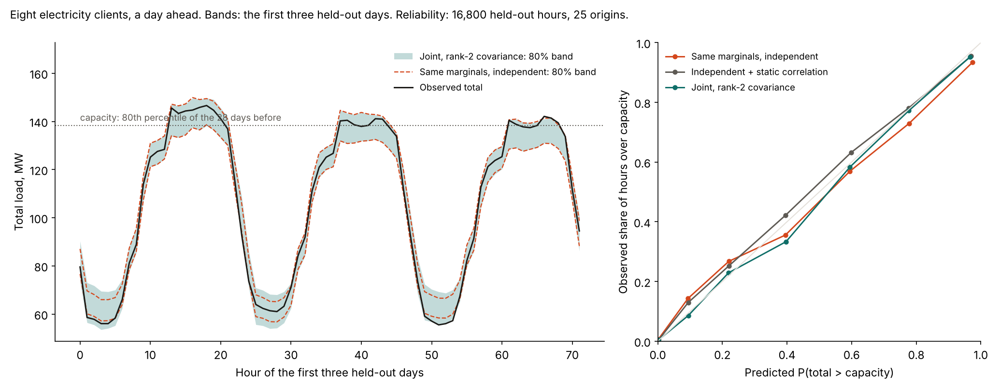

# Benchmarks

[Ashlar](../README.md) beside LightGBM, XGBoost, CatBoost, and other neural packages. The large-table numbers come from [`examples/benchmark_large.py`](../examples/benchmark_large.py), the small-table numbers from [`examples/benchmark_readme.py`](../examples/benchmark_readme.py), and the ablations from [`examples/ablation_gbm_parity.py`](../examples/ablation_gbm_parity.py).

```bash
pip install -e ".[dataframes]" xgboost lightgbm catboost openml pyarrow pytabkit
JAX_PLATFORMS=cpu python examples/benchmark_large.py --tables higgs covertype --models ashlar lightgbm --seeds 0
python examples/benchmark_large.py --report --seeds 0
JAX_PLATFORMS=cpu python examples/benchmark_readme.py --stage all
python examples/benchmark_readme.py --stage report
JAX_PLATFORMS=cpu python examples/benchmark_uncertainty.py --stage all
python examples/benchmark_uncertainty.py --stage report
```

- [How it was run](#how-it-was-run)
- [Large tables](#large-tables)
- [Beside other neural packages](#beside-other-neural-packages)
- [What each change buys](#what-each-change-buys)
- [Point accuracy on small tables](#point-accuracy)
- [Distributions on smaller tables](#distributions-on-smaller-tables)
- [Learned embeddings](#learned-embeddings)
- [Entity effects](#entity-effects)
- [Additive models against R's gamlss](#additive-models-against-rs-gamlss)
- [Forecast heads](#forecast-heads)
- [Forecast paths with covariates](#forecast-paths-with-covariates)
- [Calibrated intervals](#calibrated-intervals)
- [Count heads](#count-heads)
- [Hurdle head](#hurdle-head)
- [Labels that say what was observed](#labels-that-say-what-was-observed)
- [Observed labels on real data](#observed-labels-on-real-data)
- [Joint demand across locations](#joint-demand-across-locations)
- [Member uncertainty](#member-uncertainty)

## How it was run

**Versions.** LightGBM 4.7.0, XGBoost 3.4.1, CatBoost 1.2.10, PyTabKit 1.7.3, JAX 0.12.

**Hardware.** An Apple M3 Pro laptop with 12 cores and 18 GB, CPU only. Several runs shared the machine. Ashlar (JAX) used every core it could get; the trees ran on one thread each; PyTabKit models ran on four threads. Read the seconds as an order of magnitude.

**Large tables.** Eight tables from OpenML, each capped at 2,000,000 rows by a fixed random sample. One random 80/20 split per table (seed 0) so far; more seeds are running. Every model holds out the same share, 20% of the training rows, to stop early. The trees run at learning rate 0.05 with up to 4,000 trees and 100 rounds of patience, with native categorical handling. Ashlar is `ASRRegressor()`, `ASRClassifier()`, or `ASRRegressor(task="mixture")` with no other arguments. The distributional scores are on a fixed sample of 100,000 test rows; point and classification scores use every test row.

**Small tables.** Each table is split 80/20 at random, three times, with seeds 0, 1, and 2. A cell is the mean over the three test sets ± the standard deviation across them. The temperature forecast is split on the clock instead, the last 20% of the series, so its three runs differ only in the seed. XGBoost and LightGBM "default" is the library's constructor defaults; "early-stopped" is a learning rate of 0.05 and up to 4,000 trees, stopped after 100 rounds without improvement on a 20% validation slice of the training rows. A category the training rows never saw is missing to the trees, as it is index 0 to Ashlar.

**Distributional scores** are on the original scale of the target.

- *CRPS*, the continuous ranked probability score, is the expected absolute error of a draw minus half the expected distance between two draws. It scores the whole distribution, in the target's units, and stays finite on targets with a spike. Ashlar's is from 200 (large tables) or 400 (small tables) draws per row; a normal's is exact.
- *Pinball* is the quantile loss averaged over the 0.1, 0.5, and 0.9 levels. For a density head the levels are taken from the same draws.
- *80% coverage* is the share of held-out values between the 0.1 and 0.9 levels, and *80% width* is the average distance between them.
- *NLL* is the negative log density per row. On targets with a spike, such as taxi tips that are exactly zero or California values capped at 5, a head can drive it down by making the spike narrow. Read CRPS there.
- The trees have no density of their own. "Mean + constant normal" is the early-stopped mean with a normal whose scale is the residual standard deviation on the validation slice. "Three quantile models" fits one early-stopped model per level with the quantile loss. CatBoost's `RMSEWithUncertainty` fits a mean and a variance per row and is scored as that normal.

**What is not here.** No hyperparameter search on any side. Flight tables with a date column were dropped: under a random split a model can learn which days had bad weather and meet those same days again in the test set.

## Data

| Table | Source | Rows | Target | Notes |
|---|---|---:|---|---|
| Higgs | [OpenML 45664](https://www.openml.org/d/45664) | 2,000,000 of 5,100,000 | signal or background | 28 numeric columns. |
| Covertype | [OpenML 1596](https://www.openml.org/d/1596) | 581,012 | 7 forest cover types | 10 numeric columns and 44 binary indicators, read as categories. |
| Year prediction (MSD) | [OpenML 44027](https://www.openml.org/d/44027) | 515,345 | release year | 90 timbre features. |
| Zurich public transport | [OpenML 45034](https://www.openml.org/d/45034) | 2,000,000 of 5,465,575 | delay | Weather as observed (temperature, wind, rain, dew point, humidity) and time of day. A model of delay given the weather, not a forecast. |
| Airline delay | [OpenML 42728](https://www.openml.org/d/42728) | 2,000,000 of 10,000,000 | departure delay, minutes | Month, weekday, scheduled times, carrier, origin, destination, distance. Day of month dropped. Schedule only, no weather. |
| Click prediction | [OpenML 1218](https://www.openml.org/d/1218) | 1,997,410 | clicked | KDD Cup 2012 ad ids, read as numbers. |
| Airlines | [OpenML 1169](https://www.openml.org/d/1169) | 539,383 | delayed | Carrier, flight, airports, weekday, time, length. Schedule only. |
| NYC green taxi, Dec 2016 | [OpenML 42729](https://www.openml.org/d/42729) | 581,835 | tip, $ | Pickup and drop-off zones, rate code, total amount, and times. |
| California housing | [ageron/handson-ml2](https://github.com/ageron/handson-ml2) | 20,640 | median house value, $100k | Capped at 5.0. `ocean_proximity` is a string column. |
| Diamonds | [mwaskom/seaborn-data](https://github.com/mwaskom/seaborn-data) | 53,940 | log price; price in $1,000 for the distribution runs | The distribution runs use a fixed 12,000-row sample. |
| Adult income | [jbrownlee/Datasets](https://github.com/jbrownlee/Datasets) | 48,842 | income over $50k | Eight string columns. |
| Ames housing | [wblakecannon/ames](https://github.com/wblakecannon/ames) | 2,930 | log sale price | 79 columns, 43 of them strings. |
| Abalone | [jbrownlee/Datasets](https://github.com/jbrownlee/Datasets) | 4,177 | rings | |
| NYC taxi trips | [mwaskom/seaborn-data](https://github.com/mwaskom/seaborn-data) | 6,433 | tip in $, or log trip minutes | Tips leave out payment and total. Duration leaves out distance and fare. |
| Melbourne daily minimum temperature | [jbrownlee/Datasets](https://github.com/jbrownlee/Datasets) | 3,650 | °C, one day ahead | 28-day window. |

## Large tables

One split each (seed 0). Ashlar's seconds include every core of the laptop; each tree used one thread.

### Zurich public transport, delay, 2,000,000 of 5,465,575 rows

| Model | Splits | RMSE | MAE | CRPS | NLL | 80% coverage | 80% width | Seconds |
|---|---:|---:|---:|---:|---:|---:|---:|---:|
| Ashlar, default | 1 | 3.052 | 2.56 | — | — | — | — | 521 |
| Ashlar, `task="mixture"` | 1 | 3.05 | 2.558 | 1.621 | 2.005 | 79% | 8.03 | 536 |
| LightGBM | 1 | 3.047 | 2.554 | 1.747 | 2.534 | 79% | 7.803 | 35 |
| XGBoost | 1 | 3.047 | 2.553 | 1.747 | 2.534 | 79% | 7.804 | 59 |
| CatBoost | 1 | 3.047 | 2.553 | 1.747 | 2.534 | 79% | 7.804 | 351 |
| CatBoost, `RMSEWithUncertainty` | 1 | 3.047 | 2.554 | 1.742 | 2.531 | 80% | 7.781 | 552 |

### Airline delay, departure delay in minutes, 2,000,000 of 10,000,000 rows

| Model | Splits | RMSE | MAE | CRPS | NLL | 80% coverage | 80% width | Seconds |
|---|---:|---:|---:|---:|---:|---:|---:|---:|
| Ashlar, default | 1 | 29.04 | 13.89 | — | — | — | — | 751 |
| Ashlar, `task="mixture"` | 1 | 29.11 | 13.94 | 9.167 | 2.66 | 80% | 32.8 | 1438 |
| LightGBM | 1 | 29.06 | 13.91 | 12.2 | 4.813 | 94% | 74.87 | 12 |
| XGBoost | 1 | 29.11 | 13.92 | 12.21 | 4.813 | 94% | 74.93 | 25 |
| CatBoost | 1 | 29.05 | 13.9 | 12.17 | 4.812 | 94% | 74.91 | 880 |
| CatBoost, `RMSEWithUncertainty` | 1 | 29.06 | 13.92 | 11.46 | 4.722 | 94% | 66.82 | 626 |

### NYC green taxi, tip in $, 581,835 rows

| Model | Splits | RMSE | MAE | CRPS | NLL | 80% coverage | 80% width | Seconds |
|---|---:|---:|---:|---:|---:|---:|---:|---:|
| Ashlar, default | 1 | 1.977 | 0.872 | — | — | — | — | 190 |
| Ashlar, `tabm_piecewise()` | 1 | 1.979 | 0.8747 | — | — | — | — | 924 |
| Ashlar, `task="mixture"` | 1 | 1.977 | 0.8641 | 0.5935 | -1.973 | 82% | 2.814 | 520 |
| LightGBM | 1 | 1.752 | 0.6307 | 0.6583 | 1.978 | 95% | 4.464 | 52 |
| XGBoost | 1 | 1.869 | 0.6452 | 0.6877 | 2.055 | 95% | 4.726 | 177 |
| CatBoost | 1 | 1.758 | 0.6414 | 0.6633 | 1.995 | 95% | 4.528 | 1546 |
| CatBoost, `RMSEWithUncertainty` | 1 | 1.745 | 0.6455 | 0.4647 | 0.7008 | 83% | 1.952 | 2345 |
| RealMLP (pytabkit) | 1 | 1.934 | 0.892 | — | — | — | — | 4044 |
| TabM (pytabkit) | 1 | 1.798 | 0.7327 | — | — | — | — | 15169 |

### Year prediction (MSD), release year, 515,345 rows

| Model | Splits | RMSE | MAE | CRPS | NLL | 80% coverage | 80% width | Seconds |
|---|---:|---:|---:|---:|---:|---:|---:|---:|
| Ashlar, default | 1 | 8.698 | 5.903 | — | — | — | — | 323 |
| Ashlar, `task="mixture"` | 1 | 8.699 | 5.835 | 4.051 | 3.081 | 77% | 16.81 | 282 |
| LightGBM | 1 | 8.754 | 6.09 | 4.621 | 3.588 | 85% | 22.33 | 309 |
| XGBoost | 1 | 8.71 | 6.085 | 4.609 | 3.583 | 85% | 22.22 | 736 |
| CatBoost | 1 | 8.776 | 6.123 | 4.637 | 3.591 | 85% | 22.4 | 271 |
| CatBoost, `RMSEWithUncertainty` | 1 | 8.883 | 6.197 | 4.407 | 3.416 | 83% | 19.01 | 220 |

### Higgs, signal against background, 2,000,000 of 5,100,000 rows

| Model | Splits | Accuracy | AUC | Log loss | Seconds |
|---|---:|---:|---:|---:|---:|
| Ashlar, default | 1 | 0.7625 | 0.8464 | 0.4823 | 507 |
| LightGBM | 1 | 0.7493 | 0.8324 | 0.5002 | 261 |
| XGBoost | 1 | 0.7516 | 0.8347 | 0.497 | 391 |
| CatBoost | 1 | 0.7503 | 0.8328 | 0.5 | 855 |

### Covertype, 7 forest types, 581,012 rows

| Model | Splits | Accuracy | AUC | Log loss | Seconds |
|---|---:|---:|---:|---:|---:|
| Ashlar, default | 1 | 0.967 | 0.9988 | 0.09441 | 415 |
| LightGBM | 1 | 0.9628 | 0.9983 | 0.1165 | 361 |
| XGBoost | 1 | 0.9477 | 0.9973 | 0.1488 | 930 |
| CatBoost | 1 | 0.9102 | 0.9929 | 0.2474 | 692 |

### Airlines, delayed or not, 539,383 rows

| Model | Splits | Accuracy | AUC | Log loss | Seconds |
|---|---:|---:|---:|---:|---:|
| Ashlar, default | 1 | 0.6601 | 0.71 | 0.6143 | 267 |
| LightGBM | 1 | 0.6655 | 0.7185 | 0.6085 | 13 |
| XGBoost | 1 | 0.6642 | 0.7181 | 0.6089 | 14 |
| CatBoost | 1 | 0.6675 | 0.7215 | 0.6062 | 1011 |

### Click prediction, clicked or not, 1,997,410 rows

| Model | Splits | Accuracy | AUC | Log loss | Seconds |
|---|---:|---:|---:|---:|---:|
| Ashlar, default | 1 | 0.8421 | 0.7382 | 0.3943 | 365 |
| LightGBM | 1 | 0.8444 | 0.7544 | 0.3858 | 132 |
| XGBoost | 1 | 0.8442 | 0.7557 | 0.3852 | 188 |
| CatBoost | 1 | 0.8435 | 0.7502 | 0.3879 | 726 |

## Beside other neural packages

PyTabKit 1.7.3's tuned-default recipes (`RealMLP_TD`, `TabM_D`, `FTT_D`, `MLP_PLR_D`) on one split (seed 0), missing numbers filled with the training median because PyTabKit refuses them, four threads each. Same split as the ablations: adult is not stratified here. The taxi column is the large-table split above; `tabm_piecewise()` ran there before the automatic epoch budget grew, with 10 epochs.

| Model | California RMSE ↓ | Diamonds RMSE ↓ | Adult accuracy ↑ | NYC green taxi tips RMSE ↓ |
|---|---:|---:|---:|---:|
| Ashlar, default | 0.475 (28 s) | 0.0876 (2 min) | 0.864 (27 s) | 1.977 (3 min) |
| Ashlar, `tabm_piecewise()` | **0.440** (4 min) | 0.0842 (8 min) | **0.869** (4 min) | 1.979 (15 min) |
| TabM (PyTabKit) | 0.453 (11 min) | **0.0797** (49 min) | 0.863 (8 min) | **1.798** (4.2 h) |
| RealMLP (PyTabKit) | 0.472 (13 min) | 0.0882 (11 min) | 0.868 (4 min) | 1.934 (67 min) |
| FT-Transformer (PyTabKit) | 0.466 (11 min) | 0.0853 (38 min) | 0.864 (14 min) | — |
| MLP-PLR (PyTabKit) | 0.489 (2 min) | 0.0896 (5 min) | 0.862 (2 min) | — |
| LightGBM, early-stopped | 0.446 (2 s) | 0.0841 (6 s) | 0.875 (1 s) | 1.752 (1 min) |

PyTabKit's TabM is the strongest of the other packages and wins diamonds and the taxi tips; it is also the slowest by far on a CPU. `tabm_piecewise()` wins California and adult. The Ashlar default matches RealMLP and FT-Transformer in a tenth of the time or less.

## What each change buys

Three random splits of California, diamonds (log price), and adult, the same splits as the small-table comparison below except that adult is not stratified here. Each row adds one change to the row above. Mean ± standard deviation across the splits. Seconds are for one fit.

| Step | California RMSE ↓ | Diamonds RMSE ↓ | Adult accuracy ↑ | California seconds |
|---|---:|---:|---:|---:|
| Old default: 2 blocks of 64, batch 64, constant `1e-3`, 50 epochs | 0.562 ± 0.003 | 0.107 ± 0.008 | 0.856 ± 0.003 | 4 |
| Wider: 3 blocks of 256, dropout 0.1, batch 256, up to 100 epochs | 0.521 ± 0.004 | 0.102 ± 0.007 | 0.857 ± 0.004 | 55 |
| + cosine schedule at `2e-3` | 0.511 ± 0.005 | 0.094 ± 0.003 | 0.857 ± 0.004 | 41 |
| Wider + piecewise-linear embeddings, constant `1e-3` | 0.471 ± 0.007 | 0.089 ± 0.002 | 0.860 ± 0.005 | 38 |
| **New default**: wider + piecewise + cosine `2e-3` + auto budget | 0.472 ± 0.003 | 0.089 ± 0.003 | 0.861 ± 0.003 | 39 |
| `tabm_piecewise()`: 32-member TabM on piecewise embeddings of quantile-normalized columns | **0.447 ± 0.006** | **0.085 ± 0.000** | 0.865 ± 0.003 | 263 |

The piecewise-linear embedding of each numeric column is the largest single gain: it takes California from 0.52 to 0.47 and diamonds from 0.102 to 0.089. Width and the cosine schedule buy most of the rest. Once the embeddings are in, the schedule matters little on these tables; it is the default because it converges inside a fixed budget on large tables, where early stopping rarely fires. The TabM ensemble buys another 5% on California at about seven times the cost.

Variations that did not help, three splits each, on top of the new default:

| Variation | California | Diamonds | Adult |
|---|---:|---:|---:|
| Periodic embeddings instead of piecewise (constant rate) | 0.513 ± 0.004 | 0.096 ± 0.006 | 0.860 ± 0.004 |
| ReLU on the piecewise embedding | 0.470 ± 0.006 | 0.092 ± 0.005 | 0.860 ± 0.003 |
| Hidden layer per categorical column, 16-d categories | 0.465 ± 0.007 | 0.090 ± 0.005 | 0.860 ± 0.003 |

Single-split screens (seed 0) of batch size 1,024, width 512, dropout 0 or 0.2, embedding width 32, weight decay `1e-2`, and quantile scaling all landed within 0.006 of the default on California, inside the spread between splits. On one split the spread from initialization alone is about ±0.015 RMSE on California, so a single-split difference smaller than that is noise.

The large tables changed the epoch budget. With 10 epochs at a million rows, covertype reached 0.897; with 40 it reached 0.969. The automatic budget is now about 20 million row passes, at least 20 and at most 100 epochs.


## Point accuracy

Three random splits of five small tables. Ashlar is `ASRRegressor()` or `ASRClassifier()`.

### Abalone, rings

4,177 rows, 3 splits.

| Model | RMSE | Seconds |
|---|---:|---:|
| Ashlar, default | 2.166 ± 0.080 | 6.8 |
| LightGBM, default | 2.236 ± 0.058 | 0.1 |
| LightGBM, early-stopped | 2.231 ± 0.072 | 0.1 |
| XGBoost, default | 2.302 ± 0.047 | 0.1 |
| XGBoost, early-stopped | 2.225 ± 0.060 | 0.1 |

### Adult income, over $50k

48,842 rows, 3 splits.

| Model | Accuracy | Log loss | Seconds |
|---|---:|---:|---:|
| Ashlar, default | 0.864 ± 0.002 | 0.296 ± 0.003 | 62 |
| LightGBM, default | 0.877 ± 0.001 | 0.271 ± 0.002 | 0.6 |
| LightGBM, early-stopped | 0.877 ± 0.002 | 0.271 ± 0.001 | 1.4 |
| XGBoost, default | 0.874 ± 0.001 | 0.277 ± 0.002 | 0.6 |
| XGBoost, early-stopped | 0.876 ± 0.002 | 0.271 ± 0.001 | 1.9 |

### Ames housing, log sale price

2,930 rows, 3 splits.

| Model | RMSE | Seconds |
|---|---:|---:|
| Ashlar, default | 0.117 ± 0.011 | 8.7 |
| LightGBM, default | 0.120 ± 0.002 | 0.3 |
| LightGBM, early-stopped | 0.120 ± 0.003 | 0.6 |
| XGBoost, default | 0.129 ± 0.007 | 0.4 |
| XGBoost, early-stopped | 0.122 ± 0.004 | 3.0 |

### California housing, median value in $100k

20,640 rows, 3 splits.

| Model | RMSE | Seconds |
|---|---:|---:|
| Ashlar, default | 0.472 ± 0.003 | 38 |
| LightGBM, default | 0.475 ± 0.006 | 0.2 |
| LightGBM, early-stopped | 0.457 ± 0.009 | 2.1 |
| XGBoost, default | 0.473 ± 0.008 | 0.3 |
| XGBoost, early-stopped | 0.464 ± 0.010 | 3.8 |

### Diamonds, log price

53,940 rows, 3 splits.

| Model | RMSE | Seconds |
|---|---:|---:|
| Ashlar, default | 0.089 ± 0.002 | 138 |
| LightGBM, default | 0.090 ± 0.001 | 0.5 |
| LightGBM, early-stopped | 0.085 ± 0.002 | 6.1 |
| XGBoost, default | 0.087 ± 0.001 | 0.5 |
| XGBoost, early-stopped | 0.085 ± 0.002 | 4.4 |

## Distributions on smaller tables

The `flow` rows here and under [Forecast heads](#forecast-heads) were rerun on the same splits after the flow head gained its per-row shift and scale; before it, every row shared the spline's tails. The other rows are from the first run.

### Abalone, rings

4,177 rows, 3 splits.

| Model | CRPS | Pinball | 80% coverage | 80% width | NLL | MAE | Seconds |
|---|---:|---:|---:|---:|---:|---:|---:|
| Ashlar, `flow` | 1.087 ± 0.030 | 0.486 ± 0.012 | 77% | 4.489 ± 0.099 | 1.965 ± 0.023 | 1.512 ± 0.044 | 9.1 |
| Ashlar, `gaussian` | 1.105 ± 0.025 | 0.494 ± 0.010 | 84% | 5.098 ± 0.251 | 2.059 ± 0.027 | 1.530 ± 0.038 | 6.7 |
| Ashlar, `histogram` | 1.089 ± 0.033 | 0.487 ± 0.015 | 81% | 4.847 ± 0.104 | 1.942 ± 0.008 | 1.520 ± 0.029 | 6.0 |
| Ashlar, `mixture` | 1.076 ± 0.039 | 0.481 ± 0.018 | 78% | 4.398 ± 0.063 | 1.941 ± 0.033 | 1.498 ± 0.036 | 7.6 |
| Ashlar, squared error | — | — | — | — | — | 1.528 ± 0.035 | 7.0 |
| Ashlar, `quantile` | — | 0.479 ± 0.015 | 79% | 4.584 ± 0.180 | — | 1.498 ± 0.055 | 8.6 |
| LightGBM mean + constant normal | 1.161 ± 0.028 | 0.528 ± 0.012 | 83% | 5.075 ± 0.076 | 2.237 ± 0.038 | 1.546 ± 0.038 | — |
| LightGBM, three quantile models | — | 0.503 ± 0.015 | 72% | 4.070 ± 0.150 | — | 1.535 ± 0.035 | — |
| XGBoost mean + constant normal | 1.157 ± 0.021 | 0.526 ± 0.009 | 83% | 5.081 ± 0.098 | 2.234 ± 0.032 | 1.539 ± 0.024 | — |
| XGBoost, three quantile models | — | 0.512 ± 0.017 | 75% | 4.180 ± 0.075 | — | 1.559 ± 0.040 | — |

### California housing, median value in $100k

20,640 rows, 3 splits.

| Model | CRPS | Pinball | 80% coverage | 80% width | NLL | MAE | Seconds |
|---|---:|---:|---:|---:|---:|---:|---:|
| Ashlar, `flow` | 0.211 ± 0.002 | 0.095 ± 0.001 | 77% | 0.853 ± 0.011 | 0.036 ± 0.015 | 0.290 ± 0.002 | 50 |
| Ashlar, `gaussian` | 0.225 ± 0.003 | 0.101 ± 0.001 | 83% | 1.014 ± 0.012 | 0.403 ± 0.018 | 0.311 ± 0.005 | 38 |
| Ashlar, `histogram` | 0.229 ± 0.003 | 0.103 ± 0.002 | 86% | 1.122 ± 0.035 | 0.479 ± 0.008 | 0.310 ± 0.002 | 32 |
| Ashlar, `mixture` | 0.205 ± 0.001 | 0.092 ± 0.001 | 76% | 0.812 ± 0.035 | 0.076 ± 0.037 | 0.287 ± 0.002 | 51 |
| Ashlar, squared error | — | — | — | — | — | 0.312 ± 0.006 | 40 |
| Ashlar, `quantile` | — | 0.094 ± 0.001 | 75% | 0.812 ± 0.007 | — | 0.288 ± 0.001 | 52 |
| LightGBM mean + constant normal | 0.236 ± 0.003 | 0.108 ± 0.001 | 87% | 1.178 ± 0.020 | 0.638 ± 0.020 | 0.303 ± 0.004 | — |
| LightGBM, three quantile models | — | 0.098 ± 0.001 | 70% | 0.848 ± 0.016 | — | 0.288 ± 0.002 | — |
| XGBoost mean + constant normal | 0.238 ± 0.002 | 0.108 ± 0.001 | 87% | 1.182 ± 0.020 | 0.652 ± 0.022 | 0.305 ± 0.002 | — |
| XGBoost, three quantile models | — | 0.103 ± 0.001 | 71% | 0.874 ± 0.019 | — | 0.301 ± 0.002 | — |

### Diamonds, price in $1,000, 12,000-row sample

12,000 rows, 3 splits.

| Model | CRPS | Pinball | 80% coverage | 80% width | NLL | MAE | Seconds |
|---|---:|---:|---:|---:|---:|---:|---:|
| Ashlar, `flow` | 0.210 ± 0.018 | 0.094 ± 0.008 | 79% | 0.907 ± 0.089 | -0.054 ± 0.123 | 0.289 ± 0.025 | 25 |
| Ashlar, `gaussian` | 0.216 ± 0.013 | 0.097 ± 0.006 | 84% | 1.126 ± 0.185 | -0.015 ± 0.094 | 0.294 ± 0.012 | 24 |
| Ashlar, `histogram` | 0.343 ± 0.003 | 0.154 ± 0.002 | 95% | 2.177 ± 0.007 | 1.007 ± 0.011 | 0.427 ± 0.005 | 17 |
| Ashlar, `mixture` | 0.202 ± 0.007 | 0.091 ± 0.003 | 80% | 0.907 ± 0.050 | -0.111 ± 0.056 | 0.283 ± 0.010 | 27 |
| Ashlar, squared error | — | — | — | — | — | 0.298 ± 0.009 | 23 |
| Ashlar, `quantile` | — | 0.090 ± 0.002 | 80% | 0.901 ± 0.038 | — | 0.274 ± 0.007 | 27 |
| LightGBM mean + constant normal | 0.286 ± 0.012 | 0.130 ± 0.006 | 90% | 1.607 ± 0.026 | 0.914 ± 0.077 | 0.310 ± 0.013 | — |
| LightGBM, three quantile models | — | 0.100 ± 0.005 | 69% | 0.854 ± 0.045 | — | 0.292 ± 0.011 | — |
| XGBoost mean + constant normal | 0.274 ± 0.006 | 0.124 ± 0.003 | 91% | 1.551 ± 0.103 | 0.884 ± 0.033 | 0.295 ± 0.007 | — |
| XGBoost, three quantile models | — | 0.096 ± 0.003 | 74% | 0.836 ± 0.021 | — | 0.284 ± 0.010 | — |

### NYC taxi tips, $, payment type hidden

6,383 rows, 3 splits.

| Model | CRPS | Pinball | 80% coverage | 80% width | NLL | MAE | Seconds |
|---|---:|---:|---:|---:|---:|---:|---:|
| Ashlar, `flow` | 0.872 ± 0.023 | 0.376 ± 0.007 | 75% | 3.439 ± 0.263 | 0.005 ± 0.394 | 1.322 ± 0.023 | 16 |
| Ashlar, `gaussian` | 0.950 ± 0.019 | 0.406 ± 0.007 | 79% | 4.038 ± 0.151 | 1.767 ± 0.018 | 1.443 ± 0.037 | 6.1 |
| Ashlar, `histogram` | 0.917 ± 0.017 | 0.398 ± 0.009 | 81% | 3.762 ± 0.129 | 1.416 ± 0.021 | 1.370 ± 0.033 | 7.2 |
| Ashlar, `mixture` | 0.872 ± 0.017 | 0.372 ± 0.005 | 84% | 3.689 ± 0.116 | 0.092 ± 0.386 | 1.420 ± 0.045 | 15 |
| Ashlar, squared error | — | — | — | — | — | 1.402 ± 0.025 | 8.2 |
| Ashlar, `quantile` | — | 0.384 ± 0.004 | 74% | 3.759 ± 0.154 | — | 1.337 ± 0.031 | 7.2 |
| LightGBM mean + constant normal | 1.001 ± 0.034 | 0.460 ± 0.016 | 86% | 4.690 ± 0.066 | 2.076 ± 0.038 | 1.377 ± 0.044 | — |
| LightGBM, three quantile models | — | 0.371 ± 0.006 | 85% | 3.563 ± 0.067 | — | 1.323 ± 0.022 | — |
| XGBoost mean + constant normal | 1.046 ± 0.019 | 0.479 ± 0.009 | 88% | 4.998 ± 0.156 | 2.132 ± 0.008 | 1.438 ± 0.022 | — |
| XGBoost, three quantile models | — | 0.412 ± 0.010 | 79% | 3.429 ± 0.053 | — | 1.385 ± 0.031 | — |

## Learned embeddings

### NYC taxi trips, log minutes, from zones without distance

6,343 rows, 3 splits.

| Model | RMSE | Seconds |
|---|---:|---:|
| Ashlar, 8-d embeddings, default | 0.681 ± 0.015 | 6.6 |
| Ashlar, 16-d embeddings, longer | 0.694 ± 0.008 | 8.8 |
| Ashlar, 8-d embeddings, longer | 0.682 ± 0.014 | 7.2 |
| Ashlar, one-hot, default | 0.651 ± 0.045 | 7.6 |
| Ashlar, one-hot, longer | 0.580 ± 0.017 | 14 |
| LightGBM, early-stopped | 0.520 ± 0.003 | 0.4 |
| XGBoost, early-stopped | 0.580 ± 0.002 | 1.0 |

## Entity effects

From [`examples/benchmark_effects.py`](../examples/benchmark_effects.py), the protocol of [#41](https://github.com/maxmbay/ashlar/issues/41). Every store is an entity. In each of three random splits, a fifth of the stores are held out whole, and each gives 5 rows of context and 30 rows to score. Every other store trains on a log-uniform 1 to 300 of its rows and scores 30 others, so its test rows fall in a bucket by how many rows it trained on. The score is the CRPS of log sales, lower is better: from 400 draws for Ashlar, and in closed form for the normal predictions of GPBoost and the mixed model. Coverage is the share of rows inside the raw 80% interval. The tables give means over the three splits. The gaps discussed below are several times the spread between splits.

The methods, all with a normal head on log sales:

- **embedding**: the store as an ordinary learned embedding, Ashlar's default for a categorical column.
- **dropped**: no store column.
- **pooled**: `random_effects={"store": "intercept"}`.
- **pooled + embedding**: `random_effects={"store": ["intercept", "embedding"]}`.
- **nested**: the same, with the store nested in its type (Rossmann) or city (FreshRetailNet), which has an offset and embedding of its own.
- **in context**: no store column. Each row instead carries up to 32 other rows of its store, through the existing set encoder, as two set features: their binned outcomes, and their binned outcomes by promotion (Rossmann) or activity (FreshRetailNet). The set's size is a feature too. A training row's set leaves the row out and has a random size. A seen store's test row reads the store's training rows. An unseen store's row reads its 5 context rows, or nothing.
- **GPBoost**: tree boosting with a grouped random intercept, early-stopped.
- **mixed model**: a statsmodels linear mixed model with a random intercept, linear in every feature but the store and product.

"Unseen, 5 rows" reads each unseen store's 5 context rows. The pooled models use `with_context`, GPBoost and the mixed model the conjugate update with their fitted variances, and the in-context model the rows as its set. `tau` is the fitted spread of the store offsets.

### Rossmann, log daily sales, 1,115 stores, 844,338 open days

| Method | 1-5 rows | 6-20 | 21-100 | 101-300 | Unseen | Unseen, 5 rows | Coverage, unseen | Coverage, 1-5 | `tau` |
|---|---:|---:|---:|---:|---:|---:|---:|---:|---:|
| embedding | 0.1198 | 0.0815 | 0.0646 | 0.0620 | 0.2213 | | 35.7% | 46.9% | |
| dropped | 0.2318 | 0.1913 | 0.1298 | 0.0846 | 0.2589 | | 42.0% | 47.4% | |
| pooled | 0.1013 | 0.0870 | 0.0820 | 0.0740 | 0.1905 | 0.0926 | 78.0% | 75.7% | 0.285 |
| pooled + embedding | **0.0963** | **0.0751** | **0.0614** | **0.0567** | **0.1890** | **0.0906** | 75.4% | 72.4% | 0.274 |
| nested | 0.0964 | 0.0757 | **0.0614** | 0.0573 | 0.1895 | 0.0913 | 76.0% | 73.0% | 0.278 |
| in context | 0.1165 | 0.0915 | 0.0820 | 0.0753 | 0.1951 | 0.1045 | 78.9% | 75.1% | |
| GPBoost | 0.1246 | 0.1044 | 0.0961 | 0.0886 | 0.2032 | 0.1106 | 80.8% | 79.3% | 0.315 |
| mixed model | 0.1313 | 0.1176 | 0.1125 | 0.1139 | 0.2055 | 0.1224 | 81.8% | 83.9% | 0.307 |

### FreshRetailNet-50K, log1p daily sales of store and product pairs, 898 stores, 4,500,000 rows

| Method | 1-5 rows | 6-20 | 21-100 | 101-300 | Unseen | Unseen, 5 rows | Coverage, unseen | Coverage, 1-5 | `tau` |
|---|---:|---:|---:|---:|---:|---:|---:|---:|---:|
| embedding | 0.1651 | 0.1502 | 0.1418 | 0.1378 | 0.1516 | | 75.6% | 65.3% | |
| dropped | 0.1454 | 0.1447 | 0.1443 | 0.1407 | 0.1455 | | 78.6% | 78.6% | |
| pooled | 0.1428 | 0.1398 | 0.1359 | 0.1321 | 0.1442 | **0.1418** | 79.8% | 78.8% | 0.093 |
| pooled + embedding | **0.1424** | **0.1386** | **0.1347** | **0.1303** | **0.1441** | **0.1418** | 79.0% | 78.1% | 0.086 |
| nested | **0.1424** | 0.1391 | 0.1349 | 0.1307 | **0.1441** | **0.1418** | 79.2% | 78.4% | 0.086 |
| in context | 0.1480 | 0.1455 | 0.1452 | 0.1414 | 0.1477 | 0.1471 | 77.1% | 77.0% | |
| GPBoost | 0.1525 | 0.1495 | 0.1439 | 0.1393 | 0.1513 | 0.1496 | 67.1% | 64.4% | 0.084 |
| mixed model | 0.1744 | 0.1704 | 0.1710 | 0.1685 | 0.1749 | 0.1743 | 82.1% | 82.2% | 0.062 |

- **Stores with few rows gain the most.** On Rossmann stores with 1 to 5 training rows, offsets plus embeddings score 0.0963. That compares with 0.1198 for the ordinary embedding, 0.2318 with no store column, 0.1246 for GPBoost, and 0.1313 for the mixed model. On FreshRetailNet the store matters less, since products differ far more than stores (`tau` 0.09 against 0.27 to 0.29). Pooling still beats both the embedding and leaving the store out there.
- **An unseen store gets an honest interval.** The ordinary embedding reads a category it never trained as a confident store. Its 80% interval holds 36% of an unseen Rossmann store's rows. Pooling's interval widens by the spread between stores and holds 75% to 78%.
- **The embedding adds to the offset.** With the interaction, offsets plus embeddings beat offsets alone in every bucket of seen stores on both tables: by 5% at 1 to 5 rows and 23% at 101 to 300 on Rossmann. Nesting the store in its type or city added nothing on either table, within 0.001.
- **Five rows of a new store halve its CRPS.** With `with_context`, an unseen Rossmann store goes from 0.1890 to 0.0906.
- **Ashlar's pooled models beat GPBoost and the mixed model on CRPS in every column on both tables.** Their intervals are nearer 80% on Rossmann, 79% to 84%, but on seen stores their CRPS is 29% to 101% worse than offsets plus embeddings.
- **Finishing the posteriors.** Before `fit` set each store's offsets exactly after training, the variational posteriors scored 0.1061 (offsets plus embeddings) and 0.1108 (offsets) at 1 to 5 rows on Rossmann. Finishing takes them to 0.0963 and 0.1013 and moves every larger bucket by under 0.002. The posteriors are now as narrow as the model says, so the raw 80% interval of those stores holds 72% of their rows instead of 75%. Calibrate on held-out rows when coverage matters.
- **Reading the store in context loses to the exact update.** This is the amortized, neural-process view of a mixed model. It loses to offsets plus embeddings on CRPS in every column on both tables. On FreshRetailNet it loses even to leaving the store out. On Rossmann it beats the ordinary embedding at 1 to 5 rows and on unseen stores, and GPBoost everywhere, and its unseen interval is the best calibrated of Ashlar's, at 78.9%. A set encoder over binned tokens is a cruder reader of the rows than a dedicated numeric one could be. Even so, it would have to beat `with_context`, which is exact for the offset, so the variant was not built into the library.

### The README's pooling figure

From [`examples/readme/store_pooling.py`](../examples/readme/store_pooling.py). It refits offsets plus embeddings on the first split (seed 0) and reproduces that split's saved CRPS in every bucket. Loading the table and fitting took 68 seconds on the laptop, and the fitted `tau` is 0.278. The figure's left panel is that fit, and its right panel the three splits above. After five rows of a new store, over the three splits, the raw 80% interval of its scored rows holds:

| Method | CRPS, unseen, 5 rows | 80% coverage | 80% width |
|---|---:|---:|---:|
| pooled | 0.0926 | 75.4% | 0.369 |
| pooled + embedding | **0.0906** | 69.7% | 0.304 |
| nested | 0.0913 | 69.8% | 0.306 |
| in context | 0.1045 | 73.9% | 0.409 |
| GPBoost | 0.1106 | 77.7% | 0.438 |
| mixed model | 0.1224 | 83.5% | 0.578 |

- **One row moves a store most of the way to its own mean.** A seen store's pooled effect is on average 0.84 times its own mean residual from the population at 1 training row, 0.89 at 2 to 3, 0.96 at 4 to 10, and 0.98 to 1.00 above that: least-squares slopes through zero, over 63, 132, 181, and 516 stores. The stores' spread, `tau` 0.278 on log sales, is large beside the noise of a typical day, about 0.10, so the pull towards the average store is strongest at one row and nearly gone by ten.
- **A new store's offset narrows faster than it learns.** For each of the split's 223 unseen stores, `with_context` reads its first 1, 2, 3, 5, 10, 20, and 35 rows (its 5 context rows, then its scored rows), each time from the prior, as the left panel draws for store 342. Against the store's level, its mean residual over all its 606 to 942 days, the offset's 80% interval holds 72%, 69%, 71%, 69%, 68%, 65%, and 66% of the stores. The prior alone holds 76%, and a plain mean of the same 35 rows with its own standard error holds 80%.
- **Probably because a new store's days scatter more than the head says.** The update is exact for a normal head: it weights each day by the head's precision and reads the days as independent around one offset. That precision was learned on stores whose embeddings fit them, and a new store's embedding stays at the average. Its days scatter about its level 1.26 times as widely as the head's spread says (the median over stores), and the head's weights do not suit them: after 35 rows the offset is 0.030 from the level (root mean square) where its posterior sd says 0.017, while the plain mean of the same rows is 0.024 from it. Offsets alone, whose head had no embedding to fit a store's own pattern, hold 75.4% of a new store's rows after five rows against 69.7% with the embedding. This is a reading of the numbers, not a tested cause.
- **GPBoost's and the mixed model's intervals are nearer 80% after five rows,** 77.7% and 83.5%, at a CRPS 22% and 35% higher. In this split's refit, the offsets plus embeddings' interval holds 70.7% of the rows from `predict_interval` and 70.1% from 400 draws. Calibrate on held-out rows of new stores when their coverage matters.

## Additive models against R's gamlss

From [`examples/benchmark_additive.py`](../examples/benchmark_additive.py), the protocol of [#42](https://github.com/maxmbay/ashlar/issues/42). Every parameter of an additive model of a distribution is a sum of one shape per column. R's `gamlss` 5.4.22 fits each shape as a penalized B-spline (`pb`) by backfitting. `backbone="additive"` fits each as a small network, trained by gradient descent with the head. Two tables, with three random 80/20 splits each:

- **Hourly bike rentals**, 17,379 hours, a count. Every model is a negative binomial whose mean and dispersion are each additive in every column: Ashlar's `negative_binomial` head and `gamlss`'s `NBI`. Each additive model is also fitted with the one pair that matters, the hour by the working day.
- **Abalone rings**, 4,177 abalone, treated as continuous. Ashlar's `gaussian` is set against `gamlss`'s `NO`, each with an additive mean and log scale. Ashlar's `mixture` is set against `gamlss`'s `BCCGo`, a Box-Cox Cole-Green with an additive median and scale and a constant skewness.

The residual-network rows are Ashlar's default backbone with the same head. Scores are on the test rows: the negative log-likelihood (log mass for the counts, log density for the rings), the CRPS, and the raw central 80% interval. R computes the CRPS of `gamlss` from its own CDFs on the same grid as Python. For the `NBI` and `NO` fits, Python recomputed it from R's fitted parameters and agreed within 5e-12 per row. ± is one standard error over the splits. Seconds are the mean per fit on one laptop. Some `gamlss` fits shared it with other jobs, so their times run high.

### Hourly bike rentals, negative binomial

| Model | NLL | CRPS | 80% coverage | 80% width | Seconds per fit |
|---|---:|---:|---:|---:|---:|
| Ashlar, additive | 5.089 ± 0.010 | 42.25 ± 0.68 | 82.5% | 223.1 | 8 |
| `gamlss` `NBI`, additive | 5.078 ± 0.012 | 42.15 ± 0.48 | 82.1% | 222.7 | 122 |
| Ashlar, additive + hour × working day | 4.755 ± 0.014 | 23.46 ± 0.31 | 83.4% | 110.8 | 10 |
| `gamlss` `NBI`, additive + hour × working day | 4.763 ± 0.020 | 23.40 ± 0.28 | 82.6% | 108.8 | 1,093 |
| Ashlar, residual network | 4.497 ± 0.012 | 16.48 ± 0.34 | 80.1% | 69.5 | 19 |

### Abalone rings

| Model | NLL | CRPS | 80% coverage | 80% width | Seconds per fit |
|---|---:|---:|---:|---:|---:|
| Ashlar `gaussian`, additive | 2.193 ± 0.059 | 1.156 ± 0.019 | 84.6% | 5.48 | 2 |
| `gamlss` `NO`, additive | 2.135 ± 0.030 | 1.115 ± 0.025 | 83.0% | 5.06 | 173 |
| Ashlar `mixture`, additive | 1.949 ± 0.021 | 1.085 ± 0.019 | 79.0% | 4.67 | 2 |
| `gamlss` `BCCGo`, additive, constant skewness | 1.982 ± 0.021 | 1.096 ± 0.019 | 79.6% | 4.59 | 104 |
| Ashlar `gaussian`, residual network | 2.049 ± 0.015 | 1.095 ± 0.017 | 83.8% | 5.07 | 3 |
| Ashlar `mixture`, residual network | 1.938 ± 0.019 | 1.071 ± 0.019 | 80.2% | 4.80 | 3 |

- **On bike rentals the additive models match `gamlss`.** CRPS is 42.25 against 42.15, and 23.46 against 23.40 with the pair, each within a standard error. Ashlar's likelihood is 0.011 nats behind without the pair and 0.008 ahead with it.
- **They take a fraction of the time.** An additive Ashlar fit took 8 to 10 seconds. `gamlss` took 110 to 135 seconds without the pair, and 256 to 2,691 with it. The slowest stopped at its limit of 200 cycles without converging (`Algorithm RS has not yet converged`), as did one `BCCGo` fit. R also warned, after each split's `NO` fit, that an inner backfitting loop had stopped at its limit of 30 iterations.
- **The pair is worth 0.33 nats an hour.** Rentals on working days peak at 8 am and again at 5 to 6 pm, and on other days rise to one plateau, which no single shape of the hour can draw. The pair cuts the CRPS by 44%.
- **What additivity costs.** The residual network learns every interaction and scores 16.48 on bike rentals, 30% below the best additive model. On abalone, the additive `mixture` comes within 0.011 nats of the residual network's.
- **On abalone, `gamlss`'s normal beats Ashlar's additive `gaussian`.** CRPS is 1.115 against 1.156, and NLL 2.135 against 2.193, the largest gap in `gamlss`'s favor. With 3,341 training rows, its penalized splines fit the mean and spread better than one network per column. Ashlar's additive `mixture` beats `gamlss`'s `BCCGo`, CRPS 1.085 against 1.096 and NLL 1.949 against 1.982. Most gaps on abalone are within one or two standard errors.

### The README's additive figure

From [`examples/readme/additive_gamlss.py`](../examples/readme/additive_gamlss.py), which runs the `terms` stage of [`examples/benchmark_additive.py`](../examples/benchmark_additive.py). It refits Ashlar's additive negative binomial and `gamlss`'s `NBI`, each with the hour × working day pair, on split 0, the split whose saved `gamlss` pair fit was fastest, and reads every term on a grid of its column: Ashlar's from `shape_functions` on the 13,903 training hours, `gamlss`'s from `predict(type = "terms")` on the same hours. Ashlar's refit scored the saved test CRPS, 24.033, in 10 seconds. `gamlss` converged in 38 cycles and 260 seconds, and its terms add back to its fitted linear predictor within 1.1e-5 on the log mean and 5e-11 on the log dispersion. Without the pair, its log-dispersion terms miss its linear predictor by up to 0.24 on some hours, so the figure draws the pair models only.

`NBI`'s sigma is Ashlar's dispersion: both make the variance the mean plus the dispersion times the mean squared. Ashlar's dispersion is `softplus(raw) + 1e-4`, so each of its raw dispersion terms is drawn as the change in log dispersion it makes at the average hour, `log(softplus(b + f) + 1e-4) − log(softplus(b) + 1e-4)`, where `b` is the intercept. Every curve is centred on the training hours. The hour's panel sums, for each day type, every term the hour or the working day enters (the hour, the working day, and the pair), centred on its 24 hours, since each tool splits that level between the three terms in its own way. The temperature's panel adds the terms of the temperature and the felt temperature, which move together.

| Term | Log mean, mean gap | `gamlss`'s span | Log dispersion, mean gap | `gamlss`'s span |
|---|---:|---:|---:|---:|
| Hour, working days | 0.009 | 4.61 | 0.179 | 2.16 |
| Hour, other days | 0.018 | 3.74 | 0.131 | 1.51 |
| Temperature | 0.009 | 0.88 | 0.063 | 1.27 |
| Humidity | 0.008 | 0.24 | 0.055 | 1.02 |

The gap is the mean absolute difference between the two curves: over the 24 hours for the hour, and over the training hours for temperature and humidity. The span is the range of `gamlss`'s curve over the 24 hours, or over the middle 98% of the training hours.

- **The log means agree.** The curves differ by 0.008 to 0.018 on average, against spans of 0.24 to 4.61.
- **The dispersions agree less, and `gamlss`'s hour is rougher.** The gaps are 0.055 to 0.179, 5% to 9% of their spans: a dispersion is learned from the scatter of the counts, not their level, so neither tool pins it down as well. `gamlss` reads the hour as a factor, 24 levels fitted without a penalty, as it reads the season, year, month, holiday, weekday, working day, and weather. Its hour curves on the dispersion are rougher than Ashlar's: their root mean square second difference is 0.59 and 0.34 against Ashlar's 0.23 and 0.16.
- **Where the data are sparse, the curves part.** Below 20% humidity, 63 of the 13,903 training hours, the two humidity curves differ by up to 0.59 on the log mean and 1.01 on the log dispersion. Above it, they differ by at most 0.031 and 0.26.

## Forecast heads

### Melbourne daily minimum temperature, °C, one day ahead

3,650 rows, 3 splits.

| Model | CRPS | Pinball | 80% coverage | 80% width | NLL | MAE | Seconds |
|---|---:|---:|---:|---:|---:|---:|---:|
| Ashlar, `flow` | 1.247 ± 0.003 | 0.555 ± 0.001 | 83% | 6.098 ± 0.033 | 2.223 ± 0.002 | 1.746 ± 0.002 | 20 |
| Ashlar, `gaussian` | 1.264 ± 0.005 | 0.564 ± 0.002 | 85% | 6.348 ± 0.022 | 2.240 ± 0.005 | 1.756 ± 0.007 | 21 |
| Ashlar, `histogram` | 1.262 ± 0.004 | 0.562 ± 0.002 | 87% | 6.616 ± 0.034 | 2.284 ± 0.003 | 1.745 ± 0.006 | 18 |
| Ashlar, `mixture` | 1.243 ± 0.004 | 0.554 ± 0.001 | 83% | 6.052 ± 0.089 | 2.221 ± 0.002 | 1.726 ± 0.004 | 16 |
| Ashlar, squared error | — | — | — | — | — | 1.746 ± 0.003 | 19 |
| Ashlar, `quantile` | — | 0.564 ± 0.005 | 84% | 6.309 ± 0.058 | — | 1.779 ± 0.020 | 15 |
| LightGBM on the same lags | — | 0.573 ± 0.005 | 77% | 5.492 ± 0.058 | — | 1.771 ± 0.014 | — |

## Forecast paths with covariates

From [`examples/benchmark_paths.py`](../examples/benchmark_paths.py), the cheap test of [#43](https://github.com/maxmbay/ashlar/issues/43). The question: with many series, covariates known ahead, and a question about several days at once, does a direct joint head over the horizon give the right answer, and what do the covariates and the dependence between days each add?

**Data.** Rossmann's daily sales, 2013 to July 2015, as the fev benchmark ships them. Each seed draws 300 of the 1,115 stores. `ashlar.horizon.horizon_frame` makes each store at each forecast origin a row: the last 28 days of `log1p` sales; for each of the next 12 days whether the store opens, runs a promotion, or has a state or school holiday, and the weekday; and the store's type, assortment, competition distance, and long-running promotion. The outcome is the next 12 days of `log1p` sales, one joint outcome. Closed days stay in, with no sales, so a path is what the store sells day by day.

**Protocol.** Split by time, with no target day shared: origins up to 16 February 2015 train (every third day), origins from 28 February to 19 May 2015 calibrate (every third day), and every origin from 31 May to 19 July 2015, the last whose 12 days are in the data, is scored: 15,000 paths per seed. Three seeds, each a new sample of stores and a new initialization. Every Ashlar model is `ASRRegressor` with its defaults and the head below, then `calibrate(X_cal, Y_cal, target=[total, peak])`. Scores use 400 draws per path.

**Models.**

- `joint`: `task="multivariate_gaussian"`, rank 4.
- `joint`'s marginals: the same fitted model with the dependence between days dropped (`Independent(dist.marginals())`), so every day's forecast is `joint`'s and only the dependence differs. Scored raw.
- `independent`: `multivariate_gaussian` with `rank=0`, trained with no dependence at all.
- `joint_flow`: `task="multivariate_flow"`, the autoregressive flow over the 12 days.
- `joint`, lags only: `joint` without the covariates.
- Chronos-2 (`amazon/chronos-2`), zero-shot, with the known covariates (open, promotion, school and state holiday), from each store's whole history before the origin. It gives quantiles per day, not paths, so it is scored per day only. Rossmann's daily sales are a task of fev-bench, and Chronos-2's authors report that none of fev-bench's data was in its training corpus.
- DeepAR from GluonTS (PyTorch): an autoregressive recurrent network with a Student-t output, trained on the same stores' `log1p` sales up to the last training target day, with the known days ahead (open, promotion, school and state holiday), GluonTS's own calendar features, and the store's type, assortment, competition distance, and long-running promotion. Its draws are paths, scored raw; it has no `calibrate`. It trained for 500 epochs of 50 batches, until its training loss moved by under 1% over the last 20 epochs on every seed. At 50 epochs, the script's first budget, it was still learning fast and scored 649 a day on seed 0; at 200 epochs it scored within 0.2% of 500 on the daily loss and the total.

**The cap.** Draws of `log1p` sales are capped at twice the largest day of sales in the training rows, 67,000 to 76,000 a day, before they become sales. A normal on log sales can give a row unlike any it trained on a spread so wide that its upper draws are billions a day. In the first run, store 876, which closed for refurbishment in July 2015 after its best weeks, got a standard deviation of 31 on log sales on its first closed days, and its rows alone decided the mean daily loss. The "Without the cap" column keeps every draw.

Daily scores, in sales: the quantile loss is twice the mean pinball loss over levels 0.1 to 0.9, close to the CRPS, averaged over row-days, and its median over row-days; and the share of days inside the central 80% interval. The joint NLL is the log density of the 12-day path of `log1p` sales, in nats per path. Fit seconds are training alone, on one laptop; calibration and drawing the paths took most of each model's time, and Chronos-2 took 19 minutes a seed to forecast on the laptop's CPU. ± is one standard error over the seeds.

| Model | Daily quantile loss | Median row-day | Without the cap | Daily 80% coverage | Joint NLL | Fit seconds |
|---|---:|---:|---:|---:|---:|---:|
| `joint` | 477.6 ± 16.3 | 282.9 | 5,821 ± 2,983 | 69.0% | −7.58 | 148 |
| `joint`'s marginals | 477.9 ± 16.5 | 282.8 | 6,035 ± 3,001 | 68.9% | — | — |
| `independent` | 484.6 ± 14.5 | 289.4 | 1,263 ± 778 | 65.8% | −1.27 | 129 |
| `joint_flow` | 481.7 ± 16.6 | 295.1 | 481.7 ± 16.6 | 75.2% | −10.91 | 73 |
| `joint`, lags only | 1,326.1 ± 37.8 | 707.6 | 121,261 ± 8,923 | 93.4% | 24.75 | 50 |
| Chronos-2, zero-shot | 467.6 ± 13.9 | 301.4 | — | 76.1% | — | — |
| DeepAR | 625.0 ± 33.8 | 393.8 | 625.1 ± 33.7 | 81.2% | — | 405 |

Path scores, in sales, for the 12-day total and the peak day: the CRPS, the share of paths inside the central 80% interval and its width, and the Brier score and expected calibration error (10 bins) of an exceedance, P(total > 1.1 × the last 12 days' total) and P(peak > the largest day of the last 28). The total passed its threshold on 19.5% of paths and the peak on 25.0%. A → B is raw from the draws → after `calibrate`.

| Model | Path | CRPS | 80% coverage | 80% width | Brier | Calibration error |
|---|---|---:|---:|---:|---:|---:|
| `joint` | total | **2,623 ± 121** | 75.7% → 83.8% | 11,030 → 13,192 | **0.0693** → 0.0690 | **0.026** → 0.029 |
| `joint`'s marginals | total | 2,782 ± 120 | 51.3% | 6,882 | 0.0714 | 0.043 |
| `independent` | total | 2,730 ± 106 | 50.0% → 85.0% | 5,837 → 13,256 | 0.0745 → 0.0759 | 0.044 → 0.050 |
| `joint_flow` | total | 2,751 ± 104 | 75.0% → 79.9% | 10,464 → 11,754 | 0.0733 → 0.0789 | 0.029 → 0.056 |
| `joint`, lags only | total | 10,996 ± 486 | 95.7% → 85.5% | 68,911 → 50,021 | 0.2093 → 0.1377 | 0.284 → 0.100 |
| DeepAR | total | 3,881 ± 446 | 66.9% | 12,174 | 0.1023 | 0.053 |
| `joint` | peak | 935 ± 96 | 62.8% → 69.1% | 3,450 → 3,822 | 0.2183 → 0.2068 | 0.169 → 0.145 |
| `joint`'s marginals | peak | 941 ± 97 | 59.6% | 3,332 | 0.2221 | 0.175 |
| `independent` | peak | 841 ± 56 | 59.1% → 72.8% | 2,446 → 3,306 | 0.2216 → 0.2095 | 0.168 → 0.140 |
| `joint_flow` | peak | **808 ± 38** | 72.8% → 71.3% | 3,067 → 2,944 | 0.2139 → 0.2057 | 0.139 → 0.135 |
| `joint`, lags only | peak | 6,628 ± 42 | 71.8% → 82.7% | 27,961 → 31,623 | 0.3907 → 0.2591 | 0.410 → 0.207 |
| DeepAR | peak | 866 ± 50 | 79.5% | 3,900 | **0.1921** | **0.099** |

What holds up:

- **The covariates are most of the forecast.** From the 28 lags alone, the joint normal's daily loss is 2.8 times as large, 1,326 against 478, and its median 2.5 times. It cannot see that a store will be closed on a Sunday or a holiday, or that a promotion starts, so its spread covers both, and its 80% interval holds 93% of days.
- **For the 12-day total, the dependence between days is worth having.** The joint normal's raw 80% interval for the total holds 75.7% of paths. Its own marginals, made independent, hold 51.3%, and the independent model 50.0%: errors that move together over the days do not cancel in the sum. Its CRPS for the total is 5.7% below its marginals' and 3.9% below the independent model's, lower on every seed, and its P(total > threshold) has the best Brier score and calibration error, raw and calibrated.
- **For the peak day, much less.** The issue asked whether the joint head gets P(max over 12 days > threshold) right where independent marginals do not. Against its own marginals, the joint normal's dependence moves the peak's scores only slightly: Brier 0.2183 against 0.2221, CRPS 935 against 941. Every model with the covariates overstates that probability, 0.31 to 0.36 on average against 0.25 observed. Of Ashlar's heads, the flow is best on the peak by every raw score.
- **Calibration fixes the total's coverage, not the peak's.** On the calibration origins, `calibrate` brings every total interval to 80% to 85% on average, the independent model's from 50%. The peak's stays at 69% to 73%, and the exceedance scores barely move. Split conformal's guarantee needs calibration origins exchangeable with the ones forecast, and spring origins are not exchangeable with summer ones. Calibrate on the most recent origins, and recalibrate as the season turns.
- **A normal on log sales has tails to watch.** Without the cap, the joint normal's mean daily loss is 5,821 ± 2,983 and the independent model's 1,263, because a spread on log sales becomes orders of magnitude in sales. Even capped, the joint normal's mean loss jumps at some steps on two seeds where its median barely moves, and its upper tails make its peak CRPS the worst of the three heads. The flow's quantiles never reached the cap. For sales on a log scale, cap the draws, or use the flow.
- **Chronos-2, zero-shot, is level day by day.** Its mean daily loss is 467.6 against the joint normal's 477.6, lower on two seeds of three, and its 80% interval holds 76% of days against 69%. The joint normal's median row-day is 6% lower, 282.9 against 301.4, on every seed. Chronos-2 gives quantiles per day, not paths, so it has no answer for the total or the peak.
- **DeepAR's paths lose on the total and calibrate the peak best.** Trained to convergence, its daily loss is 625, 31% above the joint normal's, and its CRPS for the total 3,881 against 2,623, with 67% of totals inside its 80% interval; the joint normal wins both on every seed. But its peak is the best calibrated of any model: 79.5% inside the 80% interval, a Brier score of 0.192, and a calibration error of 0.099, against 0.206 and 0.135 for the best Ashlar head after `calibrate`. Its days are better calibrated too, 81% inside their 80% interval against 66% to 75% for Ashlar's heads, which is probably why: a peak takes each day's upper tail.

A static correlation on the independent model's residuals, which matched the joint head on [the electricity loads](#joint-demand-across-locations), was not tried here.

### The README's forecast figure

From [`examples/readme/forecast_paths.py`](../examples/readme/forecast_paths.py). It refits `joint` on seed 0, 155 seconds on the laptop with building the frames, and draws 400 paths from it and 400 from its marginals with the dependence dropped, for test rows chosen by a fixed rule: a complete 28-day history, and 1 to 3 closed days, a promotion day, and a state holiday in the 12 days ahead. The candidates are taken in a seeded random order, and the figure draws the first, store 966 from 1 June 2015. Its realized 12-day total, 50,117, sits inside the joint's raw 80% interval, 46,040 to 50,869, and outside its marginals', 46,928 to 49,908. The title's coverage and the footer's scores are the three-seed means from the tables above; the intervals printed under the totals are this store's.

On the peak day, always saying 25% scores a Brier of 0.1875 over the three seeds (0.1838, 0.1887, and 0.1901 on each, where the peak passed its threshold on 24.3%, 25.2%, and 25.5% of paths). That is below DeepAR's 0.1921 and below the best Ashlar head after `calibrate`, `joint_flow`'s 0.2057, on every seed: no model's probability for the peak is yet worth more than its base rate.

## Calibrated intervals

From [`examples/benchmark_uncertainty.py`](../examples/benchmark_uncertainty.py), stage `calibration`. This script and its three sections ran on a 4-core Linux VM with 15 GB, CPU only, LightGBM 4.7.0 on one thread, not on the laptop above. Each table is split 60% train, 20% calibration, 20% test, three times (seeds 0, 1, 2). Ashlar is `ASRRegressor(task="mixture")` or `ASRRegressor(task="quantile")` with no other arguments, then `calibrate(X_cal, y_cal)`. LightGBM is two early-stopped quantile models at 0.1 and 0.9 on the same training rows, then the same conformal step on the same calibration rows (conformalized quantile regression). Each cell is the test coverage of a nominal 80% interval, mean over three splits, before → after. The mixture's quantiles are read exactly from its CDF and calibrated from each calibration row's CDF value; until the unified distributions they came from 1,000 draws, and rerunning with exact quantiles moved the mixture column by at most 0.9 points.

| Table | Rows | Ashlar `mixture` | Ashlar `quantile` | LightGBM quantiles |
|---|---:|---:|---:|---:|
| California housing | 20,640 | 75.7% → 80.6% | 77.3% → 80.4% | 68.9% → 79.4% |
| Diamonds, price in $1,000 | 53,940 | 79.2% → 79.4% | 80.4% → 79.5% | 73.8% → 79.1% |
| Bike rentals per hour | 17,379 | 76.6% → 79.5% | 77.5% → 79.0% | 65.3% → 79.3% |
| Abalone, rings | 4,177 | 80.1% → 80.1% | 78.5% → 78.8% | 76.0% → 79.8% |
| NYC taxi tips, $ | 6,383 | 89.5% → 79.7% | 80.8% → 80.1% | 84.4% → 84.4% |

Calibration moves every Ashlar interval to within a point of 80% and leaves an interval that was already right alone (diamonds, abalone). It also narrows one that was too wide: the taxi mixture covered 90% and calibration took it to 80%, from $3.97 to $3.71 wide on average. The 90% mixture interval behaves the same way, 87.0% → 89.6% on bike rentals and 87.3% → 90.4% on California.

Conformal calibration is not Ashlar's alone: the same step brings LightGBM's quantile models to 79–80% on four tables. The difference is width. After calibration the Ashlar mixture's 80% interval is narrower than LightGBM's on California (0.94 against 1.00, in $100k), diamonds (0.81 against 0.83), and bike rentals (73 against 87 rentals), and slightly wider on abalone (4.67 against 4.59 rings). On taxi tips CQR cannot move LightGBM: a third of tips are exactly $0, both quantile models put their 0.1 level there, so the conformal margin lands on a tie at zero and the trees keep their 84%.

A smaller table gives a noisier calibration: with 835 calibration rows on abalone the calibrated mixture covers between 77.6% and 82.2% on single splits.

Rerun for the README's figure in a 4-core Linux container with 15 GB, CPU only, on November 2, 2026, like the run above (`python examples/readme/intervals.py compute`): every coverage and width in this section came out the same at the digits shown. As a share of CQR's width at the same coverage, the calibrated mixture's 80% interval is 94% on California, 98% on diamonds, 85% on bike rentals, and 102% on abalone.

### Coverage within groups

One calibration holds 80% over all rows, not necessarily within each kind of row. From the same script, stage `groups`, on the same tables and splits, with one column of each table as the groups: California by distance to the ocean, diamonds by cut, abalone by sex, taxi tips by the taxi's color (yellow or green), and bike rentals by hour of day. The column is also a feature of each table. The model is `ASRRegressor(task="mixture", random_state=seed)`, scored within each group with at least 50 test rows before calibration, after one calibration of every calibration row, and after `calibrate(X_cal, y_cal, groups=column)`, which gives each group with at least 100 calibration rows a table of its own. Calibration and test rows are each 20% of the table, so a group has about as many of one as of the other. A group's coverage is its mean over the three splits; the last column is the group furthest from 80% on each split, averaged over the splits. Unlike the rest of this script, this stage ran on the M3 Pro laptop of [How it was run](#how-it-was-run), beside other jobs.

| Table, groups | Groups (test rows each) | Raw | One calibration | Per group | Furthest group on a split, points from 80%: one calibration → per group |
|---|---|---:|---:|---:|---:|
| California, distance to the ocean | 4 (454 to 1,824) | 75.4% to 76.4% | 79.7% to 80.6% | 79.8% to 82.1% | 2.4 → 2.3 |
| Diamonds, cut | 5 (321 to 4,328) | 76.6% to 79.8% | 77.3% to 80.3% | 77.8% to 82.3% | 3.3 → 3.0 |
| Abalone, sex | 3 (267 to 294) | 77.6% to 80.9% | 78.3% to 81.6% | 79.3% to 81.8% | 4.2 → 3.3 |
| Taxi tips, taxi color | 2 (189 and 1,087) | 89.4% to 93.8% | 79.7% to 82.0% | 79.9% to 80.0% | 5.7 → 3.5 |
| Bike rentals, hour of day | 24 (131 to 153) | 69.0% to 83.8% | 72.0% to 86.6% | 72.0% to 82.4% | 8.8 → 13.1 |

- **On four of the five tables one calibration already holds within every group.** After it, every group of California, diamonds, abalone, and taxi tips holds 77.3% to 82.0% of its rows, and a table per group leaves the furthest group about where it was. The clearest gain is the 189 green taxis, 82.0% → 79.9%.
- **Hour of day on bike rentals is the exception.** One calibration leaves the night hours too wide (85.1% at 3:00 and 86.6% at 4:00) and some busy hours too narrow (72.8% at 14:00, 73.9% at 7:00), with 5 of the 24 hours outside 75% to 85%. A table per hour brings those four to 80.3%, 81.0%, 75.1%, and 78.7%, and leaves 1 hour outside: 23:00, at 72.0% both ways, which moves by 7 points from split to split.
- **A table per group is noisier, since it has fewer rows.** Each hour has about 145 calibration rows, so its own conformal level misses by about 3 points either way, and on a single split the furthest hour is 13.1 points from 80% after calibrating per hour, against 8.8 after one calibration. Averaged over the three splits, the hours are 3.6 points from 80% (root mean square) after one calibration, more than the 1.9 that 145 test rows per hour explain, and 2.7 after one per hour, which their calibration and test rows explain by chance alone. A group needs several hundred calibration rows before its table is reliably closer than one table of every row on a single split, unless one calibration is far off for it; `min_group_rows` (100 by default) is the floor below which a group reads the table of every row.
- Calibrating per group widens an interval only where a group needed it: the bike rentals' 80% interval goes from 72.4 to 74.8 rentals on average, and the other four tables' widths change by under 1%. Over all rows the per-group tables hold 79.0% to 80.6%, as one calibration does (78.6% to 80.3%).

### Per hour, beside LightGBM CQR

The README's figure puts LightGBM beside the bike-rentals row above: the same stage, splits, and mixture, and LightGBM's early-stopped 0.1 and 0.9 quantile models from [Calibrated intervals](#calibrated-intervals), conformalized on the same calibration rows three ways. One margin for every row is CQR. One margin on the score divided by each row's own 0.1-to-0.9 width stretches the interval where the trees' spread is wide. A margin per hour from that hour's calibration rows is Mondrian CQR, with the same floor of 100 rows as `min_group_rows`. It ran in a 4-core Linux container with 15 GB, CPU only, on November 2, 2026 (`python examples/readme/intervals.py compute`), not on the laptop, and its mixture fits differ from the laptop's: one calibration leaves 3 hours outside 75% to 85%, not 5, and a table per hour also leaves 3 (12:00, 16:00, and 23:00), not 1. An hour's coverage is its mean over the three splits; the RMS is over the 24 hours; the furthest hour is the one furthest from 80% on each split, averaged over the splits.

| Method | Hours outside 75% to 85% | Hourly coverage, lowest to highest | RMS points from 80% | Furthest hour on a split | All rows | 80% width, rentals |
|---|---:|---:|---:|---:|---:|---:|
| Ashlar `mixture`, raw | 8 | 70.8% to 84.9% | 4.7 | 11.4 | – | – |
| Ashlar, one calibration | 3 | 73.5% to 86.5% | 2.9 | 10.4 | 79.5% | 73.5 |
| Ashlar, a table per hour | 3 | 72.6% to 84.8% | 3.4 | 11.9 | 79.7% | 75.4 |
| LightGBM 0.1 and 0.9 models, raw | 24 | 56.1% to 72.0% | 15.3 | 27.4 | – | – |
| LightGBM CQR, one margin | 14 | 71.0% to 97.9% | 7.8 | 17.9 | 79.3% | 86.8 |
| LightGBM CQR, margin scaled by width | 6 | 70.0% to 89.6% | 4.5 | 13.8 | 79.0% | 99.2 |
| LightGBM CQR, a margin per hour | 2 | 72.1% to 86.3% | 2.8 | 10.0 | 79.6% | 92.3 |

- **One calibration holds hour by hour for Ashlar's mixture and not for LightGBM's quantile models.** Both cover 79% to 80% of all rows. The mixture keeps 21 of the 24 hours inside 75% to 85%. CQR's one margin keeps 10: it is too wide at night (89.8% to 97.9% from 1:00 to 5:00, when few bikes are out) and too narrow in the day (71.0% at 14:00).
- **The trees need the conditioning spelled out, and it costs width.** A margin per hour brings CQR to 22 of 24 hours, at 92.3 rentals wide against the mixture's 73.5 after one calibration, 26% wider. Scaling the margin by each row's width reaches 18 of 24 at 99.2 rentals, 35% wider.
- **On this run a table per hour does not help the mixture.** It leaves 3 hours outside either way and moves the RMS from 2.9 to 3.4 points, the noise of about 145 calibration rows an hour described above; it widens the interval from 73.5 to 75.4 rentals.

## Count heads

From the same script, stage `counts`. Four count targets, each split 80/20 three times. Every Ashlar model is `ASRRegressor(task=...)` with no other arguments; `gaussian` and `mixture` see the count as a number. LightGBM is early-stopped with the Poisson objective, and scored as a Poisson with that mean. CRPS and coverage are from 400 draws per row; NLL is the negative log mass of the count that happened, so it is only defined for the models that give a mass.

| Target | Rows | Mean | Variance | Zeros |
|---|---:|---:|---:|---:|
| Bike rentals per hour, all riders ([Capital Bikeshare via UCI](https://github.com/udacity/deep-learning-v2-pytorch/tree/master/project-bikesharing/Bike-Sharing-Dataset)) | 17,379 | 189 | 32,900 | 0% |
| Bike rentals per hour, casual riders only | 17,379 | 36 | 2,431 | 9% |
| NYC taxi pickups per half hour, from the previous day and the same slot a week earlier ([NAB](https://github.com/numenta/NAB)) | 9,984 | 15,198 | 4.8 × 10⁷ | 0% |
| Abalone rings | 4,177 | 9.9 | 10.4 | 0% |

| Target | Model | CRPS | NLL | 80% coverage | 80% width |
|---|---|---:|---:|---:|---:|
| Bike rentals, all | Ashlar `negative_binomial` | 16.55 ± 0.51 | **4.50** | 80% | 71 |
| | Ashlar zero-inflated `negative_binomial` | 16.71 ± 0.30 | **4.50** | 81% | 72 |
| | Ashlar `poisson` | 18.44 ± 0.52 | 6.60 | 53% | 31 |
| | Ashlar `mixture` | **16.34 ± 0.44** | — | 76% | 64 |
| | Ashlar `gaussian` | 17.56 ± 0.40 | — | 79% | 76 |
| | LightGBM, Poisson objective | 18.43 ± 0.23 | 6.52 | 54% | 31 |
| Bike rentals, casual | Ashlar zero-inflated `negative_binomial` | **5.98 ± 0.09** | **3.28** | 82% | 25 |
| | Ashlar `negative_binomial` | 6.05 ± 0.14 | **3.28** | 82% | 26 |
| | Ashlar `poisson` | 6.38 ± 0.03 | 4.10 | 61% | 12 |
| | Ashlar `mixture` | 6.08 ± 0.09 | — | 78% | 25 |
| | Ashlar `gaussian` | 6.25 ± 0.10 | — | 82% | 28 |
| | LightGBM, Poisson objective | 6.26 ± 0.07 | 4.07 | 62% | 12 |
| Taxi pickups | Ashlar `negative_binomial` | 314.7 ± 5.5 | **7.83** | 76% | 1,231 |
| | Ashlar zero-inflated `negative_binomial` | 322.2 ± 13.3 | **7.79** | 79% | 1,372 |
| | Ashlar `poisson` | 378.1 ± 9.3 | 19.43 | 25% | 304 |
| | Ashlar `mixture` | **310.8 ± 2.1** | — | 75% | 1,176 |
| | Ashlar `gaussian` | 321.4 ± 7.0 | — | 79% | 1,341 |
| | LightGBM, Poisson objective | 397.8 ± 5.9 | 21.12 | 24% | 304 |
| Abalone rings | Ashlar `negative_binomial` | 1.189 ± 0.027 | **2.247** | 97% | 7.9 |
| | Ashlar `poisson` | 1.194 ± 0.026 | 2.249 | 96% | 7.9 |
| | Ashlar `mixture` | **1.075 ± 0.036** | — | 78% | 4.6 |
| | Ashlar `gaussian` | 1.098 ± 0.030 | — | 84% | 5.1 |
| | LightGBM, Poisson objective | 1.208 ± 0.022 | 2.258 | 95% | 7.9 |

Bold is the best in its column per target; NLL ties within 0.01.

- **Against a Poisson, the negative binomial wins every overdispersed target by a wide margin.** It has the best log mass on all four, 4.50 against LightGBM's 6.52 on bike rentals and 7.8 against 21.1 on taxi pickups. A Poisson's variance equals its mean, so its 80% interval holds only 24% to 62% of these counts; the negative binomial's holds 76% to 82%. The same holds against Ashlar's own `poisson` head, so the gain is the family, not the network.
- **Against the continuous heads it is close.** The `mixture` has the best CRPS on bike totals (16.34 against 16.55) and taxi pickups (310.8 against 314.7), within about one standard deviation across splits; the zero-inflated negative binomial has the best on casual riders (5.98 against 6.08). What the count heads add is a real probability for each count: whole-number draws and quantiles, a log mass you can compare across models, and the 9% of zero hours in the casual counts, which the negative binomial reproduces (9.2% of its draws are 0) and the mixture does not (0.0%).
- **On abalone the count heads lose.** Rings vary less than their mean once the shell measurements are known, and neither a Poisson nor a negative binomial can be narrower than a Poisson. Their 80% intervals hold 96% of rings and are 70% wider than the mixture's. Use `gaussian` or `mixture` for an underdispersed count.
- **Zero inflation helps only where there are zeros.** It ties the plain negative binomial on log mass everywhere and helps CRPS only on the casual counts.

### Against a negative binomial around LightGBM's mean

The fix a LightGBM user would reach for when the Poisson is too narrow: keep the Poisson objective's mean and put a negative binomial around it, with one dispersion `d` (variance = mean + d × mean²) fitted by maximum likelihood on the early-stopping slice. It comes out at 0.042 on bike rentals and 0.0034 on taxi pickups. From [`examples/benchmark_shapes.py`](../examples/benchmark_shapes.py), stage `counts`, on the same three splits, scored the same way.

| Target | Model | CRPS ↓ | NLL ↓ | 80% coverage | 80% width |
|---|---|---:|---:|---:|---:|
| Bike rentals, all | Ashlar `negative_binomial` | **16.56 ± 0.52** | **4.50** | 80% | 71 |
| | LightGBM Poisson mean, one negative binomial dispersion | 18.28 ± 0.11 | 4.63 | 86% | 104 |
| | LightGBM, Poisson objective | 18.42 ± 0.23 | 6.52 | 54% | 31 |
| Taxi pickups | Ashlar `negative_binomial` | **314.7 ± 5.5** | **7.83** | 76% | 1,231 |
| | LightGBM Poisson mean, one negative binomial dispersion | 362.3 ± 14.8 | 8.26 | 88% | 2,234 |
| | LightGBM, Poisson objective | 397.8 ± 5.9 | 21.12 | 24% | 304 |

One dispersion closes most of the gap in log mass, 4.63 against the head's 4.50 on bike rentals and 8.26 against 7.83 on pickups, and less of the gap in CRPS, 18.28 against 16.56 and 362.3 against 314.7. Its intervals now miss the other way: they hold 86% and 88% of counts and are 46% and 81% wider than the head's, since one dispersion has to serve every hour, steady or not. The head fits a dispersion for every row.

## Hurdle head

From [`examples/benchmark_hurdle.py`](../examples/benchmark_hurdle.py). NYC taxi tips from the seaborn `taxis` table, 6,383 trips, 35.8% with no tip, payment type and total dropped. Five random 80/20 splits, seeds 0 to 4, mean ± standard error. Every model is `ASRRegressor(task=...)` with no other arguments. CRPS is from 2,000 draws of `predict_dist`; `P(no tip)` is `cdf(0)`, which for a smooth head is the mass it puts at or below zero; the interval is the uncalibrated 80% one.

| Head | CRPS, $ ↓ | Brier of P(no tip) ↓ | 80% interval holds | Width, $ |
|---|---:|---:|---:|---:|
| `gaussian` | 0.936 ± 0.013 | 0.261 ± 0.005 | 79.4% | 4.03 |
| `mixture` | **0.863 ± 0.022** | 0.239 ± 0.005 | 84.8% | 3.59 |
| `hurdle`, lognormal | 0.892 ± 0.017 | 0.207 ± 0.002 | 94.5% | 4.13 |
| `hurdle`, gamma | 0.867 ± 0.015 | **0.204 ± 0.003** | 93.2% | 4.00 |

The hurdle answers "will this trip be tipped at all" best, with a Brier score 15% below the mixture's, because it is the only head that puts a real atom at zero. On the whole distribution it ties the mixture: the gamma hurdle's CRPS is within a standard error of it. Its 80% intervals hold 93% to 95% of tips, because every interval that starts at zero contains all the zeros; read the hurdle's intervals as at least their coverage, and ask for `dist.cdf(0)` when the zero is the question.

### Against LightGBM's two-model hurdle

A LightGBM user builds a hurdle from two models: a classifier for P(tip > 0), and a regressor on the tipped trips, either with a gamma objective and one shape fitted on the early-stopping slice, or on the log tip with a constant normal. Composed, they give a distribution with an exact zero. From [`examples/benchmark_shapes.py`](../examples/benchmark_shapes.py), stage `zero`, on the same five splits, mean ± standard error. The NLL is the negative log of the mass at $0 for an untipped trip and of the density for a tipped one.

| Model | CRPS, $ ↓ | Brier of P(no tip) ↓ | NLL ↓ | 80% interval holds | Width, $ |
|---|---:|---:|---:|---:|---:|
| Ashlar `hurdle`, gamma | 0.867 ± 0.015 | 0.204 ± 0.003 | 1.489 ± 0.012 | 93.2% | 4.00 |
| Ashlar `hurdle`, lognormal | 0.892 ± 0.017 | 0.207 ± 0.002 | 1.648 ± 0.038 | 94.5% | 4.13 |
| Ashlar `mixture` | 0.863 ± 0.022 | 0.239 ± 0.005 | — | 84.8% | 3.59 |
| LightGBM classifier + gamma regressor | **0.856 ± 0.009** | **0.200 ± 0.003** | **1.487 ± 0.011** | 93.3% | 4.01 |
| LightGBM classifier + log-tip regressor | 0.879 ± 0.009 | **0.200 ± 0.003** | 1.643 ± 0.023 | 95.0% | 4.43 |
| LightGBM mean + constant normal | 0.982 ± 0.017 | 0.238 ± 0.006 | — | 86.6% | 4.70 |

**The trees' hurdle ties Ashlar's.** With a gamma for the amount in both, the pair's CRPS is 0.856 against 0.867 and its Brier score 0.200 against 0.204, differences about the size of their standard errors, and the NLL is level at 1.487 against 1.489. What the head saves is the assembly: one model, one `predict_dist`, and draws and quantiles with the zero in them. A mean with a normal cannot say "no tip" at all; its P(no tip) is the mass it puts below zero, with a Brier score of 0.238.

## Spikes, caps, and skew

From [`examples/benchmark_shapes.py`](../examples/benchmark_shapes.py). Four targets whose shape a tree's normal cannot take, each against LightGBM's mean with a constant normal (its scale the residual standard deviation on the early-stopping slice) and CatBoost `RMSEWithUncertainty` (a mean and a variance per row, early-stopped on the same slice); on the claim costs, also LightGBM with a gamma objective. Every Ashlar model is `ASRRegressor(task=...)` with no other arguments except the histogram's 48 bins. CRPS is from 2,000 draws per row; the 80% intervals are uncalibrated; mean ± standard deviation over the splits.

```bash
pip install lightgbm xgboost catboost pyreadr
JAX_PLATFORMS=cpu python examples/benchmark_shapes.py --stage all
python examples/benchmark_shapes.py --stage report
```

### freMTPL2 cost per claim, at four fixed amounts

The 24,944 claims of French motor insurance on the three splits of [Monotone constraints on freMTPL2](#monotone-constraints-on-fremtpl2), the log of the average cost per claim from the policy's features. 41.5% of claims sit at four amounts, €1,128.00, €1,128.12, €1,172.00, and €1,204.00, and 18.2% within 1% of €1,204 alone. The last two columns are the mass each model puts within 1% of €1,204 and between the four amounts widened by 1%.

| Model | NLL of the log cost ↓ | CRPS of the log cost ↓ | 80% interval holds | Width | Within 1% of €1,204 | At the four amounts |
|---|---:|---:|---:|---:|---:|---:|
| Ashlar `mixture` | **0.6761 ± 0.0053** | **0.5383 ± 0.0047** | 80.0% | 2.543 | 7.6% | 32.9% |
| Ashlar `gaussian` | 1.4999 ± 0.0139 | 0.5791 ± 0.0052 | 83.5% | 2.818 | 0.7% | 3.1% |
| LightGBM, gamma objective on the cost | 1.7458 ± 0.0329 | 0.6151 ± 0.0228 | 88.3% | 3.701 | 0.6% | 2.5% |
| LightGBM on the log cost + constant normal | 1.5206 ± 0.0070 | 0.5841 ± 0.0046 | 83.2% | 2.828 | 0.7% | 3.0% |
| CatBoost `RMSEWithUncertainty` on the log cost | 1.5011 ± 0.0139 | 0.5763 ± 0.0050 | 82.4% | 2.691 | 0.8% | 3.2% |

The mixture puts a third of its mass at the four amounts, where 41.5% of the claims are; every smooth distribution puts about 3% there. Its NLL is 0.676 against 1.501 for CatBoost, the best of the trees, and its CRPS 0.538 against 0.576. LightGBM's gamma objective, with one shape for every claim, scores worst.

### California housing, capped at $500,001

The 20,640 block groups of the 1990 census, median house value in $100,000 from the other columns, three random 80/20 splits. The table caps the value at $500,001: 4.7% of block groups sit at the cap, and 45.9% of the 1,199 with a median income of $70,000 or more. The Brier score is for P(within $10,000 of the cap or above) against whether the block group is at the cap; "past the cap" is the mass more than $10,000 above it, where no block group is.

| Model | CRPS ↓ | NLL ↓ | 80% holds | Width | Brier, at the cap ↓ | Past the cap | Income ≥ $70k: CRPS ↓ | Brier ↓ | Past the cap |
|---|---:|---:|---:|---:|---:|---:|---:|---:|---:|
| Ashlar `mixture` | **0.2061 ± 0.0025** | 0.081 ± 0.060 | 75.9% | 0.814 | **0.0186 ± 0.0003** | 0.09% | **0.203 ± 0.015** | **0.092 ± 0.007** | 0.6% |
| Ashlar `flow` | 0.2109 ± 0.0021 | **0.034 ± 0.016** | 77.1% | 0.860 | 0.0199 ± 0.0004 | 0.11% | 0.215 ± 0.023 | 0.102 ± 0.010 | 0.1% |
| Ashlar `histogram`, 48 bins | 0.2200 ± 0.0030 | 0.298 ± 0.014 | 81.3% | 0.934 | 0.0200 ± 0.0008 | 1.42% | 0.251 ± 0.016 | 0.105 ± 0.004 | 14.0% |
| LightGBM mean + constant normal | 0.2357 ± 0.0028 | 0.638 ± 0.020 | 86.7% | 1.178 | 0.0250 ± 0.0016 | 1.34% | 0.273 ± 0.012 | 0.153 ± 0.008 | 18.6% |
| CatBoost `RMSEWithUncertainty` | 0.2467 ± 0.0022 | 0.579 ± 0.025 | 78.3% | 0.985 | 0.0264 ± 0.0023 | 1.29% | 0.282 ± 0.013 | 0.169 ± 0.015 | 16.9% |

A normal is symmetric, so where the cap binds it spills past it. In the block groups earning $70,000 or more, LightGBM's normal puts 18.6% of its mass more than $10,000 above the cap and CatBoost's 16.9%; the mixture puts 0.6% there and stacks the rest at the cap, with a Brier score of 0.092 against 0.153 for whether a block group sits there. The histogram's fixed bins spill too (14.0%). LightGBM's constant width beats CatBoost's per-row variance on this table, 0.236 against 0.247 in CRPS. The mixture's uncalibrated 80% interval holds 75.9%; [`calibrate`](heads.md#calibrated-intervals) takes it to 80.6% on this table ([calibrated intervals](#calibrated-intervals)).

### Diamonds, price in $1,000

The 12,000-row sample of [Distributions on smaller tables](#diamonds-price-in-1000-12000-row-sample), three random 80/20 splits. The last column is the mass each model puts below $0 for the cheapest quarter of stones.

| Model | CRPS ↓ | NLL ↓ | 80% holds | Width | Below $0, cheapest quarter |
|---|---:|---:|---:|---:|---:|
| Ashlar `mixture` | **0.2042 ± 0.0078** | **-0.081 ± 0.057** | 80.5% | 0.915 | 0.0% |
| Ashlar `flow` | 0.2119 ± 0.0236 | -0.060 ± 0.106 | 79.0% | 0.897 | 0.2% |
| LightGBM mean + constant normal | 0.2849 ± 0.0118 | 0.914 ± 0.077 | 90.4% | 1.607 | 13.7% |
| CatBoost `RMSEWithUncertainty` | 0.2250 ± 0.0064 | 0.113 ± 0.055 | 77.5% | 0.915 | 0.0% |

Here CatBoost's per-row variance does most of the work: it narrows the normal for cheap stones, puts no mass below zero, and trails the mixture by 10% in CRPS. The constant width is what hurts the plain LightGBM normal, which puts 13.7% of a cheap stone's mass below $0.

### NYC taxi fares, at the $52 flat fare

The seaborn `taxis` table, 6,383 trips with zones; the fare from the zones, boroughs, hour, weekday, passengers, and cab colour, with distance, tolls, tip, and total left out. Every trip between JFK and Manhattan, 110 of them, ran at the $52 flat fare. Three random 80/20 splits; the last three columns are on the 20 to 27 JFK trips in each test set.

| Model | CRPS, $ ↓ | NLL ↓ | 80% interval holds | Width, $ | Within $0.50 of $52 | Within $2 of $52 | CRPS on JFK trips, $ ↓ |
|---|---:|---:|---:|---:|---:|---:|---:|
| Ashlar `histogram`, 48 bins | 3.837 ± 0.033 | 3.075 ± 0.006 | 80.1% | 16.32 | 14.6% | 36.2% | 7.15 ± 2.35 |
| Ashlar `mixture` | 2.961 ± 0.175 | **2.931 ± 0.095** | 74.0% | 9.82 | 7.5% | 29.1% | **2.19 ± 0.29** |
| Ashlar `flow` | 3.824 ± 0.093 | 3.128 ± 0.029 | 73.3% | 13.61 | 7.9% | 30.3% | 2.69 ± 0.32 |
| LightGBM mean + constant normal | 3.146 ± 0.061 | 3.275 ± 0.024 | 90.9% | 18.04 | 4.9% | 19.4% | 2.54 ± 0.35 |
| CatBoost `RMSEWithUncertainty` | **2.762 ± 0.082** | 3.032 ± 0.023 | 82.1% | 11.35 | 5.2% | 20.7% | 2.50 ± 0.45 |

**CatBoost wins this one.** Its per-row variance has the best CRPS over all trips, 2.76 against the mixture's 2.96, and no model learns the flat fare: on trips that all paid exactly $52, the histogram puts the most mass within 50 cents of it, 14.6%, against about 5% for the trees. With 83 to 90 JFK trips in a training set, the zones do not pin the fare down. The mixture is closest on those trips, CRPS 2.19 against 2.50, and has the best log likelihood overall.

### The README's shapes figure

[`examples/readme/shapes.py`](../examples/readme/shapes.py) refits split 0 of three of these runs and draws one held-out slice of each: the 256 hours LightGBM's Poisson puts at 350 to 450 bike rentals, every held-out claim, and the 235 block groups earning $70,000 or more. A model's line is its CDF across each bin averaged over the slice's rows; the numbers over the tiles are the three-split means above.

## Chained claim counts and costs

From [`examples/benchmark_chain.py`](../examples/benchmark_chain.py). French motor insurance (freMTPL2, from CASdatasets), 677,991 policies, 3.68% with a claim. Each policy's outcome is its number of claims `N`, capped at 4, and its average cost per claim `S`, 0 without a claim. Three random 80/20 splits, mean ± standard deviation. The joint NLL is per policy, with a cost's density per euro. The total `T = N × S` is read from 200 joint draws per policy on 50,000 test policies; the PIT distance is the Kolmogorov distance of its randomized PIT from uniform, × 100. Observed on split 0: P(T > 0) 3.66%, P(T > 1,000) 2.53%, P(T > 5,000) 0.15%.

| Model | Joint NLL ↓ | Count NLL | Cost NLL given the count | P(T > 0) | P(T > 1,000) | P(T > 5,000) | Mean T / observed | CRPS of T ↓ | PIT distance × 100 ↓ | CPU seconds |
|---|---:|---:|---:|---:|---:|---:|---:|---:|---:|---:|
| `chain`: `negative_binomial`, then `hurdle` | **0.4672 ± 0.0033** | 0.1553 | 0.3120 | 3.52% | 1.72% | 0.25% | 0.73 ± 0.17 | **92.5** | 0.48 ± 0.08 | 940 |
| independent `negative_binomial` and `hurdle` | 0.6145 ± 0.0036 | 0.1551 | 0.4593 | 0.24% | 0.13% | 0.02% | 0.05 ± 0.01 | 93.9 | 3.30 ± 0.07 | 1,716 |
| frequency and severity by hand | 0.4673 ± 0.0030 | 0.1551 | 0.3122 | 3.52% | 1.73% | 0.25% | 0.73 ± 0.17 | 92.6 | **0.47 ± 0.06** | 894 |

The chain beats the independent heads by 0.147 nats per policy, fifteen times the issue's bar of 0.01, and its total is far better calibrated: the independent hurdle cannot know that a cost is zero exactly when the count is, so drawn apart they give a policy a positive total 0.24% of the time against 3.66%. The chain ties the actuary's model built by hand, a count model and a log-normal cost fitted on the policies with claims, with the cost set to zero where there was none: its joint NLL is 0.0001 nats better, inside the spread across splits, and it learns the same structure from the column kinds alone. Both put too little mass between 1,000 and 5,000 euros and too much above. The mean total is 0.96 to 0.98 of the observed on split 0 and about 0.61 on splits 1 and 2, for both models alike; freMTPL2's costs have a very long tail, and a handful of test claims in the millions decide the sum.

### Against the GBM actuary

From the `gbm` stage of [`examples/benchmark_chain.py`](../examples/benchmark_chain.py): the same three splits, the same 50,000 test policies, and 200 draws per policy, of what a gradient-boosting user would build. LightGBM with the Poisson objective on the claim count, and LightGBM with the gamma objective on the cost per claim of the policies with claims, composed by hand: a gamma with the fitted mean and one shape fitted by likelihood on validation rows (the cost model is also tried weighted by the count, with the average of `n` claims then a gamma of `n` times the shape, and kept where it wins). And LightGBM Tweedie on the total itself, its power (1.3, 1.5, or 1.7) and its dispersion fitted on validation rows, read as the compound Poisson-gamma distribution it implies. Each LightGBM model trains at learning rate 0.05 with up to 4,000 trees, early-stopped after 100 rounds on a random 20% of the training rows, and is the best of four leaf settings by validation likelihood. These ran in a four-core Linux container, so their CPU seconds, grid included, do not compare with the laptop's above.

| Model | Joint NLL ↓ | Count NLL | Cost NLL given the count | P(T > 0) | P(T > 1,000) | P(T > 5,000) | Mean T / observed | CRPS of T ↓ | PIT distance × 100 ↓ | CPU seconds |
|---|---:|---:|---:|---:|---:|---:|---:|---:|---:|---:|
| `chain`, from the table above | **0.4672 ± 0.0033** | 0.1553 | 0.3120 | 3.52% | 1.72% | 0.25% | 0.73 ± 0.17 | **92.5** | 0.48 ± 0.08 | 940 |
| LightGBM Poisson × gamma | 0.4781 ± 0.0037 | 0.1553 | 0.3228 | 3.73% | 2.08% | 0.35% | 0.85 ± 0.25 | 92.7 | **0.37 ± 0.04** | 660 |
| LightGBM Tweedie | | | | 3.49% | 1.87% | 0.34% | 0.80 ± 0.24 | 93.4 | 0.52 ± 0.07 | 334 |

On the total, the GBM actuary ties the chain: CRPS 92.7 against 92.5, with a standard deviation of 22 across splits, and its total is a little better calibrated, with a PIT distance of 0.37 against 0.48. It puts more mass above 1,000 euros, closer to what happened (2.08% against 1.72%, observed 2.53%), and more above 5,000, further from it (0.35% against 0.25%, observed 0.15%). The chain keeps the better joint likelihood, by 0.011 nats per policy: the counts tie at 0.1553, and the hurdle's cost given the count beats a gamma by 0.011. Tweedie, one model of the total, ties as well (CRPS 93.4), with no count or cost of its own to score. So the chain is level on the total with both the actuary's model by hand and the GBM actuary, and gets there as one model with an exact joint likelihood, where they compose two models by hand.

## Monotone constraints on freMTPL2

From [`examples/benchmark_monotone.py`](../examples/benchmark_monotone.py). French motor insurance (freMTPL2): the claim count of a 200,000-policy sample of each training split, and the log cost per claim of every training policy with a claim, three random 80/20 splits, mean ± standard deviation. Each of 2,000 test policies has its bonus-malus (or vehicle power) set to 12 levels from the 2nd to the 98th percentile, and `P(y > t)` is read at a ladder of thresholds (a count above 0, 1, and 2; the log cost at its 5th to 95th percentiles). A step violates dominance where some threshold's probability moves against the feature's overall direction by more than 0.001; the direction is the sign of the mean's average change. Largest move: the mean over policies of the largest such move. Mean against: the share of steps where the mean itself moves against the direction.

| Outcome | Head | `monotone` | NLL ↓ | Feature | Steps violating | Policies violating | Largest move | Mean against | CPU s |
|---|---|---|---:|---|---:|---:|---:|---:|---:|
| claim count | `negative_binomial` | none | **0.1525 ± 0.0019** | BonusMalus | 15.0% | 71.7% | 0.0245 | 20.1% | 293 |
| | | | | VehPower | 12.1% | 36.2% | 0.0012 | 29.2% | |
| claim count | `negative_binomial` | `BonusMalus` rising | 0.1538 ± 0.0020 | BonusMalus | **0** | **0** | **0** | **0** | 301 |
| | | | | VehPower | 15.7% | 46.4% | 0.0015 | 31.8% | |
| log cost | `gaussian` | none | **1.4999 ± 0.0139** | BonusMalus | 72.6% | 100% | 0.0407 | 33.0% | 28 |
| | | | | VehPower | 73.0% | 100% | 0.0103 | 22.0% | |
| log cost | `gaussian` | `BonusMalus` rising | 1.5122 ± 0.0121 | BonusMalus | **0** | **0** | **0** | **0** | 40 |
| | | | | VehPower | 66.0% | 100% | 0.0155 | 36.5% | |
| log cost | `mixture` | none | **0.6738 ± 0.0085** | BonusMalus | 81.7% | 100% | 0.0578 | 28.9% | 49 |
| | | | | VehPower | 59.8% | 95.2% | 0.0215 | 20.0% | |
| log cost | `quantile_spline` | none | 1.1455 ± 0.0378 | BonusMalus | 62.9% | 100% | 0.0604 | 22.9% | 48 |
| | | | | VehPower | 39.2% | 94.0% | 0.0094 | 25.0% | |
| log cost | `quantile_spline` | `BonusMalus` rising | 1.1368 ± 0.0155 | BonusMalus | **0** | **0** | **0** | **0** | 62 |
| | | | | VehPower | 49.8% | 87.9% | 0.0077 | 16.6% | |

The constraint leaves no violation in bonus-malus on any split and costs little: 0.0013 nats per policy on the count, 0.012 per claim on the gaussian cost. The spline's constrained mean is lower only because one split's unconstrained fit was poor (1.197 against 1.150); on the other two the constraint cost 0.008 and 0.013. Vehicle power, left unconstrained, keeps violating, as it should. The log costs are lumpy, with many claims at a few fixed amounts, which is why the mixture's likelihood is far ahead of the smooth heads; it cannot be constrained, since a feature moving its weights can cross.

### Against gradient boosting

From the `gbm` and `calibrated` stages of [`examples/benchmark_monotone.py`](../examples/benchmark_monotone.py), on the same three splits, samples, test policies, and ladders: what a gradient-boosting user would build. On the claim count, LightGBM with the Poisson objective, with and without `monotone_constraints` rising in bonus-malus; a Poisson's every exceedance rises with its mean, so the constrained one keeps dominance by construction. On the log cost per claim, quantile regression at seven levels: 5%, 10%, 25%, 50%, 75%, 90%, and 95%. LightGBM 4.7 refuses `monotone_constraints` with its quantile objective, so it runs without them, one model per level; XGBoost 3.4 takes them, in one multi-quantile model (`objective="reg:quantileerror"`), fitted with and without the constraint. For the dominance test, a boosted model's distribution is read from its seven quantiles, sorted where they cross and linear between them. Beside them: `quantile_spline`, refitted here so that its quantiles can be scored, and fitted again on 80% of the training claims and calibrated on the other 20% (`calibrate`); the `mixture` head, which cannot be constrained; and the training claims' own quantile at each level, the same for every claim. Pinball is the mean over the seven levels on the test claims. A test claim crosses where some level's quantile is below the one under it, and a probe policy crosses if that happens anywhere in its bonus-malus sweep. The dominance columns are bonus-malus's, as in the table above, which has the uncalibrated spline's. The boosted models are tuned as in [the chain's](#against-the-gbm-actuary), XGBoost over four pairs of depth and smallest leaf weight. These ran in a four-core Linux container, so their CPU seconds do not compare with the table above.

| Outcome | Model | `BonusMalus` rising | NLL ↓ | Pinball ↓ | Test claims crossing | Probe policies crossing | Steps violating | Policies violating | CPU s |
|---|---|---|---:|---:|---:|---:|---:|---:|---:|
| claim count | LightGBM Poisson | no | **0.1527 ± 0.0018** | | | | 17.4% | 80.8% | 52 |
| claim count | LightGBM Poisson | yes | 0.1533 ± 0.0017 | | | | **0** | **0** | 48 |
| log cost | LightGBM quantiles | no | | 0.2321 ± 0.0019 | 2.5% | 12.2% | 48.6% | 99.7% | 35 |
| log cost | XGBoost quantiles | no | | 0.2319 ± 0.0017 | 0 | 0 | 40.7% | 100% | 112 |
| log cost | XGBoost quantiles | yes | | 0.2320 ± 0.0018 | 0 | 0 | **0** | **0** | 122 |
| log cost | `quantile_spline` | no | 1.1414 ± 0.0172 | 0.2892 ± 0.0039 | 0 | 0 | | | 104 |
| log cost | `quantile_spline` | yes | 1.1348 ± 0.0161 | 0.2901 ± 0.0055 | 0 | 0 | | | 102 |
| log cost | `quantile_spline`, calibrated | no | | 0.2366 ± 0.0028 | 0 | 0 | 51.8% | 89.3% | 63 |
| log cost | `quantile_spline`, calibrated | yes | | 0.2375 ± 0.0026 | 0 | 0 | **0** | **0** | 57 |
| log cost | `mixture` | no | 0.6761 ± 0.0053 | **0.2317 ± 0.0016** | | | | | 114 |
| log cost | one quantile per level for every claim | | | 0.2391 ± 0.0025 | | | | | 0 |

- **XGBoost keeps the guarantee at the seven levels it fitted, and it models this cost better.** Constrained, none of its quantiles falls as bonus-malus rises, at a pinball loss of 0.2320, the same as without the constraint (0.2319). Its quantiles crossed on no test claim and no probe policy, with or without the constraint, though nothing in it rules a crossing out. The constrained `quantile_spline`'s loss is 25% higher, 0.2901. LightGBM's seven separate models cannot be constrained, and they cross on 2.5% of the test claims and somewhere in the sweep for 12.2% of the probe policies.
- **The spline loses on three fixed claim amounts.** 37% of the claims cost €1,204, €1,128.12, or €1,172 per claim, and a smooth quantile function fitted by likelihood bends around those spikes: before calibration, 19% to 20% of the test claims fall below its 5% quantile and 14% to 15% above its 95%. `calibrate`, on a held-out fifth of the training claims, puts both near 5% and takes the constrained spline's loss to 0.2375, with no violation, since one increasing map moves every policy's distribution the same way. That is still 2.3% behind XGBoost, and only 0.0016 ahead of giving every claim the same seven quantiles (0.2391): the features move this cost little, and the best model is 3% better than none. The `mixture` head, whose components can sit on the spikes, ties XGBoost at 0.2317, but it cannot be constrained.
- **`monotone=` covers more than the levels.** XGBoost's constraint holds at the seven levels it was given; between and beyond them the distribution is whatever one interpolates, and it has no density. The constrained spline's holds at every level and every threshold, and for its density, from one fit, and `calibrate` keeps it. On this cost that guarantee costs 2.3% of pinball loss after calibration, which XGBoost does not pay.
- **On the count the two tie.** The constrained Poisson's NLL is 0.1533 against 0.1538 for the constrained `negative_binomial` above, inside the spread across splits. The constraint costs LightGBM 0.0006 nats per policy and the negative binomial 0.0013.

## Labels that say what was observed

From [`examples/benchmark_observed.py`](../examples/benchmark_observed.py). Three simulations, so the true values are known and every fit is scored against them. Five seeds, 0 to 4, mean ± standard deviation across seeds. Every Ashlar model is `ASRRegressor(task=...)` with no other arguments. [docs/observed.md](observed.md) describes the labels.

### Demand when shelves sell out

The sales of 50 stores, with 20,000 store-days per seed: 14,000 to train, 2,000 to calibrate on, and 4,000 to test. Demand is negative binomial with dispersion 5. Its mean, mostly between 3 and 50 units, moves with the store, the weekday, a promotion, a discount, and the temperature. Each day's stock is the true mean times a lognormal forecast error (sd 0.25) times a safety factor between 1.0 and 1.5, so given the features it is independent of the demand. Between 32% and 33% of days sell out, losing 13% to 14% of demand. Each head is fitted four ways: on the true demand (an oracle no shop has), on sales as if they were demand, on only the days that did not sell out, and on `observed.censored(sales, sold_out)`. LightGBM's quantile regression on sales (400 trees, learning rate 0.05) is the tree baseline.

- **NLL** is of the true demand. For the mixture it is the log probability of each count's rounding bin, `[d - 0.5, d + 0.5]`, so it is comparable with the count head's log mass.
- **CRPS** is from 1,000 draws.
- **Below the 90% quantile** is the share of test days whose true demand is at or below the predicted 90% quantile.
- **Order cost** is the newsvendor cost of stocking each day's 75% quantile when a lost sale costs 3 and a leftover unit 1, in percent above stocking the true 75% quantile.
- **Calibrated 80%** is after `calibrate` on the calibration days: on their true demand for the oracle, their censored labels for the censored fit, and their sales for the others.

| Head | Trained on | NLL ↓ | CRPS ↓ | Below the 90% quantile | Order cost above best ↓ | Calibrated 80% holds | Seconds |
|---|---|---:|---:|---:|---:|---:|---:|
| `negative_binomial` | true demand (oracle) | 3.251 ± 0.067 | 4.116 ± 0.265 | 90.8% ± 1.4% | 1.3 ± 0.5% | 83.0% ± 0.7% | 28 |
| `negative_binomial` | sales as demand | 3.387 ± 0.085 | 4.296 ± 0.326 | 79.5% ± 1.6% | 7.9 ± 2.2% | 70.5% ± 1.2% | 22 |
| `negative_binomial` | days not sold out | 3.541 ± 0.057 | 4.648 ± 0.305 | 72.0% ± 1.3% | 20.1 ± 2.4% | 70.0% ± 0.7% | 20 |
| `negative_binomial` | censored | **3.251 ± 0.067** | **4.112 ± 0.271** | 90.9% ± 0.6% | **1.1 ± 0.4%** | 83.7% ± 0.5% | 49 |
| `mixture` | true demand (oracle) | 3.260 ± 0.068 | 4.124 ± 0.272 | 89.0% ± 1.6% | 1.5 ± 0.8% | 79.7% ± 0.6% | 19 |
| `mixture` | sales as demand | 3.489 ± 0.073 | 4.286 ± 0.304 | 75.8% ± 0.7% | 6.7 ± 0.9% | 65.8% ± 0.9% | 17 |
| `mixture` | days not sold out | 3.637 ± 0.056 | 4.614 ± 0.299 | 69.2% ± 1.0% | 18.2 ± 0.9% | 65.6% ± 0.8% | 13 |
| `mixture` | censored | 3.266 ± 0.065 | 4.132 ± 0.266 | 92.4% ± 0.9% | 1.9 ± 0.3% | 82.8% ± 1.1% | 18 |
| LightGBM quantile | sales as demand | | | 73.0% ± 0.6% | 9.4 ± 0.5% | | |

- **The censored fit matches the oracle.** With either head it scores within 0.006 nats of the fit trained on the true demand, and its orders cost as little, from sales alone. The spread across seeds is mostly the seeds' own data: within a seed, the censored and oracle negative binomials differ by at most 0.006 nats, in either direction.
- **Fitting sales as demand learns demand that is too low.** Its 90% quantile is above the true demand on 76% to 80% of days, and stocking its 75% quantile costs 7% to 8% more than it should. LightGBM's quantile regression on sales is worse on both, because a tree has no way to know which days were capped.
- **Dropping the sold-out days is the worst of all**, because what remains are the slow days: 69% to 72% below the 90% quantile, and orders that cost 18% to 20% too much.
- **Calibration cannot repair a fit on capped data**, because the calibration days are capped too: calibrated on sales, the fits on sales hold 66% to 71% of true demand in an interval that promises 80%. Calibrated on censored labels, the censored fits hold 83% to 84%. A count's interval holds a little more than it promises, because it includes both end counts.
- **The censored negative binomial trains in about 1.7 times the oracle's time**, since its survival function is an incomplete beta whose gradient in the dispersion is taken by finite differences. The mixture's censored fit costs nothing extra.

### Daily values from weekly totals

1,500 weeks of seven days, with only each week's sum recorded. A daily value has mean `10 + 3 x1 + 2 sin(3 x2)` and standard deviation 0.5, or 1.5 on the volatile days with `x2 > 0`. A daily count is Poisson with mean `exp(0.5 + 0.8 x1)`. The features change from day to day. Each head is fitted on the days themselves (the oracle), on `observed.total(weekly, week)`, and on each week's total spread evenly over its days (rounded for the count). Scored on 3,000 new days: the NLL of the true daily value, the root-mean-square error of the predicted mean against the true mean, the mean predicted standard deviation on calm and on volatile days, and the share of true values inside the uncalibrated 80% interval.

| Head | Trained on | NLL ↓ | Mean error ↓ | SD, calm days (true 0.5) | SD, volatile days (true 1.5) | 80% interval holds | Seconds |
|---|---|---:|---:|---:|---:|---:|---:|
| `gaussian` | the days (oracle) | 1.304 ± 0.014 | 0.102 ± 0.010 | 0.510 ± 0.010 | 1.491 ± 0.021 | 79.6% ± 0.6% | 23 |
| `gaussian` | weekly totals | 1.429 ± 0.050 | 0.250 ± 0.055 | 0.809 ± 0.125 | 1.408 ± 0.082 | 83.4% ± 1.9% | 20 |
| `gaussian` | total spread evenly | 4.295 ± 0.123 | 2.843 ± 0.056 | 1.218 ± 0.031 | 1.225 ± 0.019 | 38.9% ± 0.8% | 11 |
| `poisson` | the days (oracle) | 1.591 ± 0.014 | 0.136 ± 0.014 | | | 91.8% ± 0.5% | 15 |
| `poisson` | weekly totals | 1.596 ± 0.016 | 0.224 ± 0.049 | | | 91.7% ± 0.6% | 23 |
| `poisson` | total spread evenly | 2.010 ± 0.019 | 1.500 ± 0.020 | | | 88.1% ± 0.6% | 14 |

- **From totals alone, the Poisson head comes within 0.005 nats of the oracle.** It learns each day's rate from sums it never sees broken down.
- **The gaussian learns each day's mean, and the spread only partly.** Its mean error is 0.25 against the oracle's 0.10, and it places the volatile days' spread nearly right (1.41), but it puts 0.81 on calm days whose spread is 0.5. A sum's variance blends seven days' variances, so from 1,500 sums the split between them is harder to learn than the means. Its 80% intervals hold 83%.
- **Spreading a total evenly teaches every day its week's average**, which is wrong for each of them: an NLL of 4.3, means off by 2.8, and an interval that holds 39%.

### Several products that sell out together

Four products at 20 stores, with 12,000 store-days per seed: 8,000 to train and 4,000 to test. On the log scale, each product's demand is the store's level plus the product's own, a weekday cycle, a promotion on a quarter of days, and the temperature, to which each product reacts differently, plus a normal shock common to all four (sd 0.25) and one of each product's own (sd 0.2). On a rush day, 10% of ordinary days and 35% of promotion days, all four products' demand is 80% higher. The stock is each product's usual demand, without the rush or the shocks, times a safety factor between 1.2 and 1.6 and a little noise. The features are the store, the weekday, the promotion, and the temperature, so no model sees a rush coming. 26% of product-days sell out, and every shelf empties on 10% to 12% of test days, about half of the rush days.

Each joint head is fitted three ways: on the true log demand (the oracle), on log sales as if they were demand, and on `observed.censored(log_sales, sold_out)`, a label with a cell per product. The baseline handles the censoring without a joint model: a censored `mixture` head per product, the products then independent.

- **Joint NLL** is of the true log demand of all four products, per day. For the per-product fits it is the sum of their four log densities.
- **Total below its 90% quantile** is the share of test days whose total demand over the four products is at or below the 90% quantile of the predicted total, from 1,000 joint draws.
- **Every shelf empty** is the predicted probability, from the same draws, that every product's demand reaches that day's stock: its Brier score, and the mean prediction, against the 11.1% of days on which it happened.

| Head | Trained on | Joint NLL ↓ | Total below its 90% quantile | Every shelf empty: Brier ↓ | Predicted share of days | Seconds |
|---|---|---:|---:|---:|---:|---:|
| `multivariate_gaussian` | true demand (oracle) | 0.498 ± 0.022 | 89.3% ± 1.6% | 0.096 ± 0.003 | 10.6% ± 1.7% | 6 |
| `multivariate_gaussian` | sales as demand | 0.809 ± 0.036 | 76.4% ± 1.2% | 0.105 ± 0.005 | 2.6% ± 0.2% | 6 |
| `multivariate_gaussian` | censored | **0.511 ± 0.033** | 87.9% ± 1.2% | 0.096 ± 0.004 | 9.1% ± 1.1% | 12 |
| `multivariate_mixture` | true demand (oracle) | 0.496 ± 0.020 | 89.5% ± 1.0% | 0.096 ± 0.003 | 10.6% ± 0.8% | 6 |
| `multivariate_mixture` | sales as demand | 2.261 ± 0.303 | 74.0% ± 1.0% | 0.109 ± 0.005 | 0.8% ± 0.2% | 7 |
| `multivariate_mixture` | censored | 0.523 ± 0.021 | **90.8% ± 1.2%** | 0.096 ± 0.003 | **11.4% ± 1.3%** | 36 |
| `multivariate_flow` | true demand (oracle) | 0.527 ± 0.019 | 89.7% ± 1.1% | 0.096 ± 0.004 | 10.5% ± 0.7% | 11 |
| `multivariate_flow` | sales as demand | 2.775 ± 0.379 | 74.3% ± 1.1% | 0.108 ± 0.005 | 1.2% ± 0.1% | 13 |
| `multivariate_flow` | censored | 0.613 ± 0.040 | 92.2% ± 1.6% | 0.096 ± 0.003 | 12.1% ± 1.8% | 48 |
| `mixture`, one per product | censored | 1.874 ± 0.043 | 86.3% ± 2.0% | 0.109 ± 0.005 | 0.7% ± 0.1% | 21 |

- **The censored joint fits nearly match the oracle.** The joint normal is 0.013 nats behind its own oracle and the mixture 0.027. Both score the chance that every shelf empties as well as the oracle does, a Brier score of 0.096, and expect it on 9.1% and 11.4% of days, against the 11.1% on which it happened.
- **Fitting sales as demand misses the busy days.** The total's 90% quantile covers 74% to 76% of days, and the chance that every shelf empties falls to 1% to 3% of days, because a fit to capped sales never sees demand above the stock.
- **Censoring product by product gets each product right but not the four together.** The per-product mixtures are 1.36 nats behind the censored joint normal, their quantile of the total covers 86% of days, and they expect every shelf to empty on 0.7% of days: four independent products seldom run out at once, and these four rush together.
- **The joint normal is enough here.** The mixture's likelihood is no better, since on the log scale an 80% lift one day in six is a small departure from a normal, though its quantile of the total and its chance that every shelf empties are the closest to the truth. The flow learns the least from censored cells, 0.09 nats behind its own oracle, with a quantile of the total that covers 92%.
- **A censored joint fit takes two to six times as long as one on exact values**, 12 to 48 seconds against 6 to 11, because each training row integrates over its sold-out products at 32 points.

### Cure, competing risks, and regimes

From [`examples/benchmark_observed_more.py`](../examples/benchmark_observed_more.py), simulated tables of 6,000 rows with known truth, 4,500 to fit and 1,500 to score, three seeds, mean ± standard deviation. Every model is `ASRRegressor` with its defaults.

A share of rows never have the event, 39.7% on average and rising with a feature, the others a log-normal time, censored at a random follow-up:

| Model | NLL ↓ | Predicted never | Error of never per row ↓ | Error of `P(T > t)` ↓ | CPU seconds |
|---|---:|---:|---:|---:|---:|
| `gaussian`, `cure=True` | **0.999 ± 0.009** | 39.8% | **0.042 ± 0.005** | **0.028 ± 0.003** | 9.4 |
| `gaussian` | 1.051 ± 0.005 | 0.0% | 0.397 | 0.045 ± 0.001 | 9.6 |
| `mixture` | 1.009 ± 0.015 | 0.0% | 0.397 | 0.038 ± 0.014 | 10.1 |

Two causes, each with its own log-normal time, censored at a random follow-up; the error is of the cumulative incidence `P(cause = c, T <= t)` at three times, averaged over rows and causes. The cause-specific fits are one censored `mixture` per cause, treating the other cause, and an event of unknown cause, as censored:

| Model | All causes recorded ↓ | 30% of causes unrecorded ↓ | CPU seconds |
|---|---:|---:|---:|
| `chain`: `categorical`, then `gaussian` | **0.029 ± 0.005** | **0.029 ± 0.002** | 12 to 14 |
| cause-specific `mixture`s | 0.033 ± 0.005 | 0.051 ± 0.007 | 23 to 27 |

Two columns whose correlation is +0.9 in one regime and -0.9 in the other, the regime's share changing with a feature, each column censored at its own random limit; the NLL is of the true values, and the error is of `P(both > 1)` from 2,000 draws:

| Model | Fitted to | NLL ↓ | Error of P(both > 1) ↓ | CPU seconds |
|---|---|---:|---:|---:|
| `multivariate_mixture` | censored label | **2.433 ± 0.033** | **0.0103** | 66 |
| `multivariate_mixture` | true values (oracle) | 2.404 ± 0.026 | 0.0100 | 9 |
| `multivariate_gaussian` | censored label | 2.745 ± 0.049 | 0.0175 | 25 |
| `multivariate_gaussian` | true values (oracle) | 2.735 ± 0.026 | 0.0165 | 9 |

## Observed labels on real data

From [`examples/benchmark_observed_real.py`](../examples/benchmark_observed_real.py): the questions of [the section above](#labels-that-say-what-was-observed), asked of real tables. The clinical tables and the drives carry their own censoring. For the sold-out shelves and the meter readings, the censoring or the grouping is applied to values that were recorded exactly, so every fit can still be scored against them. Each stage ran alone on the M3 Pro laptop of [How it was run](#how-it-was-run), beside a macOS background process that used up to one core, because two jobs at once make XGBoost's threads spin and multiply its CPU seconds. CPU seconds count every thread of the process. XGBoost 3.4.1, LightGBM 4.7.0, scikit-survival 0.28.0, pycox 0.3.0 on torch 2.15.0, and JAX 0.12. Every Ashlar model is `ASRRegressor(task=...)` with no other arguments but a seed, and for the meter readings the weekday and the day of the year marked as cyclical.

In short: censored sales and irregular meter readings teach the model nearly what the true values would have, as in the simulations, while weekly totals cannot place the load within the week. On the sold-out shelves, though, XGBoost's AFT model fitted to the same censored sales is ahead of every Ashlar fit, its orders costing 4.7% less than those of Ashlar's fit to the true demand. On survival, the `mixture` head, untuned, has a better likelihood than tuned XGBoost AFT on two clinical tables of three and ties on the third, but on drive failures with delayed entry the usual workaround of fitting the days watched, with the age as a feature, beats Ashlar's truncated likelihood.

### Survival on three clinical tables

SUPPORT (8,873 seriously ill hospital patients, 14 features, 68% died during follow-up), METABRIC (1,904 breast cancer patients, 9 features, 58%), and GBSG (2,232 breast cancer patients, 7 features, 57%), as pycox ships them from the DeepSurv repository. Five random splits of each, 80% to train and 20% to test, stratified by the event. Ashlar fits `observed.survival(np.log(time), event)` with the `gaussian` head, a log-normal survival model whose location and spread are both learned per row; with the `mixture` head; and with the `gaussian` fitted on 85% of the training rows and calibrated on the other 15%, its survival curve read from `predict_exceedance`. The baselines are XGBoost's accelerated failure time model, with its error family (normal, logistic, or extreme value), depth (3 or 6), and spread (0.5 to 4) chosen by likelihood on the same 15%, each of its 42 fits early stopped there; scikit-survival's Cox model with Breslow's baseline; and Kaplan-Meier, which ignores the features.

- **Concordance** is Harrell's C of the predicted median time, or of the Cox model's risk score.
- **Integrated Brier** is the Brier score of the survival curve, weighted by the inverse probability of censoring estimated from the test rows (as pycox does), averaged over 40 times between the 10th and 90th percentiles of the test times.
- **D-calibration** (Haider et al., 2020): a calibrated model's `S(T)` is uniform over the test rows, a censored row spreading its weight over `[0, S(c)]`. The χ² statistic over ten equal bins, and the number of splits whose p-value is above 0.05.
- **NLL** is of the log time: an event's log density, a censored row's log probability of lasting longer. Only the models with a density have one.

| Table | Model | Concordance ↑ | Integrated Brier ↓ | D-calibration χ² ↓ | Splits passing D-calibration | NLL of the log time ↓ | CPU seconds |
|---|---|---:|---:|---:|---:|---:|---:|
| SUPPORT | Ashlar `gaussian` | 0.624 ± 0.008 | 0.2011 ± 0.0025 | 65.9 ± 21.0 | 0 of 5 | 1.825 ± 0.013 | 13.7 |
| | Ashlar `mixture` | 0.624 ± 0.009 | **0.1997 ± 0.0032** | 11.9 ± 5.8 | 4 of 5 | **1.732 ± 0.017** | 14.2 |
| | Ashlar `gaussian`, calibrated | 0.619 ± 0.006 | 0.2011 ± 0.0024 | 13.9 ± 8.6 | 2 of 5 | | 12.0 |
| | XGBoost AFT | 0.623 ± 0.010 | 0.2049 ± 0.0033 | 46.9 ± 12.0 | 0 of 5 | 1.874 ± 0.010 | 29.1 |
| | Cox | 0.577 ± 0.012 | 0.2165 ± 0.0021 | 4.9 ± 3.8 | 5 of 5 | | 0.2 |
| | Kaplan-Meier | 0.500 | 0.2271 ± 0.0008 | 6.9 ± 5.4 | 5 of 5 | | 0.0 |
| METABRIC | Ashlar `gaussian` | 0.648 ± 0.017 | 0.1934 ± 0.0084 | 8.9 ± 4.1 | 5 of 5 | 1.107 ± 0.058 | 4.7 |
| | Ashlar `mixture` | 0.648 ± 0.013 | **0.1891 ± 0.0062** | 7.3 ± 1.9 | 5 of 5 | **1.061 ± 0.032** | 6.5 |
| | Ashlar `gaussian`, calibrated | 0.645 ± 0.020 | 0.1912 ± 0.0059 | 16.3 ± 7.5 | 2 of 5 | | 5.3 |
| | XGBoost AFT | 0.645 ± 0.013 | 0.1992 ± 0.0072 | 8.5 ± 6.0 | 5 of 5 | 1.142 ± 0.047 | 20.8 |
| | Cox | 0.639 ± 0.017 | 0.1938 ± 0.0060 | 6.1 ± 2.6 | 5 of 5 | | 0.0 |
| | Kaplan-Meier | 0.500 | 0.2177 ± 0.0030 | 6.3 ± 4.9 | 5 of 5 | | 0.0 |
| GBSG | Ashlar `gaussian` | 0.678 ± 0.018 | 0.1975 ± 0.0085 | 12.7 ± 4.6 | 4 of 5 | 1.174 ± 0.046 | 5.3 |
| | Ashlar `mixture` | 0.680 ± 0.025 | 0.1968 ± 0.0064 | 12.2 ± 10.1 | 4 of 5 | 1.168 ± 0.037 | 6.6 |
| | Ashlar `gaussian`, calibrated | 0.687 ± 0.021 | **0.1930 ± 0.0089** | 13.4 ± 7.6 | 3 of 5 | | 5.0 |
| | XGBoost AFT | 0.680 ± 0.016 | 0.1956 ± 0.0070 | 8.0 ± 4.5 | 5 of 5 | **1.158 ± 0.040** | 21.8 |
| | Cox | 0.662 ± 0.017 | 0.2017 ± 0.0045 | 6.2 ± 3.0 | 5 of 5 | | 0.1 |
| | Kaplan-Meier | 0.500 | 0.2228 ± 0.0018 | 5.1 ± 2.3 | 5 of 5 | | 0.0 |

XGBoost's CPU seconds are for its grid of 42 fits. One fit at the setting the grid chose took 0.4 to 0.6 seconds. The grid chose different settings from split to split on SUPPORT (logistic errors with spread 1.5, or normal with 3) and on METABRIC (three settings in five splits), and normal errors with spread 1 on every GBSG split.

- **The mixture has the better likelihood on two tables of three.** On SUPPORT its NLL is 0.14 nats below XGBoost AFT's (1.732 against 1.874), and on METABRIC 0.08 below (1.061 against 1.142); on GBSG AFT is 0.01 ahead, well inside the spread across splits. Its integrated Brier score is lower than AFT's on the same two tables, and about the same on GBSG.
- **Ranking is a tie.** Ashlar's mixture and AFT are within 0.003 of each other in concordance on every table, against a spread of 0.01 to 0.02 across splits. Both rank better than the Cox model, by 0.05 on SUPPORT and by 0.01 to 0.02 on the others.
- **A single log-normal does not fit SUPPORT.** The `gaussian` head passes D-calibration on no split there, and neither does AFT, whose one error family with one spread for every row is less flexible still. The mixture passes on 4 of 5. On METABRIC and GBSG every uncalibrated model passes on at least 4 splits of 5. Cox and Kaplan-Meier, whose baseline curves assume no shape, pass everywhere.
- **Calibrating on 15% of the training rows helps D-calibration only where the head was wrong.** On SUPPORT it brings the `gaussian` from a D-calibration χ² of 65.9 to 13.9; on METABRIC and GBSG, with 230 to 270 calibration rows, it fails more splits than the uncalibrated head (2 and 3 passing of 5, against 5 and 4).
- **Ashlar's one fit costs less than tuning AFT, and more than AFT once tuned.** Its 5 to 14 CPU seconds per fit are a quarter to a half of AFT's grid, and 10 to 25 times one AFT fit at the chosen setting. Without its grid AFT has no setting: its likelihood depends on the error family and the spread, which it does not learn.

#### The README's survival figure

[`examples/readme/survival.py`](../examples/readme/survival.py) reruns the five SUPPORT splits for the README's figure on the current code, in a cloud container with 4 CPUs: the `mixture` head and XGBoost AFT on its 42-fit grid, split and scored as above. The results match the table. The mixture's NLL of the log time is 1.733 ± 0.018 against AFT's 1.874 ± 0.010, its concordance 0.623 ± 0.009 against 0.623 ± 0.010, and its integrated Brier score 0.1998 ± 0.0033 against 0.2049 ± 0.0033. It passes D-calibration on 4 of 5 splits, with a χ² of 12.8 ± 5.1, against 0 of 5 and 46.9 ± 12.0 for AFT.

On the first split the script also reads every test patient's survival curve over five years. The mixture's curves cross, each lying at least 0.02 above the other somewhere, for 38% of the pairs among 400 test patients. AFT's never cross: each patient's curve is the same error family with the same spread, shifted along log time, so one patient's risk is above another's at every time or at none.

### Drive failures with delayed entry

Backblaze's daily records of every hard drive in its data centers in the first quarter of 2024, one row per drive: 282,903 drives, 975 of which failed in the quarter, with a median age of 2.8 years on entry. The features are the drive's model (35 groups, with models of under 200 drives pooled as "other"), its size, and five SMART error counts on its first day in the quarter: reallocated, reported uncorrectable, and pending sectors, command timeouts, and offline uncorrectable sectors. The age comes from the power-on hours. A drive is in the table only because it was still running when the quarter began, or was installed during it, so its age at failure is truncated at its age on entry. Ashlar fits the log of the age with `observed.survival(np.log(exit_age), failed, entry=np.log(entry_age))`, with the `gaussian` and `mixture` heads, and reads each test drive's survival over the days watched as `S(entry + t) / S(entry)`. XGBoost's AFT model, tuned on the same grid as above, and pycox's logistic hazard (Gensheimer and Narasimhan, 2019), a neural network over 30 intervals of time, cannot read a truncated age. They fit the days each drive was watched, with its age on entry as a feature, the usual way around it, and Kaplan-Meier on those days is the baseline. Three random splits of the drives, 80% to train and 20% to test, with 15% of the training drives held out for XGBoost's and pycox's early stopping. Every model is scored on what happened to the test drives in the quarter: the concordance of the risk of failing within 80 days, the integrated Brier score from 10 to 80 days, D-calibration, and the NLL of the days watched, an event's density per day.

| Model | Concordance ↑ | Integrated Brier × 1000 ↓ | D-calibration χ² ↓ | Splits passing D-calibration | NLL of the days watched ↓ | CPU seconds |
|---|---:|---:|---:|---:|---:|---:|
| Ashlar `gaussian` | 0.787 ± 0.032 | 1.799 ± 0.046 | 0.1 ± 0.1 | 3 of 3 | 0.0343 ± 0.0007 | 403 |
| Ashlar `mixture` | 0.809 ± 0.023 | 1.832 ± 0.067 | 0.3 ± 0.3 | 3 of 3 | 0.0344 ± 0.0006 | 220 |
| XGBoost AFT | **0.823 ± 0.013** | **1.785 ± 0.046** | 0.0 ± 0.0 | 3 of 3 | **0.0335 ± 0.0003** | 400 |
| pycox logistic hazard | 0.812 ± 0.004 | 1.803 ± 0.058 | 0.3 ± 0.0 | 3 of 3 | | 11 |
| Kaplan-Meier | 0.500 | 1.900 ± 0.048 | 0.0 ± 0.0 | 3 of 3 | | 0 |

XGBoost's grid chose normal errors with spread 3 on two splits and spread 2 on the third, and one fit at its choice took 9.1 CPU seconds of the grid's 400. pycox's seconds are those of its fit, in a process of its own: on macOS, torch's OpenMP runtime hung in a process where XGBoost's had run.

- **The usual workaround beat the truncated likelihood.** XGBoost AFT, fitted to the days watched with the age on entry as a feature, ranks the drives best, 0.823 against the mixture's 0.809, and has the better likelihood, 0.0335 nats per drive against Ashlar's 0.0343 and 0.0344, a gap a little larger than the spread across splits. pycox's network ranks them about as well as the mixture. Their integrated Brier scores, 1.785 to 1.832 thousandths, are within the spread across splits of one another, and all beat Kaplan-Meier's 1.900. A likely reason for the gap: the trees learn how the risk changes with age from the age itself, while Ashlar has to get it from the shape of one lifetime distribution per drive.
- **D-calibration cannot tell these models apart.** With 0.3% of drives failing in the quarter, nearly every drive's survival over the days watched stays near 1, so each censored drive spreads its weight over all ten bins nearly evenly, and every model passes, Kaplan-Meier included.
- **The mixture's fit takes 220 CPU seconds**, about half of AFT's grid and 24 times one AFT fit at the setting the grid chose; the `gaussian` took 403. pycox's network took 11.

### Sold-out shelves on FreshRetailNet-50K

FreshRetailNet-50K (Wang et al., 2025) holds 90 days of hourly sales of 50,000 store and product pairs of fresh food, with a flag for every hour out of stock. A day with no hour out of stock between 6:00 and 22:00 recorded its demand, and only those days are used. On them, 2,000 sampled series get a simulated stock, drawn as in [the simulation](#demand-when-shelves-sell-out): the series' mean demand on its training days, times a lognormal forecast error (sd 0.25) and a safety factor between 1.0 and 1.5. 31% of days sell out, losing 13% to 14% of demand, about as in the simulation. Days 0 to 59 train (about 70,000 series-days), days 60 to 69 calibrate (12,700), and days 70 to 89 test (24,500). The features are the store, the product and its three category levels, the city, the weekday, the discount, the holiday and activity flags, the weather, and the series' mean recorded sales on its training days. Three seeds, each its own sample of series and its own stock.

The `mixture` and `hurdle` heads are each fitted four ways, as in the simulation, with LightGBM's quantile regression on sales as the tree baseline, and scored the same way against the true demand, with two changes. The NLL is of the true demand's bin, 1% of the mean demand wide, since some stocked days sold nothing and a density cannot score that atom. The order cost is in percent above the cost of the same head's oracle fit, the mixture's for LightGBM.

| Head | Trained on | NLL ↓ | CRPS ↓ | Below the 90% quantile | Order cost above the oracle's ↓ | Calibrated 80% holds | CPU seconds |
|---|---|---:|---:|---:|---:|---:|---:|
| `mixture` | true demand (oracle) | 5.368 ± 0.115 | 0.284 ± 0.010 | 82.4% ± 2.3% | | 73.2% ± 0.9% | 113 |
| `mixture` | sales as demand | 6.290 ± 0.357 | 0.304 ± 0.011 | 67.9% ± 0.8% | 12.2% ± 1.0% | 58.1% ± 1.7% | 113 |
| `mixture` | days not sold out | 6.765 ± 0.521 | 0.314 ± 0.002 | 65.5% ± 1.4% | 17.2% ± 4.5% | 59.4% ± 1.6% | 88 |
| `mixture` | censored | 5.373 ± 0.112 | 0.294 ± 0.019 | 81.3% ± 4.2% | 4.0% ± 4.7% | 71.0% ± 2.8% | 119 |
| `hurdle` | true demand (oracle) | 5.275 ± 0.041 | 0.283 ± 0.014 | 84.5% ± 2.9% | | 72.8% ± 0.7% | 109 |
| `hurdle` | sales as demand | 5.583 ± 0.112 | 0.301 ± 0.010 | 72.1% ± 1.9% | 12.3% ± 2.1% | 59.5% ± 1.8% | 101 |
| `hurdle` | days not sold out | 5.580 ± 0.092 | 0.312 ± 0.006 | 68.8% ± 1.6% | 19.0% ± 3.8% | 58.7% ± 2.7% | 85 |
| `hurdle` | censored | 5.280 ± 0.020 | 0.291 ± 0.008 | 88.0% ± 2.3% | 4.4% ± 6.9% | 75.8% ± 1.4% | 111 |
| LightGBM quantile | sales as demand | | | 67.0% ± 0.3% | 12.9% ± 1.5% | | 16 |

- **The censored fit matches the oracle's likelihood**, within 0.005 nats for both heads, from sales alone, and its CRPS is within 4%. Its orders cost 4% more than the oracle's, with a wide spread across the three seeds, against 12% more for a fit to sales as demand, 13% for LightGBM's quantile regression on sales, and 17% to 19% for a fit that drops the sold-out days.
- **Fitting sales learns demand that is too low**, as in the simulation: the 90% quantile of a fit to sales is above the true demand on 68% to 72% of days, and LightGBM's on 67%.
- **Every fit holds less of the last 20 days than it promises, the oracle included.** The oracle's 90% quantile holds 82% to 85% of the test days, and its 80% interval, calibrated on days 60 to 69, holds 73%, so the last 20 days differ from the 70 before them. The censored fits track the oracle there (81% to 88%, and 71% to 76% after calibration); the other fits stay 13 to 15 points below it after calibration, since they are calibrated on capped sales.
- **Censoring costs about what the oracle's fit costs**: 111 to 119 CPU seconds against 109 to 113.

#### XGBoost AFT on the censored sales

XGBoost's accelerated failure time model reads a censored label as a lower and an upper bound per row, so it can fit the sold-out days as censored too: `[sales + shift, sales + shift]` on a day that kept stock, `[sales + shift, inf)` on one that sold out. AFT models the log of its label and demand can be zero, hence the shift: 1, which makes the label the log of one plus the demand, or a tenth of the mean training sales. A shift leaves the label's density unchanged, so the likelihoods of the two are comparable. Its grid is the two shifts, the three error families, depths 3 and 6, and eleven spreads from 0.1 to 3: 132 fits, each early stopped on the censored sales of days 60 to 69, which also choose the fit with the best likelihood. It is scored as above, on the same three seeds, and its order cost is above the cost of the `mixture` fitted to the true demand.

| Model | Trained on | NLL ↓ | CRPS ↓ | Below the 90% quantile | Order cost above the oracle's ↓ | CPU seconds |
|---|---|---:|---:|---:|---:|---:|
| XGBoost AFT | censored | 5.285 ± 0.028 | 0.273 ± 0.007 | 87.8% ± 0.7% | −4.7% ± 1.4% | 565 |

The grid chose a shift of 1, normal errors, and a spread of 0.2 on every seed, with depth 3 on two seeds and 6 on the third. One fit at its choice took 4.5 CPU seconds of the grid's 565.

- **The one tree that reads censoring is ahead on this table.** Its orders cost 4.7% less than the mixture oracle's, less on every seed (3.6% to 6.3%), against 4.0% more for the censored `mixture` and 5.2% more for the censored `hurdle` on the same yardstick. Its CRPS is 7% below the censored mixture's, and its 90% quantile is above the true demand on 87.8% of days against 81.3%. Its NLL, 5.285, is level with the censored `hurdle`'s 5.280 and 0.09 nats ahead of the censored mixture's.
- **The gap is not the censoring.** XGBoost's censored fit also beats Ashlar's fits to the true demand, whose CRPS is 0.283 to 0.284, so on these features its trees predict demand better than Ashlar's default network does, censored or not. Reading the sold-out days as censored is what both need: every fit that reads them as demand, or drops them, orders at a cost 12% to 19% above its oracle's.
- **Its grid costs about five Ashlar fits, and one tuned fit costs a twenty-fifth of one**: 565 CPU seconds for 132 fits, against 111 to 119 for each censored Ashlar fit, and 4.5 for one fit at the setting the grid chose.

### Daily loads from meter readings

The daily load of the eight electricity clients of [the joint demand benchmark](#joint-demand-across-locations), in MWh, from 2012 to 2014. The days are cut into four-week blocks that start on a Monday, and every fifth block is held out, so the 1,648 test client-days are spread between the 7,120 training ones. The features are the client, the weekday, the day of the year, and the time since the start. The `gaussian` head is fitted on the days themselves (the oracle) and on two kinds of totals: each calendar week's, Monday to Sunday (1,024 weekly totals), and meter readings at irregular intervals of 2 to 12 days, each with `observed.total` and with the total spread evenly over its days. Every week holds each weekday once, so weekly totals say nothing about how the load splits between weekdays; irregular readings do. Five seeds. Scored on the held-out days: NLL, the RMSE of the mean, CRPS, the share inside the uncalibrated 80% interval, and the weekday profile error, the root mean square over clients and weekdays of the error in each weekday's share of the client's mean load.

| Trained on | NLL ↓ | RMSE, MWh ↓ | CRPS, MWh ↓ | 80% interval holds | Weekday profile error ↓ | CPU seconds |
|---|---:|---:|---:|---:|---:|---:|
| the days (oracle) | 4.949 ± 0.035 | 35.3 ± 0.2 | 18.0 ± 0.2 | 63.3% ± 0.9% | 2.0% ± 0.0% | 33 |
| weekly totals | 5.468 ± 0.232 | 52.9 ± 5.9 | 29.7 ± 4.1 | 72.9% ± 7.1% | 11.9% ± 2.2% | 27 |
| weekly totals spread evenly | 7.772 ± 0.887 | 34.7 ± 0.4 | 19.3 ± 0.3 | 42.6% ± 1.0% | 2.6% ± 0.0% | 32 |
| irregular readings | **4.898 ± 0.046** | 36.4 ± 0.6 | 19.0 ± 0.5 | 90.4% ± 3.1% | 2.9% ± 0.3% | 31 |
| irregular readings spread evenly | 6.276 ± 0.674 | 33.9 ± 0.3 | 18.4 ± 0.2 | 47.1% ± 0.8% | 2.5% ± 0.0% | 32 |

- **From readings 2 to 12 days apart, the model learns the days nearly as well as from the days.** Its CRPS is 19.0 MWh against the oracle's 18.0, and its weekday profile is off by 2.9% against 2.0%. Its NLL is even a little lower, as it is less sure: its 80% interval holds 90% of the held-out days, the oracle's 63%, and the held-out blocks are not the training blocks.
- **Weekly totals cannot place the load within the week, and the fit makes up a pattern.** Every way of splitting a week between its days fits the week's total equally well, and the fit settles on a weekday profile that is off by 11.9%, worse than the flat profile of a fit to the totals spread evenly (2.6%). Its RMSE is 52.9 MWh against the oracle's 35.3.
- **Spreading a total evenly gets these means right and the spread wrong.** These clients' loads differ little between weekdays, so an even split is close to the truth: its RMSE matches the oracle's and its weekday profile is off by 2.5% to 2.6%. But a total spread over its days is much smoother than the days, so the model learns too small a spread: its 80% interval holds 43% to 47% of days, and its NLL is 6.3 to 7.8. In [the simulation](#daily-values-from-weekly-totals), where the days of a week differ, the even split gets the means wrong as well.

## Joint demand across locations

From [`examples/joint_demand.py`](../examples/joint_demand.py). The question: when several outcomes move together, does a model of their dependence change the answer to a question about all of them, here P(total load > capacity)?

**Data.** The hourly electricity load matrix of Lai et al. (321 Portuguese clients, 2012 to 2014), cut to the eight clients whose mean load is between 10,000 and 30,000 kW and that have under 1% zero hours, so no one client dominates the total. Each row is an hour; the target is the eight loads; the features are the calendar (hour, weekday, day of year, all cyclical) and each client's load 24 hours and a week earlier, so every forecast is a day ahead.

**Protocol.** 25 rolling forecast origins, every 28 days from late January 2013 to the end of 2014. At each, every model is fitted on all hours before the origin (the last 15% as a temporal validation slice for early stopping) and scored on the 28 days after it, 672 hours, so 16,800 held-out hours in all and no test hour is used twice. Capacity is set the way an operator would: the 80th and 95th percentiles of the total over the 28 days before the origin. One fit per model and origin; every model is `ASRRegressor(task="multivariate_gaussian", cyclical=...)` with `max_epochs=60, patience=8`. Scores use 4,000 joint draws per hour. Mean ± standard error over the 25 origins.

**Models.**

- `joint`: the default rank-2 covariance, learned per row.
- `joint marginals, independent`: the same fitted model with its covariance dropped (`Independent(dist.marginals())`), so every client's own forecast is identical to `joint` and only the dependence differs.
- `independent heads`: `head_kwargs={"rank": 0}`, trained with no dependence at all.
- `independent + static correlation`: that rank-0 model with one correlation matrix estimated from its standardized residuals on the validation slice, a Gaussian copula: the usual fix after the fact.

| Score | `joint` | joint marginals, independent | independent heads | independent + static correlation |
|---|---:|---:|---:|---:|
| Joint NLL of the eight loads ↓ | **67.31 ± 0.29** | 67.41 ± 0.27 | 67.77 ± 0.33 | 67.89 ± 0.42 |
| CRPS per client, kW ↓ | **683.6 ± 23** | **683.6 ± 23** | 687.1 ± 24 | 687.1 ± 24 |
| CRPS of the total, kW ↓ | 2,970 ± 120 | 2,981 ± 130 | 2,954 ± 130 | **2,938 ± 120** |
| Total inside its 80% interval | **81.2%** | 72.2% | 69.7% | 80.7% |
| Width of that interval, kW | 13,650 | 10,390 | 9,950 | 12,970 |
| Brier, total > 80th percentile ↓ | **0.0468** | 0.0472 | 0.0485 | 0.0471 |
| Log loss, total > 80th percentile ↓ | 0.149 | 0.155 | 0.161 | **0.148** |
| Brier, total > 95th percentile ↓ | 0.0284 | 0.0287 | 0.0287 | **0.0282** |
| Log loss, total > 95th percentile ↓ | 0.095 | 0.098 | 0.097 | **0.091** |

The standard errors of the event scores are about 0.006 for the Brier scores and 0.02 for the log losses, larger than every gap between columns. Over the 16,800 hours the total exceeded the 80th-percentile capacity 19.4% of the time and the 95th 8.3% of the time, more than the 5% its name suggests, because the 28 days ahead are not the 28 days behind.

What holds up:

- **Dependence matters for the total's uncertainty.** Errors at these clients move together, so they do not cancel in the sum. With the covariance dropped, the same marginals give an 80% interval for the total that holds 72% of hours; with it, 81%.
- **It shows in the moderate exceedance probabilities.** Where the independent version says P(total > capacity) is 2% to 10%, the event happened 9.9% of the time (5.2% predicted); the joint model's 5.4% came true 6.4% of the time. Independent heads trained without any dependence are worse again: 14.1% observed for 5.2% predicted.
- **A static correlation captures most of it on these loads.** The copula on independent heads covers 80.7% and ties or beats the joint model on every event score, within noise. The gain here comes from modelling dependence at all, not from letting it change with the hour. The joint head gets there in one model and one fit, with the best joint log density, but it does not beat the classical fix.
- **Against its own marginals made independent, the joint model's edge per origin is a coin flip** on everything but coverage: it wins 11 to 13 of 25 origins on joint NLL, total CRPS, and each event score.

**Richer joint models, added after the table above was seen.** Three more joint models ran afterwards on the same 25 origins, capacities, and draws: the normal head with rank 4, the rank-2 normal on the TabM backbone (`backbone="tabm"`, 32 members), and `task="multivariate_flow"`, the autoregressive flow, which did not exist when the first four ran. They were added to ask whether a richer joint closes the gap to the static correlation, so read them as exploratory, not as a fixed protocol.

| Score | `joint` (rank 2) | rank 4 | TabM | `multivariate_flow` |
|---|---:|---:|---:|---:|
| Joint NLL of the eight loads ↓ | 67.31 ± 0.29 | 67.23 ± 0.29 | 66.88 ± 0.25 | **66.48 ± 0.29** |
| CRPS per client, kW ↓ | 683.6 ± 23 | 677.1 ± 26 | 690.8 ± 25 | **667.9 ± 23** |
| CRPS of the total, kW ↓ | 2,970 ± 120 | 2,975 ± 140 | 3,031 ± 130 | **2,926 ± 130** |
| Total inside its 80% interval | 81.2% | 83.0% | 88.6% | 76.7% |
| Width of that interval, kW | 13,650 | 14,010 | 16,020 | 11,690 |
| Brier, total > 80th percentile ↓ | 0.0468 | 0.0465 | **0.0459** | 0.0484 |
| Log loss, total > 80th percentile ↓ | 0.149 | 0.147 | **0.145** | 0.152 |
| Brier, total > 95th percentile ↓ | 0.0284 | 0.0278 | **0.0277** | 0.0291 |
| Log loss, total > 95th percentile ↓ | 0.095 | **0.091** | 0.092 | 0.095 |

- **The flow models the eight loads best.** It has the best joint log density, 0.83 nats per hour better than the rank-2 normal and better at 22 of 25 origins, and the best CRPS for each client and for the total.
- **It is a little too sure about the total.** Its 80% interval for the total holds 76.7% of hours, and where it gives P(total > capacity) between 2% and 10% (5.1% on average), the event happened 8.5% of the time. Its event scores tie the normal: it wins 11 to 16 of 25 origins on each. The better density does not carry over to the tail of the sum here.
- **TabM's 32 members give the best event scores**, by a margin well inside the noise, with an interval that is too wide (88.6%). Rank 4 changes little.
- **None of them clearly beats the static correlation on P(total > capacity).** The question this benchmark asks is answered about as well by independent heads with a fixed residual correlation as by any joint model tried.



### Calibrating the total

Does `calibrate` fix what these models get wrong about the total? From `examples/joint_demand.py calibrated`. At each of the same 25 origins, four models are fitted on the training weeks but the last 15%, calibrated on those (`model.calibrate(X_cal, Y_cal)`, which covers each client and the sum), and scored before and after on the same 28 days, with the same capacities and 4,000 joint draws per hour: the rank-2 `joint`, `independent heads` (rank 0), the rank-2 normal on TabM, and `multivariate_flow`. Each model trains on 15% fewer hours than in the tables above, so its raw numbers differ a little from theirs. One fit per model and origin, means over the 25 origins, before → after. It ran on an Apple M3 Pro with 12 cores, three origins at a time.

| Score | `joint` | independent heads | TabM | `multivariate_flow` |
|---|---:|---:|---:|---:|
| Total inside its 80% interval | 80.5% → 79.5% | 68.6% → 79.5% | 88.6% → 80.5% | 74.8% → 80.4% |
| Width of that interval, kW | 13,465 → 12,975 | 10,217 → 13,189 | 16,637 → 13,558 | 11,862 → 13,759 |
| Brier, total > 80th percentile ↓ | 0.0487 → 0.0473 | 0.0516 → 0.0484 | 0.0482 → 0.0482 | 0.0480 → 0.0466 |
| Log loss, total > 80th percentile ↓ | 0.163 → 0.151 | 0.168 → 0.155 | 0.151 → 0.150 | 0.152 → 0.147 |
| Brier, total > 95th percentile ↓ | 0.0281 → 0.0280 | 0.0339 → 0.0302 | 0.0293 → 0.0300 | 0.0294 → 0.0286 |
| Log loss, total > 95th percentile ↓ | 0.096 → 0.091 | 0.118 → 0.098 | 0.095 → 0.095 | 0.096 → 0.091 |
| Where P(total > 80th percentile) is 2% to 10%, share of hours it happened | 8.1% → 6.0% | 12.6% → 7.5% | 5.7% → 8.3% | 9.8% → 5.4% |
| Hours of the day whose total is inside its interval less than 75% or more than 85% of the time | 8 → 8 | 21 → 9 | 13 → 13 | 15 → 10 |
| Seconds to calibrate, per origin | 2.4 | 0.2 | 1.7 | 115 |

In the 2% to 10% band the mean prediction is 5.1% to 5.3% for every model, before and after.

- **Calibration puts the total's 80% interval at 80% for every model**, 79.5% to 80.5% after, from 68.6% to 88.6% before. It widens the independent heads' interval by 29%, since their errors move together and they do not know it, and narrows TabM's by 19%. Each client's own interval lands between 74.7% and 82.0%, from between 57.9% and 89.8%.
- **It makes P(total > capacity) more reliable where a model was off.** Where the independent heads said 2% to 10%, the event happened 12.6% of the time, and 7.5% after calibration; the flow goes from 9.8% to 5.4%. TabM was already reliable in that band, and calibration moved it the wrong way, to 8.3%.
- **The event scores improve on average, not origin by origin.** The mean Brier score and log loss fall for most models, the most for the independent heads (log loss at the 95th percentile from 0.118 to 0.098), but calibration lowers each score at only 10 to 16 of the 25 origins: the gain comes from the origins where a model was far off. One map of the PIT corrects the average error, not which hours are risky. After calibration the four models' event scores differ by at most 0.002 in Brier score and 0.008 in log loss, inside the noise of the origins, as in the tables above.
- **It does not fix coverage by hour of day.** After calibration the joint normal still covers its total in 73.9% to 87.3% of the hours at each hour of the day, with 8 of the 24 hours outside 75% to 85%, and TabM 13, because one table pools every hour. A table per hour does fix it ([below](#calibrating-per-hour-of-day)).
- **The normal-based heads calibrate in 0.2 to 2.4 seconds per origin**, since the sum's PIT is exact for them. The flow reads every column and the sum from 4,000 joint draws per calibration hour: 115 seconds.

### Calibrating per hour of day

One table of every calibration hour holds the total at 80% on average, not at each hour of the day. From `examples/joint_demand.py by_hour`, on the same 25 origins, splits, capacities, and draws as the calibration above: the rank-2 `joint` normal and `multivariate_flow`, fitted as there, calibrated on every calibration hour and then with `model.calibrate(X_cal, Y_cal, groups="hour", min_group_rows=50)`, which gives each hour of the day tables of its own. The calibration weeks hold 56 to 161 days, so every hour has its own table at every origin. The last column is the share of test hours whose eight loads are inside the 80% joint highest-density region ([`predict_region`](distributions.md#calibrating-the-columns-and-the-total)), calibrated the same way. An hour's coverage is over its 700 test hours, 28 at each origin. Calibrating took 7.5 seconds per origin for the joint normal and 152 for the flow, region included. It ran on the same Mac, three origins at a time, beside other jobs.

| Model | Calibration | Total inside its 80% interval | Lowest hour | Highest hour | Hours outside 75% to 85% | Width of that interval, kW | Eight loads inside the 80% region |
|---|---|---:|---:|---:|---:|---:|---:|
| `joint` | none | 80.5% | 74.1% | 89.4% | 8 | 13,465 | 61.3% |
| `joint` | every row | 79.5% | 73.9% | 87.3% | 8 | 12,975 | 78.9% |
| `joint` | per hour | 79.4% | 73.4% | 84.3% | 2 | 13,258 | 78.5% |
| `multivariate_flow` | none | 74.8% | 61.1% | 87.1% | 15 | 11,862 | 53.4% |
| `multivariate_flow` | every row | 80.4% | 67.4% | 90.6% | 10 | 13,759 | 78.1% |
| `multivariate_flow` | per hour | 80.8% | 77.0% | 83.4% | 0 | 13,738 | 78.1% |

The fits, and the calibration of every row, reproduce the table above exactly.

- **A table per hour holds the total near 80% at every hour.** After one calibration the hours spread more than 5 points either way, 8 of them outside 75% to 85% for the joint normal and 10 for the flow, so they need a calibration of their own. With a table per hour the flow's hours hold 77.0% to 83.4%, none outside, at the same mean width. The joint normal's over-covered hours come down to at most 84.3%, 2 hours stay just under 75%, and its interval widens by 2%. Tables of 56 to 161 rows are enough here, since one table is far off for many hours.
- **Calibration holds the joint region near 80% too.** Before calibration the 80% region holds the eight loads in 61.3% of hours for the joint normal and 53.4% for the flow: both models are far more overconfident about the eight loads together than about their total, whose raw interval holds 80.5% and 74.8%. Calibrating on the model's probability of an outcome denser than the one seen takes the region to 78.9% and 78.1%, and a table per hour leaves it there. The calibration weeks come before the 28 test days rather than among them, so the conformal guarantee holds only approximately, and the region lands 1 to 2 points short.

### Training on other proper scores

Does a training score that judges the eight loads as one outcome, rather than each load given the ones before it, get the total right without calibration? From `examples/joint_demand.py scored`, on the same 25 origins, splits, capacities, and draws as [calibrating the total](#calibrating-the-total): the rank-2 `joint` normal and `multivariate_flow`, each trained on the energy score alone (`objective="energy"`) and added to the log density (`objective={"nll": 1.0, "energy": 1.0}`), and the flow on the log density plus the variogram score (`{"nll": 1.0, "variogram": 1.0}`), each then calibrated as above. The log-density rows are the fits of the calibration table, and every model trains on 15% fewer hours than in the first tables, so its joint NLL is higher than theirs. Mean over the 25 origins (± standard error), before → after calibration. It ran on the same Mac, three origins at a time.

| Model | Trained on | Joint NLL ↓ | CRPS of the total, kW ↓ | Total inside its 80% interval | Width of that interval, kW | Brier, total > 80th percentile ↓ |
|---|---|---:|---:|---:|---:|---:|
| `joint` | log density | 67.76 ± 0.33 | **2,995 ± 118** | 80.5% → 79.5% | 13,465 → 12,975 | 0.0487 → 0.0473 |
| `joint` | energy | 69.49 ± 0.46 | 3,067 ± 129 | 70.8% → 79.6% | 11,078 → 13,435 | 0.0483 → 0.0483 |
| `joint` | log density + energy | 67.93 ± 0.37 | 3,163 ± 152 | 79.0% → 78.6% | 13,670 → 13,469 | 0.0518 → 0.0489 |
| `multivariate_flow` | log density | 67.34 ± 0.40 | 3,065 ± 141 | 74.8% → 80.4% | 11,862 → 13,759 | 0.0480 → **0.0466** |
| `multivariate_flow` | energy | 70.80 ± 0.61 | 3,258 ± 155 | 64.7% → 79.1% | 9,852 → 13,853 | 0.0530 → 0.0498 |
| `multivariate_flow` | log density + energy | **67.24 ± 0.41** | 3,120 ± 149 | 72.9% → 79.8% | 11,529 → 14,002 | 0.0500 → 0.0468 |
| `multivariate_flow` | log density + variogram | 67.65 ± 0.44 | 3,084 ± 128 | 73.6% → 79.4% | 11,792 → 13,950 | 0.0494 → 0.0474 |

- **The energy score alone makes the total worse.** Both models give the total a narrower interval than on the log density, and it holds fewer hours: 70.8% for the joint normal and 64.7% for the flow. Where the joint normal trained on it says P(total > capacity) is 2% to 10% (5.5% on average), the event happened 11.2% of the time, against 8.1% trained on the log density, and before calibration the flow's coverage by hour of day falls to between 50.6% and 77.9%, from between 61.1% and 87.1%. It also costs 1.7 nats of joint NLL for the normal and 3.5 for the flow, and the flow trained on it beats the log-density flow on joint NLL at none of the 25 origins. The energy score is far more sensitive to each column's own distribution than to how the columns move together (Pinson and Tastu, 2013; Scheuerer and Hamill, 2015), so it gives the dependence behind the total little to learn from; the models it trains come out sharper, and the 28 days ahead, which are not the weeks they trained on, punish that.
- **Added to the log density, the scores tie it.** The flow on the log density plus the energy score has the best joint NLL, 67.24 against 67.34, but beats the log-density flow at only 14 of 25 origins, and at 9 on the total's CRPS and 8 on the Brier score before calibration. Before calibration its total holds 72.9%, no closer to 80% than the log-density flow's 74.8%. The variogram score beats the log-density flow at 7, 11, and 8 of 25 origins on the three scores. On the joint normal, adding the energy score changes coverage by 1.5 points and loses on the total's CRPS (3,163 against 2,995).
- **Calibration does what the training scores do not.** After `calibrate`, every model's total is inside its 80% interval in 78.6% to 80.4% of hours, whatever it trained on, and the best Brier score after calibration is still the flow trained on its log density (0.0466), tied with the blend (0.0468).
- **The scores make the flow slow to train**: its fits take 71 to 83 seconds per origin, against 14 seconds on the log density, since every step draws 16 samples per row and a draw takes one pass per column. The joint normal's take 14 seconds against 12.

### Casual and registered riders

A second pair of outcomes, for the README's isometric figure. From [`examples/benchmark_joint_riders.py`](../examples/benchmark_joint_riders.py). Capital Bikeshare's hourly rentals, 17,379 hours of 2011 and 2012, record riders without a subscription (casual) and subscribers (registered), with the calendar and the weather as features. Every Ashlar model fits `log1p([casual, registered])`: the four models of the first table above, with `joint` the normal's full 2 × 2 covariance learned per row, and `task="multivariate_mixture"`, five joint normals. Beside them, what a gradient-boosting user would build for the total, the bikes out in the hour: LightGBM quantile regression at 0.1 and 0.9 fitted to the total itself, and the same for each group, with the total's interval read as the sum of the groups' bounds. Each LightGBM model trains at learning rate 0.05 with up to 4,000 trees, early-stopped after 100 rounds, and every model early-stops on the same random 20% of its training rows. The total's scores are read from 4,000 joint draws per hour, mapped back to counts. Three random 80/20 splits, 3,476 test hours each, mean ± standard deviation. It ran in a four-core Linux container.

| Model | Joint NLL of the two log counts ↓ | Total inside its 80% interval | Width, riders | CRPS of the total, riders ↓ |
|---|---:|---:|---:|---:|
| `joint` | 0.471 ± 0.029 | 81.2% | 79 | 17.24 ± 0.40 |
| joint marginals, independent | 0.522 ± 0.038 | 78.0% | 73 | 17.20 ± 0.43 |
| independent heads | 0.526 ± 0.027 | 78.4% | 72 | 17.16 ± 0.25 |
| independent + static correlation | 0.489 ± 0.023 | 81.3% | 77 | 17.17 ± 0.25 |
| `multivariate_mixture` | **0.133 ± 0.203** | 77.1% | 67 | **16.25 ± 0.37** |
| LightGBM quantiles of the total | | 68.2% | 73 | |
| LightGBM quantiles per group, summed | | 78.6% | 90 | |

The static residual correlation is 0.23 to 0.27.

- **The loads' story again.** The two kinds of rider share shocks the features do not record, so with the dependence dropped the same marginals give an 80% interval for the total that holds 78.0% of hours, and with it 81.2%. One correlation fitted after the fact holds as often, 81.3%, with an interval 3% narrower: the gain is from modelling the dependence at all, and the joint head gets it in one fit. The CRPS of the total ties across the four normal models, 17.16 to 17.24.
- **The mixture models the pair best but holds the total's interval least of Ashlar's models.** Its joint NLL is far ahead, 0.133 against 0.471 with a wide spread across splits, and so is its CRPS of the total, 16.25 against 17.24, but its 80% interval holds 77.1% of hours. The README draws the normal, whose coverage is the number it prints.
- **LightGBM's quantiles of the total hold 68.2% of hours.** Quantile regression on the total itself, the direct route to this one interval, is too narrow on held-out hours. Summing each group's bounds holds 78.6%, with an interval 13% wider than the joint normal's, since a sum of quantiles is not a quantile of the sum.

The README's figure, [`examples/readme/joint_blocks.py`](../examples/readme/joint_blocks.py), refits split 0's `joint` model the same way and stacks its predicted density for two held-out hours in the logo's blocks; the numbers it prints are this table's.

## Member uncertainty

From the same script, stage `uncertainty`. The model is `tabm_piecewise(task="gaussian")`, a TabM backbone with 32 members, and `predict_uncertainty(X_test, n_samples=200)`. Two tests per table:

- **Ranking.** An 80/20 split. Each score ranks the test rows; the table gives its Spearman correlation with the absolute error of the point prediction, and the RMSE of the half of the rows the score is surest of. A random ranking keeps about the full RMSE.
- **Shift.** Train on rows at or below the 80th percentile of one column, then compare held-out rows inside that range with every row above it. A score that knows what the model has not seen should rise above the range.

These fits are slow on 4 CPU cores (about an hour per split), so this section has fewer splits than the others: two for California (seeds 0 and 1) and one for diamonds and bike rentals (seed 0). Treat the single-split numbers as one draw, not a mean. `python examples/benchmark_uncertainty.py --stage uncertainty` runs all three seeds and skips any already saved.

| Table | Rows | Test RMSE | Spearman with abs error: epistemic / aleatoric / total | RMSE of surest half: epistemic / aleatoric / random |
|---|---:|---:|---:|---:|
| California housing, $100k, 2 splits | 20,640 | 0.445 | 0.48 / 0.52 / 0.53 | 0.242 / 0.228 / 0.452 |
| Diamonds, price in $1,000, 20,000-row sample, 1 split | 20,000 | 0.572 | 0.70 / 0.72 / 0.72 | 0.111 / 0.103 / 0.574 |
| Bike rentals per hour, 1 split | 17,379 | 39.2 | 0.62 / 0.65 / 0.65 | 16.0 / 15.6 / 40.2 |

| Table | Shift column | RMSE inside → above | Mean epistemic inside → above | Mean aleatoric inside → above |
|---|---|---:|---:|---:|
| California housing | median income | 0.440 → 0.884 | 0.084 → 0.211 | 0.379 → 0.587 |
| Diamonds | carat | 0.290 → 6.01 | 0.055 → 0.223 | 0.220 → 0.462 |
| Bike rentals | temperature | 40.7 → 60.1 | 9.8 → 15.5 | 30.8 → 45.4 |

- **Every score ranks errors well.** Keeping the half of the rows the model is surest of cuts the RMSE by half on California, by 60% on bike rentals, and by more than 80% on diamonds, where error grows with price.
- **In range, the noise ranks errors slightly better than the member spread.** Aleatoric beats epistemic on all three tables, by 0.02 to 0.04 in Spearman. On rows like the training rows most of the error is noise, and the noise head already sizes it.
- **Out of range, the member spread rises most.** Above the training range the mean epistemic grows 2.5 times on California, 4 times on diamonds and 1.6 times on bike rentals, against 1.5, 2.1 and 1.5 times for the aleatoric part. That is the signal `epistemic` exists for: the members agree on what they saw and drift apart on what they did not.
- **It flags a shift; it does not size the error.** On diamonds above 80th-percentile carat the RMSE grows 21 times and the epistemic part only 4 times. Use the spread to find rows to distrust, not as an interval. Calibrated intervals (above) are for exchangeable rows, and these rows are not.

### Calibrating where the members disagree

Does a calibration that knows how much the members disagree hold the interval past the training range? From the same script, stage `localize`: the shift test above with a calibration slice. On each table the model trains on 60% of the rows at or below the 80th percentile of the shift column, calibrates on 20%, and is scored on the other 20% (in range) and on every row above the 80th percentile (above range), three times (seeds 0, 1, 2). The model is `tabm_piecewise(task="gaussian")` again, and four 80% intervals are scored:

- *raw*: the model's own.
- *one calibration*: `calibrate(X_cal, y_cal)`.
- *members*: `calibrate(X_cal, y_cal, localize="members")`, a table for each of five equal-count bins of the members' share of the predictive spread. The bins' edges come from the calibration rows, so a row past the largest edge reads the top bin's table.
- *scaled*, for comparison and not part of Ashlar: the median ± q times the member spread (`epistemic`), with q the conformal quantile of |y − median| / `epistemic` over the calibration rows (normalized conformal prediction). This interval keeps widening with the spread past anything the calibration rows showed.

Each cell is a mean over the three splits. The last two columns score each bin of member disagreement on its own, on the splits where it has at least 50 rows: the range over the five bins in range, and the top bin above the range, which holds 82% of the rows above the range on California, 84% on diamonds, and 26% on bike rentals. It ran on the M3 Pro laptop of [How it was run](#how-it-was-run), one process per table, beside other jobs.

| Table, shift column | Calibration | In range | Above range | Width above range | In range, over the five bins | Above range, top bin |
|---|---|---:|---:|---:|---:|---:|
| California, $100k, median income | raw | 86.0% | 64.5% | 1.448 | 84.6% to 86.7% | 65.0% |
| | one calibration | 81.3% | 59.0% | 1.275 | 79.6% to 82.4% | 59.5% |
| | members | 81.2% | 58.8% | 1.269 | 79.7% to 82.6% | 59.4% |
| | scaled | 81.3% | 77.2% | 2.121 | 64.9% to 92.6% | 80.4% |
| Diamonds, $1,000, carat | raw | 89.6% | 15.8% | 1.543 | 86.3% to 92.2% | 8.9% |
| | one calibration | 80.3% | 11.7% | 1.151 | 75.4% to 85.3% | 6.3% |
| | members | 80.3% | 11.0% | 1.042 | 79.0% to 81.9% | 5.5% |
| | scaled | 79.7% | 18.6% | 2.293 | 59.8% to 93.9% | 13.9% |
| Bike rentals per hour, temperature | raw | 88.0% | 79.9% | 122.9 | 86.9% to 89.2% | 78.0% |
| | one calibration | 80.3% | 70.8% | 99.0 | 78.5% to 81.7% | 69.7% |
| | members | 79.9% | 70.4% | 98.5 | 77.9% to 82.0% | 68.6% |
| | scaled | 80.2% | 74.3% | 111.6 | 62.7% to 91.6% | 85.1% |

- **`localize="members"` evens out coverage across the bins where one calibration leaves it uneven.** In range on diamonds, one calibration covers 75.4% of the rows the members agree on most and 85.3% of those they disagree on most; a table per bin puts every bin between 79.0% and 81.9%, with an interval 2% wider on average. On California and bike rentals one calibration already holds every bin between 78.5% and 82.4%, and the bins change little.
- **No calibration on rows in range holds the interval above it.** The members flag those rows: most of California's and diamonds' fall in the top bin. But the top bin's table comes from rows in range, whose errors are smaller, so the rows above the range keep the coverage of one calibration, 59.4% on California and 5.5% on diamonds. Calibrating also narrows an interval that was too wide in range, and that costs coverage above it: California's 64.5% before calibration falls to 59.0% after one calibration, and bike rentals' 79.9% to 70.8%.
- **Scaling by the member spread trades coverage in range for coverage above it.** Above the range the scaled interval covers 77.2% of California's rows, with an interval 1.7 times as wide as one calibration's, and 74.3% of bike rentals'. In range it still covers 80% on average, but only 59.8% to 64.9% of the rows the members agree on most and 91.6% to 93.9% of those they disagree on most. In range most of the error is noise, which the member spread does not measure (the ranking table above), so an interval sized by the spread alone is too narrow where the members agree and too wide where they do not. Ashlar does not ship it.
- **On diamonds nothing reaches the rows above the range.** The scaled interval, twice as wide as one calibration's, covers 18.6% of them. The members drift apart there, but the error grows far more (the RMSE 21 times, the member spread 4 times, in the shift table above), so no interval sized by their disagreement holds it. Use the spread to flag those rows, as above.

### Spread past the training range

Does the encoder hide the rows past the training range from the members? `numeric_scaling="robust"` ends in a smooth clip at ±3 interquartile ranges, and the quantile maps stop at the edge of the training rows, so a row far past the range reads as a row on its edge, and the members agree there. From the same script, stage `extrapolate` ([#34](https://github.com/maxmbay/ashlar/issues/34)): the splits of `localize` above, once per way of scaling the numeric columns, three times (seeds 0, 1, 2), with `tabm_piecewise(task="gaussian")`:

- *quantile, clipped*: the recipe's quantile map, which stops at the edge of the training rows.
- *quantile, linear*: `numeric_clip=None`, the same map continued past its outermost knots on a straight line. Inside the range it is the same map, so the fit is the same model up to early stopping; only the rows past the edge read differently.
- *robust, linear*: `numeric_scaling="robust", numeric_clip=None`, the median and the interquartile range with no clip.
- *standard*: `numeric_scaling="standard"`, the mean and the standard deviation, which never clip.

Each cell is a mean over the three splits. *Growth ratio* is how many times the mean epistemic part grows above the range, divided by how many times the RMSE grows: 1 means the members' spread keeps pace with the error. The coverage columns score the 80% interval on the rows above the range, raw and after one calibration (`calibrate(X_cal, y_cal)`), and the last column the calibrated interval in range. It ran on the M3 Pro laptop of [How it was run](#how-it-was-run).

| Table, shift column | Scaling | RMSE in → above | Epistemic in → above | Growth ratio | Above range, raw | Above range, calibrated | Width above, calibrated | In range, calibrated |
|---|---|---:|---:|---:|---:|---:|---:|---:|
| California, $100k, median income | quantile, clipped | 0.461 → 0.891 | 0.090 → 0.227 | 1.31 | 64.5% | 59.0% | 1.275 | 81.3% |
| | quantile, linear | 0.463 → 0.914 | 0.091 → 0.284 | 1.58 | 64.7% | 58.7% | 1.313 | 81.3% |
| | robust, linear | 0.464 → 1.449 | 0.086 → 0.353 | 1.31 | 46.5% | 40.9% | 1.457 | 81.1% |
| | standard | 0.466 → 1.374 | 0.086 → 0.430 | 1.70 | 52.1% | 45.1% | 1.538 | 81.2% |
| Diamonds, $1,000, carat | quantile, clipped | 0.273 → 5.967 | 0.057 → 0.284 | 0.23 | 15.8% | 11.7% | 1.151 | 80.3% |
| | quantile, linear | 0.365 → 4.693 | 0.089 → 0.493 | 0.43 | 34.9% | 24.6% | 1.833 | 80.4% |
| | robust, linear | 0.305 → 4.525 | 0.063 → 0.562 | 0.60 | 26.5% | 18.8% | 1.674 | 79.8% |
| | standard | 0.289 → 3.907 | 0.058 → 0.752 | 0.96 | 26.8% | 19.3% | 1.985 | 79.8% |
| Bike rentals per hour, temperature | quantile, clipped | 41.1 → 62.3 | 9.36 → 14.96 | 1.05 | 79.9% | 70.8% | 99.0 | 80.3% |
| | quantile, linear | 41.1 → 67.2 | 9.36 → 16.89 | 1.10 | 77.2% | 68.2% | 100.5 | 80.3% |
| | robust, linear | 40.8 → 80.6 | 9.00 → 17.54 | 0.99 | 70.9% | 61.5% | 108.6 | 80.0% |
| | standard | 40.4 → 84.4 | 9.30 → 19.97 | 1.03 | 68.8% | 59.3% | 105.8 | 79.5% |

- **Without the clip the members spread further past the range.** On diamonds the growth ratio rises from 0.23 with the clip, where the error grows 22 times and the spread 5, to 0.60 with robust scaling and 0.96 with standard scaling. On California and bike rentals the spread already kept pace with the error under the clip, at 1.31 and 1.05, and it still does.
- **Coverage past the range improves only where the trend goes on.** Diamonds' price keeps rising with carat past the training rows, and a model that keeps moving with carat follows it: with standard scaling the error above the range falls from 5.97 to 3.91 thousand dollars, and the 80% interval holds 26.8% of those rows instead of 15.8%, or 19.3% instead of 11.7% after calibration. California's values are capped at $500,000, and bike rentals fall in the hottest hours, so carrying the trend on overshoots: the error above the range grows by 29% to 63%, and the interval holds 12 to 18 points fewer of those rows on California and 9 to 12 fewer on bike rentals. The quantile map continued on a straight line changes least, as its slope past the edge is gentle: it stays within 3 points of the clip on California and bike rentals.
- **Without the clip, a wild value in any column moves the model too.** Diamonds lists one 0.51-carat stone as 31.8 mm deep (`z`), 29 interquartile ranges from the median: a data error. On the third split it fell among the rows each fit holds out to stop early. Clipped, it reads as the edge of the range; unclipped, it reads as far past it, and on that split, and only there, the three unclipped fits stopped training early. Robust and standard scaling lost little, but the straight-line quantile map's fit has twice the error in range of its other two splits (0.54 against 0.28), and its wider interval is why its mean coverage above the range, 34.9%, is the highest in the table.
- **The issue's test was a 10-point gain in that coverage.** One table of three passes it, before calibration only, and the other two lose about as much, so the clip stays the default, and the distance-aware members (SNGP, DUE) and the engression objective the issue proposed were not built. `numeric_clip=None` is there for a target known to keep its trend past the data, on features without wild values. A row past the range is better flagged than trusted: `input_log_density` ranks such rows below the test rows (see [Rows outside the training range](#rows-outside-the-training-range)).

## Decisions from the distribution

`examples/benchmark_decide.py`, issue #32's test of training through a decision's cost. A newsvendor orders before demand is known; a unit short costs `under`, a unit over costs `over`, and the best order is the `under / (under + over)` quantile. Each head is trained on its likelihood (`nll`, then the plug-in order), on its likelihood plus the newsvendor cost of its own order (`hybrid`, weights 1 and 1), and on the cost alone (`cost`). Run on an M3 Pro laptop, CPU only, in 7 minutes.

### A skewed target, costs 9:1

Four features; demand is `exp(0.5 x0 + s(x1) G)`, `G ~ Gamma(2)`, `s(x1) = 0.4 + 0.3 tanh(x1)`. 6,000 rows to train, 1,500 to calibrate on, 20,000 to test; seeds 0 to 4, mean ± standard deviation. Cost in percent above ordering the true 0.9 quantile; the service level is the share of demand at or below the order (90% is right); "calibrated" is after `calibrate` on the 1,500 rows.

| model | objective | cost above oracle | service level | NLL | calibrated cost | calibrated service |
|---|---|---:|---:|---:|---:|---:|
| LightGBM quantile | – | 5.37% ± 0.93 | 85.1% | – | – | – |
| gaussian | nll | 59.1% ± 42.6 | 95.2% | 3.48 | 25.3% ± 23.0 | 90.0% |
| gaussian | hybrid | 41.3% ± 28.0 | 95.8% | 3.46 | 8.91% ± 4.62 | 89.7% |
| gaussian | cost | 1.37% ± 0.57 | 90.1% | 4.96 | 1.35% ± 0.60 | 90.3% |
| mixture | nll | 0.74% ± 0.27 | 89.2% | 1.51 | 0.59% ± 0.20 | 90.2% |
| mixture | hybrid | 1.00% ± 0.65 | 89.2% | 1.54 | 0.78% ± 0.38 | 90.0% |
| mixture | cost | 1.58% ± 0.43 | 89.6% | 5.23 | 1.45% ± 0.48 | 90.5% |

The issue's rule was to drop decision training if the hybrid's gain on the mixture is under 1%. It is negative: the mixture's plug-in order is already within 0.7% of the oracle, and the hybrid costs 0.26% ± 0.63 more. The cost pays only on the misspecified normal head, where `calibrate` recovers part of it and training on the cost alone recovers nearly all of it, but wrecks the likelihood (NLL 3.48 to 4.96). Decision training was not shipped; `ashlar.decide` and `predict_order` were.

### Hourly bike rentals, four cost ratios

Seeds 0 to 2, 80/20 split, the `mixture` head. Cost against the likelihood fit's plug-in order (negative is cheaper).

| costs (short:over) | level | hybrid cost vs nll | LightGBM quantile vs nll | NLL: nll fit | NLL: hybrid |
|---|---:|---:|---:|---:|---:|
| 1:1 | 0.50 | -0.13% ± 0.20 | +6.1% ± 2.4 | 4.46 | 4.46 |
| 3:1 | 0.75 | -0.75% ± 0.28 | +7.5% ± 2.5 | 4.46 | 4.47 |
| 9:1 | 0.90 | -0.24% ± 0.46 | +12.2% ± 1.8 | 4.46 | 4.46 |
| 19:1 | 0.95 | -0.60% ± 0.52 | +22.6% ± 3.0 | 4.46 | 4.46 |

The hybrid is a little cheaper at every ratio but never by 1%. LightGBM's quantile regression, fitted per ratio, costs 6% to 23% more than the mixture's plug-in order, and more the further into the tail the order sits.

### Hourly bike rentals, eight cost ratios from one fit

`examples/benchmark_decide.py sweep`, for the README's figure. One `mixture` fit per split (60 epochs, `cyclical={"hr": 24}`) is read at eight critical ratios with `predict_order(X, under, over)`, a unit over costing 1 and a unit short `level / (1 - level)`. LightGBM's quantile regression is refitted at every ratio two ways: the four-ratio table's 400 trees at learning rate 0.05 with season and weather as numbers, and early-stopped (learning rate 0.05, up to 4,000 trees, 100 rounds of patience on 20% of the training rows, native categories). Seeds 0 to 2, 80/20 splits; each cell is LightGBM's newsvendor cost on the held-out hours above the one fit's, mean ± standard deviation, then each method's service level (the share of hours with demand at or below the order). It ran in a 4-core Linux container with 15 GB, CPU only, on November 2, 2026.

| level | costs (short:over) | LightGBM, 400 trees | LightGBM, early-stopped | early-stopped trees | service: Ashlar | 400 trees | early-stopped |
|---:|---:|---:|---:|---:|---:|---:|---:|
| 0.50 | 1:1 | +6.4% ± 2.3 | +0.9% ± 0.9 | 1,975 to 3,978 | 49.4% | 49.6% | 49.9% |
| 0.60 | 1.5:1 | +8.2% ± 2.1 | +2.8% ± 1.3 | 2,068 to 3,152 | 58.7% | 58.9% | 57.4% |
| 0.70 | 2.3:1 | +8.0% ± 1.8 | +4.3% ± 0.7 | 1,984 to 3,511 | 68.1% | 67.5% | 64.2% |
| 0.75 | 3:1 | +7.8% ± 2.0 | +4.7% ± 1.2 | 1,449 to 2,417 | 72.9% | 71.3% | 69.1% |
| 0.80 | 4:1 | +8.0% ± 0.3 | +6.2% ± 0.5 | 1,540 to 2,250 | 77.5% | 76.4% | 72.7% |
| 0.85 | 5.7:1 | +8.5% ± 0.2 | +8.9% ± 1.5 | 725 to 1,235 | 82.5% | 81.6% | 78.9% |
| 0.90 | 9:1 | +12.1% ± 1.8 | +13.4% ± 2.5 | 761 to 1,017 | 87.8% | 86.6% | 83.9% |
| 0.95 | 19:1 | +22.8% ± 3.6 | +28.4% ± 5.3 | 466 to 670 | 93.4% | 92.0% | 90.3% |

The 400-tree column reproduces the four-ratio table (+6.1%, +7.5%, +12.2%, and +22.6% there). Early stopping closes most of the gap near the median, where LightGBM is level with the one fit (+0.9% ± 0.9 at 1:1), but not in the tail: it stops earlier there and costs 28% more at 19:1. Taking LightGBM's better setting at each ratio, it costs 1% to 23% more than reading the one fit, more the further into the tail, and needs a model for every ratio. The early-stopped models also order too little in the tail: 90.3% service at 0.95 against the one fit's 93.4%.

## Explanations beside SHAP

`examples/benchmark_explain.py`. On hourly bike rentals, seeds 0 to 2, 80/20 splits, a `mixture` head (40 epochs) is fitted and `explain` attributes four numbers of each of 2,000 held-out hours to the features: the mean, the median, the width of the 80% interval, and P(rentals > 500), with 2,000 training rows as the background. Beside it is the gradient-boosting way, SHAP's `TreeExplainer` on early-stopped LightGBM (learning rate 0.05, up to 4,000 trees, 100 rounds of patience): an L2 model for the mean; SHAP of a 0.9 quantile model minus SHAP of a 0.1 quantile model for the width, since SHAP values add; and a classifier of rentals > 500, in probability, interventional against training rows. It ran in a 4-core Linux container with 15 GB, CPU only, on November 2, 2026. Each `explain` call took 15 to 26 seconds on the 2,000 rows at 256 steps; SHAP on the four LightGBM models took about 30 seconds.

There is no true attribution to score against, so this shows what each method can attribute, not a score. Each cell is a feature's mean absolute attribution, mean over the splits, in rentals (mean and width) or probability (P(rentals > 500)), with its share of the column in brackets. The median's column is left out: it matches the mean's (Spearman 1.00).

| feature | mean: LightGBM SHAP | mean: Ashlar | 80% width: LightGBM SHAP of 0.9 − 0.1 | 80% width: Ashlar | P(rentals > 500): LightGBM classifier SHAP | P(rentals > 500): Ashlar |
|---|---:|---:|---:|---:|---:|---:|
| hour | 104 (40%) | 104 (34%) | 42.2 (37%) | 41.5 (29%) | 0.069 (45%) | 0.130 (41%) |
| year | 42.3 (16%) | 51.7 (17%) | 17.9 (16%) | 14.9 (10%) | 0.029 (19%) | 0.051 (16%) |
| working day | 19.6 (8%) | 33.2 (11%) | 10.6 (9%) | 24.6 (17%) | 0.011 (7%) | 0.038 (12%) |
| temperature | 27.3 (11%) | 27 (9%) | 5.78 (5%) | 9.33 (7%) | 0.009 (6%) | 0.020 (6%) |
| weather | 8.7 (3%) | 18.7 (6%) | 3.94 (3%) | 16.1 (11%) | 0.003 (2%) | 0.014 (4%) |
| humidity | 11.6 (4%) | 16.9 (6%) | 11.4 (10%) | 8.49 (6%) | 0.007 (4%) | 0.014 (4%) |
| month | 8.16 (3%) | 14.4 (5%) | 5.6 (5%) | 5.86 (4%) | 0.005 (3%) | 0.012 (4%) |
| season | 13.2 (5%) | 13 (4%) | 2.74 (2%) | 5.35 (4%) | 0.003 (2%) | 0.011 (4%) |
| weekday | 8.23 (3%) | 11.7 (4%) | 3.61 (3%) | 8.12 (6%) | 0.005 (3%) | 0.011 (4%) |
| feels-like temperature | 11.9 (5%) | 10.4 (3%) | 8 (7%) | 4.87 (3%) | 0.009 (6%) | 0.011 (3%) |
| wind speed | 3.21 (1%) | 4.29 (1%) | 1.6 (1%) | 1.98 (1%) | 0.001 (1%) | 0.003 (1%) |
| holiday | 0.767 (0%) | 1.17 (0%) | 0.992 (1%) | 0.696 (0%) | 0.000 (0%) | 0.001 (0%) |

- **Both put hour first, and year second in every column but Ashlar's width, where working day is second.** On the mean they agree closely (Spearman 0.85 between the two columns, averaged over the splits) and give hour the same 104 rentals; on P(rentals > 500) the Spearman is 0.80.
- **The width ranks the features differently from the mean.** In Ashlar's explanation working day takes 17% of the width against 11% of the mean, and weather 11% against 6%, while year falls from 17% to 10%. SHAP of LightGBM's quantile models ranks the width differently again (Spearman 0.73 with Ashlar's): humidity third and weather eighth.
- **LightGBM needs a model per question.** The width takes two quantile models, and the 0.9 model fell below the 0.1 model on 0.35% of the held-out hours (0.29% to 0.43% by split); the tail takes a classifier for each threshold. Ashlar reads all of them off one fit.
- **Two settings of `explain` matter here.** The hour enters both models as a plain number. With `cyclical={"hr": 24}` the baseline of its sine and cosine columns is their separate medians, near the centre of the circle, an hour the network never saw; on a first run that way, one split gave hour twice the attribution of the mean that the other two did (231 rentals against 114 and 133). And `steps=256`: the straight path from the baseline hour (12:00) to a row's hour crosses the rush-hour peaks, and at the default 32 steps the integral missed 43% of how far P(rentals > 500) moved from the baseline on one split. At 256 steps the gap (`numeric_gap()`) is 0.8% to 4.5% of that move.
- The two kinds of attribution stand on different footings. SHAP's are against the average prediction over the background; `explain`'s are against the row with every numeric feature at its median, and each categorical column (season, weather) is set to every reference category in turn, with equal weight.

## Missing and noisy inputs

`examples/benchmark_inputs.py`, issue #35's test. A `mixture` head with default settings is fitted on 64% of the rows and calibrated on 11% (complete rows), then tested on 25%. Seeds 0 to 2, means. Run on an M3 Pro laptop, CPU only, in 3.5 minutes. "Median" is the default fill; "draws" is `with_uncertain_inputs(32)`.

### Masked cells

A share of the test rows' numeric cells is masked at random.

| table | masked cells | median: 80% coverage | median: width | median: NLL | draws: 80% coverage | draws: width | draws: NLL |
|---|---:|---:|---:|---:|---:|---:|---:|
| California | 0% | 79.7% | 0.947 | 0.119 | 79.7% | 0.947 | 0.118 |
| California | 10% | 65.5% | 0.994 | 0.839 | 80.8% | 1.23 | 0.263 |
| California | 30% | 48.3% | 1.05 | 1.866 | 82.4% | 1.77 | 0.534 |
| California | 50% | 38.3% | 1.10 | 2.487 | 82.9% | 2.31 | 0.791 |
| bike rentals | 0% | 80.5% | 75.3 | 4.486 | 80.5% | 75.3 | 4.486 |
| bike rentals | 10% | 72.8% | 75.4 | 4.881 | 81.8% | 99.1 | 4.631 |
| bike rentals | 30% | 59.3% | 75.0 | 5.668 | 83.3% | 144 | 4.897 |
| bike rentals | 50% | 48.3% | 74.8 | 6.328 | 83.5% | 187 | 5.148 |

The median's interval keeps its width and loses its coverage, down to 38% on California at half the cells. The draws' interval widens with the share missing and holds 81% to 84%, a little over, since the copula of the numeric features does not see the categorical ones. At 30% missing on California, the issue's target number, the draws cover 82.4%, against 48.3% for the median.

### Masked cells beside LightGBM

The README's figure reruns the masked cells with LightGBM beside them, in a 4-core Linux container with 15 GB, CPU only, on November 2, 2026 (`python examples/benchmark_inputs.py mask --seeds 0 1 2`), so its Ashlar numbers differ a little from the laptop's above (California at 30%: 82.9% against 50.5% for the median fill, there 82.4% against 48.3%). LightGBM is two early-stopped quantile models at 0.1 and 0.9 with CQR, two ways. Given NaN: fitted and calibrated on the same complete rows as Ashlar, then given NaN for a blank cell at test time. Trained with blanks: fitted and calibrated with the same share of its own rows' numeric cells blanked at random, refitted for each share. Each cell is the 80% interval's coverage · its mean width · the pinball loss averaged over the 0.1, 0.5, and 0.9 quantiles, mean of seeds 0 to 2. California's width is in $100k.

California:

| blank cells | median fill | `with_uncertain_inputs(32)` | LightGBM given NaN | LightGBM trained with blanks |
|---:|---:|---:|---:|---:|
| 0% | 80.2% · 0.94 · 0.098 | 80.3% · 0.94 · 0.097 | 80.4% · 1.01 · 0.101 | – |
| 10% | 66.9% · 1.04 · 0.177 | 81.3% · 1.23 · 0.116 | 73.6% · 1.22 · 0.179 | 79.3% · 1.14 · 0.116 |
| 30% | 50.5% · 1.19 · 0.288 | 82.9% · 1.78 · 0.155 | 68.0% · 1.55 · 0.262 | 79.7% · 1.41 · 0.141 |
| 50% | 40.6% · 1.28 · 0.362 | 83.3% · 2.31 · 0.196 | 66.8% · 1.75 · 0.302 | 79.9% · 1.69 · 0.167 |

Bike rentals:

| blank cells | median fill | `with_uncertain_inputs(32)` | LightGBM given NaN | LightGBM trained with blanks |
|---:|---:|---:|---:|---:|
| 0% | 80.2% · 74 · 7.8 | 80.2% · 74 · 7.8 | 80.9% · 87 · 8.4 | – |
| 10% | 72.4% · 74 · 10.8 | 81.6% · 98 · 9.6 | 66.9% · 84 · 14.8 | 80.4% · 111 · 10.5 |
| 30% | 58.7% · 74 · 17.5 | 82.8% · 143 · 13.2 | 48.0% · 77 · 26.9 | 79.6% · 140 · 13.3 |
| 50% | 48.3% · 74 · 24.0 | 83.1% · 186 · 17.0 | 36.4% · 68 · 38.4 | 80.8% · 168 · 16.0 |

- **LightGBM given NaN does not hold.** A feature with no blanks in training has no learned direction for a missing value, so LightGBM reads NaN as zero. Its coverage falls to 68% on California and 48% on bike rentals at 30% blank.
- **LightGBM trained with blanks holds about 80% at every share, and on California it is narrower.** At 30% blank its interval is 1.41 wide against 1.78 for the draws, with a lower pinball loss (0.141 against 0.155). On bike rentals the two are level (140 against 143 rentals, pinball 13.3 against 13.2). It needs the share of blanks in advance and a fit for each share, and it drifts below 80% on the rows with the most blanks: at 10% blank, California rows with three or more blank cells are covered 77.3% of the time, against 81.4% by the draws.
- `with_uncertain_inputs(32)` needs no refit and covers 81% to 83% at every share, a little over 80% for the reason above.

### Noisy cells

Gaussian noise is added at test time to `median_income` (California) or `temp` (bikes), with a standard deviation of 0.25, 0.5, or 1 times the column's own. "Ignored" scores the noisy rows as they are; "declared" passes `noise={column: sd}`.

| table | noise sd / column sd | ignored: 80% coverage | ignored: NLL | declared: 80% coverage | declared: NLL |
|---|---:|---:|---:|---:|---:|
| California | 0.25 | 77.0% | 0.200 | 79.8% | 0.177 |
| California | 0.5 | 70.4% | 0.418 | 79.6% | 0.303 |
| California | 1 | 59.3% | 1.092 | 80.8% | 0.551 |
| bike rentals | 0.25 | 78.7% | 4.534 | 80.6% | 4.520 |
| bike rentals | 0.5 | 75.2% | 4.651 | 80.5% | 4.593 |
| bike rentals | 1 | 65.4% | 5.024 | 79.3% | 4.750 |

### Rows outside the training range

California rows with `median_income` above its 95th percentile are held out of training. `input_log_density` ranks them below the held-out test rows from the range with an area under the ROC curve of 0.938 ± 0.006.

