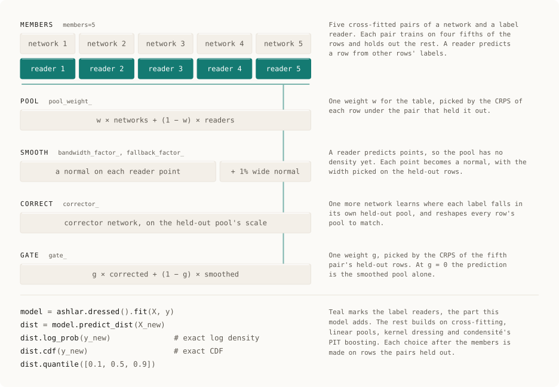

# Dressing a model

[Ashlar](../README.md) can fit several networks and several label readers to one table and return them as one distribution. `ashlar.dressed()` is the recipe; the class is `ASRDressed`. The name comes from masonry: ashlar is dressed stone, cut and finished to fit.

```python
import ashlar

model = ashlar.dressed().fit(X_train, y_train)

dist = model.predict_dist(X_test)        # one distribution per row
dist.log_prob(y_test)                    # exact log density
dist.cdf(y_test)                         # exact CDF
model.predict_quantiles(X_test, [0.1, 0.5, 0.9])
model.predict(X_test)                    # the mean
```

It is for one numeric target on a table of up to a few thousand rows, when the predicted distribution matters more than the time to fit. It is the slowest model in Ashlar: eleven fits in one.

## Why

A network with a density head fits a smooth map from the columns to the target. That is the wrong tool for some targets: one that is a linear function of the columns, one with a handful of values, one where a row's nearest neighbours already hold the answer.

A label reader (`ashlar.label_reader.LabelReader`) is the other tool. It has no weights from the columns to the target. Inside its forward pass it reads the labels of a set of training rows, its context, and solves one ridge regression of those labels on functions of their columns (a constant, each column's rank score and scaled value, and learned ReLU units), with a learned penalty. That gives each row a trend and every context row a leave-one-out residual. Attention then spreads each row's probability over those residuals, so the reader predicts point masses, one at the row's trend plus each context row's residual.

Neither wins on every table, so the two are pooled: a weight `w` on the network and `1 - w` on the reader. A pool with point masses has no density, so no log score. Dressing gives that pool a density and then corrects it.

## What `fit` does

<p align="center">
  <picture>
    <source media="(prefers-color-scheme: dark)" srcset="images/dressed-dark.svg">
    
  </picture>
</p>

1. The training rows are put in one random order and cut into five parts. Member `k` holds out part `k` and fits a network and a label reader on the other four parts. The network is `tabm_piecewise`, a [TabM](https://arxiv.org/abs/2410.24210) batch ensemble of 32 multilayer perceptrons on [piecewise-linear embeddings](https://arxiv.org/abs/2203.05556) of the columns, with a `flow` head, a [rational-quadratic spline flow](https://arxiv.org/abs/1906.04032). It trains on the likelihood, keeps the epoch with the lowest CRPS on part `k`, and is then annealed for three epochs. The reader trains on at most `reader_rows` rows of the four parts and is stopped on at most as many rows of part `k`. A target with few values gets another network, described [below](#a-target-with-few-values).
2. One pool weight `w` is picked from a grid of 21 (0, 0.05, ..., 1) by the CRPS of every held-out row under the member that held it out. The pool scored here is the unsmoothed one: the network read as its quantiles at 203 levels, and the reader's point masses. A tie goes to the smaller weight, and the five members share `w`.
3. Smoothing turns each of a reader's point masses into a normal. Its width is Silverman's rule of thumb on the row's weighted points, with Kish's effective sample size (one over the sum of the squared attention weights) as the number of points, times a factor from a grid of five, 0.125 to 2. Each smoothed reader gives 1% of its mass to a wide normal at the training labels' mean and standard deviation, so the wide normal is `0.01 * (1 - w)` of the pool. One factor is picked by the log score of every held-out row, and a second by the CRPS of at most 120 held-out rows per member. A member's pool now has a density.
4. One more network, the corrector, learns where each training label falls in its own row's pool. Its target is the label's normal score (the standard normal quantile of the pool's CDF at the label) under the pool, smoothed at the log-score factor, of the member that held the row out. It reads the row's columns only, has the members' network settings, and trains by likelihood on the held-out rows of the first four members. It keeps the epoch with the lowest CRPS, in units of the target, of the corrected pools on the fifth member's held-out rows. A member's corrected CDF at `y` is the corrector's CDF at the normal score of `y` under that member's pool.
5. A gate weight is picked from the same grid of 21, for the corrected pools against the pools smoothed at the CRPS factor, by the CRPS of the fifth member's held-out rows, the rows that also stopped the corrector. A tie goes to the smaller gate. The CRPS of a mixture can be lower than that of either part, so the gate can be positive even where the corrected pools alone score worse than the smoothed ones. At a gate of 0 the prediction is the smoothed pools alone.

The prediction is the gate times the average of the five corrected pools, plus the rest times the average of the five smoothed pools. At prediction each reader reads its held-out part as well as its training rows, so on up to 5,120 training rows every reader reads all of them; the numbers in steps 2 to 5 were picked with readers that read their training rows only. Every piece has a closed-form CDF and density, so the whole does too.

The recipe around the label reader is built from established methods. The members are cross-fitted. Each is fitted with one part held out, and the held-out predictions fit every later step, as the out-of-fold predictions of [AutoGluon-Tabular](https://arxiv.org/abs/2003.06505) fit the next layer of its stack. The pool is a [linear pool](https://doi.org/10.1214/13-EJS823) whose weight is picked on held-out rows, which is [stacking](https://doi.org/10.1214/17-BA1091); [kNN-LM](https://arxiv.org/abs/1911.00172) pools a language model with a nearest-neighbour distribution in the same way. The smoothing is kernel dressing from weather forecasting ([Roulston and Smith](https://doi.org/10.3402/tellusa.v55i1.12082), [Bröcker and Smith](https://doi.org/10.1111/j.1600-0870.2008.00333.x)); the wide normal, fitted to all the training labels, is the climatological part of affine kernel dressing, here with a fixed weight. The corrector and the gate follow the PIT boosting step of the [condensité](https://pypi.org/project/condensite/0.1.1/) package (versions 0.1.0 and 0.1.1): cross-fitted base models, a second model of where each label falls under the base model that did not see its row, given the columns, and one weight, picked on held-out rows, between the corrected and the uncorrected prediction. The package's ScoringBench entry, `condensite_pitbst_v0_1_1`, is second of the 21 models [below](#on-scoringbench). Here the base is the pool of networks and readers, the label's place is a normal score modelled by one network, and the weight is picked by CRPS. [Cal-PIT](https://doi.org/10.1088/2632-2153/ae1f05) reshapes a density by a map of its PIT that depends on the columns in the same way.

What this model adds is the label reader and its pairing with a network. We did not find the reader in the work we checked, and its parts are known: a predictive distribution from a fit and its leave-one-out residuals ([Vovk and others](https://doi.org/10.1007/s10994-018-5755-8), the [jackknife+](https://doi.org/10.1214/20-AOS1965)), learned attention over training rows ([TabR](https://arxiv.org/abs/2307.14338), [ModernNCA](https://arxiv.org/abs/2407.03257)), and a ridge regression solved inside a trained network ([R2-D2](https://arxiv.org/abs/1805.08136), [Residual Neural Processes](https://doi.org/10.1609/aaai.v34i04.5883)). Nor did we find a density network pooled with such a reader in earlier work on probabilistic regression for tables.

## What comes back

`predict_dist(X)` returns a `DressedDistribution`. A value array's last axis runs over the rows, as with every Ashlar distribution.

| Method | Returns |
|---|---|
| `log_prob(y)` | The exact log density. |
| `cdf(y)` | The exact CDF. |
| `quantile(levels)` | Quantiles, by solving the CDF. Accurate to about `3e-7` in probability, the precision of the networks' float32 CDFs. |
| `sample(n, seed)` | `n` draws per row, shape `(n, rows)`, by the quantile of uniform draws. |
| `mean()` | The mean, read from the quantiles at 203 levels. |
| `crps(y)` | The CRPS of the quantiles at 203 levels read as point masses, each carrying the probability from the level below. ScoringBench reads the same quantiles as a CDF that is linear between them, with the outer 0.1% on each side at the outermost quantiles; for a normal distribution the two readings differ by under 0.01%. |

On the estimator, `predict`, `predict_quantiles`, `log_prob`, `sample`, and `score` call these. A fitted model pickles.

## A target with few values

A target with at most 20 distinct values (`few_values=20`) is treated as a set of values. The members' networks are ordinal, a cumulative logit over the values, and are stopped on held-out log loss; the CRPS stopping is for the `flow` head. An ordinal network needs every value among its training rows, so a held-out row whose value does not occur in the other four parts moves into training. Such a row is held out by no member, and the held-out parts can be a little smaller than a fifth. The smoothed readers' mass is collected into the cells between adjacent values, the corrector is trained on the interval of normal scores that the observed value's cell covers under the row's pool, and the prediction is a probability for each value. `dist.values` holds the values and `dist.probabilities()` each row's probability of each. `log_prob` is then the log probability, `-inf` off the values, `quantile` returns the smallest value whose CDF reaches the level, and `mean` and `crps` are exact. `few_values=0` always fits a density.

## Settings

```python
ashlar.dressed(learning_rate=1e-3)             # any tabm_piecewise setting, for every network
ashlar.dressed(members=3, random_state=1)
ashlar.ASRDressed(network={"learning_rate": 1e-3}, reader={"max_steps": 2000})
```

| Argument | Default | Meaning |
|---|---|---|
| `members` | 5 | How many cross-fitted members. |
| `few_values` | 20 | The most distinct values a target may have and still be treated as a set of values. |
| `network` | `None` | Settings for `tabm_piecewise`, for every member's network and for the corrector, on top of `max_epochs=1000` and `cooldown_epochs=3`. The task, the seed, and the stopping metric are set by the model. |
| `reader` | `None` | Settings for each `LabelReader`. |
| `reader_rows` | 4096 | The most training rows a member's reader trains on, and separately the most held-out rows it is stopped on. A larger set is sampled down, because a reader's cost grows with the square of its rows. At prediction a reader reads both sets, so up to twice this many rows. |
| `floor_cost` | `None` | See [Limits](#limits). |
| `random_state` | 0 | Seeds the split, the members, the rows sampled for the readers and for the CRPS factor, and the corrector. |
| `threads` | `None` | Threads for the fit and for prediction: up to this many members train at once, and the readers' sums are split over as many. `None` reads the `ASHLAR_THREADS` environment variable, or else takes the CPUs the process may use, at most 8; `-1` takes them all. No fitted number and no prediction depends on it. Fits that share a machine each take their own threads, so give them fewer. |

After a fit, `pool_weight_`, `bandwidth_factor_`, `fallback_factor_`, and `gate_` are the four searched numbers, `members_` and `corrector_` the fitted parts, and `history_` the searched curves.

## Limits

- It takes one numeric target, exactly observed. Censored and interval labels, joint targets, classes, and sample weights raise an error.
- It has been tested on small and mid-size tables only. Every test below is on at most 2,400 training rows, so no test has reached the `reader_rows` cap.
- A target that the columns determine almost exactly is a weak spot. Mixed into a pool that is a point mass at the label, a share `e` of the wide normal adds `e` squared times the wide normal's own CRPS. With `e = 0.01 * (1 - w)` and normally spread labels, that is at most about 0.00006 of the labels' standard deviation. It is nothing on most tables, but it is larger than the whole score where the pool's CRPS is below that, and the corrector has to win it back. On one such table in the tests below it did on two folds and did not on the third. `floor_cost=0.01` lowers the share until this cost, computed for a point-mass pool and without the factor `1 - w`, is at most 1% of the unsmoothed pool's held-out CRPS; it is off by default until it has passed a test of its own.
- It is slow: five networks, five readers, and a corrector. On the 46 held-out fits below, a fit took a median of 16 minutes, from 2 minutes to 2.3 hours (the longest on 2,400-row tables), on a 12-core laptop that was running several fits at once; the times are the `seconds` field of [`examples/readme/artifacts/dressed/devset.json`](../examples/readme/artifacts/dressed/devset.json).
- Prediction is slow as well, and its cost grows with the rows you predict and the quantiles you read. On an idle 12-core laptop, a model fitted to 1,200 rows took 0.025 seconds per row to build its distributions, and then 0.12 seconds per row to read 203 quantiles with the gate at 0, or 0.27 with the corrector in use (timed by setting the gate by hand). `predict` and the ScoringBench wrapper both read 203 quantiles. Three quantiles took 0.002 seconds per row, and a `cdf` or `log_prob` value 0.0003. On ScoringBench's 2,400-row tables a prediction took a median of 0.9 seconds per row (554 seconds for 600 test rows), with six fits sharing the laptop and every prediction computed a second time for the undressed pool. That suits thousands of rows. For hundreds of thousands of rows to train on or to predict, use the general estimator.
- `predict` is slightly too high. The mean is read from the 203 quantiles with each quantile carrying the whole gap in level below it, and that reading overstates a mean: by 0.014 of the distribution's standard deviation for a normal shape, and by 0.020 for a Student-t with four degrees of freedom. The predicted distribution itself is not shifted, so `cdf`, `log_prob`, and `quantile` are unaffected. `DressedDistribution.crps` uses the same weights, and so does `fit` when it scores candidate pool weights, smoothing factors, and gates. This is to be fixed.
- It has fewer methods than the general estimator. `ASRDressed` is a scikit-learn regressor with `fit`, `predict`, `predict_dist`, `predict_quantiles`, `log_prob`, `sample`, and `score`, and it pickles. It has no `calibrate`, `predict_interval`, `predict_exceedance`, or `save` yet; [docs/estimator.md](estimator.md#the-dressed-estimator) says what to use instead.

## How it was tested

The design was chosen on 23 regression tables: 12 from OpenML's CTR23 suite, 7 from PMLB, and 4 of those with the target binned into 5 to 10 ratings. Each is split five ways, with at most 2,400 training and 600 test rows. Fold 0 was used to design the model. Folds 1 and 2 had been used before the dressed model existed: all three folds chose the networks' training length, and folds 1 and 2 confirmed an earlier model, one network pooled with one reader. The dressed model's results on folds 1 and 2 were read after its design and its pass line were fixed, except three results read while that run was going; the pass line did not change.

CRPS is lower-is-better. A ratio below 1 means the dressed model is better.


| Dressed model against | Folds 1 and 2, 46 fits: geometric mean | Median | Better by >1% | Within 1% | Worse by >1% |
|---|---|---|---|---|---|
| One member's network alone | 0.569 | 0.910 | 37 | 7 | 2 |
| The five networks, averaged | 0.568 | 0.914 | 37 | 7 | 2 |
| One network and one reader, pooled | 0.920 | 0.955 | 38 | 6 | 2 |
| The five members pooled, not dressed | 0.955 | 0.974 | 27 | 17 | 2 |

The last two rows have no density, so only the first two can be compared on log score. The dressed model's mean log score was above the five averaged networks' on 39 of the 46 fits, by 0.65 nats on average and 0.16 at the median.

The geometric means in the first two rows are pulled down by three tables where the network alone is far off (a linear target and two others); the medians are the better summary.

The pass line was on the last row: a geometric mean at most 0.5% above the undressed pool's and at least 1% below the pools smoothed at the CRPS factor (it was 0.916 of them), worse by more than 1% on at most 4 of the 46, and a log score above the networks' on at least 24 and on average. It passed. After fold 0 passed, and before any result on folds 1 and 2 existed, a second line was added, and either line would pass the model. The second line kept the conditions on the smoothed pools and the log score, asked for a larger average gain (a geometric mean at most 0.97 of the undressed pool's), allowed up to 8 of the 46 fits to be worse by more than 1%, and allowed at most one fit worse by more than 5%. Folds 1 and 2 failed it on that last condition: two fits were worse than the undressed pool by more than 5%.

- `wave_energy`, fold 2: 5.5 times the undressed pool's CRPS. The target is a linear function of the columns, the case described under [Limits](#limits). On folds 0 and 1 of the same table the dressed model was 11% and 6% better. Against the network alone it is still about 200 times better on that fold.
- `557_analcatdata_apnea1_rated6`, fold 2: 10% worse. The gate was picked on 76 rows and chose the corrector where it did not help.

Without the first of these the geometric mean of the last row is 0.919.

On fold 0, which the design had seen, the same ratio was 0.913, better by more than 1% on 13 tables and worse on 1.

The numbers above come from the research code the design was worked out in. `ASRDressed` was then run on fold 0 of all 23 tables, with the same splits and seeds, to check that the library gives the same model:

| `ASRDressed` against the research code, fold 0, 23 fits | Median | Geometric mean | Largest gap |
|---|---|---|---|
| CRPS of the dressed model | 1.000 | 1.000 | 4.4% |
| CRPS of the five members pooled, not dressed | 1.000 | 1.000 | 2.1% |

On its own fits the library's dressed model was at 0.913 of its undressed pool, better by more than 1% on 13 tables and worse on 1, and its mean log score was above the five averaged networks' on 22 of the 23, by 0.68 nats on average.

Three earlier designs failed on fold 0 and were dropped: a network fitted on top of the reader's prediction alone (worse than one network pooled with one reader on 15 of 23 tables, and than the five members pooled on 17), smoothing with no corrector (2% worse than the undressed pool, worse on 7), and the corrector with no gate (7% better on average, but worse by more than 1% on four tables with 380 to 852 training rows).

## On ScoringBench

[ScoringBench](https://github.com/jonaslandsgesell/ScoringBench) ranks probabilistic regression models by CRPS on 99 tables from OpenML. Each table is split five ways, with at most 2,400 training and 600 test rows, the same caps as the tests above, and none of the 23 tables above is among the 99. We ran `ashlar.dressed()` with its default settings on ScoringBench's own code, tables, and folds, and ranked it with the 20 published models that are trained from scratch and not tuned, listed here by their ScoringBench names.

Ashlar's networks were worked out on ScoringBench. Results there set the ordinal output for targets with at most 20 values, early stopping on CRPS, and the longer training, and the dressed model is the third Ashlar model run on all 99 tables. The label reader, the smoothing, the corrector, and the gate were designed on the 23 development tables above. The dressed model then ran on ScoringBench once, with its design and settings fixed.

On 12 of the 99 tables the target has at most 20 distinct values in every training fold, so the dressed model takes its few-values path there. A fit took a median of 32 minutes per fold, on the CPU of a 12-core laptop shared with other work.

A mean rank is a model's rank on each table, averaged over the 99 tables; 1 is best.

| Model | Mean rank |
|---|---|
| Dressed model (our run) | 1.33 |
| `condensite_pitbst_v0_1_1` | 4.73 |
| `pytabkit_realmlp_td` | 5.80 |
| `tabm_d` | 5.89 |
| `catboost_quantile` | 7.07 |
| `xgb_vector` | 9.62 |
| `ngboost_gaussian` | 10.07 |
| `flexcode_randomforest` | 10.71 |
| `crepes_catboost_difficulty` | 10.83 |
| `forest_diffusion_flow` | 11.53 |
| `cde_MDN` | 11.54 |
| `xgblss_Gaussian` | 12.24 |
| `xgb_vector_quantile` | 12.78 |
| `crepes_xgb_difficulty` | 12.90 |
| `cde_NF` | 12.95 |
| `flexcode_xgboost` | 13.23 |
| `crepes_catboost_difficulty_mondrian` | 13.65 |
| `nflows_rqs` | 15.11 |
| `crepes_xgb_difficulty_mondrian` | 15.58 |
| `surjectors_maf` | 16.66 |
| `pymc_bart` | 16.81 |

ScoringBench tests the ranks with a Friedman test and then a Nemenyi test. With 21 models on 99 tables, two mean ranks that differ by more than 3.15 differ at the 5% level. The dressed model is ahead of each of the other 20 by more than that.

It had the lowest CRPS of the 21 on 82 of the 99 tables. It was second on 10: 1201_BNG_breastTumor, 344_mv, 564_fried, abalone, Brazilian_houses, kin8nm, puma32H, sensory, Student_Performance, and visualizing_soil. It was third on Another-Dataset-on-used-Fiat-500-(1538-rows), MIP-2016-regression, and QSAR-TID-10980, fourth on Goodreads-Computer-Books and PRODUCTIVITY, sixth on 1000-Cameras-Dataset, and seventh on nyc-taxi-green-dec-2016.

The next table says what each part adds. Each row is one Ashlar model, ranked alone among the same 21, with a critical difference of 3.15 in every row. The ratio is the geometric mean over the 99 tables of a row's mean CRPS divided by the row above's, with the tables where it is lower and higher by more than 1%.

| Ashlar model | Mean rank | condensité's mean rank | CRPS ratio to the row above | Tables lower | Tables higher |
|---|---|---|---|---|---|
| One network trained for at most 100 epochs | 4.73 (second) | 4.44 | | | |
| One network with the longer training | 3.58 | 4.51 | 0.934 | 46 | 6 |
| That network pooled with one label reader | 1.62 | 4.67 | 0.903 | 62 | 0 |
| Five cross-fitted pairs pooled, not dressed | 1.38 | 4.71 | 0.978 | 57 | 1 |
| The dressed model | 1.33 | 4.73 | 0.987 | 20 | 0 |

The label reader is the largest step. Pooled with it, one network's CRPS falls by 9.7% on the geometric mean, and its mean rank goes from 3.58 to 1.62, a lead of 3.05 that is short of the critical difference. Cross-fitting five pairs takes the lead past it, and the dressing adds a density and a further 1.3%. Rows 2 and 3 come from the same fits, and so do rows 4 and 5, so each of those two steps changes one part. The other two steps compare separate runs: from row 1 to row 2 the code version and the network's validation rows changed along with its training, and from row 3 to row 4 the code moved from research code to the library, and the pool weight, chosen on one fifth of the training rows in row 3, is chosen on all of them in row 4.

The rank is provisional. It comes from our run, ranked against ScoringBench's published results of November 7, 2026. ScoringBench's maintainer has rerun submitted models before adding them to the leaderboard, and the dressed model is not there yet. ScoringBench has since changed some of its scoring code. Rescored with the code of November 13 (commit 7f36e0b), the undressed pool's saved predictions have the same CRPS on each of the 480 folds rescored. A change dated November 14 (commit 9406d60) spreads the probability beyond a model's outermost quantiles out to the ends of the training labels' range, and with it the pool's CRPS moves by less than 0.16% on a fold and 0.13% on a table. The other models' published results come from the earlier code, and how far the change moves them is not known until ScoringBench regenerates them. It has also dropped one table, Brazilian_houses, for target leakage. On the other 98, the dressed model's mean rank is 1.33 and condensité's 4.69, and the margin at the 5% level is 3.16.

ScoringBench also lists tuned models and models pretrained on other data. They are not part of this comparison. Our per-fold results and the scripts behind every number in this section are in [benchmarks/scoringbench](../benchmarks/scoringbench/), which also ranks the dressed model among all 64 models.
