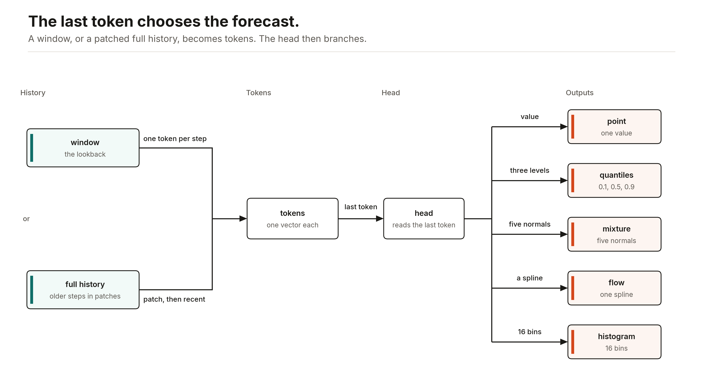
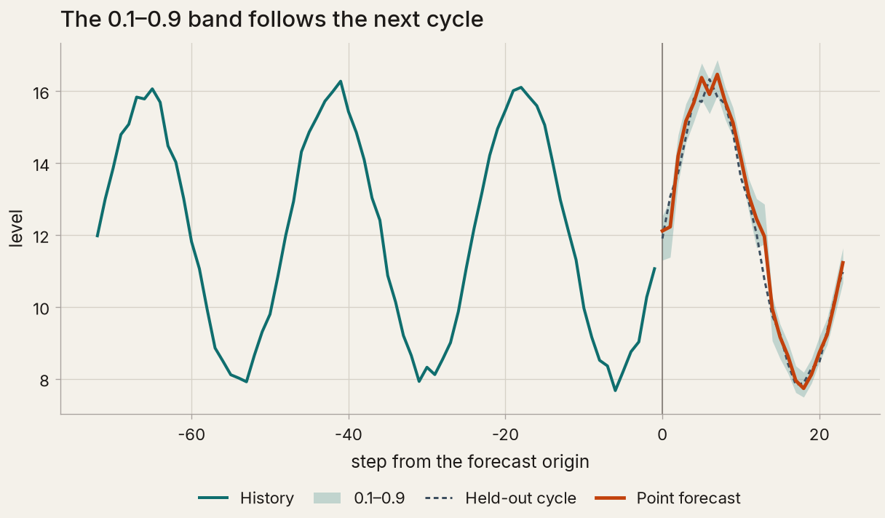
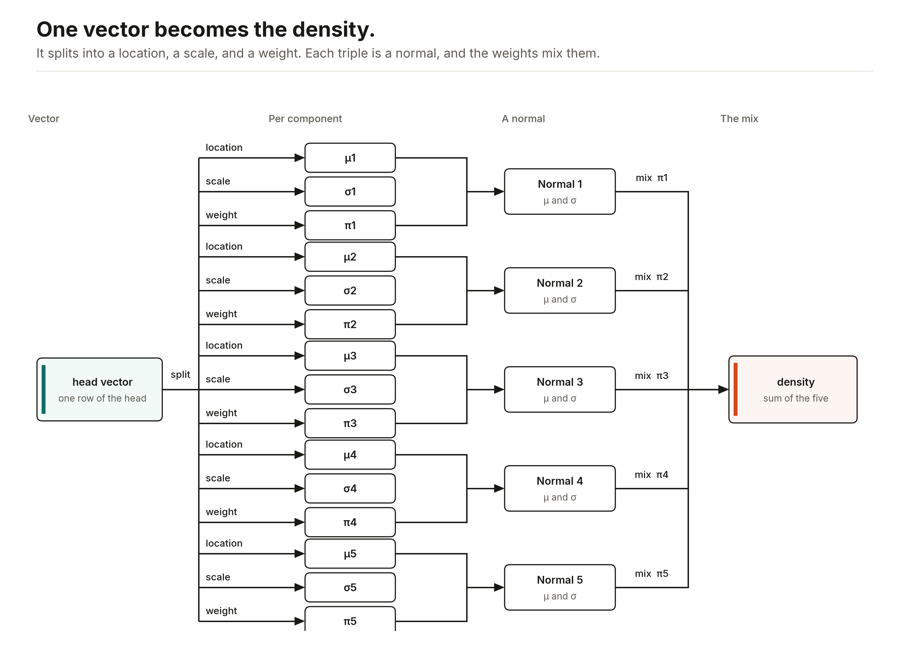
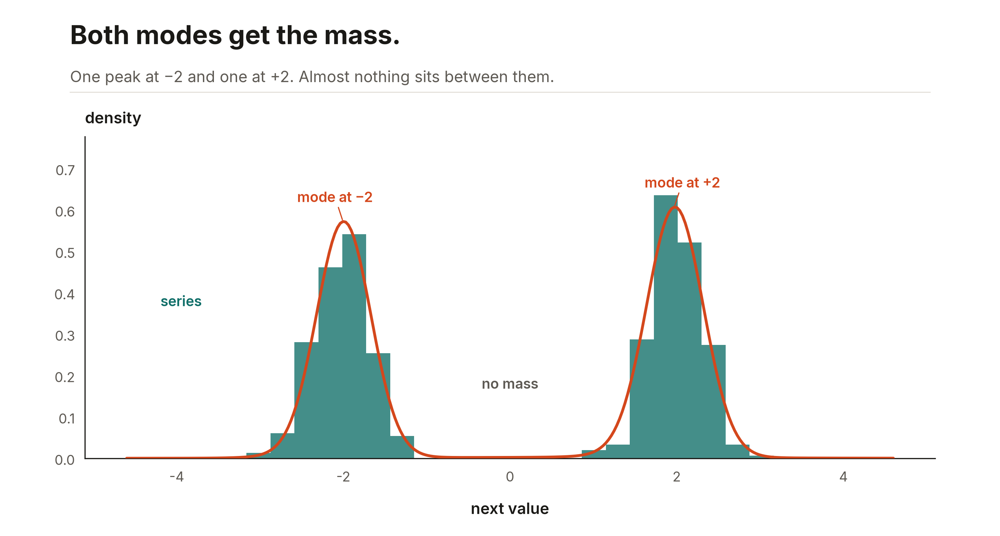
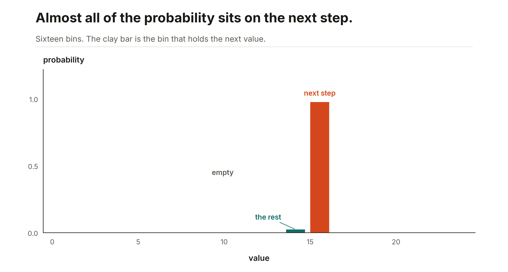

# Forecast heads

[Ashlar](../README.md)'s two forecasters read one series at a time. `ASRForecaster` reads a window of `lookback` steps and emits the next `horizon` values. The default lookback is 48 and the default horizon is 12. The default head is `mse`. For many series, covariates known ahead, and the joint path, make each forecast origin a row of a table instead: [many series, covariates, and paths](#many-series-covariates-and-paths).

`fit(series)` holds out the last 10% of that series, on the clock, and uses it only to choose the epoch. It then starts again from the same initialization and trains that many epochs on every window in the series you passed. `predict` reads the last `lookback` observations and returns one point per horizon step, on the original scale.

```python
from ashlar import ASRForecaster

model = ASRForecaster(lookback=48, horizon=1, head="quantile")
model.fit(series)
model.predict(history)
```

`history` has shape `(lookback,)` or `(batch, lookback)`. A batch in, a batch out.



A window, or the full history, becomes tokens. The last token's vector goes to the head.

The forecast figures on this page are one-step models on synthetic series, fit for a few epochs on CPU. [`examples/figures.py`](../examples/figures.py) writes them.

## Quantile

`head="quantile"` trains a pinball loss at 0.1, 0.5, and 0.9. Softplus gaps keep the three levels in that order. `predict` is the 0.5 level. `quantiles(history)` returns all three, shape `(horizon, 3)` for one window.



The quantile figure rolls a one-step model across a held-out cycle. Each window is the observed history ending at that step. That cycle was held out of the fit. The clay line is `predict`. The band is the 0.1 and 0.9 levels.

## Gaussian

`head="gaussian"` minimizes the normal negative log-density. The scale is `softplus(raw) + 1e-4`, the same map as a tabular `task="normal"`. `predict` is the mean. `gaussian(history)` returns the location and the scale on the original scale. `log_prob` is the density.

## Mixture

`head="mixture"` trains five normals. Component scales use that same positive map, and the weights are a softmax. The loss is the mixture negative log-density. `predict` is the weighted mean of the component locations.



The head splits the last token's vector into a location, a scale, and a weight for each of the five normals, then adds them.

`log_prob(history, value)` evaluates the density at `value`, which has the same shape `predict` returns.



The mixture figure is that density on a grid, for a series of independent draws from two normals centered at −2 and 2. The bars are the series itself.

## Flow

`head="flow"` is one rational-quadratic spline per horizon step, with linear tails, pushed forward from a standard normal and then shifted and scaled, so each step of each window has its own spread and tails. The loss is the negative of the exact change-of-variables log-density. `predict` is the median, the image of zero. `sample(history, key, n)` is one forward draw per sample. `log_prob` is the density.

## Histogram

`head="histogram"` is a softmax over 16 bins fixed on the standardized interval [−4, 4], plus a small squared error of the probability-weighted bin center. `predict` is that center, mapped back to the original scale. `bin_probabilities(history)` returns the probabilities and the bin centers on the original scale.



The histogram figure is one held-out step of a synthetic cycle. The clay bar is the bin that contains the next value.

## Student-t

`head="student_t"` is a location, a scale, and degrees of freedom per horizon step, the degrees of freedom held above 2 so the variance stays finite. The loss is the Student-t negative log-density, so one large shock costs less than it does under a normal. `predict` is the location. `sample` and `log_prob` work as for the gaussian.

## A longer prefix

`ASRHistoryForecaster` uses the same seven heads. The last `lookback` observations are one token each. Every older observation sits in one non-overlapping patch of that length. `predict(series)` forecasts the horizon after the last observation. Pass `origins` to forecast at earlier cut points. `quantiles`, `log_prob`, `gaussian`, `sample`, and `bin_probabilities` take the same `origins` argument.

## Save and load

```python
from ashlar import ASRForecaster

model.save("models/demand")                      # metadata.json and model.eqx
model = ASRForecaster.load("models/demand")
```

Both forecasters save their settings as JSON and their weights with Equinox, never with pickle. Load with the class that saved: `ASRHistoryForecaster.load` for the full-history model.

## Many series, covariates, and paths

The two forecasters read one series and nothing else. For many series, covariates, and the whole path ahead, make each forecast origin a row of a table and fit an ordinary `ASRRegressor` with a joint head. `ashlar.horizon.horizon_frame` builds the table from a long one, one row per series and step:

```python
from ashlar import ASRRegressor
from ashlar.horizon import horizon_frame, peak, stockout

frame = horizon_frame(
    sales,                                   # one row per store and day
    target="units", lookback=28, horizon=12,
    series="store", time="day",
    known=["promo", "holiday", "price"],     # known ahead: one column per step
    past=["customers"],                      # known once they happen: lags
    static=["store_type"],
)
frame.X        # one row per store and origin
frame.Y        # (rows, 12): the next 12 days, a joint outcome
frame.index    # the store, the origin, and the scale of each row

model = ASRRegressor(task="multivariate_gaussian", head_kwargs={"rank": 4}).fit(frame.X, frame.Y)
paths = model.sample(frame.X, n=400)         # (400, rows, 12): paths with the dependence between days
```

Each row's features are the target's last `lookback` values (`units_lag1` is the value at the origin), the same lags of each `past` column, each `known` column's value at every step ahead (`promo_step1` … `promo_step12`), and the series' `static` columns. Its outcome is the next `horizon` values. An origin needs `lookback` steps of history; `stride`, `start`, and `end` choose the origins, so a split by time is three calls, and `complete=False` keeps the last origins, whose future is not in the table yet, for forecasting. Steps are rows, so a series with gaps should be reindexed first; a missing value in the lookback stays missing, which the model reads as a missing feature, and an origin whose horizon has a missing value is left out. `scale="mean"` divides each row's lags and outcome by the mean absolute value of its lags and adds its log as a feature, so one model can read series of very different sizes, and `frame.unscale(draws)` puts draws back in the target's units.

`multivariate_gaussian`, `multivariate_mixture`, and `multivariate_flow` give the joint distribution of the steps, with an exact log density, in one pass, with no draws fed back. A function of the path comes from its draws with the dependence between steps intact: the total over the horizon, the peak day, or the first step at which the cumulative demand passes the stock. `calibrate` calibrates any of them on held-out origins, and `predict_interval` and `predict_exceedance` read them:

```python
def total(y):
    return y.sum(axis=-1)

model.calibrate(cal.X, cal.Y, target=[total, peak, stockout(500.0)])
model.predict_interval(test.X, 0.8, target=total)                    # (rows, 2), calibrated
model.predict_exceedance(test.X, threshold, target=peak)             # P(peak > threshold)
model.predict_exceedance(test.X, 7, target=stockout(500.0))          # P(the stock lasts beyond day 7)
```

The guarantee is split conformal's: the calibrated interval of a path function holds on new origins exchangeable with the calibration origins, so calibrate on the most recent origins before the ones you forecast, and recalibrate as the data moves.

This is a direct, non-autoregressive model of the path. On Rossmann's daily sales, 12 days ahead, the covariates cut the daily error by 64%, and the joint normal's 80% interval for the 12-day total holds 76% of totals, where the same model with independent days holds 51%. Chronos-2, zero-shot, is level with it day by day but gives no paths, and DeepAR's autoregressive paths score 3,881 on the total against 2,623, though DeepAR calibrates the peak day best. The joint head does little for the peak day, where `multivariate_flow` does best. A normal on log sales can give a row unlike any it trained on a spread of orders of magnitude, so cap its draws or use the flow. [docs/benchmarks.md](benchmarks.md#forecast-paths-with-covariates) has the tables.
