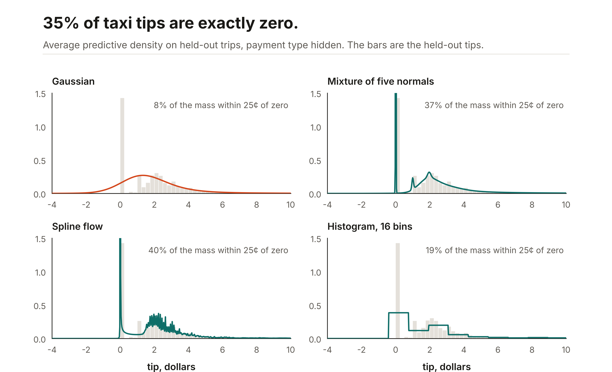

# Heads and the target shapes they fit

[Ashlar](../README.md) answers with whatever head you ask for. A tree regressor predicts a mean; for an interval you fit one more model per quantile, or put a fixed-width normal around the mean, and neither gives a density you can evaluate or sample from. An Ashlar head gives the whole predictive distribution from one fit, and the head is a choice you make for the shape of the target.

| The target looks like | `task` | Why |
|---|---|---|
| A bell whose width changes from row to row | `gaussian` | Two numbers per row, a mean and a scale. Cheap and easy to read. |
| A few distinct regimes, or a sharp peak with a long tail | `mixture` | Five normals with learned weights. Each mode gets its own location and spread. |
| Skewed or lumpy, with a spread that moves with the inputs | `flow` | A monotone spline bends a normal into a skewed or many-humped shape, and each row gets its own shift and scale, so its spread and its tails are its own. Past the spline's range the tails are normal; for heavier ones use `student_t`. The density is exact. |
| Any shape, including a spike at one value | `histogram` | A softmax over fixed bins across ±4 standard deviations. No shape assumption, and the resolution is yours: `head_kwargs={"bins": 48}`, 16 by default. The two end bins are open-ended. |
| Only the interval matters | `quantile` | Pinball loss at 0.1, 0.5, and 0.9. No density and no draws. |
| Heavy tails, outliers you should not chase | `student_t` | A location, a scale, and degrees of freedom (above 2, so the variance is finite) per row. The point is the location, not the mean. |
| Counts: visits, claims, goals | `poisson` | One rate per row. The target stays raw and must hold non-negative whole numbers. |
| Counts with more spread than their mean | `negative_binomial` | A mean and a dispersion per row, the variance being mean + dispersion × mean². |
| Often exactly zero, otherwise a positive amount | `hurdle` | The probability of zero, plus a lognormal or gamma amount. Tips, claims, rainfall. |
| Several columns that move together | `multivariate_gaussian` | A joint normal with a learned low-rank covariance, so totals and joint events come out right. |
| Several columns that move together in a few distinct ways, such as a day when everything spikes at once | `multivariate_mixture` | Five joint normals with learned weights (`head_kwargs={"components": 5}`), each with its own location and low-rank covariance. |
| Several columns whose dependence is curved, skewed, or heavier in the tails | `multivariate_flow` | An autoregressive flow: each column's whole conditional shape can change with the columns before it. |
| Several columns of different kinds, such as a claim count and its cost, or a cause and a time | `chain` | One head per column, each of its own kind, each reading the columns before it: `head_kwargs={"columns": ["negative_binomial", "hurdle"]}`. |

```python
from ashlar import ASRRegressor

model = ASRRegressor(task="mixture").fit(X, y)
model.predict(X_new)                       # the mean
model.predict_quantiles(X_new, [0.1, 0.9])
model.sample(X_new, n=1000)                # draws, on the scale of y
model.log_prob(X_new, y_new)               # log density of what happened
model.predict_dist(X_new)                  # all of the above as one JAX object
```

Every head returns the same kind of object from `predict_dist`, with `log_prob`, `sample`, moments, a CDF, and quantiles. [docs/distributions.md](distributions.md) describes it.

Every head with a CDF, which is all of them except `quantile`, also trains on a `y` that was not seen exactly: a sold-out day, a bracket, a rounded or truncated value, a reading with known noise, or a total over several rows. The joint heads take a label with a cell per column, each exact, censored, in a range, or rounded, so a day when two of four products sold out still teaches all four. [docs/observed.md](observed.md) says which head takes which label.

On hourly bike rentals and NYC taxi pickups, both overdispersed, the negative binomial's 80% interval holds 76% to 82% of held-out counts where a Poisson's, Ashlar's or LightGBM's, holds 24% to 62%, and its log mass is far better (4.50 against LightGBM's 6.52 on bike rentals). The `mixture` stays as good on CRPS for large counts; the count heads win where the counts are small and zeros matter, and lose on an underdispersed count such as abalone rings, where `gaussian` or `mixture` is the better choice. [docs/benchmarks.md](benchmarks.md#count-heads) has the tables.

Either count head takes `head_kwargs={"zero_inflated": True}`: one more output per row is the probability of a structural zero, for counts with more zeros than any count distribution gives, like a customer who never buys. A count head's `log_prob` is a log mass, its draws and quantiles are whole numbers, and its `predict` is the mean.

The forecasters take the same heads by name, as the `head` argument, except the two count heads, which need the raw count. See [docs/forecast.md](forecast.md).

## Calibrated intervals

A head's intervals are only as honest as its fit. `calibrate` corrects them on rows the model was not fitted on, so an interval that promises 80% holds at least 80% of new rows exchangeable with those:

```python
model = ASRRegressor(task="mixture").fit(X_train, y_train)
model.calibrate(X_holdout, y_holdout)
model.predict_interval(X_new, coverage=0.8)   # split-conformal, shape (rows, 2)
model.predict_quantiles(X_new, [0.1, 0.9])     # each level recalibrated
model.predict_exceedance(X_new, threshold)     # P(y > threshold) per row, recalibrated
```

A density head stores the probability integral transform of each held-out row and widens or narrows its nominal level until the interval covers what it should (distributional conformal prediction). The same table recalibrates a probability: `predict_exceedance` replaces the model's own `P(y ≤ threshold)` with the share of held-out rows whose transform was at most that much, so an overconfident model's small probabilities move up and its large ones down. The map is the same for every row, so it corrects a model that is wrong the same way everywhere, not one that is too narrow on some rows and too wide on others. The quantile head moves its 0.1 and 0.9 levels out by the conformal margin (conformalized quantile regression) and gives only its 80% interval. The calibration saves with the model, `calibrated=False` reads the raw head, and `fit` clears it. A few hundred held-out rows is enough for an 80% or 90% interval.

One calibration of every row holds its coverage over those rows on average, not within each kind of row: an interval can hold 95% of quiet rows and 50% of loud ones and still average 80%. `calibrate` can calibrate groups of rows on their own (Mondrian conformal prediction):

```python
model.calibrate(X_holdout, y_holdout, groups="store")       # a column of X, read again from X_new
model.predict_interval(X_new, 0.8)                           # each row reads its store's table

model.calibrate(X_holdout, y_holdout, groups=labels)         # one label per row
model.predict_interval(X_new, 0.8, groups=new_labels)

model.calibrate(X_holdout, y_holdout, localize="members")   # bins of member disagreement
```

Each group with at least 100 calibration rows (`min_group_rows`) gets tables of its own, so the interval holds within that group; a smaller group, and a group the calibration did not see, reads the table of every row. `localize="members"` makes the groups up to five equal bins of how much an ensemble's members disagree on a row, as a share of its predictive spread (`predict_uncertainty`), so a row the members disagree on is calibrated with rows they disagreed on as much. It needs a backbone with several members, such as `backbone="tabm"`. `predict_quantiles` and `predict_exceedance` read the groups the same way.

On public tables one calibration often holds within groups already: after it, every group of California by distance to the ocean, diamonds by cut, abalone by sex, and taxi tips by taxi color held 77% to 82% of its rows. A table per group pays off where coverage moves with the group. By hour of day, one table left the electricity flow model's total between 67% and 91% across the hours, and a table per hour put every hour between 77% and 83%. A group's own table is noisier, so a group with only a hundred or so rows is better off with it only where the table of every row is far off for it. [docs/benchmarks.md](benchmarks.md#coverage-within-groups) has the numbers.

The joint heads calibrate each column, the sum of the columns, any function of them you name, such as the largest column, and a joint region; [docs/distributions.md](distributions.md#calibrating-the-columns-and-the-total) has the detail.

On five public tables, three splits each, calibration brought the default mixture's 80% interval to between 79.4% and 80.7% of held-out rows, from between 75.9% and 88.6% before. It widened the intervals that were too narrow (California, 75.9% → 80.7%; bike rentals, 76.8% → 79.7%), narrowed the one that was too wide (taxi tips, 88.6% → 79.9%), and left the ones that were right alone. The same conformal step on LightGBM's quantile models gives about the same coverage with a wider interval on three of the four tables where it applies. [docs/benchmarks.md](benchmarks.md#calibrated-intervals) has every number.

For labels rather than numbers, `ASRClassifier` fits a softmax, `ASROrdinalClassifier` a cumulative logit that keeps neighboring classes close, and `ASROutcomeTree` one branch softmax per internal node of a tree of outcomes. [docs/tabular.md](tabular.md#tasks) covers all three.

## Large tables

CRPS scores the whole predictive distribution in the target's units, lower is better. NLL is the negative log density at the value that happened. The trees have two ways to give a distribution: the early-stopped mean with a normal whose width is the validation residual, and CatBoost's `RMSEWithUncertainty`, which fits a mean and a variance per row.

| Table | Score | Ashlar `mixture` | CatBoost mean + variance | Best tree mean + normal |
|---|---|---:|---:|---:|
| Airline delay, minutes | CRPS | **9.17** | 11.46 | 12.17 |
| | NLL | **2.66** | 4.72 | 4.81 |
| | 80% coverage | 80% | 94% | 94% |
| Year | CRPS | **4.05** | 4.41 | 4.61 |
| | NLL | **3.08** | 3.42 | 3.58 |
| | 80% coverage | 77% | 83% | 85% |
| Zurich transport | CRPS | **1.62** | 1.74 | 1.75 |
| | NLL | **2.00** | 2.53 | 2.53 |
| | 80% coverage | 79% | 80% | 79% |
| NYC green taxi tips, $ | CRPS | 0.59 | **0.46** | 0.66 |
| | NLL | **−1.97** | 0.70 | 1.98 |
| | 80% coverage | 82% | 83% | 95% |

The mixture has the best likelihood on every table and the best CRPS on three of four. Its intervals are honest: an interval that promises 80% holds about 80% of held-out values, where the trees' normal holds 94% of airline delays because one width has to serve every flight. On airline delay the mixture's 80% interval is less than half as wide as the trees' (33 minutes against 75) and still covers 80%. The taxi tips are the exception on CRPS: the trees' mean is so much closer there (RMSE 1.75 against 1.98) that CatBoost's mean and variance win on CRPS, while the mixture still puts far more density on the tips that happened, many of them exactly zero.

## Conditional predictive distributions


One fit per head on taxi fares, given the zones, the hour, the weekday, the passengers, and the cab color, with distance and the total held out. The same model answers with a different shape for each condition, and the best head changes with it, on held-out log density: the mixture on Manhattan hops (−2.79), and the histogram at 48 bins on Brooklyn trips (−3.29, against the mixture's −3.30 and the flow's −3.47) and on the Queens airport corridor (−3.30), where 32% of trips run at the $52 flat fare. Only the histogram grows a real spike there, 23% of its mass against the flow's 15%, the mixture's 5%, and the gaussian's 1%: a smooth density can only approach a spike at one value. [`examples/readme_figures.py`](../examples/readme_figures.py) draws it.

## Smaller tables



NYC taxi tips with the payment type hidden. A third of tips are exactly zero, the cash fares, and the rest are a skewed bump around $2. The Gaussian head has to cover both with one bell, so it puts only 8% of its mass within 25¢ of zero and spills below it. The flow and the mixture grow a spike there and put 40% and 37% within 25¢ of zero. The histogram sees the spike but cannot make it narrower than one bin.

| Target | Shape | `gaussian` | `mixture` | `flow` | `histogram` | Tree mean + normal |
|---|---|---:|---:|---:|---:|---:|
| Taxi tips, $ | spike at zero, skewed | 0.950 | **0.872** | **0.872** | 0.917 | 1.001 |
| California value, $100k | capped at 5.0 | 0.225 | **0.205** | 0.211 | 0.229 | 0.236 |
| Diamond price, $1,000 | skewed, spread grows with size | 0.216 | **0.202** | 0.210 | 0.343 | 0.274 |
| Abalone rings | near normal, counts | 1.105 | **1.076** | 1.087 | 1.089 | 1.157 |
| Melbourne min. temperature, °C, one day ahead | seasonal, near normal | 1.264 | **1.243** | 1.247 | 1.262 | — |

CRPS, three splits each. The mixture is the best head on four of the five tables and ties the flow on taxi tips, and every Ashlar density head beats a tree mean with a constant-width normal on California, diamonds, and abalone. The right head still depends on the shape: the histogram is the worst head on diamond prices, where most of the mass sits in two or three of its fixed bins.

The intervals are better calibrated too. With an interval that promises 80%, the three LightGBM quantile models cover 70% of held-out California values, 69% of diamond prices, and 72% of abalone rings. Ashlar's mixture covers 76%, 80%, and 78%. On the temperature forecast the mixture beats LightGBM on the same 28-day window on every interval score: pinball 0.554 against 0.573, and coverage 83% against 77%.

Every column, with pinball loss, coverage, width, and log-likelihood, is in [docs/benchmarks.md](benchmarks.md#distributions-on-smaller-tables).

## Where the members disagree

A predictive distribution says how noisy the target is. It does not say how sure the model is of that distribution. An ensemble backbone trains several members together, and where they disagree the data did not settle the answer: rows far from the training data, rare categories, thin corners of the table. `predict_uncertainty` splits the two:

```python
model = ASRRegressor(task="mixture", backbone="tabm").fit(X, y)
parts = model.predict_uncertainty(X_new)
parts["epistemic"]   # spread of the members' points, on the scale of y
parts["aleatoric"]   # the noise each member predicts, as a standard deviation
parts["total"]       # both, by the law of total variance
```

A point regression or the quantile head has no noise model, so it returns `epistemic` and `total` only. A classifier or an ordinal model returns entropies in nats instead: `total` is the entropy of the mean probabilities, `aleatoric` the members' mean entropy, and `epistemic` the mutual information between the label and the member. The default `residual_mlp` has one member, so its `epistemic` is zero: use `backbone="tabm"`, or any backbone with `k` above 1.

On three public tables with `tabm_piecewise(task="gaussian")` (32 members), every part ranks rows by error well: keeping the half the model is surest of halves the RMSE on California housing and cuts it by more than 80% on diamond prices. In range, the noise ranks errors a little better than the member spread, because most of the error there is noise. Trained below the 80th percentile of one column and tested above it, the epistemic part rose 2.5 times on California, 4 times on diamonds, and 1.6 times on bike rentals, more than the aleatoric part did on each. That makes it a flag for rows unlike the training data, not an error bar: on diamonds above the training carats the RMSE grew 21 times. These are two splits on California and one on the others, so read them as indicative. [docs/benchmarks.md](benchmarks.md#member-uncertainty) has every number.

Calibrating by the members' disagreement does not make it an error bar either. `calibrate(..., localize="members")` evens out coverage across bins of disagreement on rows like the calibration rows: on diamonds one calibration covered 75% of the rows the members agreed on most and 85% of those they disagreed on most, and a table per bin put every bin between 79% and 82%. Above the training range its 80% interval covered 59% of the rows on California and 11% on diamonds, as one calibration did, because the calibration rows never show errors that large. An interval scaled by the member spread reached 77% on California but only 19% on diamonds, and in range it covered 60% to 94% from bin to bin ([the numbers](benchmarks.md#calibrating-where-the-members-disagree)).
