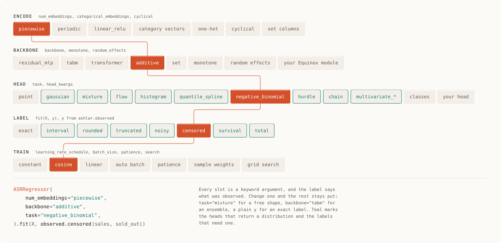

# Model slots: encode, backbone, head, train

[Ashlar](../README.md) builds a model from keyword arguments, with no class per architecture. `ASRModel` is the generic estimator; `ASRRegressor`, `ASRClassifier`, `ASROrdinalClassifier`, and `ASROutcomeTree` are the same estimator with a task and its recipe filled into the signature, the way `LGBMRegressor` is `LGBMModel` with `objective="regression"`.



A model is defined by the five choices in the diagram: how the input columns are encoded, the backbone network, the output head, the type of label, and the training schedule. Four of them are keyword arguments to the estimator. The fifth, the label type, is set by what you pass to `fit`: a plain array for exact values, or a label built with `ashlar.observed` for censored, interval, rounded, truncated, noisy, or summed values ([docs/observed.md](observed.md)). The highlighted path is one example: an additive backbone with a negative binomial head, fitted to sales that were censored on days a product sold out.

```python
from ashlar import ASRRegressor

ASRRegressor()                                      # the defaults
ASRRegressor(task="mixture")                        # same net, a predictive density
ASRRegressor(task="flow", backbone="tabm")          # skewed target, ensemble trunk
ASRRegressor(backbone="transformer", num_embeddings="periodic")
```

The choices are independent of each other, so they can be combined. A head does not know which backbone produced its input, and a backbone does not know what the head will do with its output, so a change to one leaves the rest alone. Every configuration is an instance of the same class, `ASRModel`, so a model is fully described by its arguments, which makes it easy to save, version, and tune.

## Encode

Numeric columns are imputed, scaled, and then embedded: `num_embeddings` takes `"piecewise"` (the default), `"piecewise_relu"`, `"periodic"`, `"linear_relu"`, or `None` for the scaled number itself. `num_embedding_dim` and `num_embedding_bins` set the width and the bin count.

Every other column is categorical and gets a learned vector, 8 wide by default. `categorical_embeddings=[]` restores one-hot, and a list of names embeds those and one-hots the rest. `cyclical={"hour": 24}` turns a column into a sine and cosine of its period. `set_features` names columns that hold a variable-length set in each cell. [docs/tabular.md](tabular.md#defaults) has the detail.

## Backbone

| `backbone` | What it is |
|---|---|
| `"residual_mlp"` | The default: three residual blocks of width 256, dropout 0.1, SiLU. |
| `"tabm"` | A batch ensemble: k members that share most weights and train together. `tabm()` and `tabm_piecewise()` are the paper-shaped and accuracy recipes. |
| `"transformer"` | A feature transformer: attention over the columns. |
| `"set"` | An encoder for set-valued columns. |
| `"additive"` | One small network per column, and one per pair of columns you name. The head is linear in them, so every output of the distribution, a location, a scale, a zero probability, is a sum of one shape per column: a neural GAMLSS. `shape_functions(X)` reads the shapes. [docs/additive.md](additive.md) has the detail. |
| your Equinox module | Any module with the same call signature. `backbone_kwargs` is passed to it. |

## Head

`task` picks the head: `"regression"` for a point, `"classification"`, `"ordinal"`, `"tree"` for nested outcomes, and `"gaussian"`, `"mixture"`, `"flow"`, `"histogram"`, `"quantile"`, or `"student_t"` for a predictive distribution, and `"poisson"` or `"negative_binomial"` for a count. [docs/heads.md](heads.md) says which to reach for. `task="custom"` takes your own head module with its `objective`, `point_fn`, and `dist_fn`; [`examples/advanced.py`](../examples/advanced.py) fits a linked head that shares a trunk between a continuous outcome and a masked event.

## Train

The backbone and the head of a general model are trained together, end to end, by gradient descent on the head's loss. `learning_rate`, `learning_rate_schedule`, `batch_size`, `max_epochs`, `patience`, `weight_decay`, `validation_size`, and `split` are all constructor arguments, and `"auto"` sizes the batch and the epoch budget from the number of rows. `fit(X, y, sample_weight=...)` weights rows, and `fit(X, y, search=True)` runs the small default grid from `ashlar.search.DEFAULT_SEARCH` before training the winner. [docs/tabular.md](tabular.md#defaults) lists every default.

Recipes are plain dicts. `DEFAULT_RECIPE`, `TABM_PAPER`, `TABM_PIECEWISE`, `CLASSIFIER_RECIPE`, `ORDINAL_RECIPE`, and `TREE_RECIPE` can be copied, edited, and splatted into a constructor, so a configuration you like is data you can version.

## What the general estimator covers

`ASRRegressor` and `ASRClassifier` are the general estimator's main forms, and `ASROrdinalClassifier` and `ASROutcomeTree` are two more for ordered and nested labels. The table says what the estimator covers and where each part is documented.

| You want | Setting | Guide |
|---|---|---|
| A point prediction or class probabilities, like a tree model | `ASRRegressor()`, `ASRClassifier()` | [docs/tabular.md](tabular.md) |
| A distribution per row: a bell, a skewed shape, a spike, heavy tails | `task="gaussian"`, `"mixture"`, `"flow"`, `"histogram"`, `"student_t"`, `"quantile_spline"` | [docs/heads.md](heads.md) |
| Counts, and targets that are often exactly zero | `task="poisson"`, `"negative_binomial"`, `"hurdle"` | [docs/heads.md](heads.md) |
| Labels not seen exactly: censored, survival, interval, rounded, truncated, noisy, or totals over several rows | `y = observed.censored(sales, sold_out)` and the other builders in `ashlar.observed` | [docs/observed.md](observed.md) |
| Several targets with one joint distribution, or outcomes of different kinds chained | `task="multivariate_gaussian"`, `"multivariate_mixture"`, `"multivariate_flow"`, `"chain"` | [docs/distributions.md](distributions.md#several-targets-at-once) |
| Intervals that hold their coverage, overall or within each group | `model.calibrate(X_holdout, y_holdout)`, then `predict_interval` | [docs/heads.md](heads.md#calibrated-intervals) |
| Random effects for a grouping column with few rows per group, and predictions for new groups | `random_effects={"store": ["intercept", "embedding"]}` | [docs/effects.md](effects.md) |
| An additive model of every parameter of the distribution, with readable terms (a neural GAMLSS) | `backbone="additive"`, then `shape_functions` | [docs/additive.md](additive.md) |
| A feature that must move the whole distribution one way | `monotone={"price": -1}` | [docs/distributions.md](distributions.md#features-that-push-one-way) |
| Wider predictions where inputs are missing or noisy | `model.with_uncertain_inputs(32)` | [docs/distributions.md](distributions.md#missing-and-noisy-inputs) |
| An order quantity, a tail risk, or an attribution of a quantile to the features | `predict_order`, `ashlar.decide`, `explain` | [docs/distributions.md](distributions.md#deciding-from-the-distribution) |
| Ordered labels, or outcomes nested in a tree | `ASROrdinalClassifier`, `ASROutcomeTree` | [docs/tabular.md](tabular.md#tasks) |
| A stronger, slower network: a TabM batch ensemble on piecewise-linear embeddings | `tabm_piecewise()` | [docs/tabular.md](tabular.md#recipes) |
| Forecast paths for many series with covariates (work in progress) | `ashlar.horizon.horizon_frame` and a joint head | [docs/forecast.md](forecast.md#many-series-covariates-and-paths) |
| Save and load without pickle | `model.save(path)`, `ASRModel.load(path)` | [docs/estimator.md](estimator.md#saving-and-loading) |

Many of these exist in other packages, one or two per package: LightGBMLSS and NGBoost fit distributions with boosted trees, XGBoost and CatBoost fit censored survival times, R's `gamlss` fits additive models of a distribution's parameters, GPBoost fits random effects, MAPIE adds conformal intervals, and brms in R fits many of the same likelihoods in Bayesian models. Ashlar has them in one estimator, so they can be combined. Some we have not found elsewhere, such as labels that are totals over several rows, and calibrated intervals for a function of several predicted outcomes, like the total cost of a policy's claims.

## Dressed models

`ashlar.dressed()` returns an `ASRDressed`: five cross-fitted `tabm_piecewise` networks and five label readers, pooled, smoothed, and corrected into one distribution with an exact density, or, for a target with at most 20 distinct values, an exact probability for each value. It is one estimator with its own `fit`, `predict_dist`, `predict_quantiles`, `log_prob`, and `sample`, for one numeric target. It is fitted in stages: each network and each reader is trained by gradient descent on its own loss, and the pool weight, the smoothing, and the gate are then searched on held-out rows. Its distribution is computed in NumPy on top of the networks' distributions, so unlike the models below it does not compose with `jax.grad`. [docs/dressed.md](dressed.md) is the guide.

## Research models

Beyond the four slots, these are whole model families with the same `fit` and `predict` surface. They are experimental research code: benchmarked in [docs/benchmarks.md](benchmarks.md), and not the path most tables need. Each has its own `fit(X, y, task)` for a point or class probabilities, most read numeric columns only, and none is connected to the heads, `predict_dist`, observed labels, or `calibrate`. Their API may change or go. For an additive model of a whole distribution, use `backbone="additive"` instead of `ASRAdditive` ([docs/additive.md](additive.md)).

| Class | What it fits |
|---|---|
| `ASRAdditive` | Main effects, a width-8 embedding per categorical, and at most ten interaction pairs. Readable like a GAM. |
| `ASRGatedAdditive` | Two additive specialists behind a gate learned from the labels or one feature. |
| `ASRObliviousEnsemble` | An end-to-end differentiable depth-6 oblivious tree ensemble. |
| `ASRHistogramBooster` | Leaf-wise histogram trees, with an ordinal readout. |
| `ASRLinearLeafBooster` | Boosted depth-1 trees whose leaves are ridge linear models. |
| `ASRLearnedNeighborhood` | Embeds the row, then predicts from a softmax over training neighbors. |
| `ASRDiagonalNeighborhood` | Nadaraya–Watson, or a class vote, in a learned diagonal metric. |
| `ASRBartPriorEnsemble` | Soft depth-2 trees with a BART-shaped penalty, summed; none is grown greedily. |
| `ASRVariationalPairwise` | A variational logistic head on soft bins and every pairwise bin product. |
| `ASRGradientSparseNet` | A classifier with an L1 penalty on the input gradient. |

Every model in this file except the dressed model is a JAX computation built on Equinox, so it composes with `jax.grad`, `jax.vmap`, and `jax.jit`. [`examples/jax_composition.py`](../examples/jax_composition.py) differentiates a fitted model with respect to its input.
