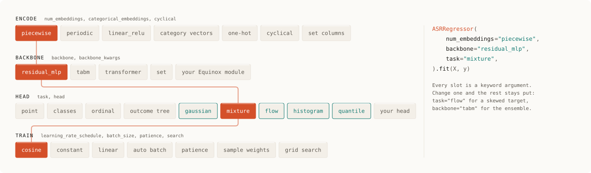

# What goes in each slot

[Ashlar](../README.md) builds a model from keyword arguments rather than from a class per architecture. `ASRModel` is the generic estimator; `ASRRegressor`, `ASRClassifier`, `ASROrdinalClassifier`, and `ASROutcomeTree` are the same estimator with a task and its recipe filled into the signature, the way `LGBMRegressor` is `LGBMModel` with `objective="regression"`.



```python
from ashlar import ASRRegressor

ASRRegressor()                                      # the defaults
ASRRegressor(task="mixture")                        # same net, a predictive density
ASRRegressor(task="flow", backbone="tabm")          # skewed target, ensemble trunk
ASRRegressor(backbone="transformer", num_embeddings="periodic")
```

The four slots are independent. A head does not know which backbone produced its input, and a backbone does not know what the head will do with its output, so a change to one leaves the rest alone.

## Encode

Numeric columns are imputed, scaled, and then embedded: `num_embeddings` takes `"piecewise"` (the default), `"piecewise_relu"`, `"periodic"`, `"linear_relu"`, or `None` for the scaled number itself. `num_embedding_dim` and `num_embedding_bins` set the width and the bin count.

Every other column is categorical and gets a learned vector, 8 wide by default. `categorical_embeddings=[]` restores one-hot, and a list of names embeds those and one-hots the rest. `cyclical={"hour": 24}` turns a column into a sine and cosine of its period. `set_features` names columns that hold a variable-length set rather than one value. [docs/tabular.md](tabular.md#defaults) has the detail.

## Backbone

| `backbone` | What it is |
|---|---|
| `"residual_mlp"` | The default: three residual blocks of width 256, dropout 0.1, SiLU. |
| `"tabm"` | A batch ensemble: k members that share most weights and train together. `tabm()` and `tabm_piecewise()` are the paper-shaped and accuracy recipes. |
| `"transformer"` | A feature transformer: attention over the columns rather than over a sequence. |
| `"set"` | An encoder for set-valued columns. |
| your Equinox module | Any module with the same call signature. `backbone_kwargs` is passed to it. |

## Head

`task` picks the head: `"regression"` for a point, `"classification"`, `"ordinal"`, `"tree"` for nested outcomes, and `"gaussian"`, `"mixture"`, `"flow"`, `"histogram"`, or `"quantile"` for a predictive distribution. [docs/heads.md](heads.md) says which to reach for. `task="custom"` takes your own head module with its `objective`, `point_fn`, and `dist_fn`; [`examples/advanced.py`](../examples/advanced.py) fits a linked head that shares a trunk between a continuous outcome and a masked event.

## Train

`learning_rate`, `learning_rate_schedule`, `batch_size`, `max_epochs`, `patience`, `weight_decay`, `validation_size`, and `split` are all constructor arguments, and `"auto"` sizes the batch and the epoch budget from the number of rows. `fit(X, y, sample_weight=...)` weights rows, and `fit(X, y, search=True)` runs the small default grid from `ashlar.search.DEFAULT_SEARCH` before training the winner. [docs/tabular.md](tabular.md#defaults) lists every default.

Recipes are plain dicts. `DEFAULT_RECIPE`, `TABM_PAPER`, `TABM_PIECEWISE`, `CLASSIFIER_RECIPE`, `ORDINAL_RECIPE`, and `TREE_RECIPE` can be copied, edited, and splatted into a constructor, so a configuration you like is data you can version.

## Research models

Beyond the four slots, these are whole model families with the same `fit` and `predict` surface. They are research code: useful, benchmarked in [docs/benchmarks.md](benchmarks.md), and not the path most tables need.

| Class | What it fits |
|---|---|
| `ASRAdditive` | Main effects, a width-8 embedding per categorical, and at most ten interaction pairs. Readable like a GAM. |
| `ASRGatedAdditive` | Two additive specialists behind a gate learned from the labels or one feature. |
| `ASRObliviousEnsemble` | An end-to-end differentiable depth-6 oblivious tree ensemble. |
| `ASRHistogramBooster` | Leaf-wise histogram trees, with an ordinal readout. |
| `ASRLinearLeafBooster` | Boosted depth-1 trees whose leaves are ridge linear models. |
| `ASRLearnedNeighborhood` | Embeds the row, then predicts from a softmax over training neighbors. |
| `ASRDiagonalNeighborhood` | Nadaraya–Watson, or a class vote, in a learned diagonal metric. |
| `ASRBartPriorEnsemble` | Soft depth-2 trees with a BART-shaped penalty, summed rather than grown greedily. |
| `ASRVariationalPairwise` | A variational logistic head on soft bins and every pairwise bin product. |
| `ASRGradientSparseNet` | A classifier with an L1 penalty on the input gradient. |

Every model in this file is a JAX computation built on Equinox, so it composes with `jax.grad`, `jax.vmap`, and `jax.jit`. [`examples/jax_composition.py`](../examples/jax_composition.py) differentiates a fitted model with respect to its input.
