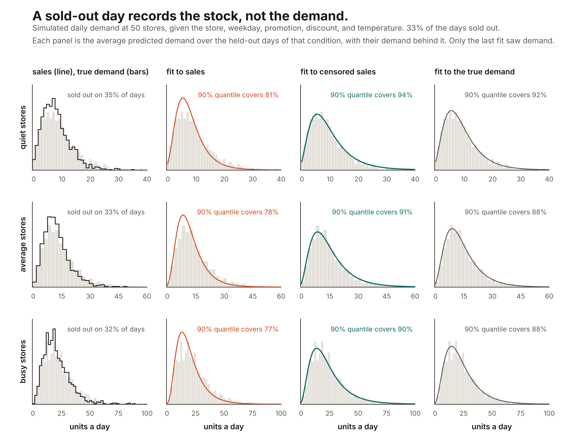

# Labels that say what was observed

A plain `y` says every value was seen exactly. Many tables know less. A day that sold out recorded the stock, not the demand. An income survey recorded a bracket, a lab a reading below its detection limit, a churn table customers who are still active. A price was rounded to the dollar, a sensor reading carries known noise, a table holds only the rows whose value fell inside a range, or only a weekly total was kept for seven daily rows.

Fitting such a `y` as if it were exact teaches the model the recording instead of the value. Pass a label from `ashlar.observed` as `y` instead, and the head trains on the probability it gives to what was actually seen: an exact value scores its density, a range the probability of the range, a sold-out day the probability that demand reached the stock. This is the coarse-data likelihood of [Heitjan and Rubin (1991)](https://doi.org/10.1214/aos/1176348396), applied to every head that has a CDF.

```python
from ashlar import ASRRegressor, observed

y = observed.censored(sales, sold_out)         # sold-out days: demand >= sales
model = ASRRegressor(task="negative_binomial").fit(X, y)

model.predict_quantiles(X_new, [0.9])          # quantiles of demand, not of sales
model.log_prob(X_test, y_test)                 # log-likelihood of each observation
model.calibrate(X_holdout, y_holdout)          # works on censored rows too
```

`predict_dist` still describes the value itself, so its quantiles, draws, and intervals are for demand, not for what the shelf allowed. A label is a NumPy structured array with one record per row, so `train_test_split`, `KFold`, and fancy indexing split it like any other `y`.

## Demand when shelves sell out

From [`examples/benchmark_observed.py`](../examples/benchmark_observed.py): simulated store-days across 50 stores, with the true demand known, about a third of the days sold out, and five seeds. Every fit is scored against the true demand on 4,000 held-out days:

| Head | Trained on | NLL ↓ | Below the 90% quantile | Order cost above the best ↓ | Calibrated 80% interval holds |
|---|---|---:|---:|---:|---:|
| `negative_binomial` | true demand (the oracle) | 3.251 | 90.8% | 1.3% | 83.0% |
| `negative_binomial` | `observed.censored(sales, sold_out)` | **3.251** | **90.9%** | **1.1%** | 83.7% |
| `negative_binomial` | sales, as if they were demand | 3.387 | 79.5% | 7.9% | 70.5% |
| `negative_binomial` | only the days that did not sell out | 3.541 | 72.0% | 20.1% | 70.0% |
| `mixture` | `observed.censored(sales, sold_out)` | 3.266 | 92.4% | 1.9% | 82.8% |
| LightGBM, quantile loss | sales | | 73.0% | 9.4% | |

The censored fit learns from sales what the oracle learns from the true demand: the same likelihood, the same coverage, and an order that costs as little. The fit on sales learns demand that is too low, so its 90% quantile is above the true demand on only 80% of days. Dropping the sold-out days is worse, because the days that remain are the slow ones. Calibration cannot rescue either, because the calibration days are censored too: the fit on sales, calibrated on sales, holds 70% of true demand in an interval that promises 80%. The order cost is what it costs to stock each day's 75% quantile when a lost sale costs three times a leftover unit, in percent above stocking the true quantile. A count's interval holds a little more than it promises, because it includes both end counts.



The figure is one seed of the same experiment, split into thirds of the stores by their average demand. The fit to sales puts its mass too low and its tail too short in every third, and its 90% quantile covers 77% to 81% of days. The censored fit and the fit to the true demand cover 88% to 94%; a count's 90% quantile covers at least 90% of its own distribution, and more at small counts. `python examples/benchmark_observed.py figure` draws it.

## Every kind of label

| Builder | What it says about `Y` | Likelihood of a row |
|---|---|---|
| `exact(y)` | `Y = y` | The density at `y`, or the mass for a count |
| `interval(lower, upper)` | `lower <= Y <= upper`; `-inf` or `inf` leaves a side open | `P(lower <= Y <= upper)` |
| `censored(y, flag)` | Where `flag` is set, `Y >= y` (`side="left"`: `Y <= y`); elsewhere `Y = y` | The survival `P(Y >= y)`, or the density |
| `survival(time, event, entry=None)` | An event at `time` where `event` is set, still waiting at `time` elsewhere; `entry` for delayed entry | The density or `P(Y >= time)`, divided by `P(Y >= entry)` |
| `rounded(y, step)` | `Y` rounds to `y` at a multiple of `step` | `P(y - step/2 <= Y <= y + step/2)` |
| `truncated(label, lower, upper)` | The row is in the table only because `lower <= Y <= upper` | The label's likelihood divided by `P(lower <= Y <= upper)` |
| `noisy(label, scale)` | What was recorded is `Y` plus normal noise of standard deviation `scale` | The label's likelihood under `Y + noise` |
| `total(values, group)`, `grouped(label, group)` | Only the sum over each group of rows was recorded | The label's likelihood under the group's sum |

Labels compose: `truncated(censored(sales, sold_out), lower=1)` is a sold-out-aware count that was recorded only on days with a sale, and `grouped(rounded(weekly, 10), week)` is a weekly total rounded to tens. `concatenate` stacks labels of different kinds, so a table can mix exact rows, censored rows, and totals. `interval(-inf, inf)` is a row whose value is unknown: it adds nothing to the loss, though its features still shape the fitted preprocessing.

Intervals are closed at both ends, which is what a count needs: a sold-out stock of 12 means `Y >= 12`, and the probability includes 12 itself. For a count, write bounds as whole numbers, and write a rounded count as the `interval` of the whole numbers it stands for.

## Which heads take which labels

| Label | Heads |
|---|---|
| exact, interval, censored, survival, rounded, truncated | `gaussian`, `mixture`, `flow`, `histogram`, `student_t`, `poisson`, `negative_binomial` (zero-inflated or not), `hurdle`, `normal` with one column |
| noisy | `gaussian`, `mixture`, `normal`, where a normal plus normal noise stays in closed form |
| group totals | `gaussian`, `normal`, `poisson` without zero inflation, where a sum of independent rows stays in closed form |

The `quantile` head has no density and the joint heads model several columns, so neither takes an observed label, and neither do the classifiers. Every head computes its interval probabilities in log space, subtracting on the side of the median where the interval lies, so a row far in a tail still has a finite, smooth likelihood. The tests check the normal 40 standard deviations out and a count interval whose probability is 10⁻¹¹⁷. The Student-t's degrees of freedom and the negative binomial's dispersion train through the censored likelihood as well.

The `histogram` head has no mass past its edges at ±4 standard deviations, so it reads a bound out there at the middle of its end bin, as its `log_prob` reads a value out there in the end bin. If many bounds fall that far out, use the `mixture` or the `flow`. The `hurdle` head's zero is an exact atom, so `interval(0, 5)` includes it and `interval(0.01, 5)` does not.

## Scoring and calibrating

- `model.log_prob(X, label)` is one log-likelihood per row, and `model.score(X, label)` their mean, so `cross_val_score` and `GridSearchCV` compare fits on censored data by likelihood. With group totals, `score` is the mean per observation and `log_prob` refuses, since a total is one observation of several rows.
- `model.calibrate(X, label)` accepts exact, interval, and censored rows. A coarse row's probability integral transform is drawn uniformly between `P(Y < lower)` and `P(Y <= upper)`, the same rule `calibrate` already uses for counts. It is uniform when censoring is independent of the value given the features, so calibration on sold-out days is honest under the same assumption as the fit. Truncated, noisy, and grouped labels are refused, since their PIT is not uniform.
- `observed.log_likelihood(dist, lower, upper, ...)` and `observed.randomized_pit(dist, lower, upper, key)` take any `ashlar.distributions.Distribution`, so they also work in a custom objective. With `task="custom"`, the training `y` the objective receives is the `(rows, 6)` array of `observed.fields(label)`.

## Daily values from weekly totals

`observed.total(values, group)` says only the sum of each group's rows was recorded, with the sum on every row of the group. Rows are independent given their features, so a sum of normal rows is normal and a sum of Poisson rows is Poisson, and the head learns each row's own distribution from the sums. Each member of an ensemble sums its own rows, as it would score its own row.

```python
weekly = observed.total(week_total, week)           # week_total repeated on each day of the week
model = ASRRegressor(task="gaussian").fit(X_days, weekly)
model.predict_dist(X_days)                          # each day's own distribution
```

From [`examples/benchmark_observed.py`](../examples/benchmark_observed.py): 1,500 weeks of seven simulated days, with only each week's sum recorded, five seeds, scored on 3,000 new days against their true values.

| Head | Trained on | NLL of the true day ↓ | Error of the daily mean ↓ | 80% interval holds |
|---|---|---:|---:|---:|
| `gaussian` | the days themselves (the oracle) | 1.304 | 0.10 | 79.6% |
| `gaussian` | `observed.total(weekly, week)` | 1.429 | 0.25 | 83.4% |
| `gaussian` | each total spread evenly over its days | 4.295 | 2.84 | 38.9% |
| `poisson` | the days themselves (the oracle) | 1.591 | 0.14 | 91.8% |
| `poisson` | `observed.total(weekly, week)` | 1.596 | 0.22 | 91.7% |
| `poisson` | each total spread evenly over its days | 2.010 | 1.50 | 88.1% |

The Poisson head learns from the totals almost all that the days would have taught it. The gaussian learns each day's mean, and the spread of the volatile days nearly right (1.41 against a true 1.5), but it puts 0.81 on the calm days, whose true spread is 0.5, so its intervals run a little wide. Spreading a total evenly teaches every day its week's average, which is wrong for each of them. A count's 80% interval holds more than 80% because it includes both end counts.

What totals can teach is limited by what varies between groups. If every week holds one Monday, one Tuesday, and so on, every weekly sum contains the same weekday pattern, so the sums cannot tell a busy Monday from a busy Tuesday. The head learns the effects of features that change from week to week, and nothing about a pattern that repeats inside every group. The spread is harder to place than the mean, since a sum's variance blends its rows' variances.

`fit` keeps each group whole: in one minibatch, with at least two of the largest groups per batch, and on one side of an internal validation split (a temporal split puts a cut group on the side of its first row; a grouped split must already keep each total inside one of its groups). A group's weight is the mean of its rows' weights. Each label records the number of rows its total covers, so a split that cuts a group, such as a shuffled `KFold`, raises instead of scoring part of a sum against the whole total; split with `GroupKFold` on the group ids.

## Limits

- **The censoring must not depend on the value given the features.** A planner who stocks more on days they expect to be busy is fine, if the model sees what the planner saw. If the stock was set from information the features lack, and that information also predicts demand, the censored fit is biased too.
- **Starting values and the target scale** come from each observation's representative value (the midpoint of a finite interval, the finite end of a one-sided one), which only sets where training starts.
- **Truncation hides the values outside the range.** Dividing by `P(lower <= Y <= upper)` makes the fit inside the range right, but what the head says outside it comes from the shape the head assumes, not from data: a Poisson extends a zero-truncated count to zero by its own formula, and a histogram or mixture has nothing to go on out there.
