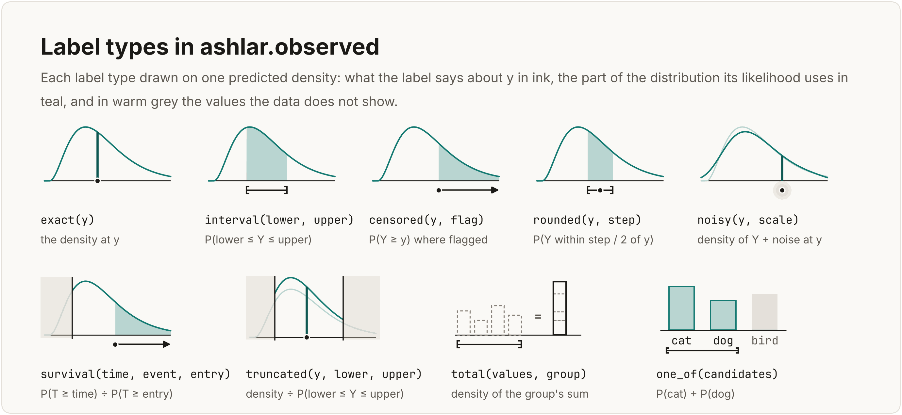

# Benchmarks and examples

This page has the benchmark results on eight large tables and detailed examples of Ashlar's main features. Each example compares Ashlar with a tool commonly used for the same task, on public data, and reports where that tool does better. The numbers come from [benchmarks.md](benchmarks.md), and the scripts in [`examples/readme/`](../examples/readme/) redraw every figure from saved results.

- [Benchmarks on eight large tables](#benchmarks-on-eight-large-tables)
- [Distribution heads](#distribution-heads)
- [Survival analysis](#survival-analysis)
- [Partially observed labels](#partially-observed-labels)
- [Several outcomes in one model](#several-outcomes-in-one-model)
- [Random effects](#random-effects)
- [Additive models](#additive-models)
- [Calibrated intervals and missing inputs](#calibrated-intervals-and-missing-inputs)
- [Decisions and explanations](#decisions-and-explanations)
- [Forecasting (work in progress)](#forecasting-work-in-progress)
- [The model object](#the-model-object)

## Benchmarks on eight large tables

![Two panels over eight OpenML tables, each row a dot for Ashlar's relative difference from the best tree-based model on that table, left of zero when Ashlar is better. Left, test error compared with the best of LightGBM, XGBoost, and CatBoost: within 0.3% on airline delay, song release years, and Zurich transport, better on Higgs and covertype, 1.5% and 2.3% worse on click prediction and airlines, and 11% worse on taxi tips. Right, the predicted distribution compared with the best tree-based distribution: CRPS 0.2% higher than LightGBMLSS's mixture on airline delay, 3.5% and 1.7% lower on song release years and Zurich transport, and 27% higher on taxi tips; log loss lower on Higgs and covertype, higher on click prediction and airlines.](images/readme/scoreboard.png)

The eight tables are from OpenML and have half a million to two million rows. All models use their default settings with no tuning, and each table has three random train/test splits. For point predictions, Ashlar's default model is within 0.3% of the best of LightGBM, XGBoost, and CatBoost on airline delay, song release years, and Zurich transport. It is better on Higgs (accuracy 0.763 against 0.752) and covertype (0.968 against 0.963), and worse on click prediction and airlines, by less than one point of accuracy, and on taxi tips, where its RMSE is 11% higher.

For predicted distributions, `task="mixture"` has a 3.5% lower CRPS than LightGBMLSS's mixture of three normals on release years and a 1.7% lower one on Zurich transport. On airline delay its CRPS is 0.2% higher, and LightGBMLSS is slightly ahead on each of the three splits. On taxi tips, where the target has a spike at $0 and a long tail, Ashlar's CRPS is 27% higher on average and varies a lot between splits, from 6% to 41% higher.

LightGBM trains much faster, in 4 seconds to 2 minutes per table on six threads. Ashlar's default and mixture models take 2 to 5 minutes on all 12 cores of a laptop, and LightGBMLSS's mixture takes 3 to 16 minutes on six threads. [docs/benchmarks.md](benchmarks.md#large-tables) has all the results, including each model's training time.

<details>
<summary>Results tables for point predictions and distributions, mean ± one standard deviation over three splits</summary>

| Table | Rows | Target, metric | Ashlar | Best tree |
|---|---:|---|---:|---:|
| Airline delay | 2,000,000 | delay in minutes, RMSE ↓ | 29.19 ± 0.1 | 29.19 ± 0.1 (CatBoost) |
| Year (MSD) | 515,345 | release year, RMSE ↓ | **8.655** ± 0.03 | 8.679 ± 0.02 (XGBoost) |
| Zurich transport | 2,000,000 | delay, RMSE ↓ | 3.053 ± 0.0006 | **3.047** ± 0.0005 (LightGBM) |
| NYC green taxi tips | 581,835 | tip in $, RMSE ↓ | 1.973 ± 0.05 | **1.771** ± 0.02 (CatBoost) |
| Higgs | 2,000,000 | signal, accuracy ↑ | **0.763** ± 0.0004 | 0.752 ± 0.0007 (XGBoost) |
| Covertype | 581,012 | 7 forest types, accuracy ↑ | **0.968** ± 0.0005 | 0.963 ± 0.0005 (LightGBM) |
| Click prediction | 1,997,410 | click, accuracy ↑ | 0.842 ± 0.0001 | **0.844** ± 0.0003 (LightGBM) |
| Airlines | 539,383 | delayed, accuracy ↑ | 0.662 ± 0.001 | **0.669** ± 0.001 (CatBoost) |

| Table | Score | Ashlar | Best tree distribution |
|---|---|---:|---:|
| Airline delay, delay in minutes | CRPS | 9.24 ± 0.05 | **9.22** ± 0.06 (LightGBMLSS mixture) |
| Year (MSD), release year | CRPS | **4.03** ± 0.02 | 4.17 ± 0.01 (LightGBMLSS mixture) |
| Zurich transport, delay | CRPS | **1.62** ± 0.002 | 1.65 ± 0.003 (LightGBMLSS mixture) |
| NYC green taxi tips, tip in $ | CRPS | 0.55 ± 0.07 | **0.44** ± 0.003 (LightGBMLSS mixture) |
| Higgs | Log loss | **0.481** ± 0.0006 | 0.496 ± 0.0008 (XGBoost) |
| Covertype | Log loss | **0.093** ± 0.002 | 0.114 ± 0.002 (LightGBM) |
| Click prediction | Log loss | 0.395 ± 0.0003 | **0.386** ± 0.0004 (XGBoost) |
| Airlines | Log loss | 0.613 ± 0.001 | **0.605** ± 0.0009 (CatBoost) |

In the first table, Ashlar is `ASRRegressor()` or `ASRClassifier()` with no arguments. In the second, it is `ASRRegressor(task="mixture")` on the regression tables and the default classifier's probabilities on the others. The best tree-based distribution is the one with the lowest score among LightGBM, XGBoost, and CatBoost with a normal distribution of fixed width; CatBoost's `RMSEWithUncertainty`, which fits a mean and a variance for each row; and LightGBMLSS's Gaussian, Student-t, and mixture of three normals, which fit a LightGBM model for each parameter. CRPS is in the target's units and log loss is per row; lower is better for both. The docs also report each model's NLL, but on a target with a spike, such as on-time departures at zero minutes or taxi tips of $0, the NLL depends mostly on how narrow a model makes the spike, so it is not compared here.

</details>

On five smaller tables, the default model matches the trees on two (Ames and abalone, within the variation across splits) and is worse than LightGBM on three. The `tabm_piecewise()` recipe closes the gap on California housing and diamonds, but not on adult. [docs/benchmarks.md](benchmarks.md#point-accuracy) has the results.

## Distribution heads

The `task` argument sets the family of the predicted distribution. This example uses three targets that a normal distribution fits poorly: hourly bike rentals, which are counts; motor insurance claim costs, many of which are one of four fixed amounts; and California home values, which are capped at $500,001.

![Three panels of held-out data as grey bars, with Ashlar's head in teal and the best tree-based distribution in dashed clay. A count: bike rentals in the 256 hours that LightGBM predicts at 350 to 450, where the negative binomial head follows the bars, LightGBM's Poisson is far too narrow, and a negative binomial with one dispersion around LightGBM's mean is too wide. Point masses: freMTPL2 claim costs on a log axis, with 42% of claims in one narrow bar at four fixed amounts; the mixture has a peak there and CatBoost's normal does not. A cap: California home values in block groups with incomes of $70k or more, 41% of them at the $500k cap; the mixture puts its mass at the cap, while LightGBM's normal extends past it.](images/readme/shapes.png)

The built-in objectives of LightGBM, XGBoost, and CatBoost predict a mean, a mean with a normal distribution around it, or a set of quantiles. Ashlar's heads model other shapes directly. On hourly bike rentals, the 80% intervals of the `negative_binomial` head contain 80% of test hours and are 71 rentals wide on average. LightGBM's Poisson objective with one fitted dispersion parameter gives intervals that contain 86% of hours at a width of 104, and the Poisson distribution alone contains only 54%. On freMTPL2 motor claims, 41.5% of claim costs are one of four amounts; the `mixture` head puts 32.9% of its probability on those amounts, and CatBoost's `RMSEWithUncertainty` puts 3.2% there. For California home values in block groups with a median income of $70,000 or more, the mixture puts 0.6% of its probability above the $500,001 cap, compared with 18.6% for LightGBM with a normal distribution of fixed width.

The tree models do as well or better in other cases. On taxi tips, a LightGBM classifier for whether a tip is paid, combined with a gamma regressor for its amount, matches the `hurdle` head. On taxi fares, where trips between JFK and Manhattan cost a flat $52, CatBoost's `RMSEWithUncertainty` has the best CRPS.

```python
import numpy as np
from ashlar import ASRRegressor

counts = ASRRegressor(task="negative_binomial").fit(X, rentals)  # dispersion per row
costs = ASRRegressor(task="mixture").fit(X, np.log(cost))        # peaks at fixed costs
tips = ASRRegressor(task="hurdle", head_kwargs={"severity": "gamma"}).fit(X, tip)
p_no_tip = tips.predict_dist(X_new).cdf(0.0)                     # P(tip = 0) per row
```

[Heads and the targets they suit](heads.md) · [Count benchmark](benchmarks.md#against-a-negative-binomial-around-lightgbms-mean) · [Point masses, caps, and skew](benchmarks.md#spikes-caps-and-skew) · [Hurdle benchmark](benchmarks.md#against-lightgbms-two-model-hurdle)

## Survival analysis

`observed.survival` marks which survival times are events and which are censored, for example patients who were still alive at their last visit. For censored rows, the likelihood uses the probability of surviving past the last visit. With the `mixture` head, the shape of the predicted survival curve can differ from patient to patient.


On SUPPORT, a study of 8,873 seriously ill patients, evaluated on five random splits, the mixture head passes the D-calibration test on 4 of 5 splits, which means its predicted survival probabilities agree with the observed survival rates. XGBoost's AFT model, tuned over a grid of 42 settings, ranks patients about as well (a concordance of 0.623 against 0.624) but passes on none of the splits. A Cox model passes on all five splits, but it ranks patients worse (concordance 0.577) and has the highest integrated Brier score of the three, a measure of the error of the survival curve over time: 0.217, against 0.200 for the mixture and 0.205 for AFT.

The mixture also has a lower negative log-likelihood (NLL) of the observed times than AFT, which means the observed times were more probable under its predictions: 1.732 against 1.874 on SUPPORT and 1.061 against 1.142 on METABRIC. On GBSG the two are tied. A `gaussian` head with `head_kwargs={"cure": True}` also estimates the share of patients who never have the event: on simulated data where 39.7% never do, it predicts 39.8%.

```python
import numpy as np
from ashlar import ASRRegressor, observed

y = observed.survival(np.log(days), died)                 # died=False: censored
model = ASRRegressor(task="mixture").fit(X, y)
p_year = model.predict_exceedance(X_new, np.log(365.25))  # P(survival past one year)
```

[Survival benchmark on three clinical tables](benchmarks.md#survival-on-three-clinical-tables) · [Survival times](observed.md#survival-times) · [Cure models](observed.md#times-that-may-never-come)

## Partially observed labels

Many tables record a label only partly: as a lower bound, a range, a rounded value, or a total over several rows. The functions in `ashlar.observed` describe what each label says about the true value, and the model is trained with the matching likelihood. The figure shows each label type on one predicted distribution.



XGBoost and CatBoost have objectives for censored survival times, but LightGBM, XGBoost, and CatBoost have no likelihood for noisy labels, totals over several rows, or multi-output labels in which each value is observed differently. In one test on real electricity data for eight clients, each client's daily load was known only from meter readings taken 2 to 12 days apart. Trained with `observed.total` on the readings, the model's daily predictions had an NLL of 4.90, about as good as the 4.95 of a model trained on the actual daily values. Spreading each reading evenly over its days and training on the result gave slightly better daily predictions by CRPS (18.4 against 19.0 MWh) but a predicted spread that was far too narrow (NLL 6.28). With weekly totals instead of irregular readings, the model could not learn how the load varies between days of the week. In a simulation of four products that often sell out on the same days, a joint model fitted to the censored sales predicted that all four sell out on 11.4% of days, close to the observed 11.1%, while separate models for each product predicted 0.7%.

![One FreshRetailNet-50K product over its 20 test days: sales bars that stop at the stock on sold-out days, with the unobserved demand above them; 10% to 90% bands of demand from Ashlar and from XGBoost AFT, both fitted to the censored sales, and LightGBM's 90% quantile fitted to sales. Beside it, each model's order cost relative to a model trained on the true demand, over three seeds: AFT below it, Ashlar's censored model a little above it, and the three models that treat sold-out days as full demand or drop them well above it](images/readme/sold-out.png)

When a product sells out, the recorded sales equal the stock, and the demand that day is only known to be at least that high. On FreshRetailNet-50K, with simulated stock levels, models that treat sold-out days as full demand, or drop them, lead to orders that cost 12% to 19% more than those of a model trained on the true demand, whichever model type is used. With those days treated as censored, Ashlar's orders cost 4.0% more than that reference. XGBoost's AFT objective, which also handles censored labels, does better on this data: its orders cost 4.7% less than the reference. In a second test, on hard-drive failures with delayed entry, XGBoost AFT with the age at entry as a feature was also slightly better than Ashlar's truncated likelihood.

```python
from ashlar import ASRRegressor, observed

y = observed.censored(sales, sold_out)          # sold_out=True: demand >= sales
model = ASRRegressor(task="mixture").fit(X, y)
order = model.predict_quantiles(X_new, [0.75])  # 75% quantile of demand

kept = observed.truncated(sales_on_sale_days, lower=1)  # rows only for days with a sale
loads = observed.total(reading, period)                 # a reading covers several rows
```

[Sold-out products on FreshRetailNet-50K](benchmarks.md#sold-out-shelves-on-freshretailnet-50k) · [Daily loads from meter readings](benchmarks.md#daily-loads-from-meter-readings) · [Several products that sell out together](benchmarks.md#several-products-that-sell-out-together) · [Label types](observed.md)

## Several outcomes in one model

A model can predict several outcomes jointly. With `task="chain"`, each outcome gets its own head, and each head is conditioned on the outcomes before it, so the model has a single likelihood for all of them. The first example is motor insurance, where the outcomes are the number of claims a policy makes in a year and the average cost per claim.

![Left: for one French motor insurance policy, the chained model's probabilities of 0 to 4 claims as bars, and for each count of one or more, the predicted distribution of the cost per claim, whose mean rises from €1,311 for one claim to €1,858 for four. Right: the share of 135,599 held-out policies whose total cost for the year is above each amount from €1 to €1M, on log axes, observed and from three models: the chained model, a count model and a cost model built by hand, and LightGBM with a Poisson and a gamma objective. All three model curves are close to the observed one, and the hand-built curve is almost on top of the chained model's.](images/readme/claims-chain.png)

On French motor insurance data with 677,991 policies, the chained model predicts the number of claims with a `negative_binomial` head and the cost per claim, given the number of claims, with a `hurdle` head. Actuaries usually build this from two separate models: a count model, and a cost model fitted only on the policies with claims. We compared the chained model with two such pairs: a count model with a log-normal cost model, and LightGBM with a Poisson objective for the count and a gamma objective for the cost. All three predict the distribution of a policy's total cost for the year about equally well. Over three splits, the CRPS of the total is 92.5 for the chained model, 92.6 for the hand-built pair, and 92.7 for LightGBM, and LightGBM's totals are slightly better calibrated.

The chained model learns from the data that the cost is zero exactly when the count is zero, and it gives joint samples and a joint log-likelihood of both outcomes. Its log-likelihood per policy is 0.011 higher than that of the LightGBM pair, and all of the difference is in the cost: the two count models score the same, and the hurdle head's log-normal cost, whose spread varies by policy, fits these claims better than a gamma distribution with one shape parameter for all policies. Both models put too little probability on totals above €1,000, the chained model more so, and too much on totals above €5,000, LightGBM more so. About a third of claims have a cost per claim at one of three fixed amounts just above €1,000.

```python
from ashlar import ASRRegressor

model = ASRRegressor(task="chain",
                     head_kwargs={"columns": ["negative_binomial", "hurdle"]})
model.fit(X, Y)                      # Y: claim count, cost per claim (0 if none)
draws = model.sample(X_new, n=1000)  # shape (1000, rows, 2)

def total(y):                        # total cost: count times cost per claim
    return y[..., 0] * y[..., 1]

model.calibrate(X_cal, Y_cal, target=total)          # calibrate the total
model.predict_exceedance(X_new, 5000, target=total)  # calibrated P(total > 5000)
```

![Joint predicted distributions of casual and registered riders for two held-out hours of Capital Bikeshare rentals, a Tuesday at 08:00 in dark teal and a Sunday at 14:00 in light teal, drawn as stacks of isometric blocks over casual riders on one axis and registered riders on the other, with a dot at the observed counts and each hour's predicted correlation. Beside them, a table of each model's 80% interval for the total riders in an hour after calibration on held-out hours: the three models built on Ashlar's heads are within two riders of each other in width, LightGBM's quantile regression of the total is wider, and LightGBM's quantiles for each group, summed, are the widest.](images/readme/joint-blocks.png)

When all the outcomes are numeric, a joint head can model them together: `task="multivariate_gaussian"`, `"multivariate_mixture"`, or `"multivariate_flow"`. In the Capital Bikeshare data, the hourly counts of casual and registered riders both depend on weather and calendar effects that the inputs do not fully capture, so their errors tend to have the same sign and add up in the total. Without calibration, the 80% interval for the total riders in an hour from one joint model contains 81% of held-out hours over three splits, compared with 78% for two separate heads and 68% for LightGBM quantile regression of the total.

After calibration to 80% on a fifth of the training hours, which were set aside for this, the joint model's interval is 80 riders wide on average. LightGBM's quantiles of the total, calibrated with conformalized quantile regression (CQR), give intervals 85 riders wide, and LightGBM's quantiles for each group, summed and calibrated, give 97. Two separate Ashlar heads are as narrow after calibration, at 79 riders. The advantages of the joint model are that its interval has close to the right coverage without calibration, so no hours need to be set aside, and that it gives joint samples of both counts, from which any function of them can be computed.

[Chained outcomes](distributions.md#outcomes-of-different-kinds-chained) · [Joint heads](distributions.md#several-targets-at-once) · [Claim counts and costs benchmark](benchmarks.md#chained-claim-counts-and-costs) · [Bike riders benchmark](benchmarks.md#casual-and-registered-riders)

## Random effects

`random_effects` treats a grouping column, such as a store, the way a mixed model does. Each store gets an offset drawn from a normal distribution whose spread the model estimates, so a store with little data gets an offset close to the average, and a store with a lot of data gets an offset close to its own mean. Adding `"embedding"` also gives each store a learned vector, shrunk towards the average in the same way, which the network combines with the other inputs.


On Rossmann sales data for 1,115 stores, each store seen in training was thinned at random to between 1 and 300 days of data. Over three splits, the CRPS for stores with 1 to 5 days of data is 0.096, compared with 0.125 for GPBoost, but Ashlar's 80% intervals for these stores contain only 72% of days, compared with 79% for GPBoost and 84% for a linear mixed model. For a store that was not in the training data, the model predicts from the distribution of store effects, and its 80% intervals contain 75% of the store's days, compared with 36% for a model with a plain store embedding.

`with_context` updates the predictions for a new store from its first few days of data, without refitting the model. After five days, the CRPS is 0.091, compared with 0.111 for GPBoost and 0.122 for the mixed model, but Ashlar's intervals contain 70% of days, compared with 78% and 84%. Nesting stores within store types made no difference.

```python
import numpy as np
from ashlar import ASRRegressor

model = ASRRegressor(task="gaussian",
                     random_effects={"store": ["intercept", "embedding"]})
model.fit(X, np.log(sales))               # X has a "store" column
model.random_effects_["store"]["tau"]     # estimated spread of store effects
new_store = model.with_context(X_first_days, np.log(first_days_sales))  # no refit
new_store.predict_interval(X_next_days, 0.8)  # 80% interval for the new store
```

[Random effects benchmark](benchmarks.md#entity-effects) · [Random effects guide](effects.md) · [New groups from a few rows](effects.md#new-groups-from-a-few-rows)

## Additive models

`backbone="additive"` makes each parameter of the predicted distribution a sum of functions of one column each, plus functions of the pairs of columns you name. This is a generalized additive model for location, scale, and shape (GAMLSS), and each fitted function can be plotted and read.


On hourly bike rentals, Ashlar's additive negative binomial model was compared with the same model fitted with penalized splines by R's `gamlss`. Over the training hours, the two tools' curves for the log mean differ by 0.01 to 0.02 on average, and the curves for the log dispersion, which is harder to estimate, differ by 0.06 to 0.18. In both models, humid hours and cold hours have a higher dispersion, so rentals in those hours vary more around their mean, as well as being lower on average.

Over three splits, the test CRPS is 23.46 for Ashlar and 23.40 for `gamlss`. An Ashlar fit takes 10 seconds on the 12 cores of a laptop, and a `gamlss` fit, which runs on one thread, took 4 to 6 minutes; one `gamlss` fit stopped after 45 minutes without converging. The additive model is less accurate than Ashlar's residual network backbone, which can learn interactions between all the columns and has a CRPS of 16.48. On the abalone data, `gamlss`'s normal model is better than Ashlar's additive `gaussian`, with a CRPS of 1.115 against 1.156.

```python
from ashlar import ASRRegressor

model = ASRRegressor(task="negative_binomial", backbone="additive",
                     backbone_kwargs={"pairs": [["hr", "workingday"]]}).fit(X, rentals)
shapes = model.shape_functions(X)   # the fitted terms
shapes.term("hum", "dispersion")    # humidity term of the dispersion for each row
shapes.importance("dispersion")     # columns ranked by their effect on the dispersion
```

[Benchmark against R's gamlss](benchmarks.md#additive-models-against-rs-gamlss) · [Additive models guide](additive.md)

## Calibrated intervals and missing inputs

`calibrate` adjusts a fitted model's intervals on held-out rows with split-conformal prediction, so that they have the requested coverage on average. Each interval still comes from the row's own predicted distribution, so on hourly bike rentals the coverage is also close to the target in each hour of the day.


After one calibration for all hours, Ashlar's coverage is outside 75% to 85% in 3 of 24 hours. LightGBM quantile regression with the same conformal step (conformalized quantile regression, or CQR) is outside that range in 14 hours: its intervals are too wide at night and too narrow during the day. Calibrating CQR separately for each hour brings it to 2 hours, but its intervals are then 26% wider (92.3 against 73.5 rentals). At the same coverage, Ashlar's calibrated intervals are narrower than CQR's on 3 of 4 tables, and 2% wider on abalone.

![Coverage of the 80% interval when 0% to 50% of the numeric cells are missing at test time, on California housing and bike rentals. With with_uncertain_inputs(32), coverage stays at 81% to 83%; with the missing cells filled with the median, it falls to 41% and 48%; for LightGBM given NaN, it falls to 67% and 36%; and LightGBM trained with the same share of missing cells stays at 80%. On the right, the predicted distribution for one California row becomes wider as its income, latitude, and longitude are removed.](images/readme/intervals-missing.png)

`with_uncertain_inputs` handles cells that are missing at test time. It draws each missing numeric cell from its distribution given the row's observed cells, using a Gaussian copula fitted on the training data, and combines the predictions for 32 such draws, instead of filling the cell with the training median. With 30% of the cells missing in the California housing data, its 80% intervals contain 83% of test values, compared with 50.5% when the missing cells are filled with the median, and 68% for LightGBM given NaN. LightGBM trained and calibrated with the same share of missing cells also reaches 80% and gives narrower intervals ($141k against $178k), but it has to know that share in advance and needs a separate fit for each share.

```python
from ashlar import ASRRegressor

model = ASRRegressor(task="mixture").fit(X_train, y_train)
model.calibrate(X_cal, y_cal)  # split-conformal; groups="hr" calibrates each hour
interval = model.predict_interval(X_test, coverage=0.8)  # lower and upper bounds

sampled = model.with_uncertain_inputs(32)  # sample missing inputs, 32 draws per row
interval = sampled.predict_interval(X_missing, coverage=0.8)
```

[Coverage by hour](benchmarks.md#per-hour-beside-lightgbm-cqr) · [Interval widths](benchmarks.md#calibrated-intervals) · [Missing inputs benchmark](benchmarks.md#masked-cells-beside-lightgbm) · [Calibration guide](heads.md#calibrated-intervals) · [Missing and noisy inputs guide](distributions.md#missing-and-noisy-inputs)

## Decisions and explanations

`predict_order(X, under, over)` returns the order quantity that minimizes the expected cost when each unit short costs `under` and each unit left over costs `over`. This is the newsvendor solution, the `under / (under + over)` quantile of the predicted distribution, so one fitted model gives the order for any cost ratio. `explain` attributes a quantity computed from the predicted distribution, such as the mean, a quantile, the width of an interval, or a tail probability, to the input features.

![Left: on hourly bike rentals, the cost of LightGBM's orders relative to Ashlar's at eight cost ratios. LightGBM is refitted for each ratio, while Ashlar uses one model for all of them. LightGBM's cost is about the same at 1:1 and 23% to 28% higher at 19:1. Right: circles showing the mean absolute attribution of each feature for the mean, the width of the 80% interval, and P(rentals > 500), from Ashlar's explain and from SHAP on LightGBM models. Working day accounts for 17% of the attribution of the width and 11% of that of the mean.](images/readme/act.png)

On hourly bike rentals, we compared `predict_order` with LightGBM quantile regression refitted for each of eight cost ratios. On held-out hours, LightGBM's orders cost about the same as Ashlar's at a 1:1 ratio, and more at higher ratios, up to 23% more at 19:1.

On the same data, whether the day is a working day accounts for 17% of the attribution of the 80% interval's width, but only 11% of the attribution of the mean. To get the same attributions with SHAP on LightGBM, you need two quantile models for the width, which gave crossing quantiles on 0.35% of hours, and a separate classifier for each threshold of a tail probability.

```python
from ashlar import ASRRegressor

model = ASRRegressor(task="mixture").fit(X_train, y_train)
order = model.predict_order(X_test, under=9, over=1)  # the 0.9 quantile: 9 / (9 + 1)
attributions = model.explain(X_test, "interval_width", coverage=0.8, steps=256)
attributions.importance()  # mean absolute attribution per feature
```

[Cost ratio benchmark](benchmarks.md#hourly-bike-rentals-eight-cost-ratios-from-one-fit) · [Comparison with SHAP](benchmarks.md#explanations-beside-shap) · [Decisions guide](distributions.md#deciding-from-the-distribution) · [Explanations guide](distributions.md#explaining-the-distribution)

## Forecasting (work in progress)

Forecasting is still in development, and the results so far are mixed. `horizon_frame` turns a long table of many time series into one row per series and forecast start date, with lagged values, the known future values of covariates such as promotions and holidays, and the static columns. A joint head then forecasts all 12 days of the horizon together, so that sampled paths keep the dependence between days.

![Forty of 400 sampled sales paths for one Rossmann store over the next 12 days, from Ashlar's joint normal head, where each path stays at a consistent level, and from the same daily forecasts drawn independently, where the paths cross each other. On the right, the distribution of the 12-day total from each set of paths: the joint model's 80% interval contains the actual total, and the independent one's does not. Below the paths, the closed days, promotion days, and holidays that the model is given as inputs.](images/readme/forecast-paths.png)

On daily sales for 300 Rossmann stores, over three seeds, the covariates reduce the daily quantile loss from 1,326 to 478. The joint normal head's 80% interval for the 12-day total contains 76% of the actual totals, compared with 51% when the same daily forecasts are sampled independently, and its CRPS for the total is 2,623, compared with 3,881 for DeepAR. Chronos-2, used zero-shot, is slightly better day by day, with a quantile loss of 467.6 against 477.6, but it does not produce sample paths.

One question is not solved yet: the probability that one of the next 12 days has higher sales than any of the previous 28 days. DeepAR's probabilities for this have the best Brier score (the mean squared error of a probability), 0.192, compared with 0.206 for Ashlar's best head after `calibrate`, but no model does better than always predicting 25%.

```python
import numpy as np
from ashlar import ASRRegressor
from ashlar.horizon import horizon_frame

frame = horizon_frame(sales, target="log_sales", lookback=28, horizon=12,
                      series="store", time="day",
                      known=["open", "promo", "holiday"], static=["store_type"])
model = ASRRegressor(task="multivariate_gaussian",
                     head_kwargs={"rank": 4}).fit(frame.X, frame.Y)
totals = np.expm1(model.sample(frame.X, n=400)).sum(axis=-1)  # 400 totals per row
```

[Forecasting benchmark](benchmarks.md#forecast-paths-with-covariates) · [Forecasting many series](forecast.md#many-series-covariates-and-paths) · [Single-series forecasters](forecast.md)

## The model object

Every configuration is an instance of one class, `ASRModel`, so a model is described completely by its arguments. `backbone=` also accepts your own Equinox module, and `task="custom"` your own head and objective. [docs/models.md](models.md) describes the keyword arguments, and [docs/observed.md](observed.md) the label types.

**Distribution objects.** `model.predict_dist(X)` returns an `ashlar.distributions.Distribution` for every head, with `log_prob`, `sample`, and `mean`, and, for a single target, exact `cdf` and `quantile`. The object is a JAX pytree, so it works with `jax.jit`, `jax.vmap`, and `jax.grad`. After the rows are encoded once, you can take the gradient of any function of the distribution with respect to the raw inputs, through imputation, scaling, and the network:

```python
import jax

batch = model.encode(X_new)
def p_late(numeric):                  # P(delay > 60 min), summed over the rows
    dist = model.forward_dist(numeric, batch.categorical_onehot, batch.category_index,
                              batch.set_tokens, batch.set_mask)
    return (1.0 - dist.cdf(60.0)).sum()
jax.grad(p_late)(batch.numeric_raw)   # gradient of P(late) for each row and input
```

**Saving and loading.** `model.save("models/delay")` writes a directory of JSON and Equinox weight files, without pickle, and `ASRModel.load("models/delay")` loads it as the class it was saved as, with identical predictions. A custom head or backbone is recorded by its module path and imported when the model is loaded, so only load models from sources you trust.

**Other features**, described in the guides but not shown on this page: TabM, transformer, and set backbones; hyperparameter search; ordinal and nested-outcome classifiers; uncertainty across ensemble members; and the single-series forecasters `ASRForecaster` and `ASRHistoryForecaster`.
