# Showcase

A general Ashlar model is five independent choices: the column encoding, the backbone, the head, the label type, and the training schedule. Each example on this page changes one or two of them, or calls one more method on the fitted model, in a line or two of code. With a distribution head, every prediction is read from one distribution object per row.

<p align="center">
  <picture>
    <source media="(prefers-color-scheme: dark)" srcset="images/architecture-dark.svg">
    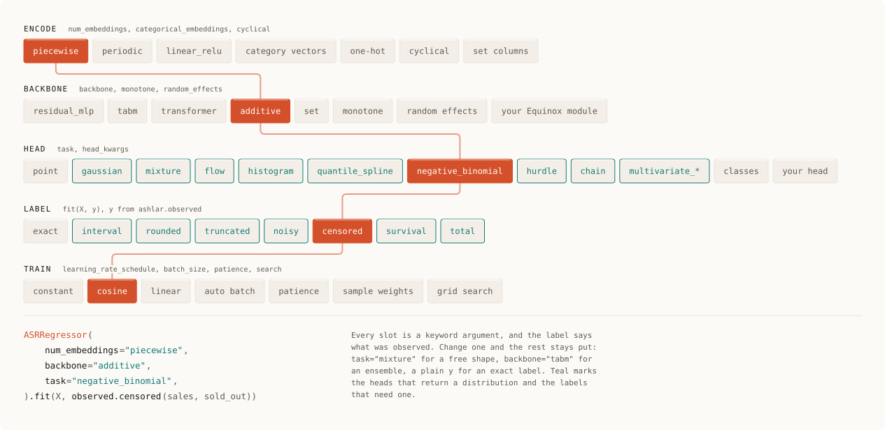
  </picture>
</p>

Every result is in [benchmarks.md](benchmarks.md), and the scripts in [`examples/readme/`](../examples/readme/) redraw each figure from saved results. Most examples set Ashlar beside a tool commonly used for the same task. The dressed model, `ashlar.dressed()`, has [its own guide](dressed.md).

## One table, one choice at a time

The table is daily sales by store, and `sold_out` marks the days a shelf emptied. Each line changes one choice and leaves the others alone.

```python
from ashlar import ASRRegressor, observed

ASRRegressor()                                               # the defaults: a point prediction
ASRRegressor(task="negative_binomial")                       # head: a count distribution per row
ASRRegressor(task="negative_binomial", backbone="additive")  # backbone: one curve per column
ASRRegressor(task="negative_binomial", backbone=Trunk)       # backbone: your own Equinox module

model.fit(X, sales)                                          # label: exact values
model.fit(X, observed.censored(sales, sold_out))             # label: censored on sold-out days
```

The label is whatever `fit` receives, and every model with a distribution head takes either one. `Trunk` is your own Equinox module: built from the input width, it returns `k` members of width `d_out` for each row.

```python
import equinox as eqx
import jax

class Trunk(eqx.Module):
    mlp: eqx.nn.MLP
    k: int = 1        # ensemble members
    d_out: int = 64   # width passed to the head

    def __init__(self, d_in, *, key):
        self.mlp = eqx.nn.MLP(d_in, 64, 64, depth=2, key=key)

    def __call__(self, x, *, key=None):          # (rows, d_in) -> (rows, k, d_out)
        return jax.vmap(self.mlp)(x)[:, None, :]
```

The count head and the censored label work on `Trunk` as they do on a built-in backbone, and `task="custom"` takes your own head ([models.md](models.md#head)).

## One distribution per row

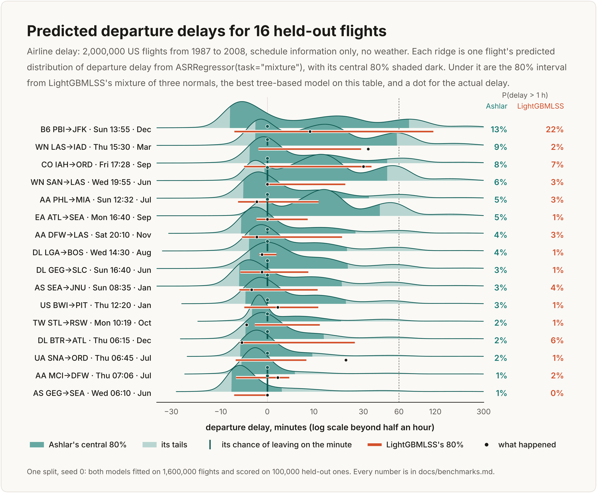

Each ridge is one test flight's predicted departure delay from `ASRRegressor(task="mixture")`, trained on 1.6 million US flights from 1987 to 2008 with schedule information only. Each prediction has a point mass at zero for leaving on the minute: its weight averages 18.4% over 1,500 test flights, and 18.5% of them did. Under each ridge are LightGBMLSS's 80% interval and the actual delay ([how the figure was made](benchmarks.md#the-showcases-airline-figures)).

```python
dist = model.predict_dist(X_new)   # one distribution per flight
dist.quantile(0.9)                 # each flight's 90% quantile of delay
1.0 - dist.cdf(60.0)               # P(more than an hour late)
```

## Distribution heads

`task` sets the head, the family of the predicted distribution. A normal distribution fits these three targets poorly.

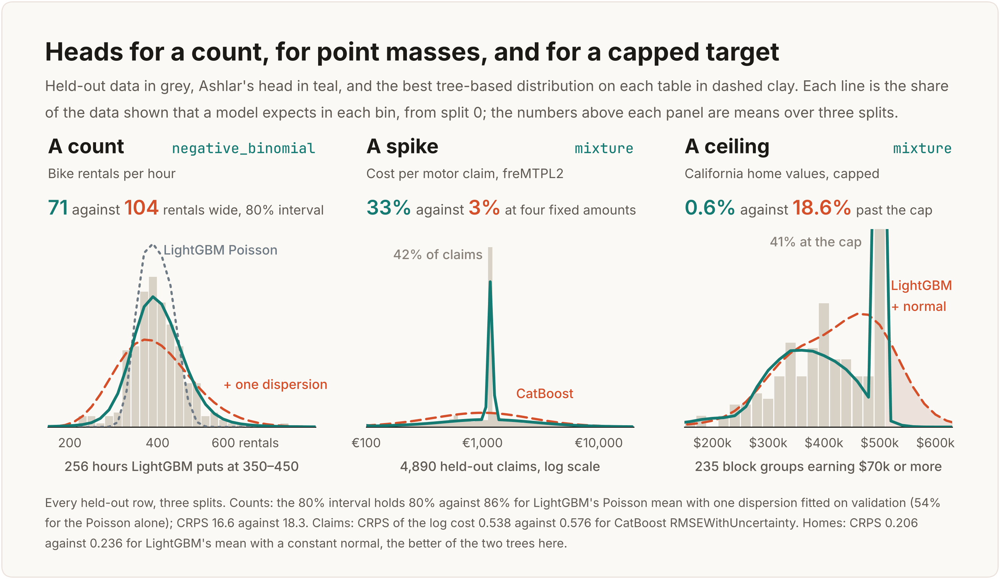

On hourly bike rentals, the 80% intervals of the `negative_binomial` head contain 80% of test hours and are 71 rentals wide on average; those of LightGBM's Poisson objective with one fitted dispersion parameter contain 86% at a width of 104. Of the motor claim costs, 41.5% are one of four fixed amounts: the `mixture` head puts 32.9% of its probability there, and CatBoost's `RMSEWithUncertainty` 3.2%. California home values are capped at $500,001: in block groups with a median income of $70,000 or more, the mixture puts 0.6% of its probability above the cap, and LightGBM with a normal of fixed width 18.6%.

```python
import numpy as np
from ashlar import ASRRegressor

counts = ASRRegressor(task="negative_binomial").fit(X, rentals)  # dispersion per row
costs = ASRRegressor(task="mixture").fit(X, np.log(cost))        # peaks at fixed costs
tips = ASRRegressor(task="hurdle", head_kwargs={"severity": "gamma"}).fit(X, tip)
p_no_tip = tips.predict_dist(X_new).cdf(0.0)                     # P(tip = 0) per row
```

[Heads and the targets they suit](heads.md) · [Count benchmark](benchmarks.md#against-a-negative-binomial-around-lightgbms-mean) · [Point masses, caps, and skew](benchmarks.md#spikes-caps-and-skew) · [Hurdle benchmark](benchmarks.md#against-lightgbms-two-model-hurdle)

## Survival analysis

`observed.survival` marks which times are events and which are censored, such as patients still alive at their last visit. With the `mixture` head, each patient's survival curve has its own shape.

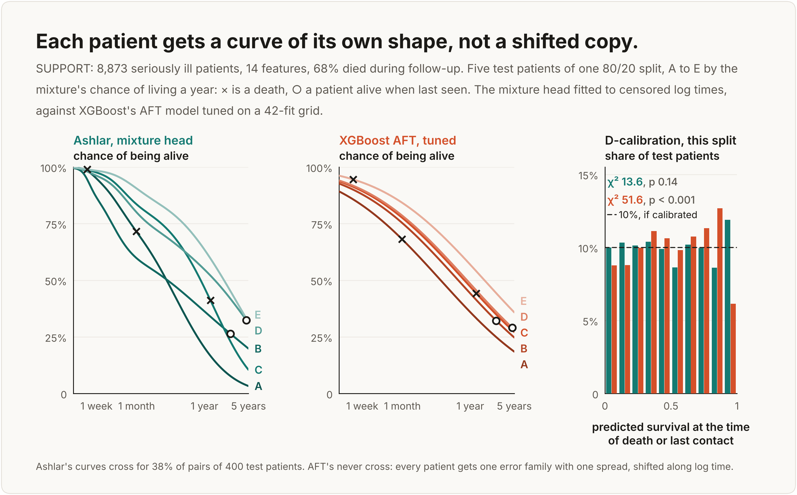

On SUPPORT, a study of 8,873 seriously ill patients, the mixture head passes the D-calibration test on 4 of 5 random splits: its predicted survival probabilities agree with the observed survival rates. XGBoost's AFT model, tuned over a grid of 42 settings, ranks patients about as well (concordance 0.623 against 0.624) and passes on none. A Cox model passes on all five and ranks patients worse (0.577). A `gaussian` head with `head_kwargs={"cure": True}` also estimates the share of patients who never have the event: 39.8% on simulated data where 39.7% never do.

```python
import numpy as np
from ashlar import ASRRegressor, observed

y = observed.survival(np.log(days), died)                 # died=False: censored
model = ASRRegressor(task="mixture").fit(X, y)
p_year = model.predict_exceedance(X_new, np.log(365.25))  # P(survival past one year)
```

[Survival benchmark on three clinical tables](benchmarks.md#survival-on-three-clinical-tables) · [Survival times](observed.md#survival-times) · [Cure models](observed.md#times-that-may-never-come)

## Partially observed labels

Many tables record a label only partly: as a lower bound, a range, a rounded value, or a total over several rows. A builder in `ashlar.observed` says what each label tells about the true value, and the model is trained with the matching likelihood.

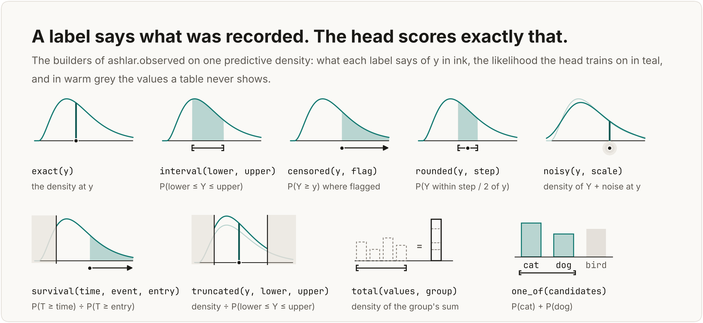

XGBoost and CatBoost have objectives for censored survival times, but LightGBM, XGBoost, and CatBoost have no likelihood for noisy labels, totals over several rows, or multi-output labels in which each value is observed differently. From electricity meter readings taken 2 to 12 days apart, a model trained with `observed.total` predicted eight clients' daily loads with an NLL of 4.90, about as good as the 4.95 of a model trained on the daily values. In a simulation of four products that often sell out on the same days, a joint head fitted to the censored sales predicted that all four sell out on 11.4% of days, close to the observed 11.1%; separate models for each product predicted 0.7%.

```python
from ashlar import ASRRegressor, observed

y = observed.censored(sales, sold_out)          # sold_out=True: demand >= sales
model = ASRRegressor(task="mixture").fit(X, y)
order = model.predict_quantiles(X_new, [0.75])  # 75% quantile of demand

kept = observed.truncated(sales_on_sale_days, lower=1)  # rows only for days with a sale
loads = observed.total(reading, period)                 # a reading covers several rows
both = observed.censored(log_sales, sold_out)           # (days, 4) arrays, for a joint head
```

[Daily loads from meter readings](benchmarks.md#daily-loads-from-meter-readings) · [Several products that sell out together](benchmarks.md#several-products-that-sell-out-together) · [Sold-out products on FreshRetailNet-50K](benchmarks.md#sold-out-shelves-on-freshretailnet-50k) · [Label types](observed.md)

## Multivariate targets

With `task="chain"`, each target gets a head of its own kind, conditioned on the targets before it, under one likelihood. On French motor insurance data with 677,991 policies, a `negative_binomial` head predicts a policy's claims in a year, and a `hurdle` head the cost per claim given that number.

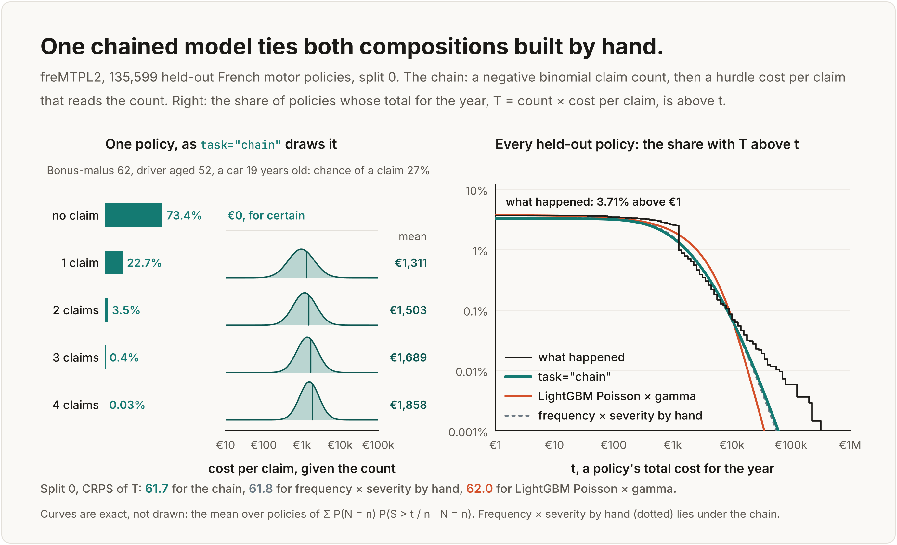

On a policy's total cost for the year, the chained model matches the pairs of separate models that actuaries usually build: over three splits, the CRPS of the total is 92.5 for the chained model, 92.6 for a count model with a log-normal cost model, and 92.7 for LightGBM with a Poisson and a gamma objective. Its joint log-likelihood per policy is 0.011 higher than that of the LightGBM pair.

```python
from ashlar import ASRRegressor

model = ASRRegressor(task="chain",
                     head_kwargs={"columns": ["negative_binomial", "hurdle"]})
model.fit(X, Y)                      # Y: claim count, cost per claim (0 if none)
draws = model.sample(X_new, n=1000)  # shape (1000, rows, 2)

def total(y):                        # total cost: count times cost per claim
    return y[..., 0] * y[..., 1]

model.calibrate(X_cal, Y_cal, target=total)          # calibrate the total
model.predict_exceedance(X_new, 5000, target=total)  # calibrated P(total > 5000)
```

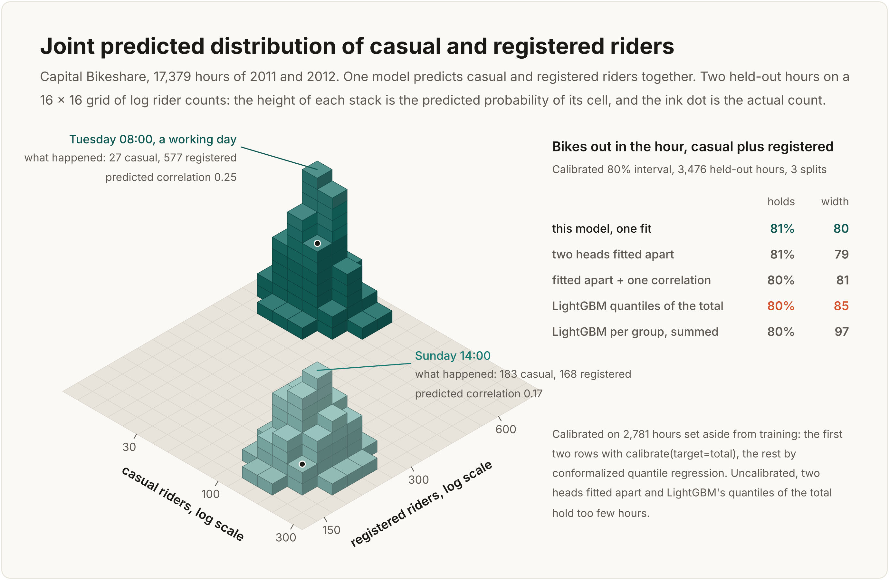

When all the targets are numeric, `task="multivariate_gaussian"`, `"multivariate_mixture"`, or `"multivariate_flow"` gives them one joint distribution. For casual and registered riders in the Capital Bikeshare data, the joint model's uncalibrated 80% interval for an hour's total riders contains 81% of held-out hours, compared with 78% for two separate heads and 68% for LightGBM quantile regression of the total. Calibrated to 80%, the joint model's interval is 80 riders wide on average, that of two separate Ashlar heads 79, and that of LightGBM with conformalized quantile regression (CQR) 85.

[Chained outcomes](distributions.md#outcomes-of-different-kinds-chained) · [Joint heads](distributions.md#several-targets-at-once) · [Claim counts and costs benchmark](benchmarks.md#chained-claim-counts-and-costs) · [Bike riders benchmark](benchmarks.md#casual-and-registered-riders)

## Random effects

`random_effects` treats a grouping column, such as a store, the way a mixed model does: each store gets an offset drawn from a normal distribution whose spread the model estimates, so a store with little data stays close to the average. `"embedding"` adds a learned vector for each store, shrunk the same way.

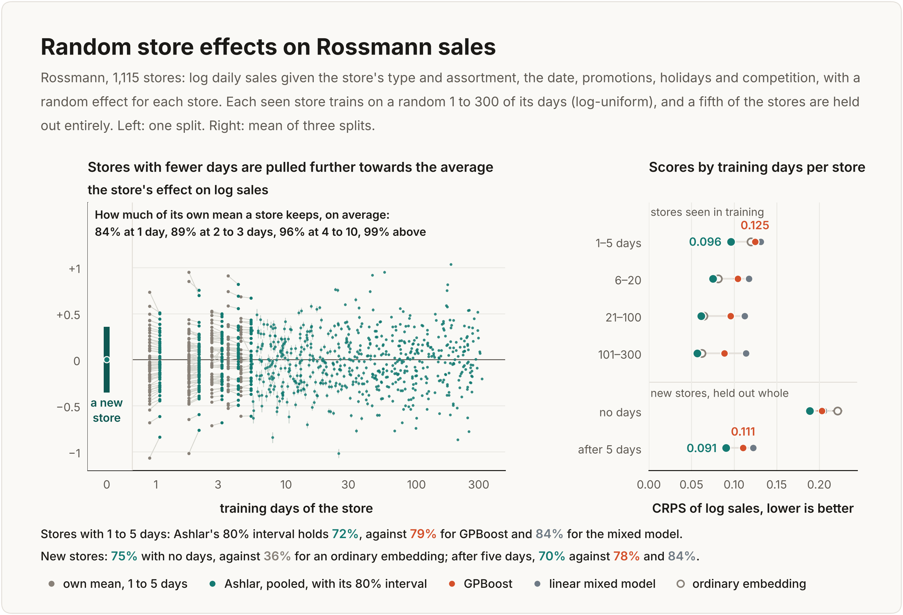

On Rossmann sales for 1,115 stores, the CRPS for stores with 1 to 5 training days is 0.096 over three splits, compared with 0.125 for GPBoost. A store that was not in the training data gets 80% intervals that contain 75% of its days, compared with 36% for a plain store embedding, and `with_context` updates it from its first few days without refitting. The uncalibrated 80% intervals contain 72% of days for stores with 1 to 5 training days, where GPBoost's contain 79%, and 70% for a new store after five days, so calibrate when the coverage has to hold.

```python
import numpy as np
from ashlar import ASRRegressor

model = ASRRegressor(task="gaussian",
                     random_effects={"store": ["intercept", "embedding"]})
model.fit(X, np.log(sales))               # X has a "store" column
model.random_effects_["store"]["tau"]     # estimated spread of store effects
new_store = model.with_context(X_first_days, np.log(first_days_sales))  # no refit
new_store.predict_interval(X_next_days, 0.8)  # 80% interval for the new store
```

[Random effects benchmark](benchmarks.md#entity-effects) · [Random effects guide](effects.md) · [New groups from a few rows](effects.md#new-groups-from-a-few-rows)

## Additive models

`backbone="additive"` makes each parameter of the predicted distribution a sum of functions of one column each, plus functions of the pairs of columns you name. This is a generalized additive model for location, scale, and shape (GAMLSS), and each fitted function can be plotted and read.

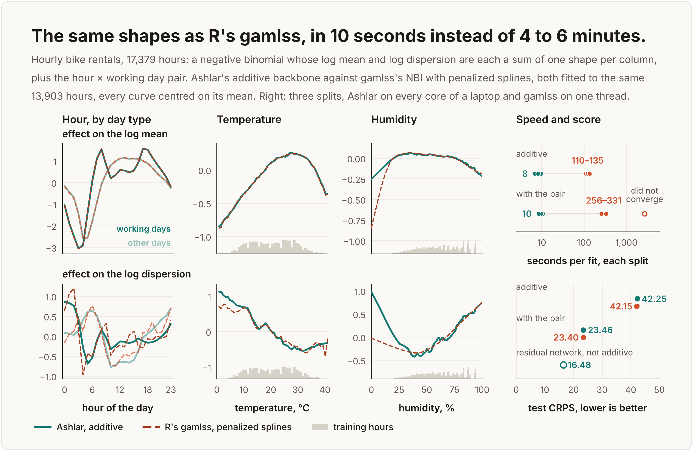

On hourly bike rentals, R's `gamlss` fits the same negative binomial model with penalized splines. The two tools' curves differ by 0.01 to 0.02 on average for the log mean and by 0.06 to 0.18 for the log dispersion; in both, humid hours and cold hours have a higher dispersion. Over three splits, the test CRPS is 23.46 for Ashlar and 23.40 for `gamlss`. An Ashlar fit takes 10 seconds on the 12 cores of a laptop; a `gamlss` fit, on one thread, took 4 to 6 minutes on two splits and did not converge on the third. The readable terms cost accuracy: Ashlar's residual network backbone has a CRPS of 16.48.

```python
from ashlar import ASRRegressor

model = ASRRegressor(task="negative_binomial", backbone="additive",
                     backbone_kwargs={"pairs": [["hr", "workingday"]]}).fit(X, rentals)
shapes = model.shape_functions(X)   # the fitted terms
shapes.term("hum", "dispersion")    # humidity term of the dispersion for each row
shapes.importance("dispersion")     # columns ranked by their effect on the dispersion
```

[Benchmark against R's gamlss](benchmarks.md#additive-models-against-rs-gamlss) · [Additive models guide](additive.md)

## Calibrated intervals and missing inputs

`calibrate` adjusts a fitted model's intervals on held-out rows with split-conformal prediction, so that they have the requested coverage on average. Each interval still comes from the row's own predicted distribution, so on hourly bike rentals the coverage is also close to the target in each hour of the day.

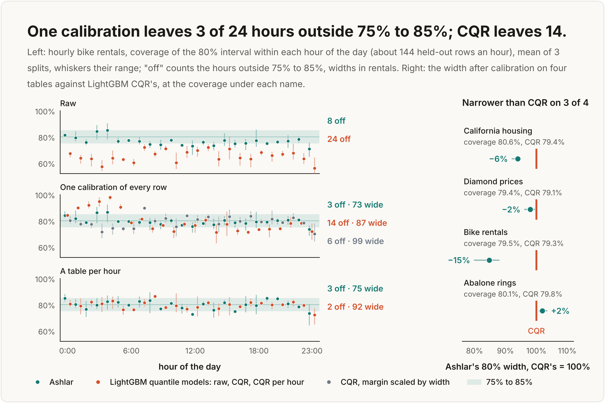

After one calibration for all hours, Ashlar's coverage is outside 75% to 85% in 3 of 24 hours. LightGBM quantile regression with the same conformal step (conformalized quantile regression, or CQR) is outside that range in 14 hours, and calibrated separately for each hour in 2, with intervals 26% wider than Ashlar's (92.3 against 73.5 rentals). At the same coverage, Ashlar's calibrated intervals are narrower than CQR's on 3 of 4 tables, and 2% wider on abalone.

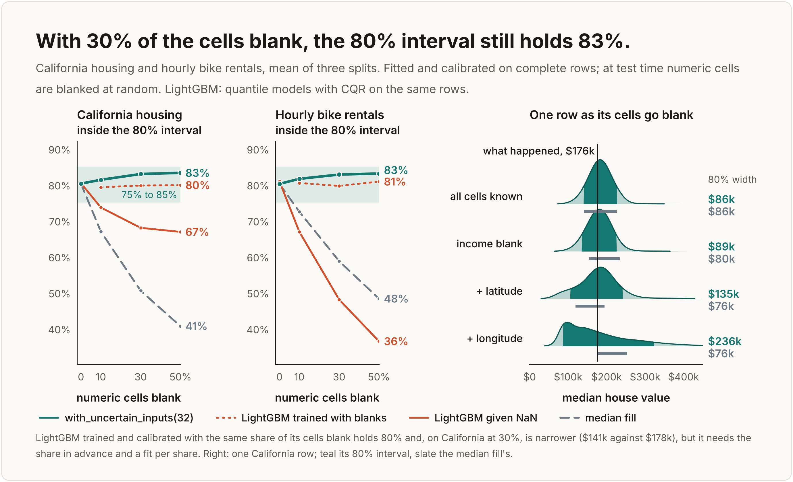

`with_uncertain_inputs` draws each numeric cell that is missing at test time from its distribution given the row's observed cells, and combines the predictions for 32 such draws. With 30% of the numeric cells missing in the California housing data, its 80% intervals contain 83% of test values, compared with 50.5% when the missing cells are filled with the training median, which is the default.

```python
from ashlar import ASRRegressor

model = ASRRegressor(task="mixture").fit(X_train, y_train)
model.calibrate(X_cal, y_cal)  # split-conformal; groups="hr" calibrates each hour
interval = model.predict_interval(X_test, coverage=0.8)  # lower and upper bounds

sampled = model.with_uncertain_inputs(32)  # sample missing inputs, 32 draws per row
interval = sampled.predict_interval(X_missing, coverage=0.8)
```

[Coverage by hour](benchmarks.md#per-hour-beside-lightgbm-cqr) · [Interval widths](benchmarks.md#calibrated-intervals) · [Missing inputs benchmark](benchmarks.md#masked-cells-beside-lightgbm) · [Calibration guide](heads.md#calibrated-intervals) · [Missing and noisy inputs guide](distributions.md#missing-and-noisy-inputs)

## Decisions and explanations

`predict_order(X, under, over)` returns the order quantity that minimizes the expected cost when each unit short costs `under` and each unit left over costs `over`: the `under / (under + over)` quantile of the predicted distribution, so one fitted model gives the order for any cost ratio. `explain` attributes a quantity computed from that distribution, such as the mean, the width of an interval, or a tail probability, to the input features.

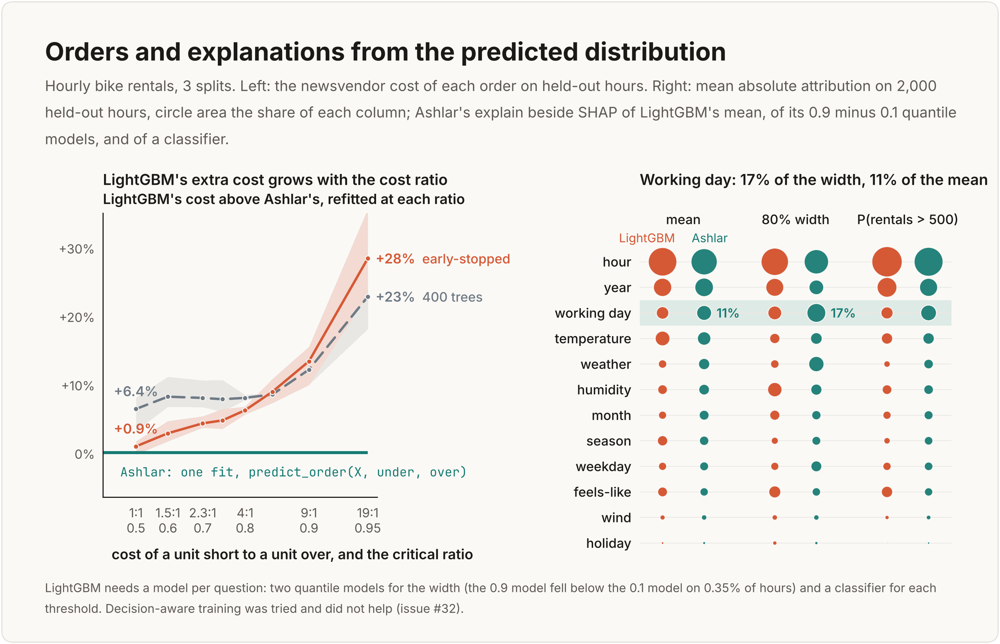

On hourly bike rentals, LightGBM quantile regression was refitted for each of eight cost ratios. On held-out hours its orders cost about the same as Ashlar's at a 1:1 ratio, and more at higher ratios: at 19:1, 23% more with 400 trees and 28% more with early stopping. On the same data, whether the day is a working day accounts for 17% of the attribution of the 80% interval's width, and 11% of the attribution of the mean. With SHAP on LightGBM, the width takes two quantile models, which gave crossing quantiles on 0.35% of hours.

```python
from ashlar import ASRRegressor

model = ASRRegressor(task="mixture").fit(X_train, y_train)
order = model.predict_order(X_test, under=9, over=1)  # the 0.9 quantile: 9 / (9 + 1)
attributions = model.explain(X_test, "interval_width", coverage=0.8, steps=256)
attributions.importance()  # mean absolute attribution per feature
```

[Cost ratio benchmark](benchmarks.md#hourly-bike-rentals-eight-cost-ratios-from-one-fit) · [Comparison with SHAP](benchmarks.md#explanations-beside-shap) · [Decisions guide](distributions.md#deciding-from-the-distribution) · [Explanations guide](distributions.md#explaining-the-distribution)

## Forecasting (work in progress)

Forecasting is still in development, and the results so far are mixed. `horizon_frame` turns a long table of many time series into one row per series and forecast start date, with lagged values, the known future values of covariates such as promotions and holidays, and the static columns. A joint head then forecasts all 12 days of the horizon together, so sampled paths keep the dependence between days.

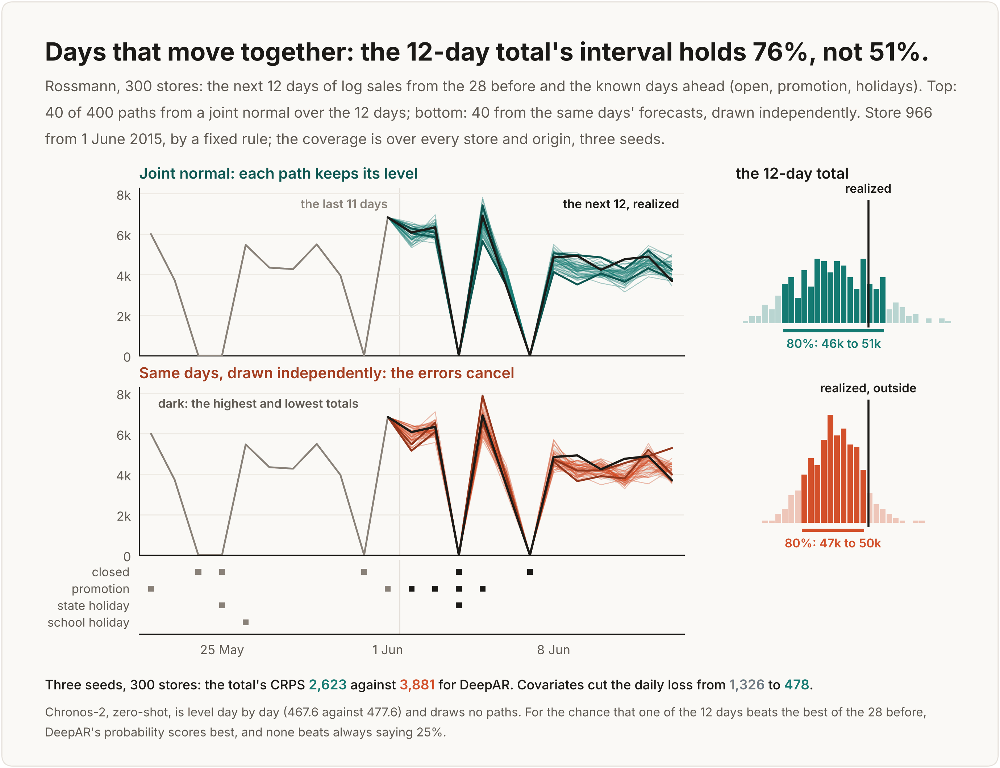

On daily sales for 300 Rossmann stores, over three seeds, the covariates reduce the daily quantile loss from 1,326 to 478. The joint normal head's 80% interval for the 12-day total contains 76% of the actual totals, compared with 51% when the same daily forecasts are sampled independently, and its CRPS for the total is 2,623, compared with 3,881 for DeepAR.

```python
import numpy as np
from ashlar import ASRRegressor
from ashlar.horizon import horizon_frame

frame = horizon_frame(sales, target="log_sales", lookback=28, horizon=12,
                      series="store", time="day",
                      known=["open", "promo", "holiday"], static=["store_type"])
model = ASRRegressor(task="multivariate_gaussian",
                     head_kwargs={"rank": 4}).fit(frame.X, frame.Y)
totals = np.expm1(model.sample(frame.X, n=400)).sum(axis=-1)  # 400 totals per row
```

[Forecasting benchmark](benchmarks.md#forecast-paths-with-covariates) · [Forecasting many series](forecast.md#many-series-covariates-and-paths) · [Single-series forecasters](forecast.md)

## The model object

Every configuration is an instance of one class, `ASRModel`, so a model is described completely by its arguments. `model.predict_dist(X)` returns an `ashlar.distributions.Distribution` for every head, with `log_prob`, `sample`, and `mean`, and, for a single target, exact `cdf` and `quantile`. The object is a JAX pytree, so it works with `jax.jit`, `jax.vmap`, and `jax.grad`. After the rows are encoded once, you can take the gradient of any function of the distribution with respect to the raw inputs, through imputation, scaling, and the network:

```python
import jax

batch = model.encode(X_new)
def p_late(numeric):                  # P(delay > 60 min), summed over the rows
    dist = model.forward_dist(numeric, batch.categorical_onehot, batch.category_index,
                              batch.set_tokens, batch.set_mask)
    return (1.0 - dist.cdf(60.0)).sum()
jax.grad(p_late)(batch.numeric_raw)   # gradient of P(late) for each row and input
```

`model.save("models/delay")` writes a directory of JSON and Equinox weight files, without pickle, and `ASRModel.load("models/delay")` loads it as the class it was saved as, with identical predictions. A custom head or backbone has to be defined in an importable module: it is recorded by its module path and imported when the model is loaded, so only load models from sources you trust.

[The guides](README.md) describe what this page does not show: TabM, transformer, and set backbones; hyperparameter search; ordinal and nested-outcome classifiers; uncertainty across ensemble members; and the single-series forecasters.
