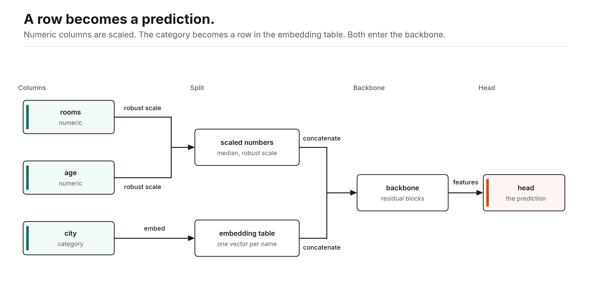
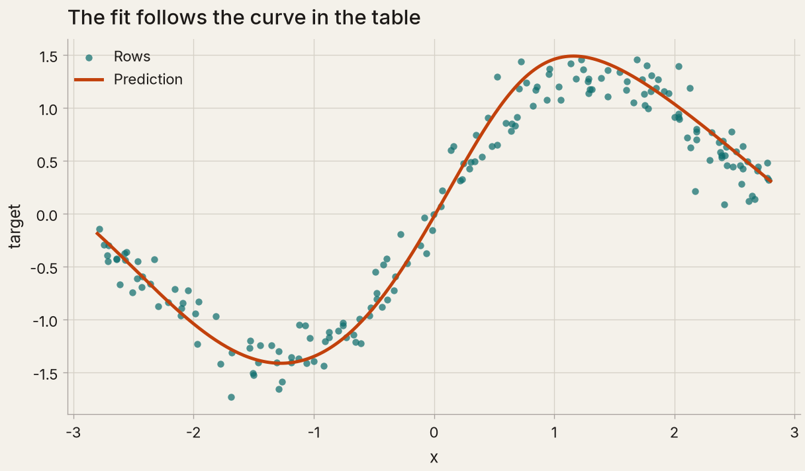
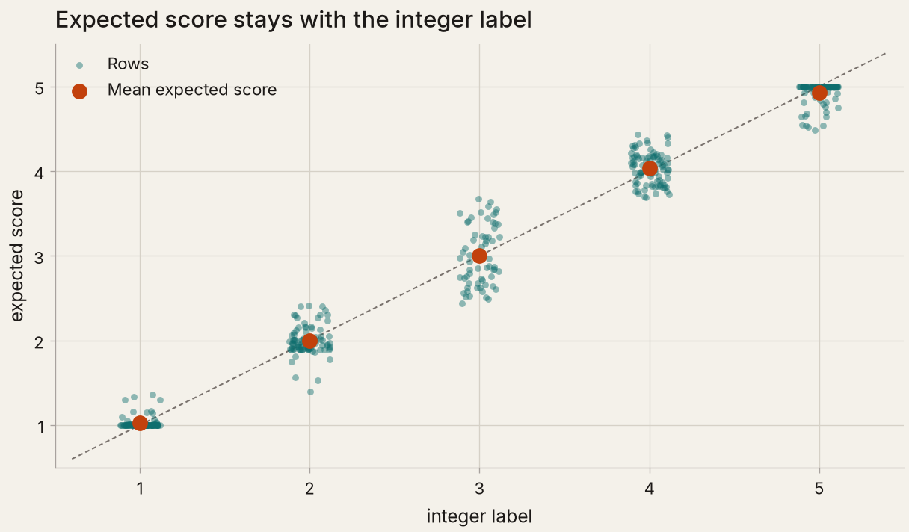
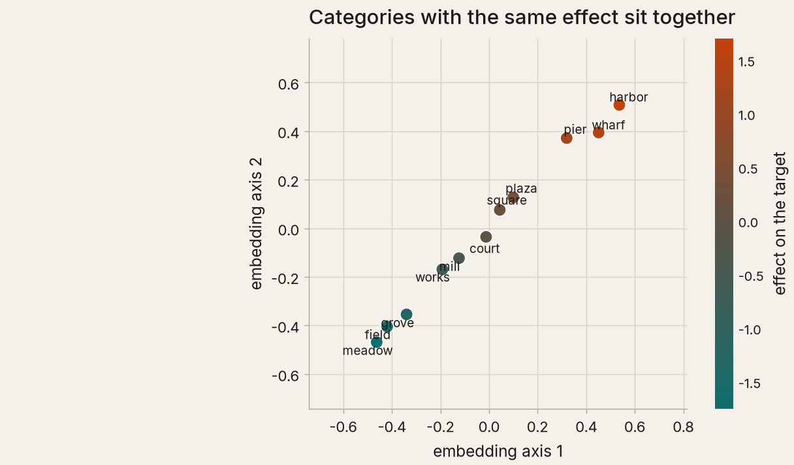
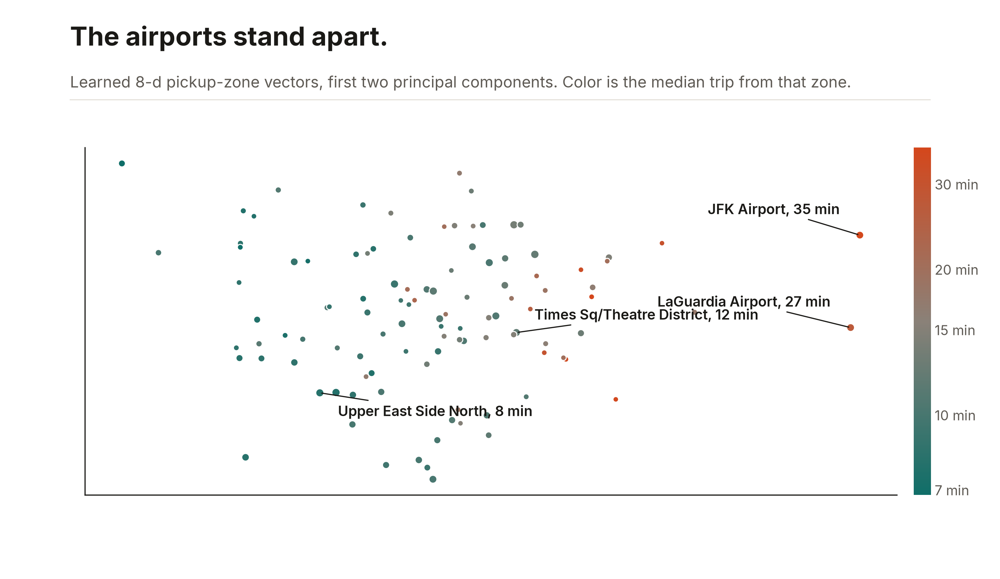

# Fitting a table

[Ashlar](../README.md) trains a residual MLP on a table. `ASRRegressor()` is the default path. Every model is `ASR` plus what it does (`ASRClassifier`, `ASROrdinalClassifier`, `ASROutcomeTree`), each `ASRModel` with its task filled in. The pictures on this page use shorter epoch budgets than these defaults.



Numeric columns are scaled. Categories become vectors. A backbone reads both, and the head emits the prediction.



One numeric column, a few epochs, then `predict` on a grid. The line is the fit. The dots are the rows. [`examples/figures.py`](../examples/figures.py) draws these pictures from synthetic data.

## Defaults

`fit(X, y)` with no other arguments does the following.

Numeric columns are filled with the training-row median, centered on that median, and divided by the interquartile range, then passed through a smooth clip at ±3. `numeric_scaling="standard"` uses the mean and the standard deviation instead. `numeric_clip` sets the clip's size, and `numeric_clip=None` turns it off, along with the stop at the edge of the training range in the quantile maps, so a value past the range keeps moving the model instead of reading as the edge. That helps where a trend continues past the data and hurts where it bends or stops; [docs/benchmarks.md](benchmarks.md#spread-past-the-training-range) has both. An integer column stays numeric unless you name it as a category.

Regression labels are z-scored on the training rows. `predict` maps them back. `standardize_target=False` leaves `y` alone. Classification and ordinal labels stay on their original scale.

Every other column is categorical. It gets a learned embedding of width 8. Pass `categorical_embeddings=[]` for one-hot, or a list of names to embed those columns and one-hot the rest. Index 0 is the row for a missing value or a category that was not in the training rows. `categorical_embedding_hidden=True` passes each category vector through its own dense layer and ReLU, with a residual, so a column's contribution is not a fixed linear read of the one-hot.

Each numeric column gets a piecewise-linear embedding of width 16. Its 48 bins are training-row quantiles of the scaled column. A value becomes its fill fraction of each bin, and a per-column linear map of that encoding is added to a plain linear embedding of the value. The piecewise part starts at zero, so training begins from the linear embedding and bends it where the data asks. The bin edges are fitted, not trained. `num_embeddings="periodic"` uses learned sine and cosine features instead, `"piecewise_relu"` adds a ReLU, `"linear_relu"` is one linear map and a ReLU per column, and `None` feeds the scaled numbers straight to the backbone. `num_embedding_bins` and `num_embedding_dim` set the bins and the width.

`cyclical={"hour": 24, "day_of_year": 365.25}` turns each named column into the sine and cosine of `2π value / period`, at fit and at predict, so the last hour of the day sits next to the first.

The fit holds out 20% of the rows at random. The batch is 256 rows up to 50,000 training rows, and doubles for each doubling of the rows beyond that, up to 2,048. The epoch budget is about 20 million row passes, between 20 and 100 epochs. The learning rate is `2e-3` on a cosine schedule: a linear warmup over the first 5% of steps, then a half cosine to zero at the end of the budget. Patience is 16. Weight decay is `1e-4`. `batch_size` and `max_epochs` take an integer instead of `"auto"`. `learning_rate_schedule` takes `constant`, `linear`, or `surface`. `patience=0` trains the full epoch budget. `validation_size=0` trains on every row.

The backbone is a residual MLP with three blocks of width 256, dropout 0.1, and a SiLU activation. `backbone_kwargs` can set `n_blocks`, `d_block`, `dropout`, and `activation` (`silu`, `relu`, or `gelu`).

Training compiles one epoch at a time and predicts in chunks of 8,192 rows, so a table with millions of rows fits in memory and an epoch costs one host round trip. [`examples/ablation_gbm_parity.py`](../examples/ablation_gbm_parity.py) has the ablations behind these defaults, and [docs/benchmarks.md](benchmarks.md#what-each-change-buys) lists what each one bought.

## Recipes

```python
from ashlar import tabm_piecewise

model = tabm_piecewise().fit(X, y)                       # regression
model = tabm_piecewise(task="classification").fit(X, y)
model = tabm_piecewise(task="mixture").fit(X, y)         # a distribution
```

`tabm_piecewise()` is the most accurate recipe in the ablations: a TabM batch ensemble of 32 members, two blocks of width 256, on piecewise embeddings of quantile-normalized columns, with a constant learning rate. It costs 5 to 10 times the default on a CPU. `tabm()` keeps the paper's architecture without numeric embeddings.

## Tasks

```python
from ashlar import ASRClassifier, ASROrdinalClassifier

ASRClassifier().fit(X, y)
ASROrdinalClassifier().fit(X, y)
```

scikit-learn tags a classification or ordinal model as a classifier and anything else as a regressor, so `cross_val_score` stratifies folds and the `roc_auc` scorer reads `predict_proba`. `score` is accuracy for a classifier and R² otherwise.

`predict` on a classifier returns the class label. `predict_proba` returns one probability column per class, in `classes_` order, and the columns sum to one. A binary problem is two classes.

An ordinal label has to be a real number. The sorted values are the class order. The default head is a cumulative logit: one score, and cutpoints that stay in order. `head="softmax"` gives each class its own score. `predict` returns the most likely label. `predict_score` returns `probabilities @ classes_`, the expected label.



`predict_score` is the expected label: class probabilities times the integer class values. The mean for each label sits on that integer.

`ASROutcomeTree(spec)` fits a nested outcome: one shared backbone and one branch softmax per internal node of a tree of labels, such as `{"wicket": None, "runs": {"dot": None, "scoring": ["boundary", "run"]}}`. A leaf's probability is the product of the branch probabilities on its path. A label may stop at an internal node, and then only the splits above it train. `predict_proba` returns the leaves, `predict_node_proba` every node, and `predict_conditional(X, node)` the split at one node. [`examples/benchmark_outcome_tree.py`](../examples/benchmark_outcome_tree.py) runs it on IPL ball-by-ball data.

`task="normal"` fits a diagonal normal. `predict_dist` returns the distribution. The default regression `predict` is the mean of the member outputs.

## Distributions

```python
model = ASRRegressor(task="mixture").fit(X, y)

model.predict(X_new)                        # the mean of the predictive distribution
model.predict_quantiles(X_new, [0.1, 0.9])  # rows by levels, on the scale of y
model.sample(X_new, n=1000)                 # draws by rows
model.log_prob(X_new, y_new)                # log density of each observed value
```

`task` takes `gaussian`, `mixture` (five normals), `flow` (a monotone rational-quadratic spline), `histogram` (fixed bins over ±4 standard deviations, 16 by default and `head_kwargs={"bins": 48}` for more), `quantile` (pinball loss at 0.1, 0.5, and 0.9), or `student_t` (learned degrees of freedom, above 2). The target is z-scored on the training rows and every method answers on the original scale. With a TabM backbone the predictive distribution is the equal-weight mixture of the members. `predict` is the mean for gaussian, mixture, and histogram, and the median for flow and quantile. The quantile head has no density and no draws, and answers only its three levels. `predict` is the location for student_t.

`poisson` and `negative_binomial` model a count on its raw scale, without z-scoring, and reject a target that is not non-negative whole numbers; `head_kwargs={"zero_inflated": True}` adds a structural-zero probability. Their draws and quantiles are whole numbers and `log_prob` is a log mass.

`model.calibrate(X_holdout, y_holdout)` makes `predict_interval` and `predict_quantiles` split-conformal on rows the model did not train on, and `model.predict_uncertainty(X_new)` splits the spread of an ensemble backbone into `aleatoric` and `epistemic` parts. [docs/heads.md](heads.md#calibrated-intervals) covers both.

When `y` was not seen exactly, pass a label from `ashlar.observed` instead: `observed.censored(sales, sold_out)` for a sold-out day, `observed.interval(low, high)` for a bracket, and so on for rounded, truncated, noisy, and total labels. Every head above except `quantile` trains on censored, interval, rounded, and truncated labels, a few on noisy and total ones, and `log_prob`, `score`, and `calibrate` take them too. [docs/observed.md](observed.md) covers each kind.

A distribution task caps the global gradient norm at 1, because a density head on a target with a spike, such as tips that are exactly zero, can shrink a component until one minibatch's gradient blows up. `gradient_clip` sets the cap for any task, and `0` turns it off.

## Embeddings

```python
model.fit({"rooms": rooms, "city": city}, y)
table = model.core_.categorical_embeddings.tables[0]
names = model.encoder_.embedding_columns[0].categories
```

Row 0 of `table` is the unknown category. `names` matches the rows after it.



Each category here is a learned 2-d vector, from `categorical_embedding_dim=2` on a synthetic table. Color is that category's effect on the target. Categories that move the target the same way land next to each other. The unknown row is left off the plot.

The vectors are ordinary arrays, and they carry structure the model was never told about:

```python
model = ASRRegressor().fit(X, y)
names = [column.name for column in model.encoder_.embedding_columns]
zones = model.core_.categorical_embeddings.tables[names.index("pickup_zone")]   # (1 + levels, 8)
```



That table is a model of NYC taxi trip duration from the pickup and drop-off zones, 191 and 203 levels, plus the hour, the weekday, and the borough. There is no distance column. The model was never told where a zone is, yet the first principal component of the learned vectors tracks how long trips from that zone run (correlation 0.73), and both airports land far from everything else.

On accuracy alone the embeddings are no magic. With 5,000 training rows spread over about 200 zones on each side, a learned vector per zone has little data behind it, and one-hot with a longer schedule does better: log-duration RMSE 0.580 against 0.681, with LightGBM's native categorical splits best at 0.520 ([docs/benchmarks.md](benchmarks.md#learned-embeddings) has the table). What the embeddings add is a representation: 8 numbers per zone instead of a 200-column one-hot block, a geometry you can inspect, cluster, or hand to another model, and a defined vector for a zone the model has never seen.

A set column is a cell that holds a list of labels. Pass `set_features=["tags"]`. The model mean-pools a learned token embedding. Lists longer than `set_max_length` (default 8) are truncated to the longest list in the training rows, capped by that maximum. An empty list becomes a zero vector.

## Search

Pass `search` to `fit` to run a search. `search=True` tries weight decay `1e-4` and `1e-3` for two epochs each, then trains the winner with the estimator's own epoch budget. Learning rate and feature dropout stay at the constructor values unless you put them in the space.

```python
model.fit(X, y, search={
    "n_trials": 4,
    "max_epochs": 3,
    "space": {
        "learning_rate": [1e-3, 3e-3],
        "weight_decay": [0.0, 1e-4],
    },
})
```

Classification trials are ranked by weighted accuracy on the validation rows. Regression, normal, and ordinal trials are ranked by validation loss. The chosen settings are `search_["chosen"]`. Leave `search` unset and the constructor settings are the whole fit.
